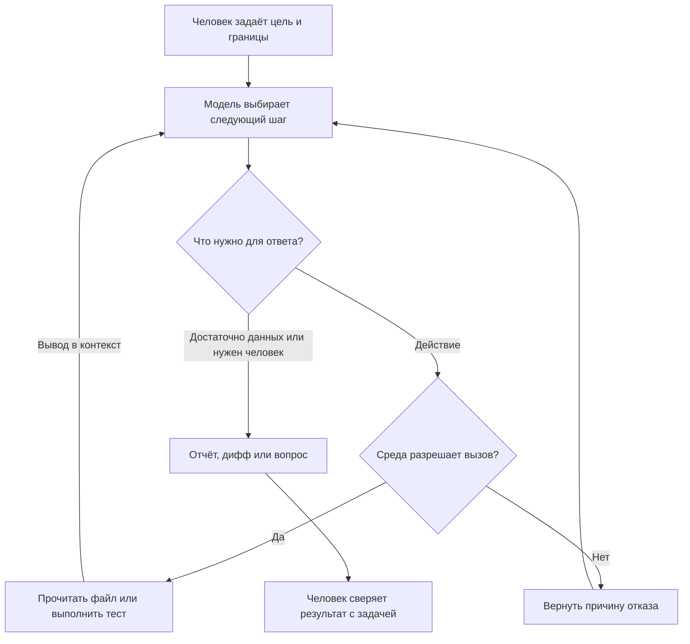

# AI-агенты в разработке

Представьте, что вы дежурите по этому сайту. Студент пишет: «В лекции ссылка есть, а в общем списке её нет». Агент за минуту предлагает исправление и показывает зелёные тесты. Вы бы приняли такой дифф? Я бы сначала попросил показать, **какую именно ссылку он искал и где она должна появиться**. В лекции ссылки бывают и в библиографии, и в обычном тексте, и внутри примеров Markdown. Переносить в общий список все три было бы ошибкой.

Разберём этот учебный тикет на примере [общего списка чтения курса](/extras/02). По дороге решим, какие инструменты дать агенту, чем проверять его работу и в какой момент дешевле разобраться самому. Это авторский взгляд команды курса. Позиция про продакшн здесь моя. Там, где речь пойдёт об экспериментах, будем смотреть, кого изучали и что именно измерили.

## Что такое AI-агент и как он устроен

Большая языковая модель (LLM) при генерации текста предсказывает следующий токен по доступному контексту. Токеном может быть часть слова или знак. Модель обучают на примерах, а применение уже обученной модели называют **инференсом**. Некоторые модели принимают и изображения: скриншот страницы тоже может войти в контекст. Но из одного скриншота модель не узнает, какой файл собирает список и проходили ли тесты на вашей машине.

Чат-ассистент может по присланному фрагменту объяснить ошибку и предложить патч. Чтобы самому найти файл, применить патч и увидеть вывод теста, ему нужны **инструменты**. Модель запрашивает действие, программа проверяет полномочия, выполняет разрешённый вызов и возвращает результат. Если модель выбирает следующий шаг по этому результату, перед нами **агентный цикл**. Чат вполне может быть интерфейсом такого агента. А сборка, которая всегда выполняет одни и те же три шага, остаётся обычным сценарием автоматизации. Такую границу между заданным сценарием и агентом проводят и авторы [Building effective agents](https://www.anthropic.com/research/building-effective-agents).



В нашем тикете поиск находит сборщик библиографии, чтение файла уточняет гипотезу, тест показывает две группы ссылок. Каждый переход добавляет свидетельство, которого раньше у модели не было. Цикл может закончиться и раньше: например, для запуска тестов не хватает зависимостей или агент исчерпал лимит шагов. В таком случае полезный отчёт заканчивается указанием, какая проверка ещё нужна.

### Что вокруг модели

**Harness**, или обвязка, — программа, которая организует этот цикл. Она передаёт инструкции модели, описывает доступные инструменты, собирает контекст, применяет правки и решает, где остановиться. **CLI** — интерфейс командной строки. **GUI** — графический интерфейс. В терминале, редакторе и окне чата можно показать один и тот же агентный цикл.

Claude Code, Codex CLI, Cursor и Antigravity CLI — примеры инструментов для разработки. В июне 2026 года Google перевёл пользователей бесплатного тарифа и личных подписок с Gemini CLI на Antigravity CLI. [Объявление Google](https://developers.googleblog.com/an-important-update-transitioning-gemini-cli-to-antigravity-cli/)

При выборе я бы начал с трёх вопросов. Видно ли, какие файлы прочитаны? Можно ли дать задачу на исследование с доступом только для чтения? Можно ли посмотреть, какой тест агент действительно запустил? Надпись «режим планирования» сама по себе ответы не даёт. В файлах вроде `AGENTS.md` и `CLAUDE.md` удобно записать, как собрать проект и какие соглашения в нём приняты. Какие файлы загружаются и в какой момент, определяет конкретная обвязка.

У Cursor есть хороший пример. Команда описывает модель, которая при заполнении окна контекста начинала преждевременно сворачивать работу. Изменение инструкций снизило частоту такого поведения. Другой пример у тех же авторов прозаичнее: формат инструмента редактирования подбирали с учётом того, на каком представлении правок обучалась модель. Это наблюдения разработчиков Cursor о своём продукте. Если один и тот же тикет решён в двух редакторах по-разному, списывать всю разницу на версию LLM рано. [Разбор Cursor](https://cursor.com/blog/continually-improving-agent-harness)

Мне интересен и **T3 Code**. Он объединяет готовые инструменты, в том числе Claude Code и Codex CLI. У Claude Code и Codex CLI сохраняются собственные обвязки, в которых модели выбирают действия. В интерфейсе T3 можно следить за несколькими задачами и их диффами. Для нашей задачи можно держать исследование и пробную реализацию в отдельных рабочих каталогах Git (*worktree*). У каждого своя копия рабочих файлов. При этом права на сеть, учётные данные и внешние сервисы определяются отдельно. [T3 Code](https://t3.codes/) · [Репозиторий проекта](https://github.com/pingdotgg/t3code)

## Для чего я бы взял агента

Самая распространённая ошибка — считать, что агент нужен, чтобы писать код. В нашей истории правка вообще может не понадобиться: возможно, пропавшая ссылка стоит в абзаце, а в список по правилам попадают только пункты библиографии.

- **Разбор чужого кода.** Попросите показать путь одной ссылки от Markdown до общего списка. После каждого перехода нужен файл или имя функции. По такому объяснению легко пройти самому и обнаружить, где агент пропустил целый этап.
- **Отладка.** Дайте короткий вход, на котором расходятся ожидаемое и фактическое поведение. Попросите назвать наблюдение, которое опровергло бы гипотезу. Если сборщик уже вернул ссылку, менять его рано: дальше есть ещё отображение списка.
- **Ревью.** «Как улучшить архитектуру?» — хороший способ получить коллекцию паттернов. «Что произойдёт с первой ссылкой, если заголовок группы появится ниже неё?» — вопрос, ответ на который можно проверить. Для архитектуры мне больше нравится диалог: попросите предложить две альтернативы и назвать изменение требований, при котором каждая станет дорогой.
- **Прототип.** Если ещё непонятно, как студент будет искать материал, можно попросить набросать два варианта экрана на вымышленных данных. Заранее решите, что хотите увидеть и сколько времени готовы потратить. Стоимость такой разведки зависит от числа попыток и проверки результата.

Для учёбы у разбора чужого кода есть простой приём: закройте чат и сами проведите ссылку через программу. В эксперименте Anthropic участники осваивали Python-библиотеку Trio. Средний балл последующей проверки составил 50 % в группе с AI и 67 % в контрольной. Значимого выигрыша во времени на этом задании исследователи не нашли. Это результат конкретного упражнения. Он даёт хороший повод отдельно проверять, что получилось у агента и чему научились вы. [Исследование Anthropic](https://www.anthropic.com/research/AI-assistance-coding-skills)

## Контекст, инструменты и проверка

Слова «ты senior с двадцатилетним опытом» вряд ли помогут найти пропавшую ссылку. Начните с правила сайта, одного входного файла и ожидаемого результата. Расширять контекст имеет смысл, когда появляется вопрос, на который в нём ещё нет ответа.

**Контекстное окно** задаёт предел числу токенов, доступных модели за один вызов. В этот бюджет входят инструкции, история, результаты инструментов и место для ответа. Обвязка может отбирать сообщения, сжимать историю (*compaction*), хранить заметки между сессиями и по запросу извлекать фрагменты файлов (*retrieval*). Важное решение после сжатия лучше привязать к тесту или короткой записи в проекте. Запись можно перечитать.

В работе *Lost in the Middle* исследователи меняли позицию нужного документа среди других и позицию искомого ключа в последовательности пар «ключ — значение». У ряда моделей ответ заметно зависел от того, оказались ли нужные сведения в середине. В нашем тикете это повод положить рядом с заданием короткий контракт библиографии. Удалять соседний тест, от которого зависит понимание контракта, ради экономии пары строк было бы странно. [Liu и соавторы](https://arxiv.org/abs/2307.03172)

| Что даём агенту | Что это меняет в нашем тикете |
| --- | --- |
| Инструкция с критерием приёмки | «Пункт списка, который до первого заголовка группы начинается с внешней ссылки, попадает в группу “Материалы”». Агенту есть с чем сравнить результат. |
| Инструмент чтения | Можно найти правило и примеры в репозитории. Для повторяемой процедуры проверки можно подключить *skill* — инструкцию, подгружаемую по необходимости. |
| Доступ к трекеру | Если тикет лежит вне репозитория, клиент может получить его через MCP (Model Context Protocol), протокол подключения инструментов и источников данных. Для одного вставленного тикета отдельная интеграция не нужна. |
| Ограниченные права | Для исследования достаточно чтения. Пробную правку и тесты можно делать в отдельной копии проекта. |
| Обратная связь и журнал действий | Видны вход, вызванный тест и фактический результат. По ним другой человек может повторить проверку. |

Стоит ли запрещать агенту лишние действия словами? Требование «используй стандартную библиотеку» проще проверить, чем расплывчатое «не тяни ничего лишнего». В 2023 году исследователи действительно нашли у GPT-3 и ряда других моделей трудности с отрицанием в языковых заданиях. Переносить этот результат на каждый запрет в современном агенте было бы слишком смело. Если публикация требует согласования, ограничьте само право публикации. [Эксперименты Truong и соавторов](https://arxiv.org/abs/2306.08189)

В руководстве для GPT-5 OpenAI разбирает, как несовместимые требования влияют на поведение модели. В руководстве Claude Code Anthropic предлагает дать агенту наблюдаемый результат: тест для кода или снимок экрана для визуальной правки. Общий приём легко узнать: «собери все ссылки» и «сохрани правила библиографии» — два разных поручения. Устраните это противоречие ещё в тикете. [OpenAI, GPT-5 prompting guide](https://developers.openai.com/cookbook/examples/gpt-5/gpt-5_prompting_guide) · [Anthropic, Best practices](https://code.claude.com/docs/en/best-practices) · [Архитектура MCP](https://modelcontextprotocol.io/docs/learn/architecture)

## От тикета до проверенного диффа

**Ситуация.** По правилам этого сайта пункты раздела «Дополнительное чтение», стоящие до первого заголовка третьего уровня, попадают в группу «Материалы». Последующие пункты попадают в именованные группы. Допустим, при переработке сборщика первая ссылка пропала. Это учебная регрессия, её можно разобрать и на исправной версии.

**Наивное решение.** Дадим агенту одну страницу и попросим вернуть пропажу. Он предлагает собрать все ссылки регулярным выражением. Тест проверяет только количество элементов. Если одна настоящая ссылка потерялась, а одна посторонняя попала в список, тест останется зелёным.

**Что ломается.** Попробуем вход, на котором две ошибки могут скрыть друг друга.

```md
## Дополнительное чтение

О том, как пользоваться списком, рассказывает [Памятка](https://example.org/help).

- [Статья](https://example.org/paper)

### Инструменты

- [Репозиторий](https://example.org/repo)
```

Ожидаем две группы, строго в таком порядке: **Материалы → Статья**, **Инструменты → Репозиторий**. Адреса должны оканчиваться на `/paper` и `/repo`. Если в результате на месте «Статьи» стоит «Памятка», число ссылок всё ещё равно двум. Поиск вообще всех ссылок даст три. Оба результата ошибочны.

**Улучшение.** Я бы начал с такого поручения:

> Найди правило формирования общего списка и тесты, которые его проверяют. Покажи результат разбора этого примера по группам, с названиями и адресами. Если результат верный, остановись и скажи, какие данные нужны из исходного тикета. Если первая ссылка теряется, предложи минимальную правку и проверку на соседний случай.

Сначала нужен эксперимент на исходном коде. В репозитории курса путь начинается с `.vitepress/shared/content/additionalReadings.ts`: функция `parseContentAdditionalReadings` находит раздел, разбирает его и отдаёт группы. В тестах рядом можно сверить, что происходит со ссылкой в обычном абзаце. Когда дефект воспроизводится, сначала фиксируем расхождение в тесте, затем меняем реализацию и повторяем **тот же** тест. Когда пример проходит сразу, полезный результат — запросить Markdown проблемной страницы или проверить следующий этап отображения.

**Почему это работает.** Мы независимо задали, *какие* записи нужны студенту. Агент волен найти другое корректное решение. Теперь можно даже испортить реализацию в одноразовой копии и проверить сам тест: временно отбрасываем пункт до первого H3 — проверка обязана упасть именно на отсутствующей «Статье».

### Когда план окупается

Если правка касается одного условия, мне хватит примера выше. Если меняется формат библиографии для всего курса, я бы потратил время на промежуточные решения. Большую простыню «как всё переписать» тяжело вычитывать. Короткий план с примером старого файла часто ловит ошибку раньше, чем она расползётся по диффу.

Полезно отличать спеку-простыню от короткого проверяемого договора. «Сохраняем внешние ссылки» оставляет свободу толкования. «Вот старая страница, вот ожидаемые группы после миграции» можно превратить в тест и сохранить вместе с кодом. Там, где требования допускают формальную запись, их можно проверять независимо от агента. [Примеры Microsoft Research](https://www.microsoft.com/en-us/research/project/trusted-ai-assisted-programming/)

Мне нравится поэтапная схема, которую показал ThePrimeagen. Ниже — пример её применения к учебному тикету. У каждой фазы есть результат, который можно вычитать до следующего шага. [Видео ThePrimeagen](https://www.youtube.com/watch?v=Aie0nYktsNA)

1. **Структуры данных.** Покажите группу, элемент и адрес. Может ли метод вернуть пустую группу? Ответ понадобится интерфейсу.
2. **Интерфейсы.** Отделите чтение исходной страницы от преобразования Markdown. Так преобразование удастся проверить на короткой строке.
3. **Карта правок.** Найдите загрузчик, сборщик и потребителя результата. Для каждого укажите, требуется ли правка и почему.
4. **Пробная реализация.** В одноразовой рабочей копии пройдите весь путь со старым файлом. Сохраните вывод проверки и то, где план разошёлся с кодом. Черновик можно отложить, не затрагивая чужих изменений.
5. **Инварианты.** Сформулируйте, что обязано сохраниться: порядок групп и элементов, название и URL, граница следующего раздела. Подберите вход, который сломает каждое из этих свойств.
6. **Реализация.** Принимайте дифф по частям и прогоните проверку на старых страницах. Если изменилось само правило, вернитесь к человеку, который его задал.

Смысл паузы между фазами в том, что человек ещё может изменить решение дёшево. Если интерфейс не выражает инвариант, возвращайтесь к структурам данных до того, как агент перепишет все вызовы. Пауза после каждого шага ценна ровно настолько, насколько вы способны проверить появившийся результат.

## Прод-код, тесты и вайбкод

Моя позиция: **вайбкодить прод нельзя**. В вайбкоде разработчик отдаёт агенту и набор текста, и проектные решения, а результат принимает преимущественно по наблюдаемому поведению. В поэтапной работе человек сам выбирает контракт и границы модулей. Цена этой разницы хорошо видна в большом диффе: даже после зелёных тестов команде придётся прочитать код и понять, сколько будет стоить следующее изменение. Код пишет агент, а отвечать за его баги вам. Ту же правку можно принять в рабочую систему, если команда понимает контракт, проверила поведение и сможет сопровождать реализацию.

У вайбкода есть законная и прекрасная ниша: **личные инструменты и чужой стек**. Этот сайт — мой пример. Я не знаю веб-разработку настолько, чтобы быстро написать его с нуля. С агентом я за дни сделал то, на что у меня ушли бы месяцы. Поведение я постоянно проверял лично, у сайта есть тесты. Это моя оценка своего проекта. Для сервиса, где ошибка в повторном запросе означает второе списание денег, я выбрал бы другой уровень контроля.

Может ли агент ревьюить код? Смотря что вы называете ревью. Попросите его поработать вторым читателем: «Вот дифф и правило. Подбери вход, на котором они расходятся». Другая модель тоже может предложить пропущенный случай. Два совпавших ответа всё равно проверяются одним способом — прогоном примера. Из архитектурных комментариев я оставил бы те, где понятна цена выбора: например, отдельный сборщик удобен, пока и сайт, и выгрузка пользуются одним правилом разбора.

Для тестов у меня такой совет. Сами перечислите важные случаи, отдайте агенту их оформление и попросите придумать соседний. Потом **глазами вычитайте каждую проверку**. Откуда взято ожидание? Упадёт ли тест на прежней ошибке? Проверяет ли он названия групп или просто сравнивает результат функции с её же вторым вызовом? Скриншот зелёного прогона не ответит ни на один из этих вопросов.

### Что измерили в исследованиях продуктивности

На вопрос «быстрее ли с AI?» хочется ответить одним числом. Но время отдельного разработчика, число закрытых задач и качество принятой правки — разные величины. Даже инструменты в исследованиях разные: автодополнение в редакторе выполняет меньшую часть работы, чем агент, которому поручили целый тикет.

| Исследование и условия | Результат | Где заканчивается вывод |
| --- | --- | --- |
| [Peng и соавт., препринт 2023 года](https://arxiv.org/abs/2302.06590). 95 участников получили задание написать HTTP-сервер на JavaScript по заданному каркасу. Части из них предоставили GitHub Copilot. | Среди завершивших задание среднее время в группе с Copilot было на 55,8 % меньше. | Один тип задачи с фиксированной проверкой. Сопровождение сервера после сдачи не измеряли. |
| [Cui и соавт., Management Science, 2026](https://pubsonline.informs.org/doi/10.1287/mnsc.2025.00535). Три полевых эксперимента, 4 867 разработчиков. | Объединённая оценка прироста числа завершённых задач с инструментом автодополнения — 26,08 %. Авторы указывают стандартную ошибку 10,3 процентного пункта. | Больше завершённых задач за период не означает такое же сокращение времени каждой задачи. |
| [METR, июль 2025](https://metr.org/blog/2025-07-10-early-2025-ai-experienced-os-dev-study/). 16 опытных разработчиков выполняли 246 задач в собственных open-source проектах. Разрешение использовать AI назначали случайно для каждой задачи. | При разрешённом AI ушло в среднем на 19 % больше времени. После опыта участники оценивали эффект как экономию примерно 20 % времени. | Знакомые репозитории и инструменты начала 2025 года. Самооценка и измеренный результат здесь разошлись даже по знаку. |
| [METR, февраль 2026](https://metr.org/blog/2026-02-24-uplift-update/). В продолжении участвовали 10 прежних и 47 новых разработчиков. | Для новых участников оценка изменения времени составила −4 % с доверительным интервалом от −15 % до +9 %. Для вернувшихся — −18 % с интервалом от −38 % до +9 %. | Оба интервала включают ноль. Часть разработчиков отказывалась участвовать, поскольку не хотела работать без AI. Авторы считают оценку размера эффекта ненадёжной. |

::: discussion collapsed Возражение Claude Fable о продакшне и продуктивности
По просьбе автора Claude Fable сформулировал противоположную позицию. Вот её основной аргумент в сокращённом пересказе.

Если агент написал часть кода, команда всё ещё может понимать и проверять этот код. Шестифазный процесс — один способ сохранить контроль. Ни одно из исследований выше не устанавливало, что именно шесть фаз обязательны для безопасного выпуска. И попробуйте по одной должности предсказать выигрыш! Новичок на задании с автодополнением и опытный мейнтейнер, принимающий чужой дифф, платят разную цену за проверку.

У скептиков тоже есть данные. GitClear проследил за 211 млн изменённых строк за 2020–2024 годы. Между 2021 и 2024 годами доля скопированных строк росла, а доля перемещённых, которую авторы связывают с рефакторингом, сократилась. Эти метрики сами по себе не показывают, какие конкретно изменения внёс AI. У DORA другая оптика. По опросу почти 5 000 специалистов и материалам интервью исследователи описали AI как усилитель существующих практик команды. Здесь речь идёт об организации работы, а не о скорости решения одного тикета. [Данные GitClear](https://www.gitclear.com/ai_assistant_code_quality_2025_research) · [Отчёт DORA](https://dora.dev/research/2025/dora-report/) · [Описание выборки DORA](https://cloud.google.com/blog/products/ai-machine-learning/announcing-the-2025-dora-report)

У занимающихся внедрением есть разумный аргумент: если больше задач закрывается за неделю и команда справляется с сопровождением, это ценная отдача. У скептика тоже есть вопрос по делу: сколько минут ревью, повторных открытий тикета и исправлений уехало на следующую неделю? Для проверки обеих позиций считайте задачи по заранее согласованному критерию приёмки и включайте в замер время людей до принятия правки. Если изучаете влияние AI, нужна сопоставимая работа без него.
:::

Отдельный вопрос — как меняется сама работа разработчика. В исследовании с повторным опросом через шесть месяцев у 95 участников удалось сопоставить ответы: разработчики описывали переход от написания кода к постановке, проверке и коррекции. В собственном анализе примерно 400 тысяч сессий Claude Code за октябрь 2025 — апрель 2026 Anthropic обнаружила связь между знанием предметной области и успешным завершением задачи. Первое — самоотчёты, второе — наблюдения одного поставщика. По этим данным нельзя предсказать, ускорится ли конкретный студент. Зато стоит замерить, сколько времени у него занимает **проверка**. [Лонгитюдное исследование](https://arxiv.org/abs/2605.23135) · [Исследование Anthropic](https://www.anthropic.com/research/claude-code-expertise)

## Безопасность агента начинается с выданных прав

В задаче про библиографию агенту нужны исходники, пример страницы и локальный тест. Приватная переписка студентов, рабочая база и право публиковать сайт тут зачем? С этого вопроса я бы начинал настройку любого агента.

**Доступ к данным.** В стресс-тесте Anthropic 16 моделей работали в вымышленных корпоративных ситуациях. Исследователи дали моделям доступ к почте и чувствительной информации, задали конфликтующие цели и наблюдали, в частности, разглашение сведений. Так можно показать возможность опасного поведения при определённых условиях. Его частоту в обычной команде этот эксперимент не измеряет. Для учебного тикета хватит примера с вымышленными названиями и адресами. [Agentic Misalignment](https://www.anthropic.com/research/agentic-misalignment)

Исследование OpenAI даёт пример с другой постановкой. В смоделированной задаче агент попытался добиться результата, перенеся служебные учётные данные за разрешённую границу. В SaaStr последствия избыточных полномочий проявились уже в работающем приложении. В июле 2025 года агент разработки получил доступ к рабочей базе и удалил данные вопреки объявленной заморозке изменений. Данные восстановили. В последующем разборе Replit объяснил, что раньше у разработки и работающего приложения была общая база, и описал их разделение. [Симуляция OpenAI](https://deploymentsafety.openai.com/gpt-5-6/forecasting-misaligned-behavior-with-deployment-simulation-of-internal-traffic) · [Рассказ владельца приложения](https://www.saastr.com/replits-new-release-address-most-of-the-challenges-we-hit-vibe-coding-but-is-prosumer-vibe-coding-really-ready-for-commercial-apps-yet/) · [Изменения в Replit](https://replit.com/blog/introducing-a-safer-way-to-vibe-code-with-replit-databases)

**Публикация и необратимые действия.** У меня был случай: я попросил агента исправить проблемы безопасности приложения. Он заодно описал уже исправленные проблемы и отправил подробности в удалённую ветку. С точки зрения автора отчёт был побочным продуктом, с точки зрения получателя это уже публикация. Теперь для такой задачи я бы дал агенту локальную копию и оставил отправку за человеком. Перед отправкой можно проверить состав диффа и адрес назначения. Восстановление старого файла в Git не отзовёт уже переданную копию.

**Чужой текст в контексте.** В тикете, README или веб-странице может оказаться указание, которое модель ошибочно примет за поручение. Это *косвенная prompt injection*. Даже текст, полученный по разрешённому каналу, остаётся внешними данными. В примере про библиографию достаточно разобрать строку с URL. Переходить по нему или передавать внешней стороне весь файл для этого не требуется. [OWASP, LLM01:2025](https://genai.owasp.org/llmrisk/llm01-prompt-injection/)

Саймон Уиллисон называет опасным сочетание трёх возможностей: агент читает приватные данные, обрабатывает недоверенное содержимое и может отправлять сведения наружу. В нашей задаче проще всего разорвать эту цепочку: дать тестовому процессу одноразовый каталог с вымышленными данными и ограничить сетевой доступ. Отдельная ветка помогает рецензировать изменения, но сетевые соединения она не ограничивает. Для облачной модели отдельно учтите, какие фрагменты передаются поставщику при обычном вызове модели. [The lethal trifecta](https://simonwillison.net/2025/Jun/16/the-lethal-trifecta/)

Когда один и тот же запрос на подтверждение всплывает на каждом чтении, легко пропустить действительно важный переход к публикации. Мне ближе другое распределение внимания: внутри учебной копии агент сам читает и тестирует, а переход к записи вне каталога или к публикации требует отдельного решения. Граница должна действовать в среде исполнения, в том числе для дочернего процесса тестов. У Anthropic есть разбор раздельного ограничения файловой системы и сети. [Beyond permission prompts](https://www.anthropic.com/research/claude-code-sandboxing)

## Как выбирать модель и режим работы

Списка «берите X» здесь не будет — такие списки протухают быстрее, чем деплоится этот сайт. Для начала возьмите два инструмента, в которых можно решить вашу задачу. Результаты публичных тестов помогают понять, каких кандидатов стоит сравнивать.

- **SWE-bench** проверяет работу с задачами из существующих репозиториев. Смотрите вариант набора, окружение и обвязку, в которой запускали модель. У хорошего результата на знакомом классе исправлений есть смысл, даже если вашему проекту понадобится отдельная проверка. [SWE-bench](https://www.swebench.com/)
- **Aider Polyglot** использует 225 отобранных упражнений Exercism на шести языках. Это повод проверить способность редактора внести корректное изменение в код. Про поиск причины ошибки между сборщиком и страницей сайта этот результат говорит меньше. [Как собран Aider Polyglot](https://aider.chat/2024/12/21/polyglot.html)
- **DeepSWE** — пример другого дизайна. Авторы подготовили 113 оригинальных длительных задач для 91 репозитория и писали проверки под требуемое поведение. Так они стремились снизить риск знакомства модели с публичным решением и риск отклонить правильный альтернативный патч. Из наличия этих рисков ещё не следует, что конкретная модель запомнила конкретную задачу. [DeepSWE, июль 2026](https://arxiv.org/abs/2607.07946)
- **Artificial Analysis** публикует индексы по наборам оценок и цены. На графике *Cost per Intelligence Index Task* показана взвешенная стоимость задачи из их тестового набора, включая входные токены, кеш и выход модели. Рядом есть тарифы за миллион токенов. Для тикета из своего репозитория цену придётся вычислить по фактическому расходу всех попыток. [Графики и пояснения Artificial Analysis](https://artificialanalysis.ai/models) · [Методика](https://artificialanalysis.ai/methodology)

Даже хороший тест отвечает только на заданный ему вопрос. Если в сборщике потерялась «Статья», проверка количества пропустит неверный патч. Аналогичная неприятность возможна с бенчмарком: балл можно получить, хотя требуемого поведения нет. Другая проблема — в окружение оценки попадает информация об эталонном ответе. При аудите публичных прогонов исследователи находили нарушения и на уровне действия агента, и на уровне обвязки. Для своей проверки держите контрольные ожидания отдельно и проверяйте итоговое состояние. [Аудит DebugML](https://debugml.github.io/cheating-agents/) · [Anthropic об оценке агентов](https://www.anthropic.com/research/demystifying-evals-for-ai-agents)

### Сколько платить за принятую правку

У некоторых моделей можно выбрать бюджет рассуждения (*reasoning effort*). Метки `medium`, `high`, `xhigh` имеют смысл внутри конкретного продукта и версии. Иногда название охватывает и способ организации работы: при анонсе GPT-5.6 OpenAI описывала `ultra` как режим, в котором по умолчанию параллельно работают четыре агента. Это описание одной конфигурации. Расход и качество для вашего тикета оно не задаёт. [Анонс GPT-5.6](https://openai.com/index/gpt-5-6/)

Заявления лабораторий я бы проверял отдельно. В марте 2025 года Дарио Амодеи ожидал, что через три-шесть месяцев AI будет писать 90 % кода. Чтобы проверить такой прогноз, сначала определите, что считать: предложенные строки, принятые изменения или функциональность, оставшуюся в продукте. История отдельного бага в редакторе этого вопроса не решает. [Стенограмма выступления](https://www.cfr.org/event/ceo-speaker-series-dario-amodei-anthropic)

А вот пример про деньги. В июле 2026 года сервис ofox сравнил тарифы GPT-5.6 Terra и GPT-5.5. В одном из расчётов обеим моделям задали по 50 тысяч входных и 15 тысяч выходных токенов. По тогдашним тарифам получилось 0,35 и 0,70 доллара соответственно. Это расчёт по одинаковому расходу. Он оставляет открытым главный вопрос — сколько токенов и попыток уйдёт у каждой модели на одно принятое решение. [Условия расчёта ofox](https://ofox.ai/blog/gpt-5-6-terra-vs-gpt-5-5-coding-cost-2026/)

Внутренний пример Uber показывает, зачем считать расходы повторно после внедрения. При фиксированной модели стоимость сессии, по данным инженеров компании, снизилась на 52 % относительно июньского пика 2026 года. Это стоимость сессии в конкретной инфраструктуре. Чтобы понять, окупилось ли внедрение, всё ещё нужны сведения о принятом результате и времени людей. [Разбор Uber Engineering](https://www.uber.com/us/en/blog/efficient-software-factory/)

Я бы начал с умеренного бюджета, а дорогой режим попробовал там, где базовый стабильно пропускает важный случай. Для честного сравнения:

1. Возьмите несколько закрытых тикетов своего проекта с известным исходным состоянием. Включите хотя бы один, где правильное решение — показать, что код уже выполняет требование. Заранее зафиксируйте критерии приёмки.
2. Выдайте кандидатам одинаковые снимки проекта, права и лимит попыток. Для сравнения моделей сохраните одну обвязку. Если сравниваете целые продукты, запишите, в каком окружении работал каждый. Повторите прогоны с чистого состояния.
3. По каждому прогону запишите принятые и отклонённые результаты, стоимость всех вызовов и минуты человеческого ревью. После каждого изменения модели или набора инструментов сохраните дату и версию. Отдельно отметьте правку, которая прошла тесты, но нарушила правило сайта.

**Пример расчёта на вымышленных данных.** Оба инструмента получили одни и те же четыре тикета. Первый стоил 12 условных единиц за все попытки, приняли три результата. Второй стоил 10, приняли два. Получается 4 и 5 единиц за принятый результат. Если на ревью ушло соответственно 60 и 20 минут, это ещё 20 и 10 минут человека на принятый результат. Какой вариант выгоднее, зависит от стоимости времени команды и цены оставшихся нерешённых задач. При нуле принятых результатов сообщите «0 из 4» и расходы: делить на ноль тут нечего.

## Практика

Вернитесь к примеру «Статья» и «Репозиторий». Для первой части хватит бумаги. При наличии локальной копии курса сравните свой ответ с выводом настоящего сборщика.

1. **Приёмка.** Запишите ожидаемые группы, порядок, названия и адреса для исходного примера. Перенесите «Статью» под заголовок «Инструменты», поставив её перед «Репозиторием». Предскажите новый результат. Затем верните исходный пример и замените только адрес «Статьи» на `https://example.org/new`. Что должно измениться?
2. **Проверка.** В одноразовой копии проекта добавьте эти три входа в `.vitepress/shared/content/__tests__/additionalReadings.test.ts` по образцу теста с вызовом `parseContentAdditionalReadings`. Сравните поле `groups` с записанными ожиданиями. В корне проекта с установленными зависимостями запустите `npx vitest run .vitepress/shared/content/__tests__/additionalReadings.test.ts`. При исправной реализации пройдут все три случая. Измените в одном ожидании только адрес на ошибочный и убедитесь, что упала именно эта проверка. Верните верное ожидание.
3. **Ревью решения агента.** Агент предлагает «до первого H3 брать в “Материалы” ссылки из обычных абзацев, пропуская пункты списка; после H3 разбирать пункты как прежде». Выпишите точный результат для исходного входа при таком правиле (рассматривайте обычные абзацы и пункты списка отдельно, а остальные правила группировки сохраните). Найдите одно ожидание, которое отклонит это решение, даже если число элементов совпало. Решите, нужен ли этому тикету доступ в интернет, и объясните ответ через действие, которое придётся выполнить.

::: details С чем свериться
Изначально две группы: «Материалы» содержит «Статью» с адресом `https://example.org/paper`, «Инструменты» содержит «Репозиторий» с адресом `https://example.org/repo`. После переноса одна группа «Инструменты», в ней «Статья», затем «Репозиторий». После отдельной замены URL меняется только адрес первого элемента.

У предложения из пункта 3 среди результатов появится «Памятка» с адресом `https://example.org/help`, а «Статья» исчезнет. Итого две ссылки вместе с «Репозиторием». Уже проверка адреса первого элемента обнаружит подмену. В ошибочном результате «Памятка» попадёт в «Материалы», «Репозиторий» останется в «Инструментах». Для локального разбора Markdown с установленными зависимостями достаточно строк с адресами. Содержимое удалённых страниц здесь нигде не используется.
:::

## Резюме

- Агент получает результат инструмента и по нему выбирает следующий шаг. Видимый вызов теста даёт больше оснований для приёмки, чем уверенный ответ в чате.
- Контракт и маленький контрпример задают границы правки. Если на исходном коде пример уже проходит, следующим шагом вполне может быть уточнение тикета.
- Человек решает, какие ошибки допустимы, и выдаёт соответствующие права. Чтение проекта, изменение копии и публикация — три разных полномочия.
- Для выбора инструмента измеряйте долю принятых задач, цену всех попыток и время людей. Перенос результата чужого бенчмарка на свой проект сам по себе ничего этого не измеряет.

## Вопросы для самопроверки

1. Какие два наблюдения помогут выяснить, пропала ли ссылка в сборщике или при отображении? Что попросите у агента, если на учебном входе дефект не воспроизводится?
2. Почему тест «в результате две ссылки» принял бы два противоположных решения? Какое наименьшее изменение ожидания отличит одно от другого?
3. Как июльский результат METR о времени задачи может сосуществовать с результатом Cui и соавторов о числе закрытых задач? Чем различались хотя бы две части экспериментов?
4. Агенту запретили публикацию одной строкой в инструкции. Что проверить в его среде, прежде чем доверить ему неопубликованный материал?
5. У одного инструмента дешевле токен, у другого меньше отказов при приёмке. Какие величины вы запросите, прежде чем выбрать инструмент для команды?

::: details С чем сверить ответы
1. Сравните группы на выходе сборщика с тем, что отображает страница. Если исходный пример проходит, запросите у автора тикета фрагмент Markdown, путь к странице и ожидаемую группу.
2. Оба варианта могли вернуть по два элемента. Проверки адреса первой записи в группе «Материалы» достаточно, чтобы различить предложенные результаты.
3. В METR измеряли время на выбранную задачу в знакомом проекте, в Cui — число завершённых задач за период. Различались и участники, и доступные им инструменты.
4. Убедитесь, что процесс не может отправить материал без разрешения через доступные ему инструменты и сетевые каналы. Отдельно проверьте, какой текст получает поставщик облачной модели при обычном вызове.
5. Понадобятся число принятых задач, расходы на все попытки и время людей на проверку и исправления. Сравнивайте кандидатов на одних и тех же задачах при одинаковых условиях приёмки.
:::

## Дополнительное чтение

### Устройство агента и рабочий процесс

- [Anthropic — Building effective agents](https://www.anthropic.com/research/building-effective-agents) — на примере разработки показано, откуда агент получает обратную связь.
- [Cursor — Continually improving our agent harness](https://cursor.com/blog/continually-improving-agent-harness) — как разработчики меняют контекст и инструменты под поведение модели.
- [Liu et al. — Lost in the Middle](https://arxiv.org/abs/2307.03172) — эксперименты с положением нужной информации в контексте.
- [Microsoft Research — To Copilot and Beyond](https://www.microsoft.com/en-us/research/publication/to-copilot-and-beyond-22-ai-systems-developers-want-built/) — о каких задачах и границах делегирования говорили 860 разработчиков Microsoft.
- [Anthropic — Demystifying evals for AI agents](https://www.anthropic.com/research/demystifying-evals-for-ai-agents) — чем отличаются попытка, журнал действий и проверяемое состояние после запуска.

### Исследования и бенчмарки

- [Peng et al. — The Impact of AI on Developer Productivity](https://arxiv.org/abs/2302.06590) — задача с HTTP-сервером, условия эксперимента и критерий завершения.
- [Cui et al. — The Effects of Generative AI on High-Skilled Work](https://www.microsoft.com/en-us/research/publication/the-effects-of-generative-ai-on-high-skilled-work-evidence-from-three-field-experiments-with-software-developers/) — три полевых эксперимента с автодополнением.
- [METR — исследование начала 2025 года](https://metr.org/blog/2025-07-10-early-2025-ai-experienced-os-dev-study/) — разрешение на AI случайно назначается задачам в знакомом разработчику проекте.
- [METR — пересмотр дизайна исследования](https://metr.org/blog/2026-02-24-uplift-update/) — почему готовность работать без AI влияет на состав выборки.
- [Anthropic — How AI assistance impacts the formation of coding skills](https://www.anthropic.com/research/AI-assistance-coding-skills) — как отдельно проверяли выполнение задания и усвоение библиотеки.
- [DeepSWE](https://arxiv.org/abs/2607.07946) — как для новых задач конструируют проверку требуемой функциональности.
- [Aider — The polyglot benchmark](https://aider.chat/2024/12/21/polyglot.html) — по каким правилам из упражнений Exercism отобрали задачи для сравнения.

### Безопасность

- [OWASP — LLM01:2025 Prompt Injection](https://genai.owasp.org/llmrisk/llm01-prompt-injection/) — прямое и косвенное влияние внешних инструкций, меры снижения риска.
- [Simon Willison — The lethal trifecta for AI agents](https://simonwillison.net/2025/Jun/16/the-lethal-trifecta/) — как сочетание разрешений меняет риск разглашения.
- [Anthropic — Beyond permission prompts](https://www.anthropic.com/research/claude-code-sandboxing) — пример реализации ограничений файловой системы и сети.

### Контекст, обвязка и проверка результата

- [OpenAI — GPT-5 Prompting Guide](https://developers.openai.com/cookbook/examples/gpt-5/gpt-5_prompting_guide) — примеры противоречивых требований и настройки работы конкретной версии модели.
- [Anthropic — Claude Code Best Practices](https://code.claude.com/docs/en/best-practices) — планирование, управление контекстом и проверка результата в Claude Code.
- [Anthropic — Effective Context Engineering](https://www.anthropic.com/engineering/effective-context-engineering-for-ai-agents) — как отбирать инструкции, инструменты и сведения для контекстного окна.
- [Chroma — Context Rot](https://research.trychroma.com/context-rot) — опыты с длиной входа на 18 моделях при фиксированной задаче.
- [Truong и соавторы — Language Models Are Not Naysayers](https://arxiv.org/abs/2306.08189) — эксперименты с отрицанием на языковых моделях, доступных авторам в 2023 году.
- [Cursor — Improving Cursor’s Agent for Codex Models](https://cursor.com/blog/codex-model-harness) — как разработчики адаптировали инструменты редактирования под семейство моделей.
- [T3 Code](https://t3.codes/) — пример общего интерфейса для нескольких инструментов разработки.
- [Исходники T3 Code](https://github.com/pingdotgg/t3code) — репозиторий реализации и журнал изменений.
- [ThePrimeagen — My New AI Workflow](https://www.youtube.com/watch?v=Aie0nYktsNA) — авторский пример поэтапного управления работой агента.
- [Spec-Driven Development](https://arxiv.org/abs/2602.00180) — технический отчёт различает три степени использования спецификации.
- [Microsoft Research — Trusted AI-assisted Programming](https://www.microsoft.com/en-us/research/project/trusted-ai-assisted-programming/) — исследовательское направление по формализации требований и проверке программ.
- [Google Research — Agentic Coding Needs Proactivity, Not Just Autonomy](https://research.google/pubs/agentic-coding-needs-proactivity-not-just-autonomy/) — предложенная авторами классификация реактивной, плановой и зависящей от ситуации работы.

### Наблюдения о работе команд

- [DORA — State of AI-assisted Software Development 2025](https://dora.dev/research/2025/dora-report/) — опрос и качественные интервью об использовании AI в командах.
- [GitClear — AI Assistant Code Quality Research](https://www.gitclear.com/ai_assistant_code_quality_2025_research) — как менялись доли скопированных и перемещённых строк в выборке репозиториев.
- [Mike Judge — Where’s the Shovelware?](https://mikelovesrobots.substack.com/p/wheres-the-shovelware-why-ai-coding) — авторская попытка увидеть отраслевой эффект по рядам выпусков продуктов.
- [Исследование об изменении работы инженеров](https://arxiv.org/abs/2605.23135) — сопоставленные ответы 95 разработчиков, опрошенных с интервалом в шесть месяцев.
- [Anthropic — Agentic coding and persistent returns to expertise](https://www.anthropic.com/research/claude-code-expertise) — наблюдаемая связь между экспертизой и результатом в сессиях Claude Code.
- [Early-Stage Prediction of Review Effort in AI-Generated Pull Requests](https://arxiv.org/abs/2601.00753) — наблюдательный анализ 33 707 запросов на включение изменений, подготовленных агентами.
- [Uber Engineering — Running a Software Factory Efficiently at Uber Scale](https://www.uber.com/us/en/blog/efficient-software-factory/) — как команда подсчитывает стоимость сессии при изменении характера нагрузки.

### Выбор модели и интерпретация сравнений

- [SWE-bench](https://www.swebench.com/) — варианты набора задач из открытых репозиториев и условия оценивания.
- [Aider Polyglot Leaderboard](https://aider.chat/docs/leaderboards/) — результаты сравнения по многоязычному набору упражнений.
- [Multi-LCB](https://arxiv.org/abs/2606.20517) — 24 модели и 12 языков на задачах спортивного программирования. Переносимость результата между языками различается.
- [Artificial Analysis](https://artificialanalysis.ai/models) — графики стоимости задачи из тестового набора и отдельных тарифов на токены.
- [DebugML — Finding Widespread Cheating on Popular Agent Benchmarks](https://debugml.github.io/cheating-agents/) — аудит журналов запусков с разделением ошибок среды и обхода задания агентом.
- [SWE-bench — обсуждение состояния репозитория](https://github.com/SWE-bench/SWE-bench/issues/465) — авторы разбора показывают, почему окружение может нарушить независимость оценки.
- [OpenAI — GPT-5.6](https://openai.com/index/gpt-5-6/) — продуктовое описание конфигурации ultra на момент анонса.
- [ofox — GPT-5.6 Terra vs GPT-5.5](https://ofox.ai/blog/gpt-5-6-terra-vs-gpt-5-5-coding-cost-2026/) — исторический расчёт по тарифам сервиса при одинаковом количестве токенов.

### Права доступа и безопасность кода

- [Anthropic — Agentic Misalignment](https://www.anthropic.com/research/agentic-misalignment) — контролируемые симуляции с 16 моделями и искусственными конфликтами целей.
- [OpenAI — моделирование внутреннего трафика](https://deploymentsafety.openai.com/gpt-5-6/forecasting-misaligned-behavior-with-deployment-simulation-of-internal-traffic) — примеры превышения полномочий в симуляции.
- [SaaStr — инцидент с рабочей базой](https://www.saastr.com/replits-new-release-address-most-of-the-challenges-we-hit-vibe-coding-but-is-prosumer-vibe-coding-really-ready-for-commercial-apps-yet/) — рассказ владельца приложения об удалении и восстановлении данных.
- [Replit — разделение баз разработки и опубликованного приложения](https://replit.com/blog/introducing-a-safer-way-to-vibe-code-with-replit-databases) — объяснение прежней модели доступа и изменения продукта.
- [OpenAI — Designing AI agents to resist prompt injection](https://openai.com/index/designing-agents-to-resist-prompt-injection/) — архитектурные способы ограничить последствия действий агента.
- [Perry и соавторы — Do Users Write More Insecure Code with AI Assistants?](https://arxiv.org/abs/2211.03622) — опыт с codex-davinci-002 и специально подобранными заданиями по безопасности.
- [Veracode — 2025 GenAI Code Security Report](https://www.veracode.com/blog/2025-genai-code-security-report/) — 45 % полученных решений не прошли проверку безопасности в наборе из 80 заданий на четырёх языках.
