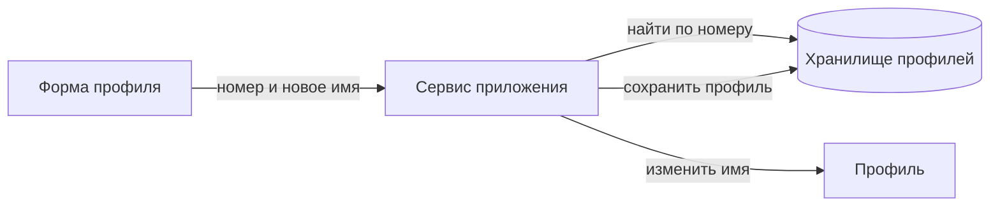

# Введение

Этот конспект — рабочие материалы по курсу «Конструирование программного обеспечения». Он связывает архитектурные принципы, практики проектирования и инженерные ограничения, которые появляются в реальных приложениях. Начнём с небольшого изменения. В профиле Ады можно исправить имя. Как программе узнать после правки, что это всё ещё та же учётная запись? На этой странице вы сможете выбрать язык примера, проверить ответ на двух записях и посмотреть, где это правило понадобится приложению.

## Как читать курс

Если проходите курс впервые, начните с [первой лекции](/lectures/01) и двигайтесь по порядку. Если пришли за конкретной темой, откройте на главной [карту «Что прочитать до лекции»](/#kpo-home-map). Например, лекция 12 продолжает лекцию 11, а та опирается на лекцию 10. Чтобы разобраться с нуля, читайте их в порядке 10 → 11 → 12. На большом экране наведите указатель на лекцию или перейдите к ней клавишей Tab. На телефоне подсказка о необходимых лекциях находится под названием.

В [песочнице](/extras/01) уже есть запускаемый пример со скидкой. Предскажите, получит ли её обычный покупатель при сумме ровно `10_000`. В песочнице выберите Kotlin, откройте Playground, если он закрыт, и задайте первому заказу `basic` в `main` сумму `10_000`. После запуска сверьте прогноз с первой строкой вывода. В [списке дополнительного чтения](/extras/02) собраны источники из лекций и дополнений. Для чтения офлайн можно [скачать конспект в PDF](https://kert0n.github.io/KPO/kpo-course.pdf).

## Как пользоваться конспектом

Лекции и дополнения перечислены в боковом меню. На телефоне его открывает кнопка «Меню». В верхней панели есть поиск, а справа на широком экране — оглавление «На этой странице». Там, где видна боковая панель, её можно свернуть кнопкой «Скрыть боковую панель». Тогда схема или таблица получит больше места, а строки обычного текста сохранят свою ширину.

## Возможности сайта

### Переключение языка примеров

У профиля есть постоянный номер `id` и имя для показа на экране. Выберите привычный язык в блоке ниже. Полная программа создаёт пользователя с номером 1 и выводит `Пользователь: Ада`. В Kotlin короткая вкладка показывает объявление `User`, а создание пользователя и вывод видны в Playground.

::: multi-code "Один пример — четыре языка"

```kotlin
data class User(val id: Int, val name: String)
```

```kotlin playground
data class User(val id: Int, val name: String)

fun main() {
    val user = User(1, "Ада")
    println("Пользователь: ${user.name}")
}
```

```csharp
using System;

var user = new User(1, "Ада");
Console.WriteLine($"Пользователь: {user.Name}");

public record User(int Id, string Name);
```

```java
public class Main {
    record User(int id, String name) {}

    public static void main(String[] args) {
        var user = new User(1, "Ада");
        System.out.println("Пользователь: " + user.name());
    }
}
```

```go
package main

import "fmt"

type User struct {
    ID   int
    Name string
}

func main() {
    user := User{ID: 1, Name: "Ада"}
    fmt.Printf("Пользователь: %s\n", user.Name)
}
```

:::

Выбор языка действует и в остальных примерах с такой вкладкой. Браузер запоминает его при переходе к другой лекции и при следующем посещении. Если выбранного языка в блоке нет, откроется вкладка, заданная автором, либо первая доступная.

### Kotlin Playground

Выберите **Kotlin**. Короткая версия для чтения показывает только объявление `User`. Если вы видите редактор с функцией `main`, интерактивный режим уже включён. Кнопка **Playground** переключает подходящие блоки между чтением и редактором, а кнопка запуска **▶** в редакторе выполняет код. Настройка режима общая и сохраняется в браузере.

Попробуем изменение из начала статьи. Ада дописала фамилию. Если сравнить два снимка профиля целиком, смена имени даст `false`. Для нашего приложения номер учётной записи уникален и остаётся прежним при переименовании. Поэтому ответ на вопрос «тот же ли это аккаунт?» можно получить, сравнив номера. Запустите пример. Первая строка покажет `false`, вторая — `true`.

::: multi-code "Профиль до и после исправления имени"

```kotlin
fun sameAccount(before: User, after: User): Boolean = before.id == after.id
```

```kotlin playground
data class User(val id: Int, val name: String)

fun sameAccount(before: User, after: User): Boolean = before.id == after.id

fun main() {
    val before = User(1, "Ада")
    val after = before.copy(name = "Ада Лавлейс")
    println(before == after)
    println(sameAccount(before, after))
}
```

```csharp
static bool SameAccount(User before, User after) => before.Id == after.Id;
```

:::

В исходнике страницы запускаемая версия помечена `kotlin playground`. Она содержит всё, что нужно для опыта, и открывается в редакторе на той же вкладке Kotlin. Для обычного блока с Kotlin без запускаемой версии кнопка **Playground** видна, но недоступна. Если автор явно задал `{playground=off}`, кнопка скрыта. Например, ниже приведён только интерфейс для поиска профиля. Знак вопроса в типе результата допускает ответ `null`, если такого номера в хранилище нет. Для запуска понадобилась бы ещё реализация.

::: multi-code "Поиск профиля по номеру" {playground=off}

```kotlin
interface UserDirectory {
    fun findById(id: Int): User?
}
```

```csharp
#nullable enable
public interface IUserDirectory
{
    User? FindById(int id);
}
```

:::

Для отдельного эксперимента можно открыть [веб-редактор Kotlin](https://play.kotlinlang.org/) и скопировать туда полную версию с `main`.

### Авторский язык по умолчанию

Иногда автор выбирает первую вкладку явно. В следующем блоке это Go, даже если выше вы выбрали Kotlin. Переключите вкладку **в этом блоке**, и он начнёт следовать общему выбору. Выберите Kotlin в этом блоке. Здесь есть только фрагмент для чтения, поэтому кнопка Playground останется недоступной.

::: multi-code "Имена для списка профилей" {default=go}

```kotlin
val names = listOf("Ада", "Грейс")
println(names.joinToString())
```

```go
names := []string{"Ада", "Грейс"}
fmt.Println(strings.Join(names, ", "))
```

:::

Оба фрагмента внутри программы выводят `Ада, Грейс`. В Go для этого используются пакеты `fmt` и `strings`.

### Текст для конкретного языка

Вернитесь к первому примеру и выберите язык. Абзац ниже и выражение в следующей строке меняются вместе с **общим** языком примеров.

::: only kotlin
У нашего `data class User` компилятор выводит `equals` и `hashCode` из свойств первичного конструктора. В `before.copy(name = "Ада Лавлейс")` номер берётся из `before`. Копия с другим именем уже отличается по значению.
:::

::: only csharp
У позиционной записи `record User(int Id, string Name)` есть свойства `Id` и `Name`. Выражение `before with { Name = "Ада Лавлейс" }` создаёт копию с прежним номером. При сравнении таких записей через `==` учитывается и имя.
:::

::: only java
Для `record User(int id, String name)` компилятор создаёт методы `id()` и `name()`. Сравнение через `before.equals(after)` учитывает и идентификатор, и имя. Оператор `==` у двух переменных типа `User` проверяет, указывают ли они на один объект.
:::

::: only go
Поля структуры `User` имеют типы `int` и `string`. Оба типа сравнимы, поэтому `before == after` сравнит оба поля. Если добавить в структуру поле `Tags []string`, сравнение структур через `==` перестанет компилироваться. Сравнение их номеров при этом останется допустимым.
:::

Номер профиля в первом примере читается выражением <LangOnly lang="kotlin">`user.id`</LangOnly><LangOnly lang="csharp">`user.Id`</LangOnly><LangOnly lang="java">`user.id()`</LangOnly><LangOnly lang="go">`user.ID`</LangOnly>.

### Диаграммы Mermaid

Что происходит, когда Ада сохраняет исправленное имя? На схеме стрелка показывает, кому передаётся работа. Форма передаёт номер и новое имя сервису приложения. Сервис находит текущий профиль по номеру, применяет правило переименования и сохраняет результат.



На узком экране широкую схему можно прокручивать внутри её рамки. Наведите на схему указатель или перейдите к кнопкам масштаба клавишей Tab. Когда схема выходит за края рамки, кнопки остаются видны. Нажатие на значение масштаба возвращает автоматический размер.

### Таблицы

Чтобы проверить правило, удобно выписать пары значений. Возьмите за исходный профиль `User(1, "Ада")`. Каждая строка таблицы — отдельное сравнение с ним.

| Второй профиль | Что изменилось | Совпадают значения профилей? | Это тот же аккаунт? |
| --- | --- | --- | --- |
| `User(1, "Ада")` | Данные совпадают | Да | Да |
| `User(1, "Ада Лавлейс")` | У прежнего аккаунта новое имя | Нет | Да |
| `User(2, "Ада")` | Такое же имя у другого аккаунта | Нет | Нет |

На узком экране текст в ячейках переносится, если ширины столбцов достаточно для чтения. Для более широкой таблицы появляется горизонтальная прокрутка внутри блока. В короткой таблице с тем же правилом достаточно двух столбцов.

| Поле | Для чего служит в примере |
| --- | --- |
| `id` | Узнать аккаунт после изменения имени |
| `name` | Подписать профиль на экране |

### Замечания, предупреждения и детали

::: tip Совет
Перед запуском предскажите обе строки вывода. Если вывод совпал с прогнозом, попробуйте найти входные данные, при которых результаты двух сравнений разойдутся.
:::

::: warning Внимание
У двух людей может быть одно имя. Проверка только по имени посчитала бы профили двух тёзок с номерами 1 и 2 одной учётной записью.
:::

::: discussion
В лекциях этим блоком отмечены вопросы, по которым расходятся инженерные школы. Например, при тестировании сервиса одна команда проверяет, что сервис вызвал метод сохранения, а другая — что после переименования из хранилища читается новое имя. Первая проверка обнаружит пропущенный вызов, вторая — ситуацию, когда вызов прошёл, а в профиле осталось старое имя.
:::

### Тема

Переключите светлую или тёмную тему в верхнем меню. Вместе со страницей сменятся цвета подсветки кода, редактора Kotlin и диаграммы. Если подпись мелкая, увеличьте саму диаграмму кнопкой **+**.

### Спросить ИИ о фрагменте

Допустим, осталось непонятно, почему сравнения профилей дали разные результаты. В верхней панели найдите «Спросить ИИ» и выберите нужный сервис или «Копировать промпт». В узком окне эти варианты находятся внутри меню. Выделите строки с двумя сравнениями, предложение из объяснения, текст ячейки таблицы или подпись на диаграмме. На компьютере щёлкните по выделению правой кнопкой мыши и выберите действие для запроса. На телефоне меню с кнопкой **Ask AI** появится после выделения.

Сайт составляет запрос в браузере из выделенного фрагмента и доступного контекста страницы. Для ChatGPT, Claude и DeepSeek он копирует запрос и открывает сайт выбранного сервиса. Вставьте текст в чат, добавьте свой вопрос и отправьте сообщение. В режиме «Копировать промпт» текст можно прочитать в любом редакторе, новая вкладка не открывается. Если браузер запретил копирование, появится поле для ручного копирования.

### Предложить правку

Нашли опечатку или пример, который ведёт себя иначе, чем обещано? Выделите проблемное место. В том же меню есть два действия.

- **Исправить фрагмент** открывает исходник страницы в редакторе GitHub. Сайт постарается скопировать часть выделения для поиска. Найдите её через Ctrl+F или ⌘F, внесите правку и предложите изменения.
- **Сообщить об ошибке** открывает черновик обращения на GitHub с цитатой и ссылкой на исходник. Если сайт определил номера строк, ссылка приведёт к нужному диапазону. Добавьте входные данные, ожидаемый и фактический результат.

На телефоне пункты называются «Исправить» и «Сообщить». Для отправки понадобится аккаунт GitHub. Помощь добровольная. [Инструкция для участников](https://github.com/Kert0n/KPO/blob/master/CONTRIBUTING.md).

## Самопроверка и мини-практика

> Когда Ада меняет имя, какое свойство позволяет узнать её профиль и какой пример поймает ошибку, если проверять только имя?

Вернитесь к примеру «Профиль до и после исправления имени», выберите Kotlin и откройте редактор, если он закрыт. Оставьте `before` прежним и замените строку с `after` на `val after = User(2, "Ада")`. Запишите прогноз и запустите код. Для второго запуска измените тело `sameAccount` на `before.name == after.name`. Какая из двух строк вывода изменится? Сверьтесь с ответом, затем верните сравнение по номеру.

::: details Проверить результат
Сравнение по номеру даёт две строки `false` и `false`. Значения профилей различны, и номера аккаунтов тоже. После замены условия первая строка остаётся `false`, вторая становится `true`. Так два разных аккаунта с одинаковым именем ошибочно признаются одним. Пара из двух одноимённых пользователей ловит эту ошибку даже без экрана профиля и хранилища.
:::

Заодно проверьте, освоились ли вы на сайте. В каком блоке кнопка Playground исчезает совсем, а в каком остаётся серой даже при выбранном Kotlin? Как получить запрос с выделенным кодом, чтобы сначала прочитать его самому?

::: details Сверить действия на сайте
В «Поиске профиля по номеру» автор выключил Playground. У «Имён для списка профилей» нет запускаемой версии Kotlin, поэтому кнопка недоступна. Для подготовки запроса выберите «Копировать промпт», выделите код, вызовите действие копирования в меню выделения и вставьте текст в редактор.
:::

В курсе к такому опыту стоит возвращаться после каждого нового правила. Сформулируйте, что программа должна сохранить при изменении данных, подберите пример, на котором легко ошибиться, и сравните прогноз с поведением программы. Эту работу продолжает [лекция 1 о конструировании ПО](/lectures/01).
