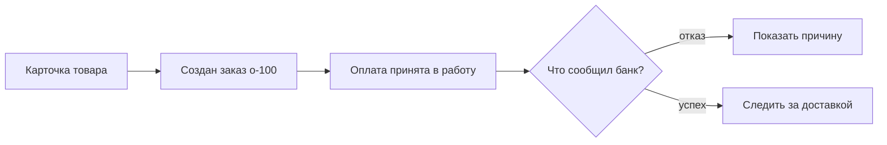
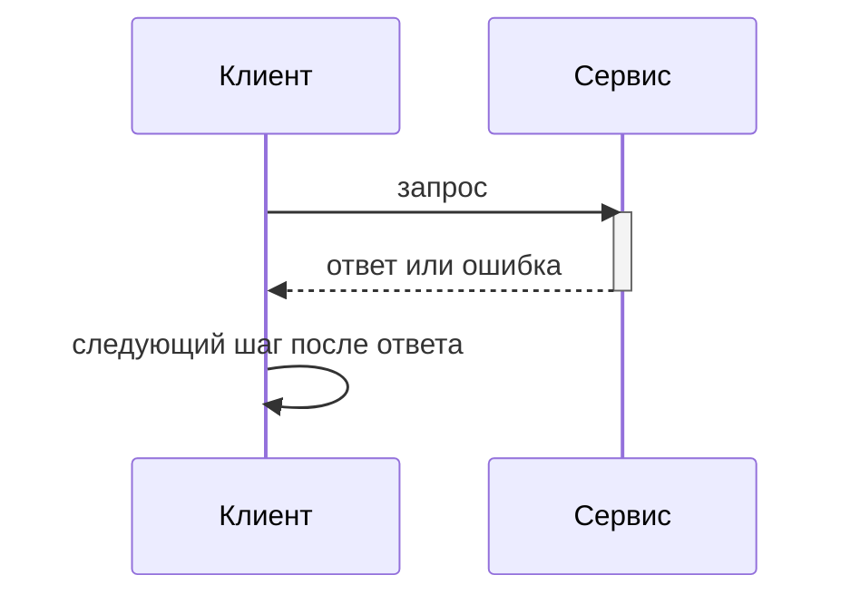
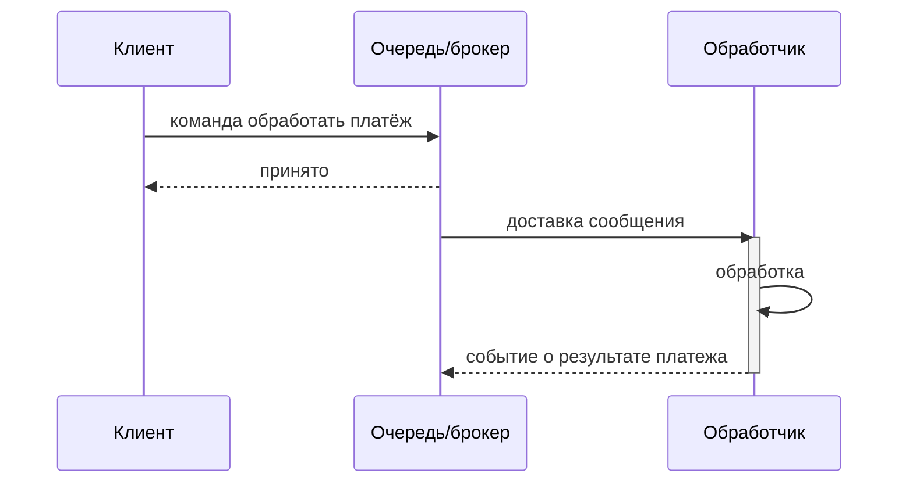
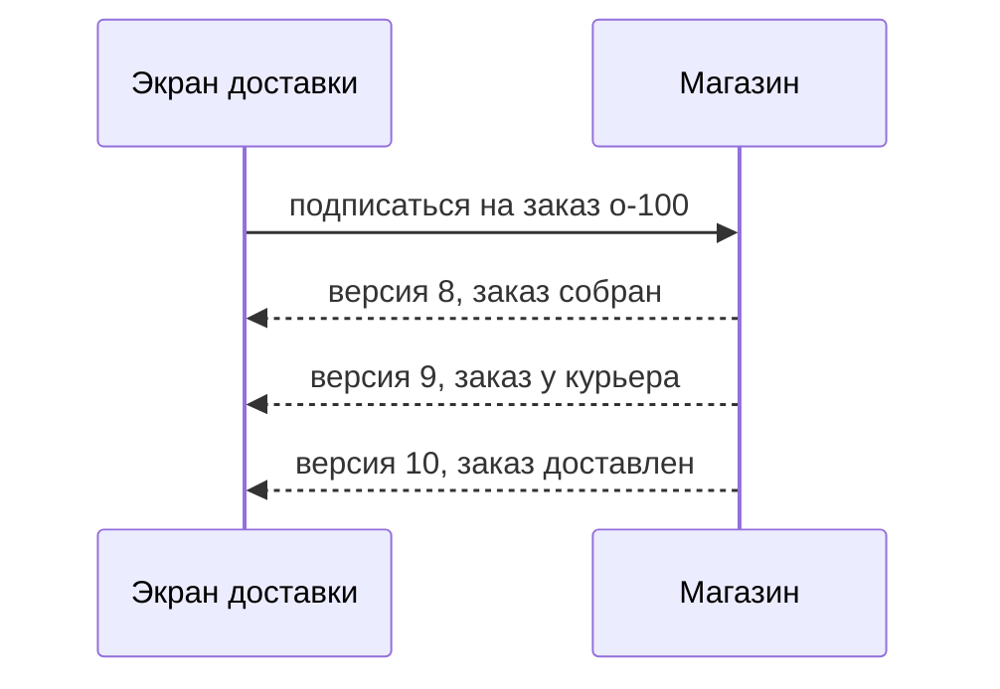
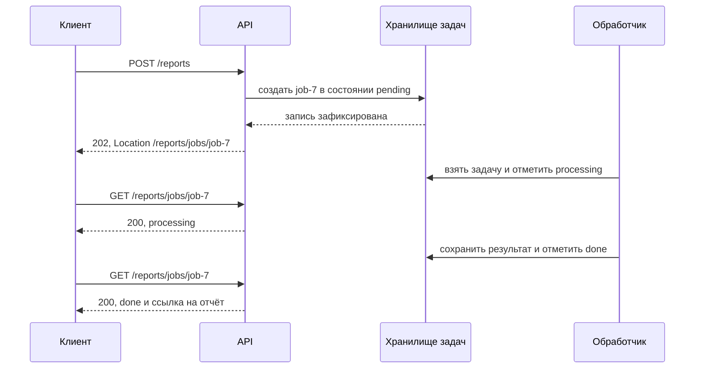
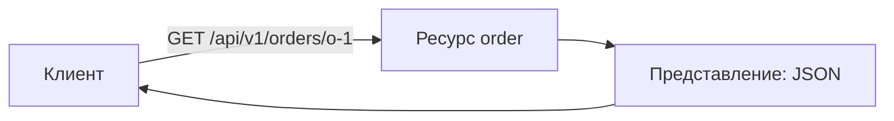
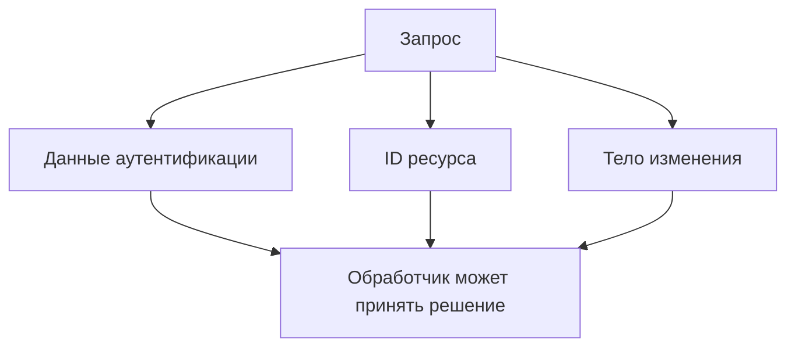
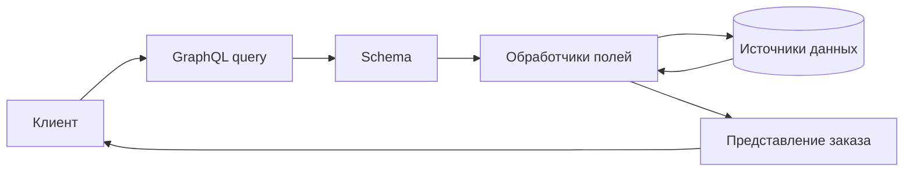
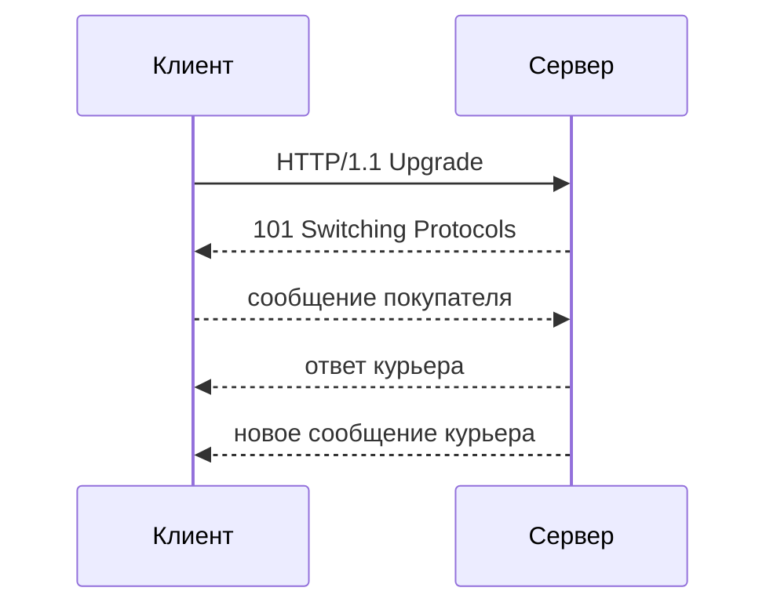
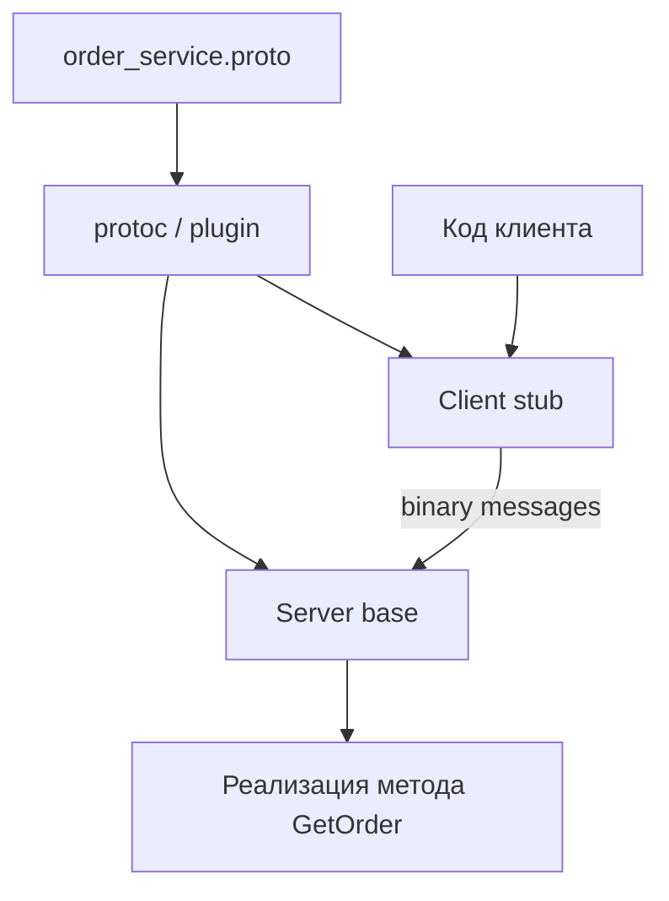

# Лекция 10. Семантика клиент-серверного и межсервисного обмена

Покупатель нажал «Оплатить». Телефон потерял связь как раз в тот момент, когда банк мог подтвердить списание. Что показать при повторном открытии приложения? Как отличить повтор той же оплаты от новой покупки? Ответа на эти вопросы в названии протокола нет.

## Сквозной сценарий

Проследим один заказ интернет-магазина. Сначала покупатель открывает карточку товара, затем создаёт заказ, оплачивает его и следит за доставкой. На каждом шаге определим, какое обещание получает клиент и как он проверит, что оно выполнено.



::: tip Главная идея лекции
Спросите, какое событие разрешает следующий шаг. Ответ «заказ создан» позволяет перейти к оплате. Ответ «оплата принята в работу» позволяет закрыть экран, но отгружать товар ещё рано.
:::

## Один магазин, четыре контракта {#worked-example-один-backend-четыре-разных-контракта}

### Ситуация

Магазин уже умеет создать заказ за долю секунды. Теперь к нему подключают банк и службу доставки. Банк иногда отвечает через минуту, а курьер меняет статус несколько раз за день. Команде предстоит добавить эти операции в мобильное приложение.

### Наивное решение

Сделаем четыре обработчика — `POST /getProduct`, `POST /createOrder`, `POST /pay` и `POST /deliveryStatus`. Каждый вернёт `200 OK`. При отказе банка положим в тело `success: false`, до ответа банка будем держать соединение открытым.

### Что ломается

Мобильный клиент ждёт банк, пока не истечёт срок ожидания. После потери ответа кнопка «Попробовать ещё раз» отправляет второй `POST /pay`. По журналу HTTP оба запроса могут выглядеть успешными, хотя первый уже списал деньги, а второй банк отклонил. Для карточки товара и статуса доставки тоже нужны разные сроки свежести. Вчерашнее описание товара ещё может быть актуальным, а вчерашний статус курьера бесполезен.

### Улучшение

| Что делает покупатель | Что отвечает магазин | Что теперь может сделать клиент |
|---|---|---|
| Открывает товар | `GET /products/p-42` → `200` с карточкой и сроком свежести | Показать цену и переиспользовать публичную карточку в пределах этого срока |
| Оформляет заказ | `POST /orders` → `201`, адрес заказа в `Location` | Открыть созданный заказ |
| Запускает оплату | `POST /payments` → `202`, адрес операции в `Location` | Закрыть экран, позже проверить исход по этому адресу |
| Ждёт курьера | Снимок состояния и подписка на изменения или периодический опрос | Показать последнее известное состояние, восстановить экран после разрыва |

### Почему это работает

Теперь клиент знает, в каком ответе искать результат. У заказа уже есть адрес. У оплаты тоже есть адрес, однако по нему пока доступно только состояние операции. В разделе об идемпотентности разберём, как клиент получит этот же адрес, даже если первый ответ потерялся. В схемах и таблицах пути указаны относительно базового пути API. В коде приложения он задан префиксом `/api/v1`.

## Цели

После лекции вы сможете по трассе обмена определить, что уже произошло с заказом, выбрать HTTP-метод и статус для следующего шага и спроектировать повтор после таймаута. По тем же вопросам сравним REST, SOAP, GraphQL, WebSocket и RPC.

## Четыре уровня обмена

Команда договорилась «сделать по HTTP». В какой момент склад получает право отгрузить заказ? Для ответа разделим четыре вопроса.

| Уровень | Вопрос | Примеры |
|---------|--------|---------|
| Семантика сценария | Какого результата ждёт следующий шаг? | Созданный заказ, подтверждение приёма оплаты, поток статусов |
| Стиль или модель API | Что видит вызывающая сторона? | Ресурсы REST, процедуры RPC, поля схемы GraphQL |
| Протокол | Как стороны обмениваются сообщениями? | HTTP, WebSocket |
| Инструменты | Чем реализуем контракт? | Ktor, ASP.NET Core, Spring, пакет Go `net/http` |

Например, `GetOrder` — процедура. В gRPC её можно описать в файле `.proto`, сгенерировать клиент и передать запрос по HTTP/2. Слово «процедура» объясняет, что вызывает клиент, а HTTP/2 — как данные идут по сети. Ни то ни другое само по себе не определяет, когда магазин вправе отправить товар.

## Синхронное взаимодействие

При синхронном взаимодействии следующий шаг сценария зависит от результата текущего вызова. Чтобы показать итоговую сумму перед оплатой, сервис заказов запрашивает цену и ждёт ответа. Если ответ потерян, клиент знает лишь, что ожидание закончилось. Выполнил ли сервер операцию, по таймауту определить нельзя.



Код такого сценария легко читать по порядку. Цена этой простоты — зависимость от времени ответа другого сервиса. Если страница ждёт расчёт цены пять секунд, а пользователь готов ждать две, у запроса должен быть предел ожидания. При повторе учитывайте оставшееся время и возможность дважды выполнить операцию.

::: warning Ожидание результата и блокировка потока
Пока корутина ждёт цену, поток исполнения может обслужить другой запрос. Расчёт суммы всё равно продолжится только с полученной ценой. Здесь «синхронно» описывает зависимость бизнес-шагов.
:::

## Асинхронное взаимодействие

При асинхронном взаимодействии клиент передаёт работу и продолжает свой сценарий после подтверждения приёма. Результат приходит отдельно. Например, магазин ставит в очередь команду обработать платёж и узнаёт исход после ответа банка.



Брокер на рисунке принимает команду и доставляет её обработчику. Подтверждение приёма команды и событие о платеже — два разных сообщения. Клиенту, который вернётся завтра, понадобится доступное по идентификатору состояние. О доставке сообщений после сбоев и повторах подробнее в [лекции 11](/lectures/11).

## Реактивное взаимодействие

Пользователь оставил экран доставки открытым. Важен уже не один ответ, а **последовательность обновлений**. Клиент может опрашивать сервер по таймеру или подписаться и получать изменения по мере появления. Подписка (push) и асинхронное выполнение совместимы: завершение оплаты тоже можно доставить подписчикам.



Поток часто обрабатывают реактивно: приложение реагирует на каждый новый элемент. У Reactive Streams есть более точное требование — получатель регулирует спрос, чтобы быстрый источник не переполнил его буфер. Сам факт отправки событий по WebSocket такого управления не даёт. Экрану доставки достаточно свежего состояния; бухгалтерии, которой важен каждый переход, понадобится история.

## Request-response, request-reply, polling и callback

| Форма обмена | Как увидеть её в магазине |
|---|---|
| Запрос и ответ (request-response) | На `GET /orders/o-100` приходит представление заказа. На `POST /payments` тоже приходит HTTP-ответ, хотя платёж может ещё обрабатываться. |
| Request-reply через сообщения | Склад отправляет ответ отдельным сообщением. Идентификатор исходного запроса связывает ответ с нужным заказом. Отправитель может ждать его или заняться другой работой. |
| Опрос (polling) | Телефон сам вызывает `GET /payments/pay-7` до конечного состояния. Интервал задаёт компромисс между задержкой и числом запросов. |
| Обратный вызов (callback) | Получатель работы вызывает переданную функцию или адрес. Webhook — вариант для HTTP, например банк присылает событие на зарегистрированный адрес магазина. |

Слова *response* и *reply* в разных источниках употребляют как синонимы. При чтении схемы смотрите, где проходит ответ и как он связан с запросом. Шина сообщений (message bus) — инфраструктура, через которую можно передать и команду, и отдельный ответ, и событие.

## Как выбрать семантику

Три вопроса помогают выбрать контракт для нового экрана.

1. **Что уже должно произойти к моменту ответа?** После создания заказа нужен его идентификатор. При старте оплаты достаточно сохранить операцию и дать способ проверить её состояние.
2. **Сколько раз понадобится результат?** Для формы подтверждения хватит одной суммы. Экран доставки меняется несколько раз за жизнь заказа.
3. **Кто возобновит обмен после обрыва связи?** Телефон может прочитать сохранённый статус. Банк может повторить webhook, поэтому магазину нужен идентификатор события для распознавания дублей.

Если статус нужен раз в минуту, периодический `GET` может полностью покрыть задачу. Если открытый экран должен реагировать сразу, обсудите подписку, допустимую задержку и восстановление после разрыва.

## HTTP как прикладной протокол

HTTP — прикладной протокол. Клиент передаёт метод, адрес, поля заголовков и при необходимости тело. Сервер отвечает статусом, заголовками и, когда это уместно, телом. Ниже полный пример HTTP/1.1. В этой версии стартовая строка и заголовки записываются текстом, пустая строка отделяет их от тела. В HTTP/2 и HTTP/3 сообщения представлены кадрами при той же семантике методов и статусов.

```http
POST /api/v1/orders HTTP/1.1
Host: example.com
Content-Type: application/json
Accept: application/json
Content-Length: 33

{"productId":"p-42","quantity":2}
```

Сервер создал заказ, назначил идентификатор и передал адрес нового ресурса:

```http
HTTP/1.1 201 Created
Content-Type: application/json
Location: /api/v1/orders/o-100
Content-Length: 33

{"id":"o-100","status":"created"}
```

`Content-Type` говорит, что находится в теле сообщения. `Accept` говорит, какой формат клиент готов принять. В нашем обмене оба тела содержат JSON. Точно так же HTTP может передавать HTML, XML или файл отчёта.

## HTTP-методы

Метод показывает намерение клиента. Сервер технически может сделать что угодно на любой метод, но тогда контракт станет
непредсказуемым для других разработчиков и инструментов.

| Метод | Смысл | Safe | Idempotent | Пример |
|-------|-------|------|------------|--------|
| `GET` | прочитать ресурс | да | да | `GET /orders/o-1` |
| `POST` | передать данные на обработку | нет | общей гарантии нет | `POST /orders` |
| `PUT` | создать или заменить состояние по заданному адресу | нет | да | `PUT /orders/o-1` |
| `PATCH` | применить документ изменений | нет | зависит от операции | `PATCH /orders/o-1` |
| `DELETE` | удалить ресурс | нет | да | `DELETE /orders/o-1` |

Безопасный метод (*safe*) означает, что клиент просит чтение. Сервер при этом может записать строку в журнал. Если робот заранее откроет ссылку на товар, покупка не должна состояться.

Идемпотентный метод (*idempotent*) обещает одинаковый **запрошенный эффект** после одного и нескольких одинаковых запросов. Первый `DELETE` может вернуть `204`, повторный — `404`; ресурс в обоих случаях отсутствует. `PUT` может также создать ресурс по известному заранее адресу. Для `PATCH` всё зависит от инструкции: «установить количество 2» допускает повтор, «увеличить на 2» — изменит результат ещё раз.

::: warning Типичная ошибка
`GET /deleteOrder?id=42` технически может работать, но ломает ожидания HTTP и REST. Робот, кеш, браузерный prefetch или
разработчик будут считать `GET` безопасным чтением, а не изменением данных.
:::

## HTTP-статусы

Вернёмся к сквозному сценарию. Карточка товара: `GET /products/p-42` → `200 OK`. Создание заказа: `POST /orders` → `201 Created`. Несуществующий товар: `GET /products/999` → `404 Not Found`. Каждый код несёт семантику для клиента, кэша и
middleware.

Статус — короткий машиночитаемый итог обработки запроса. Тело ответа может содержать подробности, но клиент сначала
ориентируется на статус.

| Группа | Смысл | Примеры |
|--------|-------|---------|
| `1xx` | информационные ответы | `100 Continue` |
| `2xx` | успешная обработка | `200 OK`, `201 Created`, `202 Accepted`, `204 No Content` |
| `3xx` | для завершения запроса используются дополнительные сведения или другой адрес | `301 Moved Permanently`, `304 Not Modified` |
| `4xx` | ошибка на стороне клиента или запроса | `400 Bad Request`, `401 Unauthorized`, `403 Forbidden`, `404 Not Found`, `409 Conflict`, `422 Unprocessable Content` |
| `5xx` | ошибка на стороне сервера | `500 Internal Server Error`, `503 Service Unavailable` |

Частые статусы в API:

| Статус | Когда использовать |
|--------|--------------------|
| `200 OK` | запрос успешно выполнен, обычно есть тело ответа |
| `201 Created` | создан новый ресурс, `Location` может указать его адрес |
| `202 Accepted` | запрос принят к обработке, исход пока неизвестен |
| `204 No Content` | успешно, но тело ответа не нужно |
| `400 Bad Request` | запрос синтаксически или структурно неверен |
| `401 Unauthorized` | нет действительных учётных данных для ресурса; сервер указывает способ аутентификации в `WWW-Authenticate` |
| `403 Forbidden` | сервер понял запрос и отказывает в его выполнении, например из-за недостатка прав |
| `404 Not Found` | ресурс не найден |
| `409 Conflict` | конфликт с текущим состоянием, например попытка отменить уже отправленный заказ |
| `422 Unprocessable Content` | данные понятны, но не проходят бизнес-валидацию |
| `500 Internal Server Error` | непредвиденная ошибка сервера |
| `503 Service Unavailable` | сервис временно недоступен или перегружен |

`202 Accepted` особенно важен для этой лекции: это способ сказать "я принял задачу, но результат будет не в этом ответе".

## Асинхронность поверх HTTP

Пусть администратор запускает отчёт по продажам за месяц. Формирование занимает две минуты, а мобильный клиент готов ждать ответа пять секунд. Дадим работе собственный адрес. В этой версии API запрос на запуск возвращает `202` только после того, как в хранилище появилась задача, которую обработчик сможет подобрать после перезапуска.



Первый ответ в нашем контракте выглядит так:

```http
HTTP/1.1 202 Accepted
Location: /api/v1/reports/jobs/job-7
Retry-After: 5
Content-Type: application/json
Content-Length: 36

{"jobId":"job-7","status":"pending"}
```

`Location` указывает, где читать состояние, `Retry-After` подсказывает, через сколько секунд сделать первый опрос. Это договорённость данного API. Сам по себе `202` не гарантирует успешного завершения и не доставляет второго ответа по первому запросу.

| Что видит клиент при опросе | Что делать дальше |
|---|---|
| `200 {"status":"pending"}` или `processing` | Подождать перед следующим опросом |
| `200 {"status":"done","resultUrl":"/api/v1/reports/r-42"}` | Скачать результат и прекратить опрос |
| `200 {"status":"failed","error":"source_unavailable"}` | Прекратить опрос, показать причину. Чтение статуса удалось, построение отчёта завершилось ошибкой |
| `404` для неизвестного идентификатора | Проверить адрес задачи |

Если обработчик отчёта упал, уже отметив задачу как `processing`, другой обработчик должен суметь забрать её после истечения срока владения. При повторе сохраняйте результат по тому же идентификатору задачи и проверяйте право завершить её.

Если процесс упадёт после записи задачи, но до отправки `202`, у клиента опять будет неизвестный исход. Ниже разберём повтор с одним ключом операции. Если потребитель результата — другой сервер, можно уведомить его по webhook. Получатель проверяет подпись по правилам отправителя и учитывает уже обработанный идентификатор события. Потеря подтверждения доставки может привести к повторному webhook.

## REST API

Заказ существует между запросами. У него есть идентификатор и изменяемое состояние. Клиент открывает адрес заказа и получает **представление** — например, JSON с выбранными полями. Другой клиент может получить представление того же заказа в другом формате.



REST — архитектурный стиль, который Рой Филдинг описал через ограничения: разделение клиента и сервера, отсутствие серверной памяти о диалоге, правила кеширования, единообразный интерфейс и слоистую систему. Передача исполняемого кода клиенту — необязательное ограничение.

Единообразный интерфейс связывает идентифицируемые ресурсы, работу через представления, самодостаточные сообщения и доступные переходы по ссылкам или формам. Например, представление заказа может содержать ссылку на оплату, пока заказ ожидает оплаты. В обиходе REST API часто называют любой ресурсный HTTP API; для примеров CRUD нам достаточно этой части стиля. Версионирование и OpenAPI помогают сопровождать контракт.

Пример REST-дизайна для ресурса `orders`:

| Операция | Endpoint | Метод | Типичный ответ |
|----------|----------|-------|-------|
| список заказов | `/api/v1/orders` | `GET` | `200` |
| один заказ | `/api/v1/orders/{id}` | `GET` | `200` / `404` |
| создать заказ | `/api/v1/orders` | `POST` | `201` |
| заменить заказ | `/api/v1/orders/{id}` | `PUT` | `200` / `204` |
| изменить статус | `/api/v1/orders/{id}` | `PATCH` | `200` |
| удалить заказ | `/api/v1/orders/{id}` | `DELETE` | `204` |

Плохой и хороший вариант одной операции:

| Плохо | Почему плохо | Лучше |
|-------|--------------|-------|
| `GET /deleteOrder?id=42` | `GET` выглядит как чтение, а URL похож на команду | `DELETE /orders/42` |
| `POST /getOrders` | чтение замаскировано под создание/команду | `GET /orders` |
| `POST /updateOrderStatus` | операция описана глаголом, ресурс спрятан | `PATCH /orders/42` |

REST не запрещает действия вообще. Иногда действие действительно является доменной командой: например, `POST /orders/{id}/cancel`. Но если обычный CRUD можно выразить ресурсами и стандартными методами, лучше начать с них.

Обработчики создания заказа для четырёх языков приведены ниже. Независимо от фреймворка проверьте одну вещь: если сервер присвоил заказу `o-100`, именно этот идентификатор должен оказаться и в теле ответа, и в адресе `Location`.

## Stateless

`Stateless` означает, что сервер не должен требовать скрытого контекста из предыдущего HTTP-запроса, чтобы понять
текущий. Например, для изменения корзины запрос указывает корзину, передаёт учётные данные и описывает изменение.



Заказы и корзины остаются в базе. Проблема возникает, если первый запрос выбирает «текущую корзину» в памяти экземпляра сервера, а второй добавляет товар в эту неявную корзину. Если в двух вкладках выбраны разные корзины, товар может попасть не в ту корзину; при смене экземпляра сервера выбор может потеряться.

Передадим идентификатор прямо в запросе. Сервер определит пользователя по учётным данным и проверит право изменять именно эту корзину.

```http
POST /api/v1/carts/cart-15/items HTTP/1.1
Host: example.com
Authorization: Bearer <token>
Content-Type: application/json
Content-Length: 33

{"productId":"p-42","quantity":1}
```

Само слово `current` в URL ничего не нарушает. Если у пользователя по правилам магазина одна активная корзина, её можно найти по идентичности пользователя и состоянию ресурса при любом запросе.

## Idempotency

Вернёмся к кнопке «Оплатить». После таймаута пользователь повторяет **ту же попытку**. Для `PUT /cart/items/p-42` с телом `{"quantity":2}` эффект повтора понятен уже из операции присваивания. Для `POST /payments` нам придётся определить его в контракте магазина.

Клиент один раз создаёт ключ и сохраняет его до выяснения исхода. Пусть сумма заказа равна 59 рублям 90 копейкам. Передадим сумму в копейках; сервер сверит её с суммой заказа и проверит владельца. Валюта в этом примере всегда RUB.

```http
POST /api/v1/payments HTTP/1.1
Host: example.com
Authorization: Bearer <token>
Idempotency-Key: 9f4b6f2d-2f5d-4f23-9e79-8e6b2f5d41ad
Content-Type: application/json
Content-Length: 38

{"orderId":"o-100","amountMinor":5990}
```

**Как возникает двойное списание.** Если код сначала ищет ключ, затем вызывает банк и лишь потом сохраняет результат, два параллельных запроса успеют увидеть пустой результат поиска. Есть и второй сбой: банк уже списал деньги, а магазин упал до записи ответа.

Сначала зафиксируем одну **локальную попытку оплаты**. В SQLite заведём таблицу, строки которой служат заданиями для обработчика. Личность клиента определяет сервер. Ключ уникален в пределах одного клиента и операции создания платежа.

```sql
CREATE TABLE payment_attempt (
    id           INTEGER PRIMARY KEY AUTOINCREMENT,
    customer_id  TEXT NOT NULL,
    request_key  TEXT NOT NULL,
    provider_key TEXT NOT NULL UNIQUE DEFAULT (lower(hex(randomblob(16)))),
    order_id     TEXT NOT NULL,
    amount_minor INTEGER NOT NULL CHECK (amount_minor > 0),
    status       TEXT NOT NULL DEFAULT 'pending',
    UNIQUE (customer_id, request_key)
);
```

Для каждого проверенного запроса сервер выполняет следующий фрагмент с именованными параметрами. Запись содержит и ключ, и само задание. Обработчик берёт только зафиксированные задания.

```sql
BEGIN IMMEDIATE;
INSERT INTO payment_attempt (customer_id, request_key, order_id, amount_minor)
VALUES (:customer, :key, :order_id, :amount_minor)
ON CONFLICT (customer_id, request_key) DO NOTHING;

SELECT id, order_id, amount_minor, status, provider_key
FROM payment_attempt
WHERE customer_id = :customer AND request_key = :key;
COMMIT;
```

Пока один запрос держит право записи, другой ждёт в пределах настроенного таймаута базы либо получает ошибку занятости. В последнем случае запись можно повторить с тем же ключом. После успешной фиксации сравниваем сохранённые параметры с присланными. Обозначим адрес строки с `id = 7` как `/api/v1/payments/pay-7`.

| Что произошло | Ответ нашего API |
|---|---|
| Новый ключ или повтор тех же параметров при незавершённой оплате | `202` и один и тот же `Location` |
| Оплата завершена, пришёл повтор с теми же параметрами | `200` и сохранённый исход по тому же адресу |
| Ключ тот же, но другой заказ или сумма | `409 Conflict`, исходная попытка сохраняется |

По адресу из `Location` покупатель всегда читает состояние своей попытки. Например, `GET /payments/pay-7` сначала вернёт `200 {"status":"pending"}`, а после отказа банка — `200 {"status":"declined"}`. Только подтверждённый исход `succeeded` разрешает магазину отгрузку.

**Граница гарантии.** Уникальность строки защищает базу магазина. Для внешнего списания обработчик передаёт банку стабильный ключ этой попытки. У двух покупателей может быть одинаковый клиентский ключ `k1`. Поэтому база при создании строки назначает отдельный `provider_key`. При повторе обработчик читает прежнее значение из этой строки и передаёт его провайдеру. Поле остаётся внутри магазина. Если ответ банка потерян, обработчик сверяет состояние у провайдера или повторяет вызов с тем же ключом в пределах гарантированного провайдером срока. До выяснения исхода платёж остаётся в обработке. Если провайдер не поддерживает ни ключ, ни сверку, автоматическое повторное списание после неопределённого ответа небезопасно.

Для создания заказа при потере ответа действует тот же принцип: если магазин обещает безопасный повтор, он должен связать ключ оформления с созданным заказом и вернуть его адрес. Без такого условия повторять создание автоматически нельзя.

Срок хранения ключа должен покрывать разрешённое окно повторов. Новый ключ означает другую попытку; запрет второй успешной оплаты одного заказа — отдельное бизнес-правило магазина.

## Cacheability

Карточка товара общая для всех покупателей. Магазин разрешает частным и общим кешам переиспользовать её в течение минуты. Вот ответ на чтение карточки.

```http
HTTP/1.1 200 OK
Cache-Control: public, max-age=60
ETag: "p-42-v4"
Content-Type: application/json
Content-Length: 48

{"id":"p-42","priceMinor":2995,"currency":"RUB"}
```

Когда срок свежести истёк, кеш может послать `GET /products/p-42` с `If-None-Match: "p-42-v4"`. Если представление не изменилось, сервер отвечает `304 Not Modified` без тела; кеш использует уже сохранённую карточку. Если изменилось, сервер вернёт `200` с новым представлением и его меткой.

Статус личного платежа может меняться и содержит данные покупателя. В нашем API его ответ получает `Cache-Control: no-store`. Для данных, которые допустимо хранить только в кеше пользователя, существует `private`; директива `no-cache` разрешает хранение, но требует проверки перед повторным использованием. Один только метод `GET` не делает содержимое публичным.

## Версионирование API

API — контракт с клиентами. Если мобильное приложение уже установлено у пользователей, сервер нельзя просто переписать
так, будто старых клиентов не существует. Версионирование помогает развивать контракт постепенно.

Распространенные варианты:

| Способ | Пример | Комментарий |
|--------|--------|-------------|
| Версия в URL | `/api/v1/orders` | просто читать, часто используют в учебных и публичных API |
| Версия в заголовке | `Accept: application/vnd.company.v2+json` | клиент выбирает представление; для кешируемого ответа, зависящего от `Accept`, укажите `Vary: Accept` |
| Совместимые изменения без версии | добавить необязательное поле | лучший вариант, когда можно не ломать клиентов |

Ломающие изменения:

- переименовать поле ответа;
- удалить endpoint;
- изменить смысл статуса;
- сделать обязательным поле, которого старые клиенты не отправляют.

Обычно совместимы следующие изменения, если клиент следует контракту и допускает дополнительные поля ответа:

- добавить необязательное поле запроса, сохранив поведение при его отсутствии;
- добавить новый endpoint;
- расширить enum при условии, что старые клиенты умеют обрабатывать неизвестные значения.

В ответе старого клиента уже есть поле `status`. Если выпустить значение `refunded`, приложение с открытым набором значений сможет показать «Статус обновлён». Клиент, который сводит строку к закрытому перечислению без запасной ветки, может упасть. Это стоит проверить на поддерживаемой старой версии приложения до выпуска сервера.

## HTTP-клиент на разных языках

Клиент запрашивает заказ `o-100`. При `200` он выводит представление. Остальные статусы идут по ветке ошибки. Истечение таймаута — отдельный случай: HTTP-ответ мог вообще не прийти. В сетевых фрагментах подставьте адрес своего API вместо демонстрационного домена. В Kotlin Playground сеть заменена двумя заранее заданными ответами; запуск показывает исходы для существующего и отсутствующего заказов.

::: multi-code "HTTP-клиент: получить заказ"

```kotlin
import java.net.URI
import java.net.http.HttpClient
import java.net.http.HttpRequest
import java.net.http.HttpResponse

fun main() {
    val client = HttpClient.newHttpClient()
    val request = HttpRequest.newBuilder()
        .uri(URI.create("https://api.example.com/api/v1/orders/o-100"))
        .header("Accept", "application/json")
        .timeout(java.time.Duration.ofSeconds(5))
        .GET()
        .build()

    val response = client.send(request, HttpResponse.BodyHandlers.ofString())

    if (response.statusCode() == 200) {
        println(response.body())
    } else {
        error("Unexpected status: ${response.statusCode()}")
    }
}
```

```kotlin playground
data class Response(
    val status: Int,
    val body: String
)

class FakeHttpClient {
    fun get(path: String): Response {
        return when (path) {
            "/api/v1/orders/o-100" -> Response(200, """{"id":"o-100","status":"paid"}""")
            else -> Response(404, """{"error":"not found"}""")
        }
    }
}

fun main() {
    val client = FakeHttpClient()
    for (path in listOf("/api/v1/orders/o-100", "/api/v1/orders/missing")) {
        val response = client.get(path)
        if (response.status == 200) {
            println("Order loaded: ${response.body}")
        } else {
            println("Request failed: ${response.status}")
        }
    }
}
```

```csharp
using var client = new HttpClient { Timeout = TimeSpan.FromSeconds(5) };

using var request = new HttpRequestMessage(
    HttpMethod.Get,
    "https://api.example.com/api/v1/orders/o-100"
);
request.Headers.Accept.ParseAdd("application/json");

using var response = await client.SendAsync(request);

if (response.StatusCode == System.Net.HttpStatusCode.OK)
{
    var body = await response.Content.ReadAsStringAsync();
    Console.WriteLine(body);
}
else
{
    throw new InvalidOperationException($"Unexpected status: {(int)response.StatusCode}");
}
```

```java
import java.net.URI;
import java.net.http.HttpClient;
import java.net.http.HttpRequest;
import java.net.http.HttpResponse;

public class Main {
    public static void main(String[] args) throws Exception {
        var client = HttpClient.newHttpClient();
        var request = HttpRequest.newBuilder()
            .uri(URI.create("https://api.example.com/api/v1/orders/o-100"))
            .header("Accept", "application/json")
            .timeout(java.time.Duration.ofSeconds(5))
            .GET()
            .build();

        var response = client.send(request, HttpResponse.BodyHandlers.ofString());

        if (response.statusCode() == 200) {
            System.out.println(response.body());
        } else {
            throw new IllegalStateException("Unexpected status: " + response.statusCode());
        }
    }
}
```

```go
package main

import (
    "fmt"
    "io"
    "net/http"
    "time"
)

func main() {
    req, err := http.NewRequest(http.MethodGet, "https://api.example.com/api/v1/orders/o-100", nil)
    if err != nil {
        panic(err)
    }
    req.Header.Set("Accept", "application/json")

    client := &http.Client{Timeout: 5 * time.Second}
    resp, err := client.Do(req)
    if err != nil {
        panic(err)
    }
    defer resp.Body.Close()

    body, err := io.ReadAll(resp.Body)
    if err != nil {
        panic(err)
    }

    if resp.StatusCode == http.StatusOK {
        fmt.Println(string(body))
    } else {
        panic(fmt.Sprintf("unexpected status: %d", resp.StatusCode))
    }
}
```

:::

::: only kotlin
В примере Kotlin/JVM метод JDK `send` блокирует поток. Объявление функции с `suspend` само по себе поведение `send` не изменит. При работе с HTTP-клиентом, поддерживающим приостановку корутин, вызывающая корутина может ждать без блокировки потока.
:::

::: only csharp
В примере консольная программа завершает работу после запроса. В работающем сервисе переиспользуют долгоживущий `HttpClient` либо получают клиент через `IHttpClientFactory`. При `await SendAsync` продолжение обработчика всё равно зависит от ответа.
:::

::: only java
Начиная с Java 11, стандартный `java.net.http.HttpClient` поддерживает `send` и `sendAsync`. Второй возвращает `CompletableFuture`; результатом всё равно будет один ответ на один запрос.
:::

::: only go
В Go транспортная ошибка возвращается в `err`, а полученный HTTP-статус — в `resp.StatusCode`: при `404` значение `err` обычно равно `nil`. Закрывайте `resp.Body` после чтения, а клиент в работающем сервисе переиспользуйте.
:::

## Endpoint на разных языках

Пусть клиент отправил `{"productId":"p-42","quantity":2}` в `POST /api/v1/orders`. При успехе все четыре обработчика возвращают `201 Created`, представление заказа и адрес из присвоенного сервером идентификатора. При количестве меньше единицы возвращают `422` до обращения к сервису. Предполагаются настроенные JSON-преобразователи, проверка прав и прикладной `OrderService`; показаны фрагменты регистрации маршрута и обработчика.

::: multi-code "REST endpoint: создать заказ" {playground=off}

```kotlin
import io.ktor.http.HttpHeaders
import io.ktor.http.HttpStatusCode
import io.ktor.server.application.call
import io.ktor.server.request.receive
import io.ktor.server.response.header
import io.ktor.server.response.respond
import io.ktor.server.routing.Route
import io.ktor.server.routing.post

data class CreateOrderRequest(val productId: String, val quantity: Int)
data class OrderResponse(val id: String, val status: String)

fun Route.orderRoutes(service: OrderService) {
    post("/api/v1/orders") {
        val request = call.receive<CreateOrderRequest>()
        if (request.quantity < 1) {
            call.respond(HttpStatusCode.UnprocessableEntity)
            return@post
        }
        val order = service.create(request.productId, request.quantity)

        call.response.header(HttpHeaders.Location, "/api/v1/orders/${order.id}")
        call.respond(HttpStatusCode.Created, OrderResponse(order.id, order.status))
    }
}
```

```csharp
app.MapPost("/api/v1/orders", (
    CreateOrderRequest request,
    OrderService service
) =>
{
    if (request.Quantity < 1) return Results.UnprocessableEntity();
    var order = service.Create(request.ProductId, request.Quantity);
    var response = new OrderResponse(order.Id, order.Status);

    return Results.Created($"/api/v1/orders/{order.Id}", response);
});

public sealed record CreateOrderRequest(string ProductId, int Quantity);
public sealed record OrderResponse(string Id, string Status);
```

```java
import java.net.URI;
import org.springframework.http.ResponseEntity;
import org.springframework.web.bind.annotation.PostMapping;
import org.springframework.web.bind.annotation.RequestBody;
import org.springframework.web.bind.annotation.RequestMapping;
import org.springframework.web.bind.annotation.RestController;

record CreateOrderRequest(String productId, int quantity) {}
record OrderResponse(String id, String status) {}

@RestController
@RequestMapping("/api/v1/orders")
class OrderController {
    private final OrderService service;

    OrderController(OrderService service) {
        this.service = service;
    }

    @PostMapping
    ResponseEntity<OrderResponse> create(@RequestBody CreateOrderRequest request) {
        if (request.quantity() < 1) return ResponseEntity.status(422).build();
        var order = service.create(request.productId(), request.quantity());
        var body = new OrderResponse(order.id(), order.status());

        return ResponseEntity
            .created(URI.create("/api/v1/orders/" + order.id()))
            .body(body);
    }
}
```

```go
package main

import (
    "encoding/json"
    "fmt"
    "net/http"
)

type CreateOrderRequest struct {
    ProductID string `json:"productId"`
    Quantity  int    `json:"quantity"`
}

type OrderResponse struct {
    ID     string `json:"id"`
    Status string `json:"status"`
}

func createOrderHandler(service OrderService) http.HandlerFunc {
    return func(w http.ResponseWriter, r *http.Request) {
        if r.Method != http.MethodPost {
            w.Header().Set("Allow", http.MethodPost)
            http.Error(w, "method not allowed", http.StatusMethodNotAllowed)
            return
        }

        var req CreateOrderRequest
        if err := json.NewDecoder(r.Body).Decode(&req); err != nil {
            http.Error(w, "bad request", http.StatusBadRequest)
            return
        }

        if req.Quantity < 1 {
            http.Error(w, "quantity must be positive", http.StatusUnprocessableEntity)
            return
        }

        order := service.Create(req.ProductID, req.Quantity)
        w.Header().Set("Location", fmt.Sprintf("/api/v1/orders/%s", order.ID))
        w.Header().Set("Content-Type", "application/json")
        w.WriteHeader(http.StatusCreated)
        json.NewEncoder(w).Encode(OrderResponse{ID: order.ID, Status: order.Status})
    }
}
```

:::

## Документирование API

API без документации превращается в набор догадок. Документация должна описывать контракт: endpoints, методы, параметры,
форматы запросов и ответов, статусы, ошибки и требования к аутентификации.

OpenAPI — распространённый формат описания HTTP API. Swagger UI — популярный интерфейс, который строит интерактивную
документацию по OpenAPI-описанию. Postman удобен для ручного тестирования, но он не заменяет контракт: коллекция
запросов показывает примеры, а OpenAPI описывает ожидаемую форму API.

Проверим, что другой разработчик сможет прочитать созданный заказ по адресу из `Location`. В OpenAPI параметр пути `id` обязателен. Для ответа `200` схема требует поля `id` и `status`, а на неизвестный идентификатор заявлен `404`.

```yaml
openapi: 3.1.0
info:
  title: Orders API
  version: 1.0.0
paths:
  /api/v1/orders/{id}:
    get:
      summary: Get order by id
      parameters:
        - name: id
          in: path
          required: true
          schema:
            type: string
      responses:
        "200":
          description: Order found
          content:
            application/json:
              schema:
                $ref: "#/components/schemas/Order"
        "404":
          description: Order not found
components:
  schemas:
    Order:
      type: object
      required: [id, status]
      properties:
        id:
          type: string
        status:
          type: string
```

## SOAP

SOAP задаёт структуру XML-сообщения и правила его обработки. WSDL — отдельный язык описания сервиса. В нём партнёр может заранее описать операции, типы сообщений и способ обращения к сервису.

Предположим, склад партнёра уже публикует операцию получения заказа в WSDL. Интеграция отправит XML-конверт SOAP 1.1. Внешний элемент задаёт версию SOAP через пространство имён, а содержимое `Body` относится к операции склада.

```xml
<soap:Envelope xmlns:soap="http://schemas.xmlsoap.org/soap/envelope/">
  <soap:Body>
    <GetOrderRequest xmlns="https://example.com/orders">
      <OrderId>o-100</OrderId>
    </GetOrderRequest>
  </soap:Body>
</soap:Envelope>
```

Склад читает `OrderId` внутри `GetOrderRequest` и по своему контракту возвращает сведения о заказе. Ошибку обработки он может выразить элементом `Fault` в теле SOAP. При таком обмене важны точные пространства имён и типы из контракта. XML-конверт часто передают поверх HTTP; SOAP допускает и другие способы передачи.

## GraphQL

Мобильному экрану нужны номер, статус и позиции заказа. Допустим, обычное представление магазина отдаёт ещё адрес и историю изменений, а названия товаров приходится запрашивать отдельно. Если схема GraphQL связывает заказ с позициями и товарами, экран может получить нужные поля одним запросом. Сервер определяет доступные поля и проверяет права.

В запросе ниже `order` принимает аргумент `id`, а вложенный набор полей определяет, что читать у каждой позиции.

```graphql
query {
  order(id: "o-1") {
    id
    status
    items {
      productName
      quantity
    }
  }
}
```

При успешном выполнении клиент увидит под `data.order` ровно выбранные поля. Число обращений к базе из запроса не следует. Если для каждой из 20 позиций обработчик поля отдельно читает товар, можно получить одно чтение списка и ещё 20 чтений товаров (проблема N+1). Пакетная загрузка товаров по собранным идентификаторам сокращает число обращений.



Теперь экран может менять набор читаемых полей без нового маршрута на сервере. Цена этой гибкости — работа на стороне API. Разрешение читать заказ ещё не даёт права на внутренние поля склада. Сервер проверяет доступ к данным и ограничивает стоимость запроса, в том числе число возвращаемых позиций. Для редко меняющейся публичной карточки обычный кешируемый `GET` может быть проще.

## WebSocket

WebSocket — протокол долгоживущего двунаправленного соединения. Сначала клиент и сервер делают handshake, после чего
оба могут отправлять сообщения без нового HTTP-запроса на каждое событие.



Для двустороннего чата между покупателем и курьером такой канал удобен: обе стороны отправляют сообщения по мере готовности. На схеме показано рукопожатие для HTTP/1.1. Протокол определяет обмен в открытом соединении; доставку пропущенных сообщений после переподключения описывает приложение.

Для экрана, который лишь принимает статус, достаточно Server-Sent Events (SSE). Браузер открывает поток `text/event-stream`. Пример одного события ниже; пустая строка завершает запись.

```text
id: 9
event: delivery
data: {"orderId":"o-100","status":"out_for_delivery"}

```

После обрыва `EventSource` при восстановлении соединения может передать `Last-Event-ID: 9`. Это позиция браузера в потоке. Если приложение должно надёжно применить каждое событие, ему понадобится собственный учёт обработанных событий. Если сервер хранит историю, он выдаст последующие события. Если история истекла, магазин должен дать экрану свежий снимок состояния и его версию, от которой продолжится подписка. При повторе уже применённой версии экран сохраняет текущее состояние.

## RPC, gRPC и tRPC

RPC — модель удалённого вызова процедуры. Клиентский код выглядит так, будто вызывает обычный метод, но фактически
запрос получает другой процесс или сервис.

gRPC — распространённая RPC-реализация. В ней контракт обычно описывают в `.proto`-файле, затем генерируют серверные и
клиентские stubs для нужных языков. Сообщения сериализуются через Protocol Buffers, а транспорт обычно работает поверх
HTTP/2.

```proto
syntax = "proto3";

service OrderService {
  rpc GetOrder(GetOrderRequest) returns (OrderResponse);
}

message GetOrderRequest {
  string id = 1;
}

message OrderResponse {
  string id = 1;
  string status = 2;
}
```



Для внутреннего склада на Go и магазина на Kotlin общая схема позволяет сгенерировать клиент и серверную основу. Поле `status = 2` имеет номер 2 в двоичном представлении. При развитии сообщения нельзя назначать этот номер новому полю с другим смыслом. Для прямого вызова из браузера потребуется подходящий клиент и поддержка, например gRPC-Web. Бинарные сообщения удобно разбирать инструментом, который знает схему.

При вызове `GetOrder` клиент передаёт одно сообщение с полем `id` и получает один ответ. Для подписки можно описать метод с потоком ответов (`returns (stream OrderResponse)`). В обоих случаях задайте срок ожидания: сеть может оборваться независимо от того, насколько локальным выглядит вызов.

tRPC — RPC-подход из TypeScript-экосистемы. Он полезен, когда frontend и backend написаны на TypeScript и команда хочет
вывести типы клиента из серверного роутера без отдельного файла схемы. Принимаемые по сети данные всё равно требуют проверки во время выполнения. Для курса важнее сама идея: RPC проектирует API вокруг процедур, а
REST — вокруг ресурсов.

## Сравнение подходов

| Подход | Что это | Типично где | Сильные стороны | Слабые стороны |
|--------|---------|-------------|-----------------|----------------|
| HTTP + REST | стиль API поверх HTTP | публичные API, web/mobile backend | простота, совместимость | фиксированное представление может содержать лишние поля для экрана |
| Async HTTP | семантика поверх HTTP | долгие задачи | просто внедрить без брокера | polling или callback усложняют контракт |
| SOAP | протокол XML-сообщений | legacy enterprise | формальный контракт, зрелые enterprise-интеграции | тяжеловесность, многословность |
| GraphQL | язык запросов и runtime | frontend-heavy API | клиент выбирает поля | сложность backend, кеша и защиты |
| WebSocket | двунаправленное соединение | realtime | push и низкая задержка | управление соединениями |
| gRPC | RPC framework | service-to-service | типизированный контракт, генерация клиентов, потоки | хуже для простых браузерных публичных API |

Один магазин может объединить несколько строк таблицы. Например, мобильный клиент читает карточку через HTTP, принимает доставку по SSE, а сервер магазина вызывает склад по контракту, который тот предоставляет. Все три решения можно обосновать разными требованиями одного заказа.

## Частые ошибки

- **«Банк не ответил — предложим оплатить заново».** Зафиксируйте неизвестный исход и по прежнему идентификатору выясните состояние первой попытки.
- **«На отчёт пришёл `200`, можно скачивать».** Сначала посмотрите, что именно запросил клиент. Успешное чтение состояния может вернуть `processing` или `failed`.
- **«Связь восстановилась — экран снова актуален».** Прочитайте версию снимка или восстановите события с последнего известного номера.

## Проверочный список проектирования API

Перед реализацией запишите четыре предложения о своей операции.

1. Что клиент узнает из первого ответа и какой шаг после этого разрешён?
2. Как выглядит конечный успех и как отличить отказ в операции от потери ответа?
3. Что произойдёт, если два одинаковых запроса придут одновременно или соединение оборвётся?
4. Где клиент прочитает актуальное состояние, как долго ему можно доверять и кто имеет право его получить?

## Итоги

Магазин отдаёт карточку, которую разрешено кешировать, и возвращает адрес созданного заказа. Для оплаты ему приходится сделать дополнительное обещание: повтор того же намерения ведёт к одной попытке, а исход можно узнать после обрыва связи. Доставка добавляет ещё одно измерение — изменения во времени. От этих обещаний зависят методы, статусы, ключи повтора, срок свежести и способ подписки.

## Дополнительное чтение

### HTTP и REST

- [RFC 9110, HTTP Semantics](https://www.rfc-editor.org/rfc/rfc9110.html) — смысл методов (§ 9), условные запросы (§ 13) и статусы (§ 15).
- [RFC 9111, HTTP Caching](https://www.rfc-editor.org/rfc/rfc9111.html) — свежесть, повторная проверка и директивы кеша.
- [Roy Fielding, диссертация, глава 5](https://ics.uci.edu/~fielding/pubs/dissertation/rest_arch_style.htm) — как последовательное введение ограничений приводит к REST.

### Долгие операции, повторы и подписки

- [Azure Architecture Center, Asynchronous Request-Reply](https://learn.microsoft.com/en-us/azure/architecture/patterns/asynchronous-request-reply) — как связать запуск задачи, чтение состояния и скачивание результата.
- [Stripe, Idempotent requests](https://docs.stripe.com/api/idempotent_requests) — как провайдер связывает ключ с параметрами запроса и задаёт окно повтора.
- [HTML Standard, Server-sent events](https://html.spec.whatwg.org/multipage/server-sent-events.html) — формат событий, переподключение и последний идентификатор.
- [Reactive Streams](https://www.reactive-streams.org/) — управление спросом между источником и потребителем.

### Контракты API

- [GraphQL, Queries](https://graphql.org/learn/queries/) — выбор полей, вложенные объекты и аргументы.
- [gRPC, Core concepts](https://grpc.io/docs/what-is-grpc/core-concepts/) — одиночные и потоковые вызовы, срок ожидания и завершение.
- [OpenAPI 3.1.0](https://spec.openapis.org/oas/v3.1.0) — описание маршрутов, параметров и ответов в версии из примера.

## Вопросы для самопроверки

1. Корутина освободила поток, пока сервис цен рассчитывал сумму. Может ли экран до ответа показать окончательную сумму?
2. `GET /reports/jobs/job-7` вернул `200` и `{"status":"failed"}`. Какое действие удалось?
3. Почему два разных ответа на повторный `DELETE` совместимы с идемпотентностью?
4. Почему одной уникальной строки в базе магазина недостаточно для защиты от двойного списания в банке?
5. Экран доставки пропустил версию 10 и снова подключился после версии 9. Какие данные нужны для восстановления?
6. GraphQL вернул 20 позиций одним HTTP-ответом. Можно ли из этого вывести число запросов к базе?

::: details Сверьте рассуждение
1. Для окончательной суммы нужен ответ сервиса. Освобождение потока меняет способ ожидания.
2. Удалось прочитать состояние задачи. Сам отчёт построить не удалось.
3. После первого и второго запроса ресурс отсутствует; коды описывают разные ситуации, в которых сервер обрабатывал запрос.
4. Между списанием и локальной записью результата возможен сбой. Нужен договор с провайдером о повторе или сверке исхода.
5. Нужны идентификатор последнего события и история последующих изменений либо актуальный снимок с версией.
6. Число чтений зависит от реализации обработчиков полей. Один ответ может потребовать одного пакетного чтения или множества отдельных.
:::

## Мини-практика

Опишите четыре операции магазина из начальной таблицы. Для каждой запишите запрос или тип сообщения, наблюдаемый результат и действие клиента при потере связи. Обоснуйте выбор протокола для доставки, если открытый экран должен узнавать об изменении за пять секунд.

Проверьте контракт на следующих трассах. Для каждого шага назовите ответ клиенту и состояние магазина после шага.

| Условие | Критерий проверки |
|---|---|
| Срок свежести карточки `p-42` истёк, выбранное представление и его метка на сервере прежние | Условный `GET` с прежней меткой получает `304` без тела. При изменившейся цене нужен `200` с актуальной карточкой и новой меткой. |
| Клиент создаёт заказ с количеством `0`, затем с количеством `2` | Первый запрос даёт `422`, заказ отсутствует. Второй даёт `201`, а `GET` по `Location` возвращает созданный заказ. |
| Два одновременных запроса оплаты несут ключ `k1`, заказ `o-100` и сумму `5990`; первый ответ потерян | Обе обработки относятся к одной записи. Повтор с `k1` находит тот же платёж. Повтор с `k1` для другого доступного клиенту заказа получает `409` и не меняет запись. |
| Экран уже показал версию 9, сеть пропала, курьер доставил заказ в версии 10 | После восстановления видна версия 10. Запоздавшее повторное событие версии 9 не возвращает статус назад. |

При переходе от одного обработчика к нескольким появится новый вопрос: что делать, если инфраструктура доставит ту же команду ещё раз? Это тема [лекции 11 об асинхронном межсервисном взаимодействии](/lectures/11#способы-взаимодеиствия-сервисов).
