# Лекция 11. Асинхронное межсервисное взаимодействие

Покупатель оформил заказ и закрыл вкладку. Через секунду платежный сервис перезапустился. Заказ уже принят, но успели ли списать деньги? Как продолжить оформление, если ответ потерялся?

## Сквозной сценарий

В [лекции 10](/lectures/10#асинхронное-взаимодеиствие) клиент мог получить ответ о приеме заявки и узнать результат позже. Теперь разберем, что происходит за это время. Сервис заказов сообщает о создании заказа, сервис оплаты проводит платеж, а доставка и уведомления ждут подтверждения оплаты.

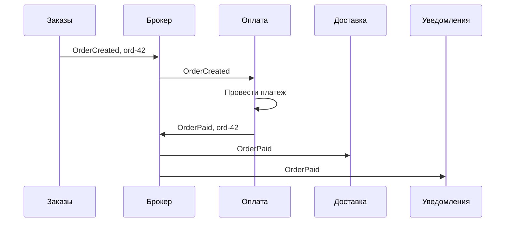

К концу лекции вы сможете выбрать очередь или журнал под требования заказа, определить, что именно подтверждает получатель, и проверить решение при повторной доставке. Примеры на Kotlin, C#, Java и Go показывают один и тот же поток. В запускаемых примерах Kotlin можно менять входные сообщения.

## Разбор сбоя при оплате

### Ситуация

В заказе `ord-42` предусмотрено одно списание. Сервис оплаты получил событие `OrderCreated` с идентификатором `msg-1`. Банк провел платеж, но процесс оплаты упал раньше, чем подтвердил доставку сообщения брокеру.

### Наивное решение

После перезапуска обработчик снова вызывает платежный API для каждого полученного сообщения. Брокер видит неподтвержденную доставку и выдает `msg-1` еще раз.

### Что ломается

Брокеру известен факт доставки. Результат списания хранится у провайдера. Отправить подтверждение раньше тоже опасно. Если обработчик упадет сразу после него, заказ может остаться без оплаты. Изменение порядка двух вызовов лишь переносит место сбоя.

### Улучшение

До первого вызова сервис создает или находит в БД единственную платежную операцию для этого заказа. Для правила «одно списание на заказ» подойдёт уникальное ограничение на `orderId`. Если два обработчика одновременно создают попытку, проигравший гонку перечитывает строку победителя. При нескольких разрешённых списаниях нужен отдельный идентификатор каждого намерения. Сервис берет ее сохраненный идентификатор, например `pay-17`, и передает его как ключ идемпотентности провайдеру, который поддерживает такой контракт. После таймаута сервис повторяет тот же запрос с тем же ключом в пределах срока его действия. Получив подтвержденный результат, он в одной локальной транзакции записывает состояние оплаты и отметку об обработке сообщения. Только после фиксации подтверждает доставку.

### Почему это работает

Если сбой случился после списания, повтор с `pay-17` позволяет получить результат той же операции. Если сбой случился после фиксации в БД, запись о `msg-1` позволяет сразу подтвердить повторную доставку. Когда срок действия ключа истек, а исход еще неизвестен, нужна сверка с провайдером до следующей попытки. Самостоятельный возврат денег или вторая согласованная оплата получат собственный ключ.

Пока оставим открытым еще один вопрос. Как гарантировать, что после фиксации оплаты доставка узнает о ней? К этой границе вернемся в конце лекции.

## От монолита к микросервисам

Асинхронное взаимодействие появляется не само по себе. Обычно оно становится заметным, когда приложение разбивают на
несколько процессов: сервис заказов, сервис оплат, сервис доставки, сервис уведомлений. Теперь обычный вызов метода
превратился в сетевое взаимодействие, а сеть добавила задержки, таймауты, частичные отказы и необходимость думать о
доставке сообщений.

### Модульный монолит не враг

Монолит — это не всегда плохо. Если код внутри одного процесса хорошо разделен на модули, зависимости направлены
осознанно, а бизнес-правила отделены от инфраструктуры, такой монолит может быть проще, дешевле и надежнее набора
сервисов.

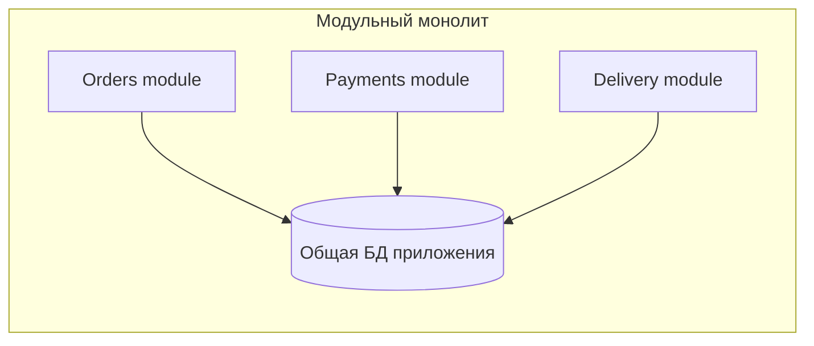

Главное преимущество модульного монолита — локальность. Вызов метода дешевый, транзакция обычно одна, отладка проще.
Главный риск — границы модулей легко нарушить, потому что технически весь код рядом.

### Распределенный монолит

Первая интуитивная ошибка при переходе к микросервисам — взять классы или модули из монолита и вынести их в отдельные
процессы без пересмотра границ. Получается распределенный монолит: сервисов много, но связность осталась монолитной.

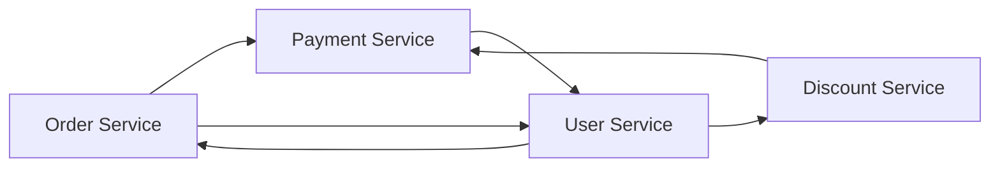

::: warning Распределенность не заменяет архитектуру
Если внутри монолита были плохие границы, вынос классов в отдельные процессы обычно добавит сеть, задержки, отказы и
сложность деплоя, но не исправит связность.
:::

Распределенный монолит обычно хуже обычного монолита:

- изменения по-прежнему требуют синхронных правок в нескольких местах;
- сервисы знают внутренние детали друг друга;
- отказ одного сервиса легко ломает цепочку вызовов;
- latency растет из-за сети;
- локальная разработка и onboarding становятся сложнее;
- горизонтальное масштабирование ограничено общей связностью.

### Где провести границу

Если вынести слой данных, бизнес-логику и API в разные процессы, одно изменение правила оплаты по-прежнему потребует согласованного релиза. Разделение по функции (feature-based) позволяет, например, выпускать отчеты отдельно от оформления заказа. Для границы по предметной области (domain-based) полезно спросить, где меняется смысл терминов. В продажах у заказа есть цена и скидка, а в доставке у отправления есть адрес и интервал вручения.

В терминах DDD это разные ограниченные контексты (bounded contexts). Такое различие помогает выбрать контракт. Для старта доставки нужны оплаченный заказ и данные для отправления. Внутренний расчет скидки для этого передавать не требуется.

### Stateless и stateful

Чтобы понять, можно ли заменить упавший экземпляр обработчика, выясните, где хранится его прогресс.

| Модель экземпляра | Что увидит другой экземпляр после рестарта |
|---|---|
| Stateless | Может продолжить по сообщению и данным во внешнем хранилище. Так работает обработчик, который восстанавливает платеж по его ключу. |
| Stateful | Нужен доступ к состоянию конкретного экземпляра или его восстановленной копии. Пример — агрегатор, накапливающий локальные итоги по заказам. |

Даже если сам обработчик stateless, состояние заказа, позиции чтения и ключи обработанных операций кому-то приходится надежно хранить.

## Способы взаимодействия сервисов

Сервисы могут обмениваться данными по-разному. Важно не выбирать технологию первой, а понять, какая семантика нужна
бизнес-сценарию.

| Способ | Когда подходит | Главный риск |
|---|---|---|
| HTTP/gRPC | нужен немедленный ответ | каскадные отказы |
| Queue | задача может выполниться позже | сложнее отладка и доставка |
| Pub-sub | много независимых подписчиков | версии событий |
| Event stream | аудит, replay, аналитика | порядок, retention, consumer lag |
| Shared DB | почти никогда между микросервисами | общая схема ломает автономность |
| Файловый обмен | большие редкие выгрузки, интеграция старых систем | задержки, ручная поддержка форматов |

Общая база данных между микросервисами почти всегда антипаттерн. Если два сервиса напрямую читают и пишут одни таблицы,
они становятся связаны схемой БД сильнее, чем REST-контрактом. Очередь поверх БД — другое дело: там БД используется как
технический механизм хранения сообщений, а не как общая доменная модель нескольких сервисов.

## Синхронность и асинхронность

Синхронность и асинхронность — это семантика взаимодействия, а не название протокола. HTTP чаще используют синхронно,
но поверх HTTP можно отправлять асинхронные команды. Брокер сообщений чаще используют асинхронно, но поверх брокера
можно построить request-reply.

Синхронный вызов:

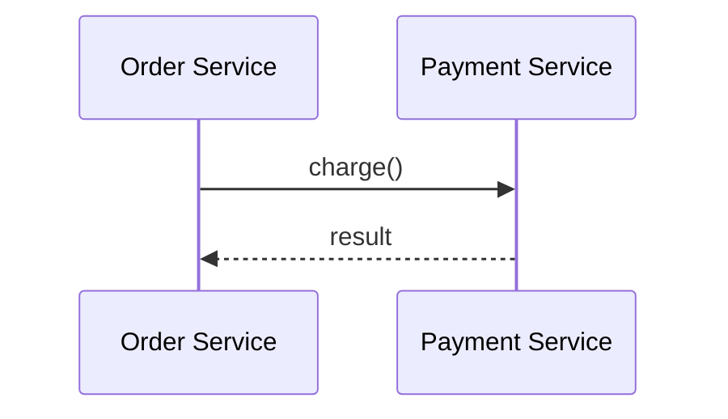

Отправитель ждет ответ. Это удобно, если без результата нельзя продолжать: например, пользователь нажал "Оплатить", и
интерфейсу нужно показать успех или ошибку.

Асинхронная очередь:

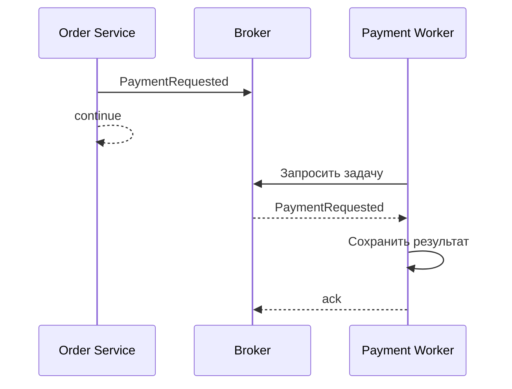

Отправитель не ждет выполнения работы. Он фиксирует намерение или событие, а обработчик выполнит задачу позже.

::: warning Асинхронность не подходит везде
Если бизнес-сценарий обязан немедленно знать результат, прямой HTTP/gRPC может быть проще и честнее. Очередь полезна,
когда допустима задержка, нужен буфер, есть независимые подписчики или требуется переживать временную недоступность
получателя.
:::

## Термины Message Bus

Message Bus — архитектурная идея: сервисы обмениваются сообщениями через общий коммуникационный слой, а не вызывают
друг друга напрямую. Для реализации шины можно использовать Kafka, RabbitMQ, NATS, облачную очередь или собственный брокер.

Основные термины:

- `message` — единица передачи данных;
- `event` — сообщение о факте, который уже произошел: `OrderCreated`;
- `command` — сообщение с просьбой выполнить действие: `ChargePayment`;
- `broker` — инфраструктурный посредник, который принимает и маршрутизирует сообщения. Хранение зависит от выбранной модели;
- `queue` — очередь, из которой сообщение обычно забирает один consumer;
- `topic` — логический канал публикации сообщений;
- `exchange` — сущность RabbitMQ, которая маршрутизирует сообщения в очереди;
- `partition` — часть топика Kafka, внутри которой сохраняется порядок;
- `producer` или `publisher` — отправитель сообщения;
- `consumer` или `subscriber` — получатель сообщения;
- `ack` — сигнал брокеру о том, что получатель берет ответственность за доставку. Когда его отправить, определяет обработчик;
- `nack` — отказ от обработки или сигнал ошибки;
- `retry` — повторная попытка обработки;
- `DLQ` — dead letter queue, очередь сообщений, которые не удалось обработать штатно;
- `consumer group` — группа обработчиков, которые совместно читают поток сообщений;
- `offset` — номер позиции записи внутри партиции Kafka. Для продолжения чтения группа фиксирует позицию следующей записи;
- `pull delivery` — consumer сам запрашивает следующую порцию сообщений;
- `push delivery` — broker сам отправляет сообщения подписчику;
- `backpressure` — механизм, которым получатель ограничивает поступление новой работы, когда не успевает обрабатывать прежнюю.

Жизнь сообщения в типичном брокере:

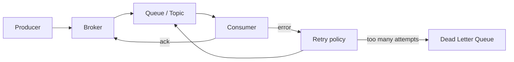

### Push и pull

В pull-модели получатель сам запрашивает следующую порцию. Он может уменьшить размер пачки или замедлить чтение. Если отправители продолжат писать с прежней скоростью, в брокере вырастет очередь.

В push-модели брокер передает сообщения по мере их появления. В RabbitMQ при ручном подтверждении параметр `prefetch` ограничивает число неподтвержденных доставок потребителю. При `prefetch=1` занятому работнику не выдадут вторую задачу, пока он не подтвердит первую.

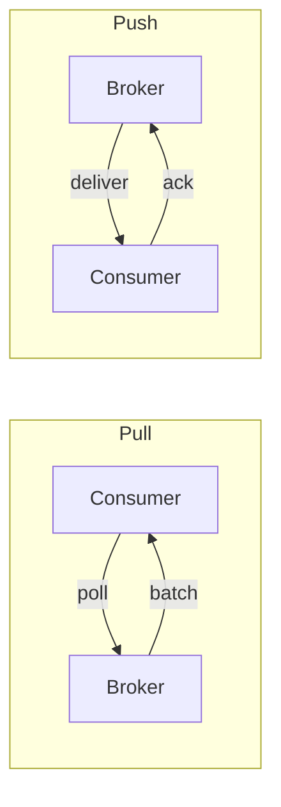

## Контракт сообщения

Сообщение — это публичный контракт между сервисами. Оно должно быть стабильнее внутренней модели отправителя. Если
сервис заказов переименовал поле внутри своей БД, подписчики не должны ломаться автоматически.

Хорошее сообщение обычно содержит:

- `messageId` идентифицирует событие и сохраняется при повторной отправке того же события;
- `occurredAt` для времени события;
- `schemaVersion` для эволюции формата;
- `correlationId` для трассировки бизнес-сценария;
- бизнес-идентификатор, например `orderId`;
- payload с данными события.

В примере магазин работает в долларах США, а `totalCents` передает сумму в центах. Время передается строкой в UTC, например `2026-07-05T10:15:30Z`. Имена полей на проводе согласованы в camelCase. Несколько событий заказа разделяют `orderId`, но каждое имеет свой `messageId`.

::: multi-code "Контракт сообщения OrderCreated"

```kotlin
data class OrderCreated(
    val messageId: String,
    val occurredAt: String,
    val schemaVersion: Int,
    val correlationId: String,
    val orderId: String,
    val customerId: String,
    val totalCents: Long
)
```

```kotlin playground
data class OrderCreated(
    val messageId: String,
    val occurredAt: String,
    val schemaVersion: Int,
    val correlationId: String,
    val orderId: String,
    val customerId: String,
    val totalCents: Long
)

fun main() {
    val event = OrderCreated(
        messageId = "msg-001",
        occurredAt = "2026-07-05T10:15:30Z",
        schemaVersion = 1,
        correlationId = "checkout-777",
        orderId = "ord-42",
        customerId = "cust-9",
        totalCents = 129900
    )

    println(event)
    check(event.totalCents == 129900L)
}
```

```csharp
public sealed record OrderCreated(
    string MessageId,
    string OccurredAt,
    int SchemaVersion,
    string CorrelationId,
    string OrderId,
    string CustomerId,
    long TotalCents);
```

```java
public record OrderCreated(
    String messageId,
    String occurredAt,
    int schemaVersion,
    String correlationId,
    String orderId,
    String customerId,
    long totalCents
) {
}
```

```go
package main

type OrderCreated struct {
    MessageID     string `json:"messageId"`
    OccurredAt    string `json:"occurredAt"`
    SchemaVersion int `json:"schemaVersion"`
    CorrelationID string `json:"correlationId"`
    OrderID       string `json:"orderId"`
    CustomerID    string `json:"customerId"`
    TotalCents    int64 `json:"totalCents"`
}
```

:::

::: only kotlin
В Kotlin для контрактов удобно использовать `data class`. Для внешнего wire-формата в реальном проекте обычно добавляют
сериализацию через `kotlinx.serialization`, Jackson или Avro/Protobuf, но сама идея контракта от библиотеки не зависит.
:::

::: only csharp
В C# позиционный `record` удобно использовать для DTO. Здесь свойства записаны в PascalCase. Для согласованного JSON настройте политику camelCase или задайте имена полей явно.
:::

::: only java
В Java 16 и новее компоненты `record` задают поля и методы доступа. Сериализатор должен поддерживать выбранное представление времени и имен полей.
:::

::: only go
В Go прописаны теги для `encoding/json`. Например, тег у экспортируемого поля `MessageID` сохраняет согласованное имя `messageId` в JSON.
:::

### Эволюция контракта

События живут дольше кода, который их впервые опубликовал. У события могут быть старые подписчики, отложенные сообщения
в очереди, replay из Kafka и аналитические потребители, которые обновляются не в тот же день.

В версии 2 магазин добавляет необязательное поле `salesChannel`. Проверьте обе стороны обмена на двух экземплярах JSON. Первый соответствует прежней схеме.

```json
{
  "messageId": "msg-1",
  "occurredAt": "2026-07-05T10:15:30Z",
  "schemaVersion": 1,
  "correlationId": "checkout-777",
  "orderId": "ord-42",
  "customerId": "cust-9",
  "totalCents": 500
}
```

Для второго установите `schemaVersion` в 2 и добавьте `"salesChannel": "web"`. Если прежний обработчик отвергает все незнакомые версии заранее, такой переход также требует обновления читателя.

| Что читаем | Какое поведение нужно проверить |
|---|---|
| Сохраненный JSON v1 без `salesChannel` читает новый обработчик | Парсер принимает отсутствие поля. Обработчик относит канал к неизвестным и сохраняет сумму заказа. |
| JSON v2 с `"salesChannel": "web"` читает прежний обработчик | Старый парсер пропускает незнакомое поле и обрабатывает заказ как раньше. Если он строгий, сначала обновляем подписчика. |

Переименовать `totalCents` или заменить центы на доллары в том же поле опаснее. Во втором случае оба парсера могут принять число, а итоговая сумма изменится в сто раз. Для такого перехода нужны новый контракт и период совместного чтения. Одно поле `schemaVersion` само по себе совместимости не дает.

::: warning Не публикуйте ORM-модель как событие
Если сообщение совпадает с текущей таблицей или внутренним классом entity, любое изменение хранения превращается в
изменение публичного API. Для межсервисного взаимодействия лучше иметь отдельный DTO-контракт.
:::

Иногда пример нужен как архитектурный фрагмент, а не как запускаемая программа. Например, сервис приложения не должен
знать, Kafka у него под капотом, RabbitMQ или облачная очередь. Ему достаточно порта публикации.

::: multi-code "Порт публикации сообщения" {playground=off}

```kotlin
interface MessagePublisher {
    fun publish(topic: String, message: OrderCreated)
}
```

```csharp
public interface IMessagePublisher
{
    void Publish(string topic, OrderCreated message);
}
```

```java
interface MessagePublisher {
    void publish(String topic, OrderCreated message);
}
```

```go
package main

type MessagePublisher interface {
    Publish(topic string, message OrderCreated) error
}
```

:::

## Очередь задач: put-take

Worker queue решает задачу "положить работу в очередь, чтобы один из обработчиков ее выполнил". Это не широковещательное
событие. Если нужно отправить одно письмо, его не должны отправить пять workers одновременно.

Типичный поток:

1. Producer кладет задачу в очередь.
2. Один consumer забирает задачу.
3. Consumer выполняет работу.
4. Если результат надежно сохранен, consumer отправляет `ack`.
5. При ошибке обработчик выбирает повтор или изоляцию сообщения по настроенной политике.

Ключевой вопрос worker queue — когда отправлять `ack`. Если подтвердить сообщение до выполнения работы, при падении
worker задача потеряется. Если подтвердить после выполнения, задача может выполниться, но `ack` не дойдет до broker, и
сообщение придет повторно. Поэтому `at-least-once` почти всегда требует идемпотентной обработки.

| Момент `ack` | Что выигрываем | Что рискуем получить |
|---|---|---|
| До обработки | брокер сразу освобождает доставку | сбой после подтверждения оставит работу невыполненной |
| После обработки | меньше риск потери | повторная обработка после сбоя |
| После одной транзакции для локального эффекта и отметки об обработке | повтор можно подтвердить без нового изменения в БД | внешнему вызову нужна собственная защита |

::: multi-code "Очередь задач in-memory"

```kotlin
data class Job(val id: String, val payload: String)

class JobQueue {
    private val jobs = ArrayDeque<Job>()

    fun put(job: Job) {
        jobs.addLast(job)
    }

    fun take(): Job? = jobs.removeFirstOrNull()
}
```

```kotlin playground
data class Job(val id: String, val payload: String)

class JobQueue {
    private val jobs = ArrayDeque<Job>()

    fun put(job: Job) {
        jobs.addLast(job)
    }

    fun take(): Job? = jobs.removeFirstOrNull()
}

fun main() {
    val queue = JobQueue()
    queue.put(Job("job-1", "send email"))
    queue.put(Job("job-2", "generate invoice"))
    println("worker-a: " + queue.take()?.id)
    println("worker-b: " + queue.take()?.id)
    check(queue.take() == null)
}

```

```csharp
using System;
using System.Collections.Generic;

public sealed record Job(string Id, string Payload);

public sealed class JobQueue
{
    private readonly Queue<Job> jobs = new();

    public void Put(Job job) => jobs.Enqueue(job);

    public Job? Take() => jobs.Count == 0 ? null : jobs.Dequeue();
}
```

```java
import java.util.ArrayDeque;
import java.util.Queue;

record Job(String id, String payload) {
}

final class JobQueue {
    private final Queue<Job> jobs = new ArrayDeque<>();

    void put(Job job) {
        jobs.add(job);
    }

    Job take() {
        return jobs.poll();
    }
}
```

```go
package main

type Job struct {
    ID      string
    Payload string
}

type JobQueue struct {
    jobs []Job
}

func (q *JobQueue) Put(job Job) {
    q.jobs = append(q.jobs, job)
}

func (q *JobQueue) Take() (Job, bool) {
    if len(q.jobs) == 0 {
        return Job{}, false
    }
    job := q.jobs[0]
    q.jobs = q.jobs[1:]
    return job, true
}
```

:::

Первый вызов `take` вернет `job-1`, второй — `job-2`, третий обнаружит пустую очередь. Здесь работники действуют по очереди в одном процессе. Элемент исчезает при извлечении. Если процесс упадет до отправки письма, эта модель потеряет задание. Для повторной доставки брокеру нужно хранить еще и выданные, но неподтвержденные сообщения.

## Publish-subscribe

Publish-subscribe нужен, когда одно событие должно быть интересно нескольким независимым подписчикам. Например,
`OrderPaid` могут слушать:

- `DeliveryService`, чтобы начать доставку;
- `BonusService`, чтобы начислить бонусы;
- `AnalyticsService`, чтобы обновить отчеты;
- `NotificationService`, чтобы отправить письмо.

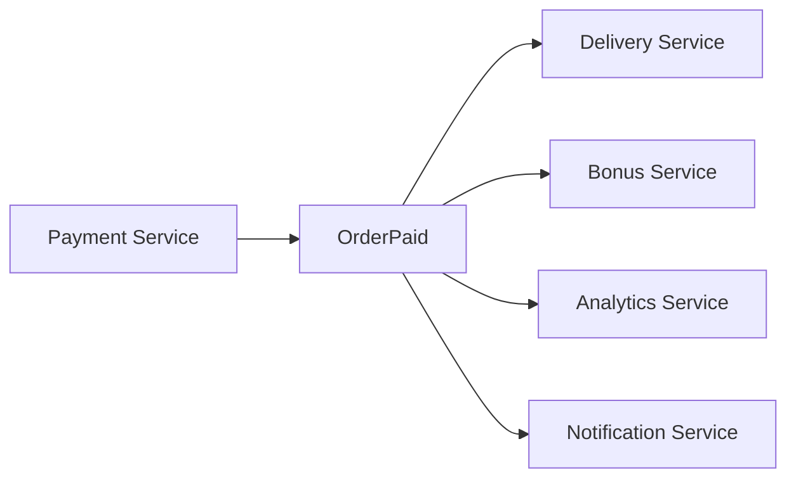

Отличие от worker queue принципиальное: в worker queue обработчик конкурирует за задачу, а в pub-sub каждый подписчик
получает свою логическую копию события.

::: multi-code "Publish-subscribe in-memory"

```kotlin
class EventBus {
    private val subscribers = mutableListOf<(String) -> Unit>()

    fun subscribe(handler: (String) -> Unit) {
        subscribers += handler
    }

    fun publish(event: String) {
        subscribers.forEach { it(event) }
    }
}
```

```kotlin playground
class EventBus {
    private val subscribers = mutableListOf<(String) -> Unit>()

    fun subscribe(handler: (String) -> Unit) {
        subscribers += handler
    }

    fun publish(event: String) {
        subscribers.forEach { it(event) }
    }
}

fun main() {
    val bus = EventBus()

    bus.subscribe { event -> println("Delivery sees $event") }
    bus.subscribe { event -> println("Bonus sees $event") }
    bus.subscribe { event -> println("Analytics sees $event") }

    bus.publish("OrderPaid(orderId=ord-42)")
}
```

```csharp
using System;
using System.Collections.Generic;

public sealed class EventBus
{
    private readonly List<Action<string>> subscribers = new();

    public void Subscribe(Action<string> handler) => subscribers.Add(handler);

    public void Publish(string message)
    {
        foreach (var handler in subscribers)
            handler(message);
    }
}
```

```java
import java.util.ArrayList;
import java.util.List;
import java.util.function.Consumer;

final class EventBus {
    private final List<Consumer<String>> subscribers = new ArrayList<>();

    void subscribe(Consumer<String> handler) {
        subscribers.add(handler);
    }

    void publish(String event) {
        subscribers.forEach(handler -> handler.accept(event));
    }
}
```

```go
package main

type Handler func(string)

type EventBus struct {
    subscribers []Handler
}

func (b *EventBus) Subscribe(handler Handler) {
    b.subscribers = append(b.subscribers, handler)
}

func (b *EventBus) Publish(event string) {
    for _, handler := range b.subscribers {
        handler(event)
    }
}
```

:::

В Playground появятся три строки с одним `ord-42`, по одной на подписчика. Локальный `publish` вызывает функции последовательно. Если первая выбросит исключение, до остальных вызовов выполнение не дойдет. Чтобы аналитика могла отстать независимо от доставки, каждому сервису нужна собственная подписка с отдельным прогрессом. Несколько экземпляров одного сервиса могут делить работу внутри подписки.

## Request-reply поверх брокера

Очереди не запрещают синхронную семантику. Можно отправить запрос в очередь, указать `correlationId` и `replyTo`, а
потом ждать ответ из другой очереди.

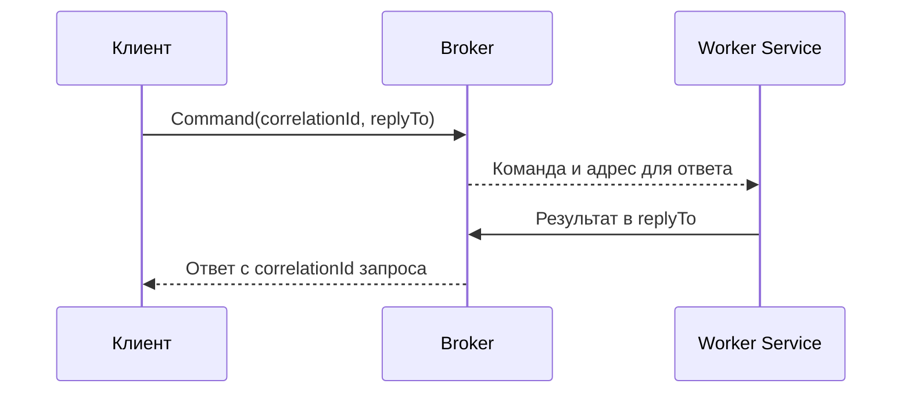

Клиент сопоставляет ответ из своей очереди с ожидающим запросом по `correlationId`. Для параллельных RPC внутри одного заказа каждому запросу нужен отдельный идентификатор. Если истек таймаут, команда могла уже выполниться. Поздний ответ и повтор команды надо учитывать отдельно. Когда адресат доступен и нужен немедленный результат, прямой вызов обычно проще.

## Зачем нужны очереди

Очередь — это не только "связать микросервисы". Она решает несколько разных инженерных задач.

### Распределение нагрузки

Два исполнителя могут одновременно брать работу из одной очереди. Распределение зависит от модели выдачи и лимита незавершенных задач. Если один исполнитель забрал большую пачку, второй может простаивать, хотя первый еще долго будет занят.

### Сглаживание пиков

Очередь работает как буфер между всплеском запросов и ограниченной производительностью обработчиков.

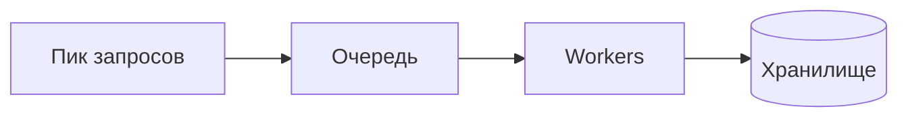

Если во время экзамена студенты массово отправляют решения, система может принять запросы быстро, поставить тяжелую
проверку в очередь и обработать ее по мере доступности вычислительных ресурсов. Если каждую секунду поступают 120 работ, а завершаются 100, за минуту скопится 1200 работ. Когда поток снизится до 80 в секунду, на разбор накопленного уйдет еще минута при той же скорости обработки.

### Отложенные и фоновые задачи

Некоторые операции не должны блокировать пользователя: отправка письма, генерация отчета, пересчет аналитики, загрузка
данных в DWH. Их удобно выполнять фоновыми workers.

### Изоляция медленного сервиса

Если `NotificationService` временно тормозит, `OrderService` не обязан ждать каждую отправку письма. Он публикует
событие, а уведомления догоняют позже.

### Retry после временных отказов

Сеть, внешние API и базы данных иногда временно недоступны. Очередь дает место, где можно сохранить работу до повторной
попытки.

### Интеграция разных систем

Очереди часто связывают системы с разным стеком, скоростью релизов и требованиями к доступности: банковский контур,
склад, CRM, биллинг, аналитика.

### Новые архитектурные стили

Event sourcing, event streaming и потоковая аналитика опираются на идею последовательности событий. Это уже не просто
"поставить задачу в очередь", а хранить историю фактов и строить из нее состояние.

## Гарантии доставки

У публикации и обработки разные подтверждения. В RabbitMQ `publisher confirm` сообщает отправителю об исходе публикации со стороны брокера. Даже положительный confirm сам по себе не доказывает, что сообщение попало в нужную очередь. Если маршрут обязателен, отправитель также обрабатывает возврат ненаправленного сообщения, например с флагом `mandatory` в AMQP 0-9-1. Позже consumer отдельным `ack` подтверждает доставку брокеру. Ни один из этих сигналов не сообщает покупателю, что оплата прошла.

| Семантика в оговоренной границе | Что наблюдаем | Цена |
|---|---|---|
| At-most-once | От нуля до одной доставки данного сообщения | После сбоя работа может быть пропущена |
| At-least-once | Хотя бы одна доставка принятого сообщения при выполнении условий. Повторы допустимы | Нужны сохранность сообщения, повтор до успеха и восстановление потребителя. Истечение срока хранения или перевод в DLQ ограничивают дальнейшие попытки |
| Effectively-once для бизнес-эффекта | После успешной обработки все повторные доставки вместе дают один результат | Нужен устойчивый ключ и механизм защиты там, где меняется состояние |

В Kafka есть конкретный контур exactly-once. Обработчик читает из Kafka, пишет результаты в выходной топик и фиксирует входные позиции в той же Kafka-транзакции. Читатель с `read_committed` видит только зафиксированный транзакционный результат. Списание у провайдера в эту транзакцию не входит.

### Идемпотентный consumer

Рассмотрим более простую задачу из нашего заказа. Аналитика прибавляет сумму каждого события оплаты к выручке. Для одного платежа в 500 центов два вызова `+= 500` дадут 1000. Запустите пример с повтором того же события, а затем с другим событием на 200 центов.

::: multi-code "Выручка при повторной доставке"

```kotlin
class Revenue {
    private val seen = mutableSetOf<String>()
    var cents = 0L
        private set

    fun onPaid(messageId: String, amountCents: Long) {
        if (seen.add(messageId)) cents += amountCents
    }
}
```

```kotlin playground
class Revenue {
    private val seen = mutableSetOf<String>()
    var cents = 0L
        private set

    fun onPaid(messageId: String, amountCents: Long) {
        if (seen.add(messageId)) cents += amountCents
    }
}

fun main() {
    val revenue = Revenue()
    for ((id, amount) in listOf("paid-1" to 500L, "paid-1" to 500L, "paid-2" to 200L)) {
        revenue.onPaid(id, amount)
        println(revenue.cents)
    }
    check(revenue.cents == 700L)
}
```

```csharp
using System.Collections.Generic;

public sealed class Revenue
{
    private readonly HashSet<string> seen = new();
    public long Cents { get; private set; }

    public void OnPaid(string messageId, long amountCents)
    {
        if (seen.Add(messageId)) Cents += amountCents;
    }
}
```

```java
import java.util.HashSet;
import java.util.Set;

final class Revenue {
    private final Set<String> seen = new HashSet<>();
    private long cents;

    void onPaid(String messageId, long amountCents) {
        if (seen.add(messageId)) cents += amountCents;
    }

    long cents() { return cents; }
}
```

```go
package main

type Revenue struct {
    seen  map[string]bool
    Cents int64
}

func (r *Revenue) OnPaid(messageID string, amountCents int64) {
    if r.seen == nil {
        r.seen = make(map[string]bool)
    }
    if !r.seen[messageID] {
        r.seen[messageID] = true
        r.Cents += amountCents
    }
}
```

:::

Получится 500, 500, 700. Множество в памяти демонстрирует правило для последовательного запуска. У второго экземпляра была бы своя копия множества, а перезапуск стер бы и его, и счетчик.

В БД аналитики заведем уникальное ограничение на пару `(subscriberId, messageId)`. В **одной транзакции** обработчик пытается вставить эту пару. Только если вставка добавила строку, он увеличивает выручку. При ошибке откатываются оба изменения; после успешного commit можно отправить `ack`. При повторе уже зафиксированного события вставка с `ON CONFLICT DO NOTHING` добавит ноль строк. Обработчик пропустит прибавление и подтвердит доставку. При гонке двух экземпляров уникальный индекс позволит учесть оплату одному из них. Независимому подписчику, например доставке, то же событие по-прежнему доступно.

Защита по `messageId` предполагает, что повтор сохраняет идентификатор события. Если источник способен выпустить два разных события об одном списании, учет выручки требует еще и уникального идентификатора самого списания. Для внешнего провайдера действует правило из разбора `pay-17`.

## Ошибки обработки

Ошибки сообщений бывают разными.

| Тип ошибки | Пример | Что делать |
|---|---|---|
| Transient | временно недоступен внешний API | retry с задержкой |
| Permanent | неверный формат сообщения | DLQ и разбор причины |
| Poison message | сообщение каждый раз ломает consumer | ограничить attempts и отправить в DLQ |
| Overload | consumers не успевают | масштабировать workers или снижать publish rate |

Retry без ограничений опасен. Одно плохое сообщение может бесконечно возвращаться в очередь и мешать обработке нормальных
сообщений.

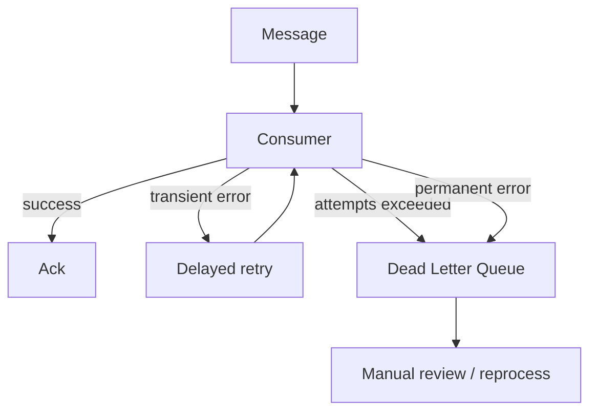

Считаем с единицы уже завершившуюся неудачную попытку. После первой, второй и третьей временной ошибки планируем новый вызов через 5, 30 и 120 секунд соответственно. После четвертой переводим сообщение в DLQ. Неверный формат попадает туда сразу. В рабочей системе к задержке часто добавляют случайный разброс, чтобы все воркеры не повторяли запрос в один момент.

::: multi-code "Задержка после неудачной попытки"

```kotlin
fun nextDelaySeconds(attempt: Int): Int? =
    when (attempt) {
        1 -> 5
        2 -> 30
        3 -> 120
        else -> null
    }
```

```kotlin playground
fun nextDelaySeconds(attempt: Int): Int? =
    when (attempt) {
        1 -> 5
        2 -> 30
        3 -> 120
        else -> null
    }

fun main() {
    for (attempt in 1..4) {
        val delay = nextDelaySeconds(attempt)
        if (delay == null) {
            println("attempt $attempt -> send to DLQ")
        } else {
            println("attempt $attempt -> retry after ${delay}s")
        }
    }
}
```

```csharp
int? NextDelaySeconds(int attempt) => attempt switch
{
    1 => 5,
    2 => 30,
    3 => 120,
    _ => null
};
```

```java
final class RetryPolicy {
    static Integer nextDelaySeconds(int attempt) {
        return switch (attempt) {
            case 1 -> 5;
            case 2 -> 30;
            case 3 -> 120;
            default -> null;
        };
    }
}
```

```go
package main

func NextDelaySeconds(attempt int) (int, bool) {
    switch attempt {
    case 1:
        return 5, true
    case 2:
        return 30, true
    case 3:
        return 120, true
    default:
        return 0, false
    }
}
```

:::

Приоритетные очереди добавляют отдельный риск: starvation. Если высокоприоритетные сообщения идут постоянно, низкий
приоритет может никогда не дойти до обработки. Поэтому за возрастом старейшего сообщения нужно следить отдельно.

::: warning DLQ — не мусорная корзина
Dead letter queue нужна для диагностики и восстановления. Если сообщения попадают туда регулярно, команда должна видеть
причину и время сбоя. Для очереди оплаты назначьте владельца. Он проверяет исход платежа, устраняет причину и только затем повторяет обработку с прежними ключами. Если приложение само перекладывает сообщение в retry-очередь или DLQ, подтверждать исходную доставку можно лишь после надежной передачи. Потерянное подтверждение и здесь может дать дубль.
:::

## Порядок сообщений

Порядок сообщений кажется простой темой только до параллелизма. Одна очередь может давать FIFO, но как только consumers
несколько, глобальный порядок обработки становится сложнее.

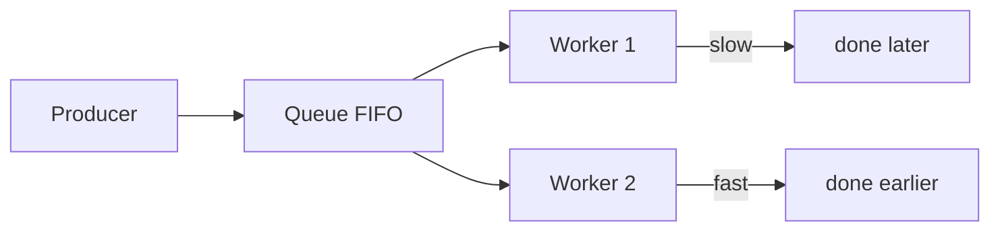

В Kafka записи внутри одной партиции упорядочены по offset. Чтобы события заказа попадали в одну партицию, используйте один топик, стабильное отображение ключа `orderId` в партицию и согласованный способ публикации. При изменении числа партиций стандартное распределение по ключу может измениться. Причинный порядок событий от разных отправителей тоже не появляется сам собой: журнал фиксирует порядок записи.

Пусть `OrderPaid` имеет offset 20, а отмена — 21. Если оплату отложили для retry, отмена может завершиться первой. Когда это нарушает правила заказа, обрабатывайте изменения одного ключа последовательно или проверяйте версии состояния и разбирайте пропуски. При параллельной обработке нельзя фиксировать позицию 22, пока запись 20 еще не обработана надежно: после рестарта группа продолжит с 22.

## Репликация и отказоустойчивость брокера

Очередь сама может стать единой точкой отказа. Если broker один и он упал, producer не может отправить сообщение, а
consumer не может его прочитать.

### Single instance

Один брокер прост в настройке, но дает низкую доступность и надежность. Подходит для локальной разработки, обучения и
некритичных систем.

### Multi instance без репликации

Падение узла делает сообщения на нем недоступными. Если диск цел, их можно прочитать после восстановления. При потере единственной копии диска соседние брокеры не смогут их восстановить.

### Leader-follower replication

Более надежная схема — лидер принимает запись, а реплики получают копии.

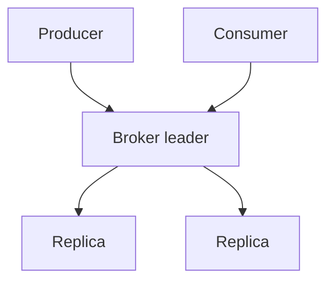

Если лидер падает, одна из реплик может стать новым лидером. Но важны детали: успела ли реплика получить сообщение,
нужен ли `ack` от всех реплик или от большинства, что происходит при разделении сети.

### Quorum

В quorum queue RabbitMQ запись согласуют реплики конкретной очереди. Из трех реплик нужны две. После потери одной оставшиеся две могут выбрать лидера и продолжить работу; одна изолированная реплика не может подтверждать новые записи. Это правило предотвращает ситуацию, когда обе стороны сетевого разделения продолжают записывать несовместимые истории (split brain).

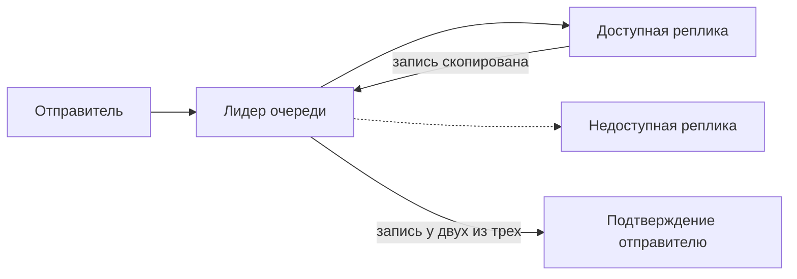

Для Kafka следует отдельно рассматривать репликацию данных партиции. При `acks=all` лидер ожидает подтверждения от текущих синхронных реплик (ISR). Параметр `min.insync.replicas` задает минимальный размер этого набора для такой записи. Например, при трех репликах и минимуме два, если в ISR осталась одна, такая публикация завершится ошибкой.

### Retention и durability

Durability описывает сохранность уже принятой записи при оговоренных отказах. Retention определяет, какую историю система еще хранит. В рабочей очереди RabbitMQ положительный `ack` позволяет брокеру удалить соответствующее сообщение из этой очереди. В Kafka чтение само по себе не удаляет запись. При политике удаления историю ограничивают время и размер, а при compaction старые значения одного ключа могут исчезнуть. Для аудита заранее проверьте, какие записи должны сохраниться и на какой срок.

## Протоколы и классы решений

У каждого решения стоит спросить, что остается после чтения, кто ведет прогресс и где описана судьба неудачной доставки. Некоторые библиотеки оставляют все три задачи приложению.

Протокол описывает правила обмена: формат команд, соединение, подтверждения, маршрутизацию. Брокер — конкретная система,
которая реализует одну или несколько моделей.

| Протокол или класс | Инженерный смысл |
|---|---|
| AMQP | классический протокол брокеров сообщений, часто ассоциируется с RabbitMQ |
| MQTT | легкий pub-sub для IoT и нестабильных сетей |
| Kafka protocol | работа с distributed log, partitions, offsets и consumer groups |
| HTTP API / SQS-like | простая интеграция с облачной очередью через HTTP API |
| NATS | легкий messaging с низкой задержкой, есть расширения для persistence |
| ZeroMQ | библиотека messaging-паттернов поверх сокетов, не полноценный managed broker |

Нельзя выбрать протокол только по популярности. Нужно смотреть на модель доставки, порядок, хранение, replay,
операционную сложность и поддержку нужных клиентов.

Кроме решений, которые разбираются ниже подробнее, в продуктах встречаются ActiveMQ, NSQ, Beanstalkd и другие брокеры.
Их стоит оценивать по тем же вопросам: порядок, подтверждения, replay, задержки, эксплуатация и поведение при отказах.

## Kafka

Пусть аналитика, доставка и уведомления читают события оплаты независимо, а аналитике нужно еще раз пересчитать отчет за вчера. Три очереди решат задачу независимой доставки. Для пересчета уже подтвержденных сообщений нужна сохраненная история.

Kafka хранит топик как набор партиций журнала. В обычной consumer group одна партиция в каждый момент назначена одному участнику. Разные группы читают ее независимо. На схеме два экземпляра аналитики делят партиции; у доставки своя группа и свои позиции.

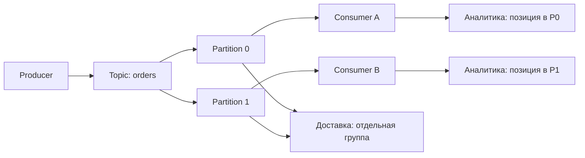

Для нашего заказа важны следующие свойства Kafka.

- высокая пропускная способность;
- replay сообщений;
- хранение истории по retention;
- consumer groups;
- хорошая модель для event streaming, аудита, логов, метрик, CDC и аналитики;
- порядок внутри partition.

При проектировании учитывайте ограничения.

- Нет естественной произвольной приоритизации сообщений;
- requeue конкретного сообщения устроен иначе, чем в классических брокерах;
- порядок зависит от ключа, партиционирования и обработки повторов;
- эксплуатация кластера требует понимания репликации, retention, lag и дисков.

Kafka часто выбирают, когда события являются ценным потоком данных, а не просто одноразовыми задачами.

## RabbitMQ

В AMQP 0-9-1 отправитель публикует в exchange. Привязки (bindings) определяют, в какие очереди попадет сообщение. Сервис доставки и аналитика получают по копии `OrderPaid`, а два работника доставки конкурируют за задачи одной очереди.

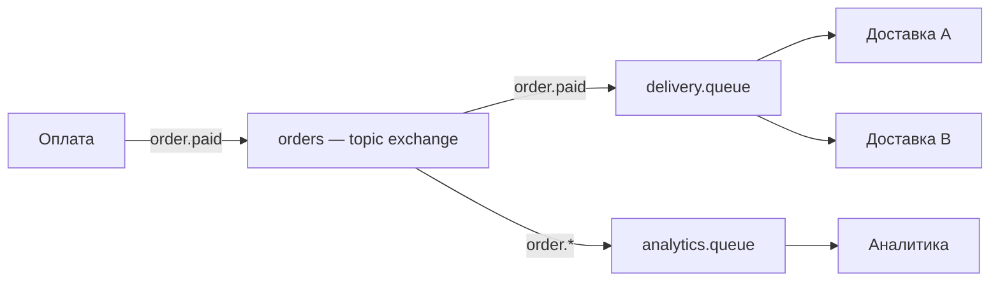

У `direct` exchange ключ публикации должен точно совпасть с ключом привязки. У `fanout` сообщение получают все привязанные очереди независимо от ключа. У `topic` привязка содержит шаблон. На схеме `order.paid` подходит обеим очередям, а `order.created` — только очереди аналитики. Звездочка соответствует одному слову между точками.

Для фоновых задач полезны ручные подтверждения, лимит выданных задач и управляемый возврат после отказа. Простое `nack` с `requeue=true` может сразу вернуть проблемную задачу тому же потребителю. Для отложенных повторов настраивают отдельную политику, например очереди с TTL и dead-letter exchange. Поддержка приоритетов и поведение при отказе зависят от типа очереди.

Обычные очереди удобны для работ, которые можно забыть после подтверждения. Когда клиенту нужна сохраненная история, у RabbitMQ также есть Streams — журнал с повторным чтением по позиции.

### Kafka и RabbitMQ в одном сравнении

| Вопрос | Kafka, топик с политикой удаления | RabbitMQ, рабочая очередь AMQP 0-9-1 |
|---|---|---|
| Базовая модель | распределенный лог событий | брокер сообщений и очередей |
| Что происходит после чтения | сообщение остается до истечения retention | сообщение обычно удаляется после `ack` |
| Replay | естественный сценарий | не основная модель |
| Приоритеты | не естественная модель | поддерживаются priority queues |
| Routing | через topics, keys и partitions | через exchanges и routing keys |
| Повтор конкретной задачи | чаще отдельный retry topic/process | `nack`, requeue, retry queues |
| Типичный сценарий | event streaming, аудит, аналитика, CDC | фоновые задачи, workflow, маршрутизация команд |

## Очереди поверх PostgreSQL, Redis и Tarantool

Очередь можно построить поверх хранилища: PostgreSQL, Redis, Tarantool или специализированного модуля вроде Tarantool
Queue. Это не то же самое, что "двум микросервисам пользоваться общей БД". В queue-over-DB хранилище является внутренней
деталью брокера или очереди, а сервисы общаются через контракт сообщений.

Когда это может быть разумно:

- нужен нестандартный алгоритм: особая приоритизация, сложная выборка, специфический put-back;
- очередь должна быть близко к данным;
- нагрузка умеренная, а дополнительный брокер слишком дорог операционно;
- команда хорошо понимает выбранное хранилище.

Риски:

- самим проектировать retry, DLQ, дедупликацию и retention;
- самим мониторить рост очереди;
- легко превратить очередь в скрытую общую БД;
- производительность и блокировки могут стать проблемой.

Например, в PostgreSQL несколько исполнителей могут выбирать готовые строки с `FOR UPDATE SKIP LOCKED`. Заблокированную строку пропустит другой исполнитель. Долгую работу обычно выносят за пределы этой короткой транзакции. Тогда нужно записать, кто и до какого момента забрал задачу, и вернуть просроченные задачи после сбоя. В Redis Streams уже есть учет доставок группы, ожидающих подтверждения; `XAUTOCLAIM` позволяет другому исполнителю перенять давно простаивающие записи. В обоих случаях повтор обработки остается возможным.

## NATS и ZeroMQ

Core NATS подходит для обмена с активными подписчиками, где допустим пропуск сообщения. Доставка в этой модели — at-most-once. В JetStream можно сохранять поток и вести прогресс потребителя. Например, обработчик доставки запрашивает пачку, подтверждает выполненную работу и после сбоя получает неподтвержденные записи повторно согласно настройкам.

ZeroMQ предоставляет библиотеку сокетов с моделями push-pull, pub-sub и request-reply. Для обмена между доступными процессами этого бывает достаточно. Если заказ должен пережить перезапуск получателя, команда отдельно проектирует хранение, восстановление и наблюдение за работой.

## Облачные очереди

Amazon SQS и Yandex Message Queue предоставляют очередь как облачный сервис. Управляемый RabbitMQ, например CloudAMQP, сохраняет модель выбранного брокера. В обоих случаях провайдер берет на себя часть эксплуатации.

В SQS получение временно скрывает сообщение от других обработчиков. После успешной работы клиент удаляет его. Если обработка или удаление не завершились до конца `visibility timeout`, задание может снова стать доступным. У стандартной очереди даже в пределах этого интервала следует предусмотреть дубли. Для длинной операции получатель может продлевать интервал видимости.

Плюсы:

- быстрый старт;
- управляемая доступность;
- готовые метрики;
- интеграция с IAM, логами и облачной инфраструктурой;
- меньше DevOps-нагрузки.

Минусы:

- vendor lock-in;
- стоимость на больших объемах;
- ограничения конкретного API;
- latency до облака;
- особенности локальной разработки и тестирования.

Если система уже живет в облаке, управляемая очередь часто является прагматичным первым выбором. Если требования
упираются в throughput, replay или сложную маршрутизацию, нужно сравнивать с Kafka/RabbitMQ отдельно.

## Матрица выбора

| Требование | Предпочтение |
|---|---|
| Нужен немедленный ответ | HTTP/gRPC |
| Фоновая задача | RabbitMQ или cloud queue |
| Много событий, replay, аналитика | Kafka |
| Приоритеты, delayed retry, routing | RabbitMQ |
| Очень низкая задержка, lightweight messaging | NATS |
| Нестандартный алгоритм очереди | Tarantool/custom |
| Минимум DevOps | cloud queue |
| Допустим пропуск событий отсутствующим подписчиком | Core NATS или подходящий сокетный pub-sub |
| Дубли недопустимы на уровне бизнес-эффекта | идемпотентность операции и дедупликация в системе, где фиксируется эффект |

Эта таблица не заменяет нагрузочное тестирование и proof of concept. Она помогает выбрать направление, чтобы не сравнивать
все со всем.

## От публикации до обработки

Соберем две части примера. Сервис заказов передает уже сформированный `OrderCreated` через порт из раздела о контракте. На стороне оплаты нужен следующий договор: `captureOnce` восстанавливает ключ операции, выполняет или сверяет списание и возвращает успех только после надежной фиксации результата. Код показывает границу ответственности. Реализация платежного адаптера зависит от провайдера.

::: multi-code "Две стороны доставки OrderCreated" {playground=off}

```kotlin
fun publishCreated(event: OrderCreated, publisher: MessagePublisher) {
    publisher.publish("orders.created", event)
}

fun handle(event: OrderCreated, payments: Payments, ack: () -> Unit) {
    payments.captureOnce(event)
    ack()
}
```

```csharp
public static class OrderFlow
{
    public static void PublishCreated(OrderCreated message, IMessagePublisher publisher) =>
        publisher.Publish("orders.created", message);

    public static void Handle(OrderCreated message, IPayments payments, System.Action ack)
    {
        payments.CaptureOnce(message);
        ack();
    }
}
```

```java
final class OrderFlow {
    static void publishCreated(OrderCreated event, MessagePublisher publisher) {
        publisher.publish("orders.created", event);
    }

    static void handle(OrderCreated event, Payments payments, Runnable ack) {
        payments.captureOnce(event);
        ack.run();
    }
}
```

```go
func PublishCreated(event OrderCreated, publisher MessagePublisher) error {
    return publisher.Publish("orders.created", event)
}

func Handle(event OrderCreated, payments Payments, ack func() error) error {
    if err := payments.CaptureOnce(event); err != nil {
        return err
    }
    return ack()
}
```

:::

Если сохранение результата завершится ошибкой, исполнение не дойдет до `ack`. При повторной доставке сервис восстановит состояние по тому же ключу. Если после успешной обработки потерялся сам `ack`, результат также должен сохраниться. Исключение или возвращенная ошибка передается адаптеру подписчика, который применяет политику повторов.

::: only kotlin
При параллельном чтении из `Channel` несколько корутин могут закончить задачи в другом порядке. Число запущенных обработчиков и размер буфера задавайте отдельно. Модификатор `suspend` сам по себе не выбирает поток исполнения.
:::

::: only csharp
Если подписчик реализован как `BackgroundService`, долгоживущий сервис создает область DI для scoped-обработчика. Асинхронную работу обработчика следует дождаться до подтверждения доставки и освобождения области.
:::

::: only java
Исключение задачи, отправленной в `ExecutorService.submit`, доступно через `Future`. Если подтвердить доставку сразу после `submit`, сбой внутри задачи останется за границей подтверждения.
:::

::: only go
Чтение из канала в нескольких горутинах распределяет задачи между ними. Ошибку обработки нужно вернуть в код, отвечающий за подтверждение. Количество горутин выбирают с учетом лимитов платежного API и соединений с БД.
:::

## Наблюдаемость

Очередь без мониторинга превращается в скрытый накопитель проблем. Пользователь видит "заявка принята", а внутри системы
сообщения могут часами лежать без обработки.

Минимальный чеклист метрик:

- `queue depth` — сколько сообщений ожидает обработки;
- `consumer lag` — для Kafka разница между конечной позицией партиции и позицией группы. Измеряется в позициях журнала; для времени ожидания нужна отдельная метрика;
- `publish rate` — скорость публикации;
- `consume rate` — скорость обработки;
- `processing latency` — время обработки одного сообщения;
- `retry count` — количество повторов;
- `DLQ size` — размер dead letter queue;
- `oldest message age` — возраст самого старого сообщения;
- `broker disk usage` — занятое место;
- `broker memory usage` — память брокера;
- `consumer error rate` — доля ошибок обработки.

В нашем магазине принятое оформление должно перейти из `PendingPayment` в конечное состояние за две минуты. Это условие задачи. Если у самого старого ожидающего заказа возраст уже три минуты, дежурный разбирает его по `orderId` и `correlationId`. Растущий долг одной партиции указывает, где искать отставание; рост повторов при стабильной скорости приема подсказывает проверить ошибки платежного API. Одна только пустая очередь не доказывает, что заказы оплачены.

## Практический мини-дизайн

Рассмотрим оформление заказа.

Сервисы:

- `OrderService` — принимает заказ и хранит его состояние;
- `PaymentService` — обрабатывает оплату;
- `DeliveryService` — планирует доставку;
- `NotificationService` — отправляет уведомления;
- `AnalyticsService` — строит отчеты.

Сначала сервис заказов сохраняет заказ в состоянии `PendingPayment`. В этом варианте создание заказа автоматически запускает оплату. Ответ на `POST /orders` — `201 Created` и адрес заказа: созданный ресурс уже можно прочитать. Его состояние `PendingPayment` означает, что исход оплаты ещё неизвестен. В лекции 10 пользователь отдельно запускал долгую операцию через `POST /payments` и получал `202 Accepted`. При отказе провайдера платежный сервис различает окончательный отказ (`PaymentFailed`) и неизвестный исход из-за таймаута. Доставку разрешает только подтвержденное событие `OrderPaid`.

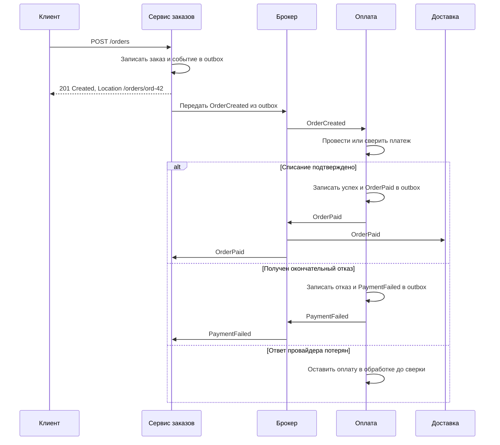

Почему на схеме появилась таблица outbox? Если сначала сохранить заказ, а потом попытаться опубликовать событие, падение процесса между вызовами оставит заказ без сообщения. В одной транзакции можно сохранить заказ и строку с событием. Отдельный отправитель дочитает эту строку и после рестарта. Такой же разрыв возникает между фиксацией результата оплаты и публикацией `OrderPaid`. Повторная публикация возможна, поэтому идентификатор события сохраняют. Детали — в [лекции 12](/lectures/12#transaction-outbox).

## Проверочный список проектирования

Перед выбором брокера полезно пройтись по вопросам:

- сообщение является командой или событием;
- нужен один обработчик или много независимых подписчиков;
- можно ли продолжить работу без немедленного ответа;
- допустима ли потеря сообщения;
- допустимы ли дубли;
- важен ли порядок и в какой границе: глобально, по заказу, по пользователю;
- нужен ли replay;
- как долго хранить сообщения;
- что делать после трех неудачных попыток;
- где будет дедупликация;
- кто смотрит DLQ;
- какие метрики и алерты обязательны;
- что произойдет при падении broker leader;
- как локально тестировать интеграцию.

Если на эти вопросы нет ответа, выбор "Kafka или RabbitMQ" преждевременен.

## Итоги

Сервис заказов может принять работу, пока платежный сервис недоступен. Очередь даст платежному сервису возможность догнать заказы, если срок хранения и пропускная способность это позволяют. Конкурирующие работники делят одну подписку; доставка, уведомления и аналитика ведут независимый прогресс.

Для каждого подтверждения назовите участника и действие, которое он уже надежно завершил. На пути `ord-42` это три разных факта: брокер принял публикацию, провайдер провел списание, а сервис оплаты сохранил его результат. Различить их особенно важно именно после таймаута.

В следующей лекции разберем [Transaction Outbox](/lectures/12#transaction-outbox) для надежной публикации, [Inbox](/lectures/12#transaction-inbox) для учета обработанных сообщений и [Saga](/lectures/12#saga) для согласования нескольких локальных операций.

## Дополнительное чтение

### Очереди и подписки

- [RabbitMQ. Work Queues](https://www.rabbitmq.com/tutorials/tutorial-two-java) — эксперимент с остановкой исполнителя до подтверждения и настройкой prefetch.
- [RabbitMQ. Publish/Subscribe](https://www.rabbitmq.com/tutorials/tutorial-three-java) — один поток логов и два независимо подключенных получателя.
- [RabbitMQ. Consumer Acknowledgements and Publisher Confirms](https://www.rabbitmq.com/docs/confirms) — два направления подтверждений и возврат сообщения без маршрута.
- [Amazon SQS. Visibility timeout](https://docs.aws.amazon.com/AWSSimpleQueueService/latest/SQSDeveloperGuide/sqs-visibility-timeout.html) — выдача, временная невидимость и удаление задания.

### Границы гарантий

- [Apache Kafka. Design](https://kafka.apache.org/41/design/design/) — порядок записей, транзакционные позиции и условия репликации.
- [Chris Richardson. Idempotent Consumer](https://microservices.io/post/microservices/patterns/2020/10/16/idempotent-consumer.html) — учет события и изменение бизнес-данных в одной транзакции.
- [Stripe. Idempotent requests](https://docs.stripe.com/api/idempotent_requests) — повтор одного запроса с тем же ключом, ограничения параметров и срока хранения.

## Вопросы для самопроверки

1. Чем модульный монолит отличается от распределенного монолита?
2. Почему асинхронность уменьшает связанность по времени, но не отменяет связанность по контракту?
3. Чем command message отличается от event message?
4. Какое изменение защищает уникальный ключ в БД аналитики? Чем защищено повторное списание у провайдера?
5. Аналитика должна завтра пересчитать сегодняшний отчет. Что придется сохранить при выборе очереди и при выборе журнала?
6. Что такое DLQ и почему она не должна быть "мусорной корзиной без владельца"?
7. В какой границе обычно стоит сохранять порядок сообщений?
8. Какие метрики очереди должны попасть в production dashboard?

## Мини-практика

Вы проектируете обработку заказа `ord-42` на 500 центов. Аналитика может отставать на день и должна уметь пересчитывать отчет. Доставка стартует только после успешной оплаты. Подготовьте схему подписок, три коротких контракта для `OrderCreated`, `OrderPaid` и `DeliveryScheduled` и таблицу результатов следующих испытаний.

| Испытание | По чему проверить решение |
|---|---|
| Две копии одного `OrderPaid` попали в аналитику | Выручка выросла на 500 центов. Укажите ключ уникальности и изменения, которые фиксируются вместе. |
| Провайдер списал деньги, обработчик упал до локальной записи | Один платеж у провайдера и одна запись об успехе после восстановления. Покажите, откуда второй обработчик возьмет прежний ключ. |
| Один заказ четыре раза подряд встретил временную ошибку | Интервалы 5, 30 и 120 секунд, затем одна логическая задача на разбор в DLQ. Назовите владельца и условие повторного запуска. |
| Оплата отклонена, а аналитика остановлена на сутки | Доставка не стартовала. После восстановления аналитика читает свою историю в пределах выбранного срока хранения. |
| `msg-1` и `msg-2` относятся к одному намерению `pay-17`, затем согласовано отдельное списание `pay-18` | Первые две доставки дают один платёж. После нового намерения платежей два. Для этого контрольного случая заказ допускает два самостоятельных списания. |
| Сервис заказов упал сразу после commit | Заказ и запись для последующей публикации присутствуют оба. Объясните, почему следующий запуск отправителя может дать дубль. |

Для каждого контракта укажите `messageId`, `orderId`, версию и поля, нужные получателю. Отдельно назовите ключ платежной операции, границу порядка и метрику для заказа, который провел три минуты в `PendingPayment`.
