# Лекция 12. Паттерны отказоустойчивости при межсервисном взаимодействии

Покупатель нажал «Оформить заказ». В базе уже есть заказ № 42 на 300 рублей, а страница оплаты всё ещё ждёт. За эти несколько секунд могли произойти две разные вещи. Сервис заказов мог упасть перед отправкой сообщения. А могло пройти даже списание, только ответ о нём потерялся. Что произойдёт, если покупатель нажмёт кнопку ещё раз?

## Цели

Проследим путь одного заказа от записи в базе до резерва на складе. На каждой границе будем задавать три вопроса. Что уже сохранилось? Кто об этом знает? Что можно безопасно повторить? Затем на примере бронирования поездки разберём, как отменять уже подтверждённые шаги и что в это время видят другие клиенты.

Вам пригодится словарь брокеров из [лекции 11](/lectures/11). Запускаемые примеры на Kotlin позволяют проверить, какой эффект оставит повтор. Архитектурные фрагменты показывают, где в приложении потребуется настоящая транзакция.

## Сквозной пример

Будем держать в голове два домена.

Первый — интернет-магазин:

- `Order Service` создает заказ;
- `Payment Service` списывает деньги;
- `Inventory Service` резервирует товар.

Второй — бронирование поездки:

- `Flight Service` бронирует билет;
- `Hotel Service` бронирует номер;
- `Car Service` резервирует автомобиль;
- `Payment Service` списывает оплату или делает возврат.

Успешный сценарий магазина выглядит просто:

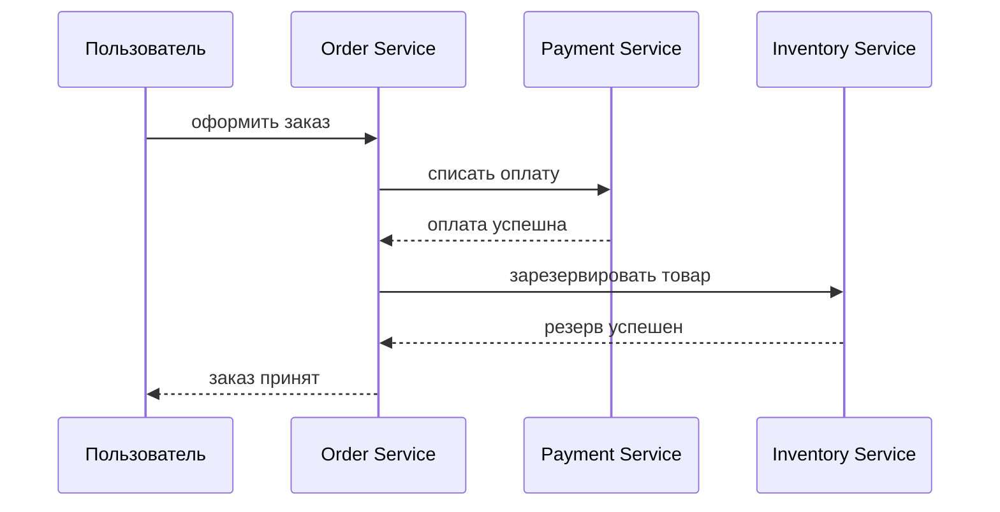

Пока всё работает, заказ можно подтвердить сразу. Но каждый сервис фиксирует изменения у себя. Ответ «оплата успешна» может пропасть на обратном пути, когда деньги уже списаны.

## Разбор на примере заказа {#worked-example-заказ-сохранен-событие-потеряно}

### Ситуация

`Order Service` принял заказ № 42. Оплате нужно получить событие `OrderCreated`, даже если сервис заказов больше не запустится на той же машине.

### Наивное решение

Сохраним заказ, затем вызовем `publish`. Пока сервис жив, он может повторить вызов после ошибки.

### Что ломается

Если процесс упал между двумя вызовами, заказ переживёт перезапуск, а задание на публикацию исчезнет. Поменяем вызовы местами — и получим зеркальную ошибку. Брокер уже принял событие, а вставка заказа нарушила ограничение БД и была отменена. Оплата получит команду для несуществующего заказа.

### Улучшение

В транзакции создания заказа запишем ещё одну строку — исходящее событие с постоянным идентификатором `evt-42`. Эту таблицу называют **Outbox**. Отдельный обработчик, ретранслятор, прочитает зафиксированные строки и отправит событие в брокер.

### Почему это работает

После отката обеих строк нет. После фиксации новый процесс найдёт и заказ, и поручение опубликовать событие. Если подтверждение брокера потерялось, ретранслятор отправит тот же `evt-42` ещё раз. В сервисе оплаты понадобится своё правило для дублей. А если покупатель повторит сам запрос на создание заказа, от второго заказа защитит отдельный ключ этой команды.

## Архитектуры и транзакционные границы

Границу транзакции удобно проверить одним вопросом. Если оборвать соединение с БД до `commit`, какие изменения откатятся вместе? Число процессов само по себе ответа не даёт.

| Архитектура | Что можно зафиксировать вместе в нашем магазине | Где проходит следующая граница |
|-------------|-------------------------------------------------|-------------------------------|
| Монолит с одной БД | Заказ и резерв, если код использует одну транзакцию | Вызов внешнего платёжного шлюза |
| Модульный монолит | Изменения двух модулей, если им разрешена общая транзакция в одной БД | Другое хранилище или асинхронный обработчик |
| Микросервисы со своими БД | Заказ и событие в базе Order | База Payment, брокер и база Inventory |

Микросервисы можно выпускать и масштабировать независимо. Обратная сторона этой автономии видна на схеме. У каждого сервиса есть место, где он может твёрдо сказать «сохранено».

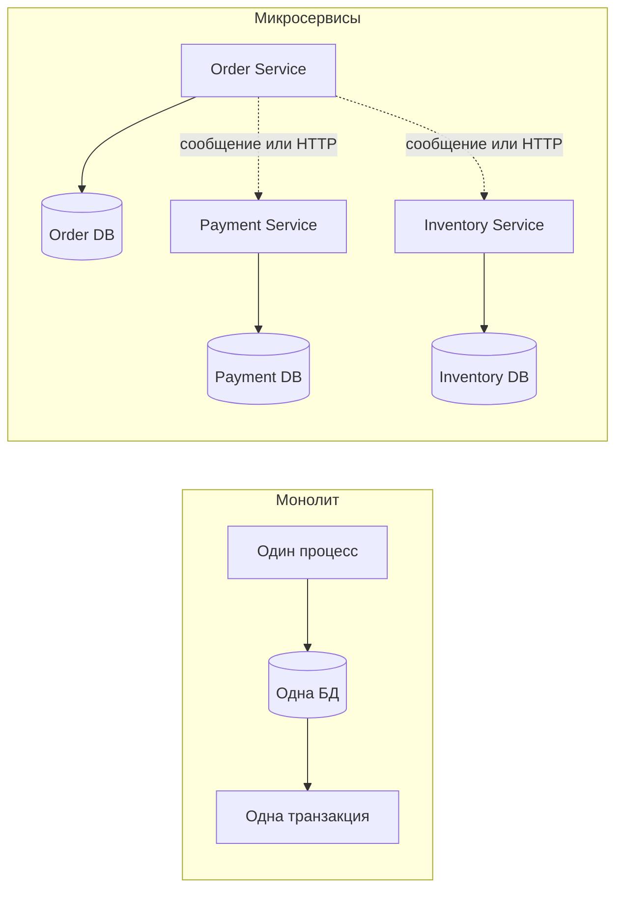

## ACID и CAP

В одной транзакции магазина действуют четыре свойства **ACID**.

| Свойство | Что это даёт заказу № 42 |
|----------|---------------------------|
| Атомарность | Заказ и строка Outbox фиксируются вместе либо обе записи откатываются. |
| Согласованность | Правила приложения и ограничения БД сохраняют инварианты. Например, ограничение `CHECK (amount > 0)` отклонит недопустимую сумму. |
| Изоляция | Уровень изоляции определяет, какие эффекты параллельных транзакций можно наблюдать. Уникальный индекс помогает двум покупателям не получить один эксклюзивный резерв. |
| Долговечность | Зафиксированные строки переживут сбой в пределах настроенных гарантий хранения БД. |

Теперь представьте две реплики склада, которые перестали обмениваться сообщениями. На одной покупатель уже забрал последний товар. Что ответит вторая на запрос об остатке? Именно к такому разрыву связи относится **CAP**. В модели Гилберта и Линч свойство C означает линеаризуемость чтений и записей одного объекта. Свойство A требует, чтобы каждый запрос к работающему узлу в итоге получил результат операции. P допускает потерю связи между группами узлов.

Во время разделения нельзя гарантировать сразу C и A. Реплика может ждать сведений о записи или отказать в обслуживании, сохранив гарантию свежести успешных чтений. Если же она обязана ответить своим локальным значением, оно может оказаться устаревшим. Для каталога такая цена часто приемлема. Подтверждать последнюю единицу товара по устаревшему остатку опасно. Буква C в ACID описывает инварианты данных, а в CAP — наблюдаемый порядок операций.

## Модели согласованности

Покупатель обновил страницу заказа. Можно ли показать ему прежний статус? Зафиксируем объект сравнения — поле `status` одного заказа — и договоримся, кто его читает.

| Модель | Что вправе ожидать читатель | Пример |
|--------|------------------------------|--------|
| Строгая согласованность в смысле линеаризуемости | Операции выглядят выполненными по одной в порядке, совместимом с реальным временем | Если запись `Paid` завершилась до начала чтения и новых записей нет, чтение вернёт `Paid`. |
| Согласованность в конечном счёте (eventual consistency) | После прекращения записей и восстановления обмена реплики со временем сойдутся. Срок модель не задаёт. | Реплика пока показывает `Pending`, затем применяет обновление до `Paid`. |
| Причинная согласованность | Если вторая запись зависела от первой, наблюдатель второй видит и эффекты первой. Независимые записи могут быть видны в разном порядке. | Проекция, уже показавшая оплату, знает о создании соответствующего заказа. |
| Чтение своих записей (read-your-writes) | Сессия видит результат собственной записи или более позднюю версию. | Создатель сразу видит свой заказ. Про остальных читателей эта гарантия ничего не говорит. |

Запись в Payment и обновление страницы в Order — уже две разные операции над разными данными. Даже линеаризуемое чтение проекции вернёт старый статус, если событие ещё не обновило саму проекцию. Проследите на схеме момент получения события.

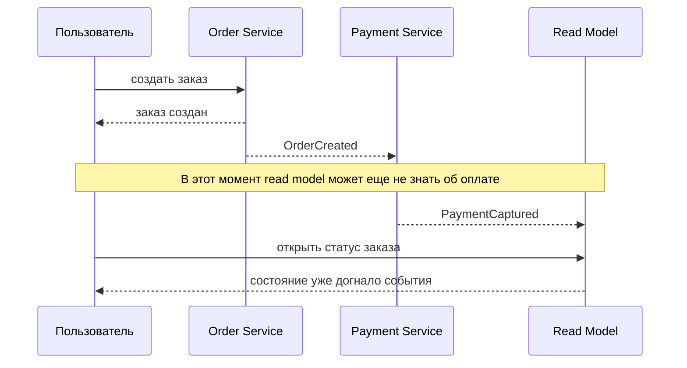

Проекцией здесь называем представление для чтения, которое сервис обновляет по событиям. Пока проекция отстаёт, страница может показать «Проверяем оплату». Повторное списание по одному лишь старому статусу превратило бы задержку отображения в финансовую ошибку.

## Где ломается межсервисное взаимодействие

Распределенная система ломается не только когда сервис "упал". Часто ломается промежуток между двумя правильными
локальными действиями.

| Сценарий | Что произошло | Чем опасно | Что применять |
|----------|---------------|------------|---------------|
| Заказ сохранен, событие не отправлено | `Order DB` получила `commit`, брокер недоступен | Оплата никогда не начнется | Transactional Outbox |
| Событие отправлено, локальная транзакция откатилась | Сообщение ушло раньше `commit` | Деньги списаны за несуществующий заказ | Публиковать событие только после локальной фиксации через Outbox |
| Сообщение доставлено дважды | Повтор, retry, потеря ack | Двойное списание | Idempotency, Inbox, deduplication |
| Ответ потерялся | Payment списал деньги, но ответ не дошел до Order | Отправитель не знает, повторять ли операцию | Idempotency key, запрос статуса, retry с тем же ключом |
| Зависимый сервис недоступен | Payment или Inventory не отвечает | Поток зависает или накапливает ошибки | Timeout, retry с backoff, circuit breaker |
| Два пользователя конкурируют за ресурс | Оба хотят последний товар или автомобиль | Ложное обещание ресурса | Атомарная проверка остатка и резерв у владельца ресурса |

Здесь метод сохранения возвращает управление после локального commit. Представьте остановку процесса перед следующей строкой.

::: multi-code "Двойная запись. Сбой между сохранением и публикацией" {playground=off}

```kotlin
fun createOrder(order: Order) {
    db.save(order)           // commit прошёл
    broker.publish("OrderCreated", order.id)  // таймаут → исход публикации неизвестен
}
```

```csharp
public void CreateOrder(Order order)
{
    _db.Save(order);           // commit прошёл
    _broker.Publish("OrderCreated", order.Id);  // таймаут → исход публикации неизвестен
}
```

```java
void createOrder(Order order) {
    db.save(order);           // commit прошёл
    broker.publish("OrderCreated", order.id()); // таймаут → исход публикации неизвестен
}
```

```go
func (s *OrderService) CreateOrder(order Order) error {
    if err := s.db.Save(order); err != nil {
        return err
    }
    return s.broker.Publish("OrderCreated", order.ID) // таймаут → исход публикации неизвестен
}
```

:::

Решение — Transactional Outbox: запись заказа и outbox-события в одной локальной транзакции (см. [раздел ниже](#transaction-outbox)).

Пример опасной двойной записи на диаграмме:

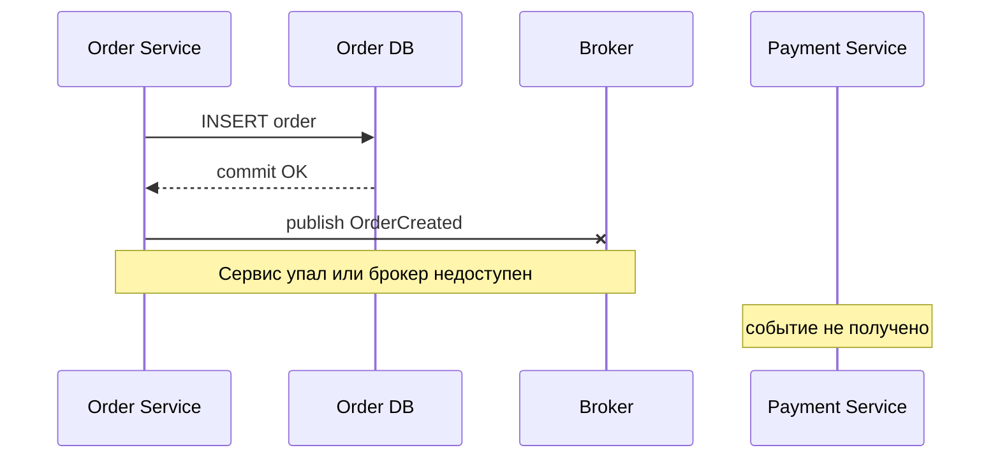

Пример еще хуже: событие ушло до того, как локальная транзакция действительно зафиксировалась.

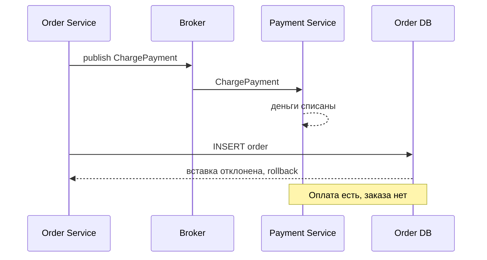

Таймаут ограничивает ожидание ответа. Повтор с увеличивающейся паузой (backoff) даёт сервису время восстановиться. При массовых ошибках circuit breaker временно прекращает вызовы, а bulkhead ограничивает долю общих ресурсов, которую может занять один зависимый сервис. Для команды списания все эти меры оставляют открытым один вопрос: как распознать уже проведённый платёж?

## Синхронный вызов или брокер

До выбора конкретного паттерна нужно решить, как сервисы вообще общаются. Синхронный HTTP/gRPC-вызов и асинхронное
сообщение через брокер решают разные задачи.

| Критерий | Синхронный вызов | Сообщение через брокер |
|----------|------------------|------------------------|
| Ответ пользователю | Можно сразу вернуть результат downstream-сервиса | Чаще возвращается промежуточный статус |
| Связность | Отправитель зависит от доступности получателя прямо сейчас | Получатель может обработать событие позже |
| Отказы | Ограничиваем ожидание, повторяем безопасные операции | Планируем повторную доставку, наблюдаем за отставанием получателя |
| Подходит для | Быстрых запросов и чтения текущего состояния | Событий, фоновых процессов и eventual consistency |
| Главный риск | Каскадная задержка или падение цепочки | Дубли, отставание, сложнее отлаживать порядок событий |

Правило грубое, но полезное: если пользователю действительно нужен немедленный ответ от другого сервиса, синхронный
вызов может быть уместен. Если нужно надежно сообщить о факте и можно обработать его позже, лучше подходит событие через
брокер. При этом оба варианта требуют идемпотентности: HTTP-запрос тоже могут повторить после таймаута, хотя первое
выполнение уже успело изменить состояние.

## Гарантии доставки сообщений

Когда сервисы общаются через брокер, важно различать гарантию доставки и гарантию бизнес-эффекта.

| Гарантия | Что обещает | Что не обещает | Что должен сделать потребитель |
|----------|-------------|----------------|--------------------------------|
| `at most once` | На выбранном участке сообщение доставят не более одного раза | Успешную доставку | Допускать пропуск или восстанавливать данные из другого источника |
| `at least once` | При сохранности сообщения, восстановлении участников и продолжении повторов сообщение будет доставлено | Отсутствие дублей и предельное время ожидания | Безопасно обрабатывать повтор |
| `exactly once` | Один видимый результат в оговорённой транзакционной области | Однократность внешних эффектов | Установить, какие записи и подтверждения входят в эту область |

Например, при обработке из одного топика Kafka в другой позицию чтения и выходные записи можно зафиксировать одной транзакцией Kafka. Получатели с `read_committed` видят только зафиксированный выход. Вызов платёжного API в теле того же обработчика живёт по правилам платёжного API.

Для дальнейших примеров договоримся об условиях. Брокер сохраняет принятые сообщения в нужной очереди, получатель вручную подтверждает обработку, сервисы восстанавливаются и продолжают повторы. Подтверждение публикации **от брокера отправителю** и подтверждение обработки **от получателя брокеру** — два независимых сообщения. Успех первого ничего не говорит о списании.

## Идемпотентность

Идемпотентная операция может быть выполнена несколько раз с тем же ключом, но бизнес-эффект будет как от одного
выполнения. Для платежа это значит: повтор сообщения с тем же `idempotencyKey` не должен списать деньги второй раз.

Дедупликация сообщения и идемпотентность близки, но это не одно и то же:

- дедупликация говорит "этот `messageId` уже видели";
- идемпотентность говорит "эта бизнес-операция с этим `idempotencyKey` уже применена".

На практике часто нужны оба ключа: `messageId` для транспорта и `idempotencyKey` для бизнес-действия.

| Ситуация | Что может совпасть | Что проверять |
|---|---|---|
| Брокер доставил одно и то же сообщение повторно | `messageId` | Таблица/хранилище обработанных сообщений |
| Клиент повторил команду после timeout | `idempotencyKey` | Бизнес-операция уже применена или находится в процессе |
| Сообщение переупаковали и отправили заново | `messageId` может измениться | `idempotencyKey` должен остаться тем же |
| Разные платежи одного заказа | `orderId` совпадает | У каждого списания должен быть свой ключ операции |

Прогоните три доставки в Kotlin Playground. Сначала приходит `msg-1`, затем брокер доставляет его ещё раз, а клиент присылает ту же команду в новом конверте `msg-2`. Во всех случаях сумма и ключ операции совпадают. Проверьте, что в отчёте одна запись на 300 рублей. Для отдельного платежа по тому же заказу понадобятся новый конверт и новый ключ операции. Здесь «списание» — запись в списке, все вызовы последовательны и выполняются в одном процессе.

::: multi-code "Idempotent consumer: оплата списывается один раз"

```kotlin
data class PaymentCommand(
    val messageId: String,
    val idempotencyKey: String,
    val orderId: String,
    val amount: Int
)

class PaymentConsumer {
    private val processedKeys = mutableSetOf<String>()
    private val charges = mutableListOf<String>()

    fun handle(command: PaymentCommand) {
        if (!processedKeys.add(command.idempotencyKey)) return
        charges += "charged ${command.amount} for ${command.orderId}"
    }
}
```

```kotlin playground
data class PaymentCommand(
    val messageId: String,
    val idempotencyKey: String,
    val orderId: String,
    val amount: Int
)

class PaymentConsumer {
    private val processedKeys = mutableSetOf<String>()
    private val charges = mutableListOf<String>()

    fun handle(command: PaymentCommand) {
        if (!processedKeys.add(command.idempotencyKey)) {
            println("duplicate ignored: ${command.idempotencyKey}")
            return
        }

        charges += "charged ${command.amount} for ${command.orderId}"
        println("payment captured: ${command.amount}")
    }

    fun report(): List<String> = charges.toList()
}

fun main() {
    val consumer = PaymentConsumer()
    val first = PaymentCommand("msg-1", "pay-order-42", "order-42", 300)
    val duplicate = first.copy(messageId = "msg-2")

    consumer.handle(first)
    consumer.handle(first)     // повторная доставка того же конверта
    consumer.handle(duplicate) // новый конверт, прежнее поручение
    check(consumer.report().size == 1)

    println("charges: ${consumer.report()}")
}
```

```csharp
public sealed record PaymentCommand(
    string MessageId,
    string IdempotencyKey,
    string OrderId,
    int Amount
);

public sealed class PaymentConsumer
{
    private readonly HashSet<string> _processedKeys = new();
    private readonly List<string> _charges = new();

    public void Handle(PaymentCommand command)
    {
        if (!_processedKeys.Add(command.IdempotencyKey))
            return;

        _charges.Add($"charged {command.Amount} for {command.OrderId}");
    }
}
```

```java
import java.util.ArrayList;
import java.util.HashSet;
import java.util.List;
import java.util.Set;

record PaymentCommand(
    String messageId,
    String idempotencyKey,
    String orderId,
    int amount
) {}

final class PaymentConsumer {
    private final Set<String> processedKeys = new HashSet<>();
    private final List<String> charges = new ArrayList<>();

    void handle(PaymentCommand command) {
        if (!processedKeys.add(command.idempotencyKey())) {
            return;
        }

        charges.add("charged " + command.amount() + " for " + command.orderId());
    }
}
```

```go
package main

import "fmt"

type PaymentCommand struct {
    MessageID      string
    IdempotencyKey string
    OrderID        string
    Amount         int
}

type PaymentConsumer struct {
    processedKeys map[string]bool
    charges       []string
}

func NewPaymentConsumer() *PaymentConsumer {
    return &PaymentConsumer{processedKeys: map[string]bool{}}
}

func (c *PaymentConsumer) Handle(command PaymentCommand) {
    if c.processedKeys[command.IdempotencyKey] {
        return
    }
    c.processedKeys[command.IdempotencyKey] = true
    c.charges = append(c.charges, fmt.Sprintf("charged %d for %s", command.Amount, command.OrderID))
}
```

:::

Для реального платежа сохраните ключ операции с уникальным ограничением, параметрами и результатом. При повторе с той же суммой верните тот же результат или текущий статус. При том же ключе и другой сумме сообщите о конфликте. Срок хранения ключа должен покрывать предусмотренный период повторов. У коллекции в примере нет ни такой проверки, ни защиты от рестарта. Ниже разберём атомарную запись эффекта и ключа в БД получателя.

## Transactional Outbox {#transaction-outbox}

Проблема двойной записи возникает, когда одна бизнес-операция требует двух независимых действий:

1. сохранить данные в своей БД;
2. отправить событие в брокер.

Между этими действиями сервис может упасть. Transactional Outbox решает это так: бизнес-данные и исходящее сообщение
записываются в одной локальной транзакции одной БД. Отдельный ретранслятор позже прочитает outbox и отправит сообщение в
брокер.

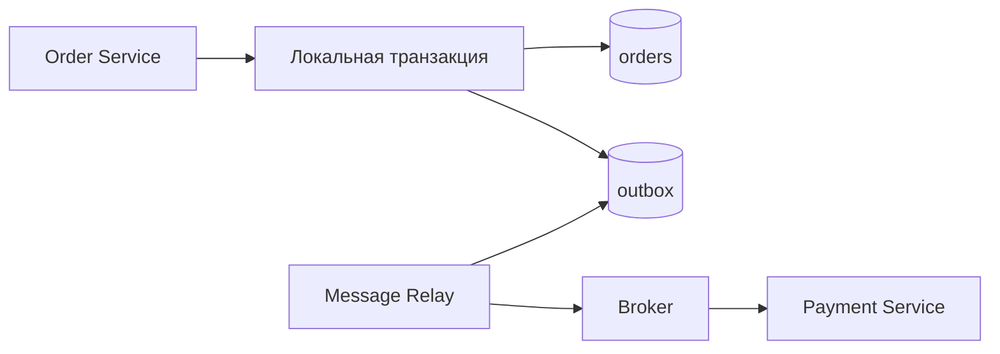

Типичная outbox-запись:

| Поле | Зачем нужно |
|------|-------------|
| `id` | Уникальный идентификатор сообщения |
| `aggregateId` | ID сущности, например заказа |
| `type` | Тип события: `OrderCreated`, `PaymentRequested` |
| `payload` | Данные события |
| `createdAt` | Когда событие записали |
| `publishedAt` | Когда ретранслятор сохранил подтверждение публикации (для варианта с опросом таблицы) |
| `attempts` | Сколько раз пытались отправить |

В Lamoda тот же разрыв проявился при отмене доставки. Резерв интервала уже увеличил счётчик занятых мест. Если потерять команду освобождения, магазин продаст меньше доставок, чем может выполнить. А повторное вычитание без проверки резерва исказит остаток в другую сторону. [Разбор команды Lamoda](https://habr.com/ru/companies/lamoda/articles/678932/).

В приложении оба репозитория должны работать через один объект транзакции. Ниже `insertOrder` и `insertEvent` обозначают вставки через переданное соединение. Обёртка фиксирует обе записи при успехе и откатывает при ошибке. Идентификатор `evt-42` создаётся один раз для события. Ретранслятор возьмёт его из сохранённой строки.

В Playground можно прервать операцию между двумя вставками. Модель готовит новое состояние и делает его видимым только при успешном завершении. Внешний наблюдатель должен увидеть сначала ноль заказов и событий, а после успешной попытки — по одному. Реальную транзакцию БД можно проверить следующим SQL-примером.

::: multi-code "Две записи в одной транзакции БД"

```kotlin
db.transaction { tx ->
    tx.insertOrder(order)
    tx.insertEvent(event)
}
```

```kotlin playground
data class Store(val orders: Set<Int> = emptySet(), val outbox: Set<String> = emptySet())

fun createOrder(before: Store, id: Int, failBeforeEvent: Boolean): Store {
    val orders = before.orders + id
    check(!failBeforeEvent) { "сбой перед записью события" }
    return Store(orders, before.outbox + "evt-$id")
}

fun main() {
    var committed = Store()
    val failed = runCatching { committed = createOrder(committed, 42, true) }
    check(failed.isFailure && committed.orders.isEmpty() && committed.outbox.isEmpty())
    println("После сбоя: ${committed.orders.size} заказов, ${committed.outbox.size} событий")

    committed = createOrder(committed, 42, false)
    check(committed == Store(setOf(42), setOf("evt-42")))
    println("После фиксации: ${committed.orders}, ${committed.outbox}")
}
```

```csharp
using var tx = connection.BeginTransaction();
InsertOrder(connection, tx, order);
InsertEvent(connection, tx, evt);
tx.Commit();
```

```java
db.inTransaction(tx -> {
    tx.insertOrder(order);
    tx.insertEvent(event);
});
```

```go
func createOrder(ctx context.Context, db *sql.DB, order Order, event Event) error {
    tx, err := db.BeginTx(ctx, nil)
    if err != nil {
        return err
    }
    defer tx.Rollback()
    if err := insertOrder(ctx, tx, order); err != nil {
        return err
    }
    if err := insertEvent(ctx, tx, event); err != nil {
        return err
    }
    return tx.Commit()
}
```

:::

Проверьте границу в пустой тестовой базе. Выполните тот же опыт ещё раз с `COMMIT` вместо `ROLLBACK`. В первом случае счётчики должны быть `0, 0`, во втором — `1, 1`. Брокер для этой проверки не нужен.

```sql
CREATE TABLE orders (id INTEGER PRIMARY KEY);
CREATE TABLE outbox (id VARCHAR(40) PRIMARY KEY, order_id INTEGER REFERENCES orders(id));
BEGIN;
INSERT INTO orders VALUES (42);
INSERT INTO outbox VALUES ('evt-42', 42);
ROLLBACK;
SELECT (SELECT COUNT(*) FROM orders), (SELECT COUNT(*) FROM outbox);
```

::: only go
В `database/sql` важно передать в обе функции именно `*sql.Tx`. Если одна из них выполнит вставку через исходный `*sql.DB`, драйвер может взять другое соединение и зафиксировать запись отдельно. Отложенный `Rollback` освобождает транзакцию при раннем выходе.
:::

::: only csharp
В примере ADO.NET одного открытого соединения недостаточно. Для каждой команды задайте ту же `DbTransaction` через свойство `Transaction` до выполнения. Тогда ошибка второй вставки позволит откатить первую.
:::

Атомарность сохранения мы проверили. Сколько раз брокер получит `evt-42`, зависит от того, в какой момент остановится ретранслятор.

## Ретранслятор сообщений

На схеме ретранслятор опрашивает таблицу. Посмотрите, кто отправляет подтверждение и когда появляется последняя запись в базе заказов.

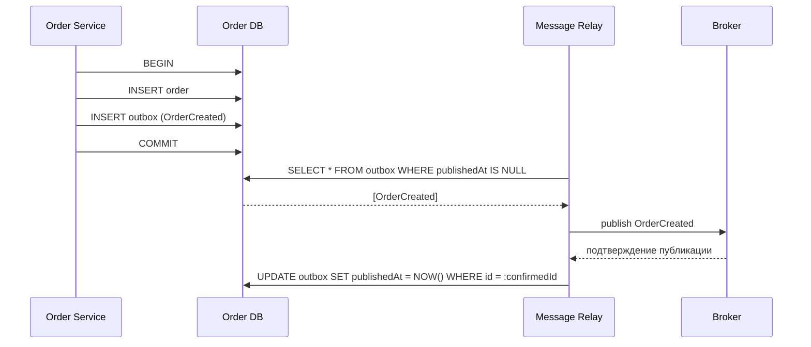

Остановим ретранслятор в разных местах. Здесь `publishedAt` — отметка конкретной строки в варианте с опросом таблицы.

| Момент остановки | Что известно после запуска | Действие |
|------------------|----------------------------|----------|
| После commit заказа, до отправки | Строка ожидает публикации | Отправить `evt-42`. |
| После отправки, подтверждение не пришло | Брокер мог уже принять событие | Повторить с тем же ID. Возможен дубль. |
| После подтверждения брокера, до commit отметки | По таблице событие всё ещё ожидает отправки | Повторить. Именно здесь дубль возможен даже при исправном брокере. |
| После commit отметки | Подтверждение сохранено | Обычный опрос пропустит строку. Получатель при этом может ещё не приступить к работе. |

Отметив строку до подтверждения, можно навсегда пропустить событие. Даже полученное подтверждение следует трактовать по договору конкретного брокера: для надёжного маршрута важны настройка хранения и обработка сообщений, не попавших ни в одну очередь.

**Проверка на двух заказах.** У ретранслятора готовы `evt-41` и `evt-42`. Брокер подтвердил только первое событие. После записи отметки и перезапуска запрос ожидающих строк должен вернуть `evt-42`. По этому результату можно обнаружить ошибку, когда одна операция `UPDATE` случайно помечает всю очередь.

Есть два распространённых способа найти события для отправки.

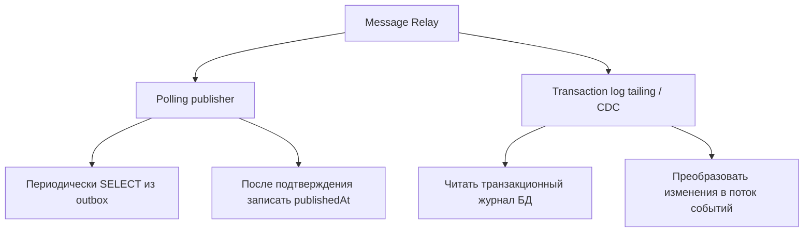

| Подход | Простота | Задержка | Нагрузка на БД | Требования к БД | Эксплуатационная сложность |
|--------|----------|----------|----------------|-----------------|----------------------------|
| Polling publisher | Высокая | Зависит от интервала опроса | Может быть заметной при частом polling | Нужна обычная таблица outbox | Низкая или средняя |
| Transaction log tailing / CDC | Ниже | Обычно меньше | Меньше лишних запросов к outbox | БД должна отдавать журнал изменений | Средняя или высокая |

При чтении журнала прогрессом служит сохранённая позиция в нём. Потеря позиции после отправки тоже может привести к повтору. Если для одного заказа важен порядок версий, присвойте им последовательные номера и обеспечьте порядок публикации и обработки для этого заказа. Один лишь `createdAt` и несколько параллельных отправителей этого не обеспечат.

В варианте с CDC (change data capture, захват изменений данных) коннектор, например Debezium, извлекает вставленную строку события из журнала транзакций. Следите, чтобы нужные записи оставались в журнале, пока коннектор их не прочитает.

::: details Когда можно очистить Outbox?
При опросе таблицы можно хранить дату подтверждения, число попыток и последнюю ошибку. Неподтверждённая старая запись — повод проверить доступность брокера или причину отказа. Подтверждённые строки архивируют по правилам хранения. Если оператор повторно публикует их для восстановления сервиса, он должен учитывать срок хранения ключей у получателя.
:::

## Transaction Inbox

Брокер доставил `evt-42` двум экземплярам одного обработчика. Если каждый сначала сделает `SELECT`, оба могут увидеть «ещё не было» и списать по 300 рублей. Для **Inbox** заведём таблицу с первичным ключом `(consumer, message_id)`. Имя логического потребителя одно у всех его экземпляров. У склада оно другое: склад имеет право самостоятельно обработать то же событие.

1. Получив сообщение, Payment открывает транзакцию и пытается вставить ключ. Например, в PostgreSQL `INSERT … ON CONFLICT (consumer, message_id) DO NOTHING RETURNING message_id` вернёт строку только тому, кто вставил её.
2. При новой вставке Payment записывает локальный платёж и при необходимости исходящее событие в **той же транзакции**. Уникальный ключ самой платёжной операции защищает также от нового конверта с другим ID. При известном платеже обработчик сверяет параметры и использует сохранённый результат.
3. Если Inbox уже содержит ключ, обработчик пропускает эффект. После успешного завершения транзакции он посылает брокеру подтверждение обработки (`ack`). При ошибке БД оставляет доставку неподтверждённой.

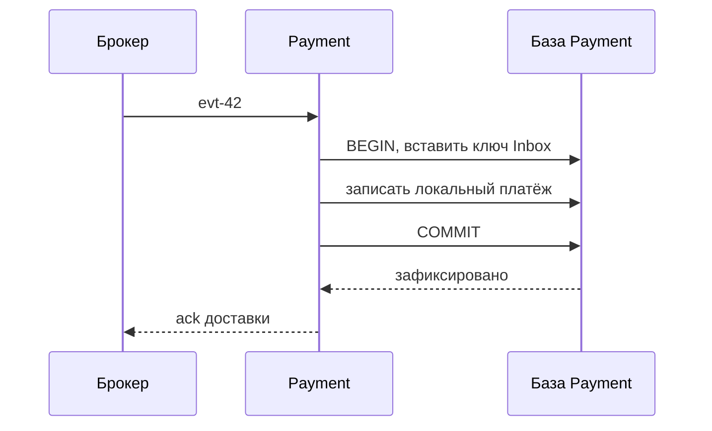

При сбое **до commit** БД откатывает и ключ, и локальный платёж. Повтор выполнит работу. При сбое **после commit, до получения ack брокером** обе строки остаются. Брокер повторит доставку, и проверка ключа остановит второе списание. После получения ack брокер считает эту доставку завершённой. Если послать ack заранее, сбой перед commit оставит магазин без платежа и без ожидаемой повторной доставки.

А если списывает внешний банк? Локальная БД не откатит сетевой вызов. Запишите намерение и стабильный ключ платежа, передавайте тот же ключ шлюзу при всех разрешённых повторах и сохраняйте результат сверки. Когда ответ потерялся, платёж остаётся «уточняется». Если шлюз не поддерживает ни распознавание повтора, ни надёжный запрос статуса, автоматический повтор небезопасен. Нужна сверка с провайдером. Хранение одного ключа в Inbox это окно не закрывает.

## Распределенные транзакции и 2PC

Допустим, две базы должны принять единое решение о фиксации перевода. Если обе поддерживают двухфазную фиксацию (**2PC**, two-phase commit), координатор сначала просит участников подготовиться. Голос `ready` — устойчивое обещание выполнить итоговое решение. Получив все голоса за фиксацию, координатор записывает решение `commit` в устойчивый журнал и сообщает его участникам. Если участник голосует против или координатор прекращает ждать недостающий голос до фиксации решения, координатор выбирает `abort`. Итог один для всех, хотя сообщения придут в разное время.

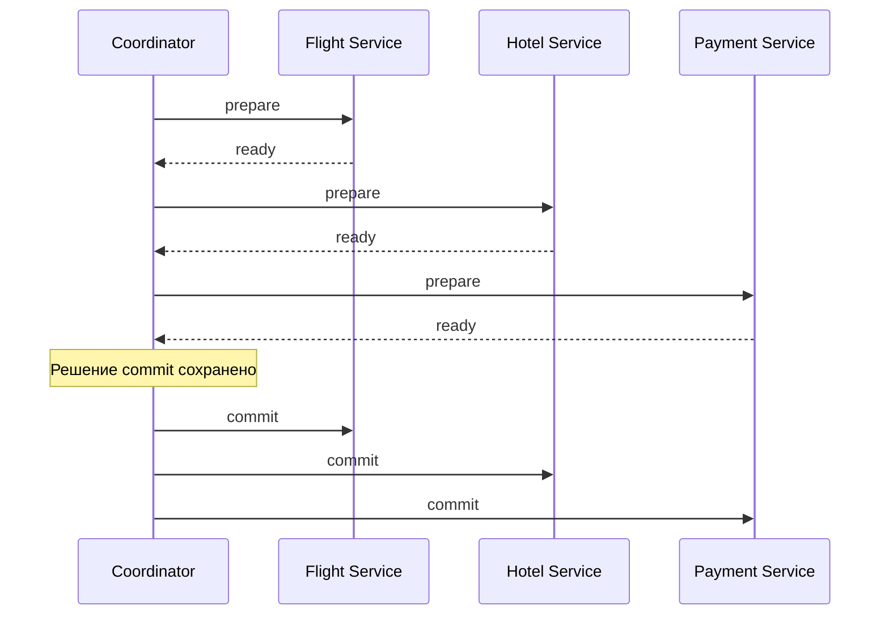

2PC даёт атомарный итог у совместимых участников. За изоляцию отвечает отдельный механизм управления конкуренцией. Цена единого решения — каждый подготовленный участник должен хранить состояние транзакции и может удерживать блокировки, пока не узнает исход. У обычного платёжного HTTP API чаще всего нет операций подготовки и фиксации для внешнего координатора.

Представим, что координатор отказал между `prepare` и `commit`. Участники уже ответили `ready` и держат
блокировки, но команды `commit` не было:

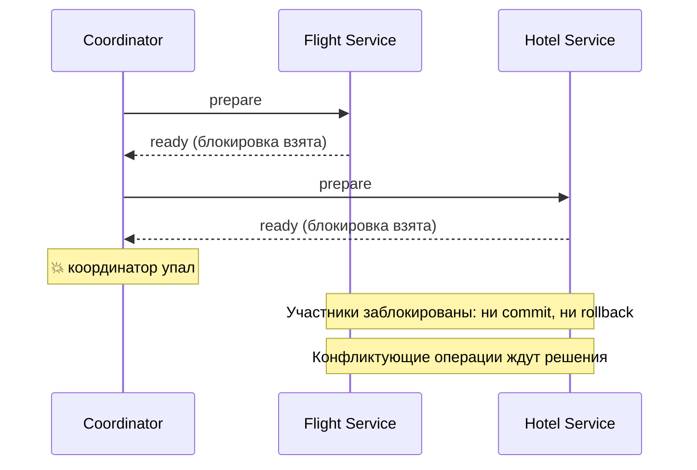

Подготовленный участник не может сам выбрать исход по таймауту. Если решение уже записано, восстановившийся координатор повторяет его участникам. Если решения ещё не было, координатор завершает протокол по своему устойчивому журналу. В частности, в обычном 2PC при отсутствии записи о принятом решении он может выбрать отмену. Для авиакомпании, отеля и платёжного API такой общий протокол обычно отсутствует. Посмотрим, как устроить поездку на уже доступных операциях брони и отмены.

## Saga

Пользователь бронирует отпуск: рейс Москва → Стамбул, отель на пять ночей, автомобиль на месте. Рейс и отель подтвердили бронь. Прокат прислал окончательный ответ «машин на эти даты нет». Если поездка без автомобиля пользователю не подходит, у нас остаются две настоящие брони, которые нужно отменить.

**Saga** разбивает долгий процесс на локальные транзакции. У каждого подтверждённого шага есть результат, например номер брони. Если бизнес-правило требует отменить поездку, **компенсация** создаёт новую операцию по этому номеру. Она может иметь собственную цену: отмена авиабилета по тарифу вернёт деньги за вычетом сбора.

В исходной работе о Saga авторы приводят пример с местами в самолёте. Пока мы отменяли свою бронь, соседнее место мог занять другой пассажир. Восстановление прежнего числа свободных мест затронуло бы и его покупку. Поэтому освобождаем ровно своё место. Для маршрута ниже предполагаем тарифы, допускающие отмену.

| Шаг | Локальная транзакция | Компенсация |
|-----|----------------------|-------------|
| 1 | `BookFlight` | `CancelFlight` |
| 2 | `BookHotel` | `CancelHotel` |
| 3 | `ReserveCar` | `ReleaseCar` |
| 4 | `ChargePayment` | `RefundPayment` |

Сравните два ответа проката. Ответ «нет машин» позволяет начать отмену отеля. Молчание в течение 30 секунд оставляет открытыми обе возможности — машина забронирована или запрос ещё не обработан. В таком случае сначала выясняем результат по ключу шага либо безопасно повторяем команду с тем же ключом.

В примере вход — результат шага бронирования машины, сохранённый в журнале поездки. Рейс и отель уже подтверждены. Функция выбирает следующее поручение оркестратора. В Playground проверьте все три исхода.

::: multi-code "Что делать с уже подтверждёнными бронями"

```kotlin
enum class CarReply { RESERVED, UNAVAILABLE, UNKNOWN }

fun next(reply: CarReply): String = when (reply) {
    CarReply.RESERVED -> "ChargePayment"
    CarReply.UNAVAILABLE -> "CancelHotel"
    CarReply.UNKNOWN -> "CheckCarStatus"
}
```

```kotlin playground
enum class CarReply { RESERVED, UNAVAILABLE, UNKNOWN }

fun next(reply: CarReply): String = when (reply) {
    CarReply.RESERVED -> "ChargePayment"
    CarReply.UNAVAILABLE -> "CancelHotel"
    CarReply.UNKNOWN -> "CheckCarStatus"
}

fun main() {
    check(next(CarReply.UNKNOWN) == "CheckCarStatus")
    check(next(CarReply.UNAVAILABLE) == "CancelHotel")
    check(next(CarReply.RESERVED) == "ChargePayment")
    for (reply in CarReply.values()) println("$reply -> ${next(reply)}")
}
```

```csharp
enum CarReply { Reserved, Unavailable, Unknown }

static class Trip
{
    public static string Next(CarReply reply) => reply switch
    {
        CarReply.Reserved => "ChargePayment",
        CarReply.Unavailable => "CancelHotel",
        CarReply.Unknown => "CheckCarStatus",
        _ => throw new ArgumentOutOfRangeException(nameof(reply))
    };
}
```

```java
enum CarReply { RESERVED, UNAVAILABLE, UNKNOWN }

final class Trip {
    static String next(CarReply reply) {
        return switch (reply) {
            case RESERVED -> "ChargePayment";
            case UNAVAILABLE -> "CancelHotel";
            case UNKNOWN -> "CheckCarStatus";
        };
    }
}
```

```go
type CarReply int

const (
    Unknown CarReply = iota
    Reserved
    Unavailable
)

func next(reply CarReply) string {
    switch reply {
    case Reserved:
        return "ChargePayment"
    case Unavailable:
        return "CancelHotel"
    default:
        return "CheckCarStatus"
    }
}
```

:::

При отказе проката в нашем маршруте сначала отменяем отель, после подтверждения — рейс. Если отель уже отменил бронь, а ответ потерялся, повторяем отмену по тому же ключу или запрашиваем её статус. Только подтверждение всех требуемых компенсаций позволяет показать пользователю «Поездка отменена».

## Choreography и Orchestration

Saga бывает двух основных видов.

При **хореографии** (choreography) сервисы публикуют события и реагируют на события соседей. В магазине Payment реагирует на создание заказа, Inventory — на подтверждение платежа. Кто примет решение о возврате, если склад откажет? Это правило тоже должно принадлежать конкретному обработчику.

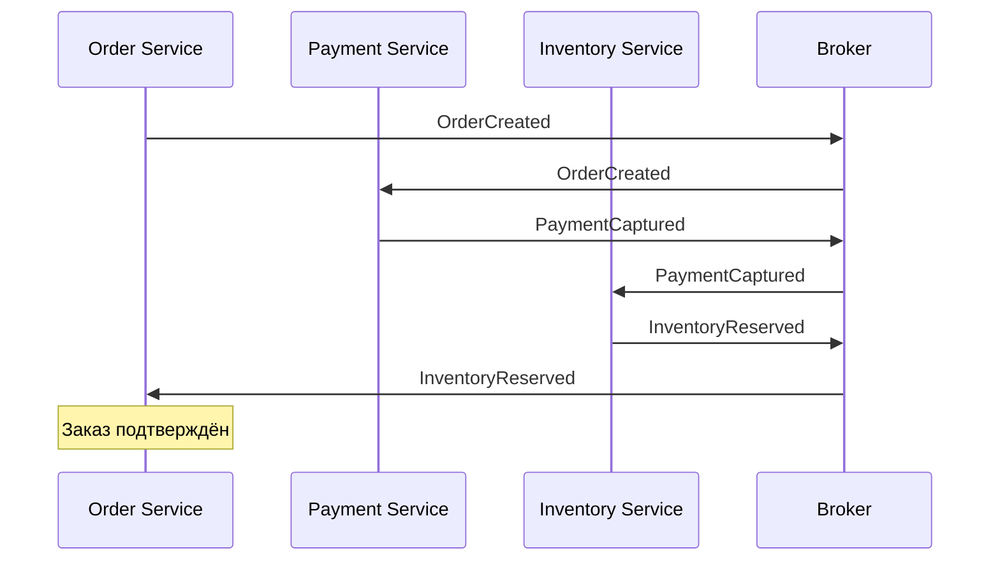

При **оркестрации** (orchestration) оркестратор хранит состояние заказа и явно назначает следующий шаг. Участники по-прежнему проверяют собственные правила и возвращают результат.

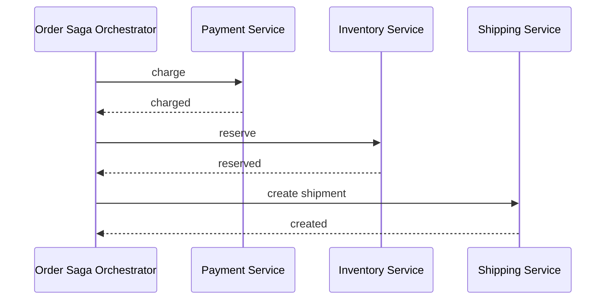

| Критерий | Choreography | Orchestration |
|----------|--------------|---------------|
| Где логика процесса | Распределена между обработчиками событий | В оркестраторе |
| Связность | Через события | Через команды оркестратора и ответы участников |
| Наблюдаемость всего процесса | Сложнее | Проще |
| Изменение порядка шагов | Требует правок нескольких сервисов | Чаще сосредоточено в оркестраторе |
| Когда выбирать | Короткий стабильный процесс | Длинный или часто меняющийся процесс |

Выбирайте по тому, где удобнее восстановить историю конкретного заказа. В хореографии для этого придётся собрать цепочку событий по одному идентификатору. В оркестрации маршрут виден в одном журнале, зато появляется компонент, восстановление которого нужно спроектировать.

### Что переживёт перезапуск оркестратора

Вернёмся к поездке `trip-7`. Сохраним в БД оркестратора номер поездки, состояние шага, ключ команды, номера подтверждённых броней и историю компенсаций. Для команды на резерв автомобиля ключом будет `trip-7/car/reserve`. У отмены свой ключ. Данные о состоянии и очередное поручение в Outbox фиксируются в одной транзакции.

| Что произошло | Что увидит восстановленный оркестратор | Как продолжить |
|---------------|----------------------------------------|----------------|
| Упал до фиксации шага и команды | Предыдущее состояние, команды в Outbox нет | Повторить переход из предыдущего состояния. |
| Зафиксировал поручение и упал до отправки | Ожидание ответа проката, команда в Outbox | Ретранслятор доставит сохранённое поручение. |
| Прокат сохранил бронь, ответ ещё не записан у оркестратора | Ожидание ответа по прежнему ключу | Участник возвращает сохранённый результат при повторе либо сообщает статус. Создавать вторую бронь нельзя. |
| Получил ответ и зафиксировал следующий шаг, но упал до ack ответа | Следующий шаг и его команда уже сохранены | Повтор ответа распознаётся по Inbox и состоянию шага. Второй переход не нужен. |
| Начал отмену, подтверждение потерялось | Незавершённая компенсация с ключом и номером брони | Возобновить сверку или повтор этой отмены. После исчерпания автоматических попыток передать оператору историю и ключ. |

Состояние «ждём ответ» переживает перезапуск. На стороне проката запись брони, ключа и исходящего ответа тоже должна переживать сбой. Если придёт устаревший ответ, обработчик сверит ключ шага и ожидаемое состояние. Это защищает, например, уже отменённую поездку от повторного перехода к оплате.

## Saga и ACID

| Свойство | Что можно обещать пользователю |
|----------|-------------------------------|
| Atomicity | Каждый локальный шаг атомарен. Другие сервисы могут увидеть его результат, даже если позже потребуется компенсация. |
| Consistency | Разработчики задают допустимые конечные и промежуточные состояния. «Возврат ожидается» и «Возврат выполнен» требуют разных оснований. |
| Isolation | Параллельные процессы видят уже зафиксированные шаги. За эксклюзивную бронь отвечает владелец ресурса. |
| Durability | Долговечность выполненного шага даёт его БД. Для продолжения процесса нужны сохранённые команды, ответы и состояние. |

Обещание «все деньги вернутся» зависит от тарифа, работоспособности участников и завершения компенсаций. Пока хотя бы одна из них ожидает сверки, поездку нельзя считать полностью урегулированной.

## Проблема изоляции

У Saga нет общей изоляции. Две параллельные Saga могут конкурировать за один ресурс и видеть состояния,
которые потом будут компенсированы.

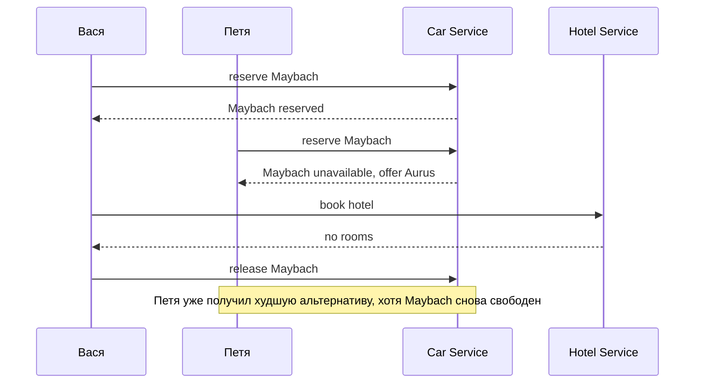

Здесь Вася выясняет доступность машины до выбора отеля. На момент запроса Пети автомобиль действительно занят. Ответ «сейчас недоступен» верен, даже если через минуту бронь Васи отменится. Если бы Петя согласился подождать, магазин мог бы сохранить продажу. Настоящий **ложный отказ** (false negative) получился бы, если резерв уже снят, а устаревшая копия всё ещё показывает машину занятой.

**Ложное подтверждение** (false positive) опаснее для этого бизнеса: два клиента получают одну машину на одни даты. Outbox может без потерь доставить оба ошибочных подтверждения. Чтобы защитить инвариант, Car Service атомарно проверяет доступность и создаёт эксклюзивный резерв. Например, для одного фиксированного слота условное изменение «свободен → занят» должно затронуть одну строку только у победителя. Для пересекающихся интервалов необходимо проверять пересечение во всём диапазоне дат.

У временного резерва есть срок (TTL) и собственный идентификатор. Подтверждение допустимо, только пока резерв действителен и принадлежит этой поездке. Запоздалая отмена резерва Васи также проверяет его идентификатор, иначе можно освободить уже выданную Пете машину. Если состояние неизвестно, можно показать «Проверяем бронь» и дать пользователю выбор, ждать или искать другую машину.

## Практические правила выбора паттерна

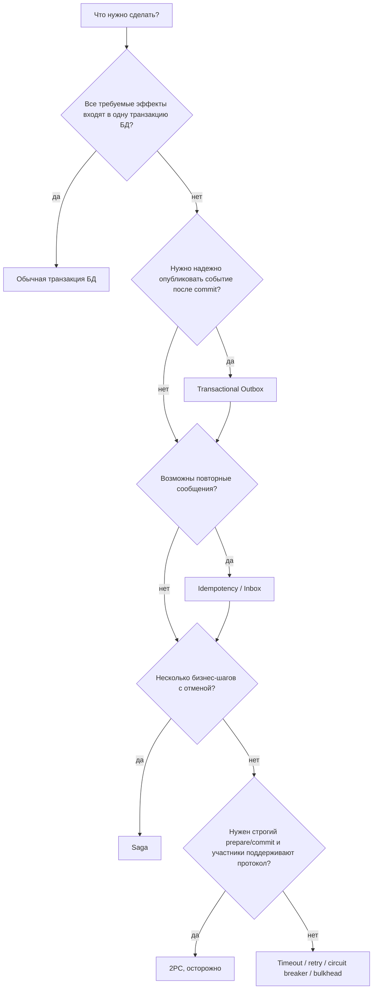

| Симптом | Паттерн | Что остается проверить |
|---------|---------|------------------------|
| Событие может не уйти после локального commit | Transactional Outbox | Как ретранслятор повторяет публикацию и как помечает успех |
| Потребитель может получить дубль | Idempotency, Inbox | Где хранится ключ и есть ли уникальный индекс |
| Нужна цепочка шагов с отменой | Saga | Какие шаги обратимы, когда допустим необратимый шаг и как завершить процесс после него |
| Нужно ждать внешний сервис | Timeout + retry | Не усилит ли retry нагрузку и есть ли backoff |
| Зависимый сервис отвечает ошибкой на большинство запросов | Circuit breaker | Что отвечает сервис в открытом состоянии |
| Один ресурс бронируют параллельно | Условное создание резерва | Проверяются ли владелец и срок при подтверждении |

## Наблюдаемость и эксплуатация

Паттерн без наблюдаемости часто превращается в скрытую очередь проблем. Минимальный набор технических маркеров:

- `correlationId` — связывает пользовательский запрос, события и логи;
- `messageId` — идентифицирует конкретное сообщение;
- `idempotencyKey` — идентифицирует бизнес-операцию;
- `sagaId` — идентифицирует экземпляр долгого процесса;
- `attempts` и `lastError` — показывают число попыток и причину последнего сбоя;
- dead-letter queue — место для сообщений, которые не удалось обработать автоматически;
- оповещения о возрасте старейшей записи Outbox и шагах Saga с истёкшим сроком ожидания.

::: warning Операционный долг
Если в системе есть Outbox или Saga, но нет экрана, метрики или хотя бы запроса для поиска застрявших записей, то
команда узнает о проблеме от пользователя. Для финансовых и заказных сценариев это слишком поздно.
:::

## Чеклист проектирования

- Для каждой команды назовите владельца данных и правило, которое он проверяет при commit.
- Для каждого подтверждения укажите отправителя, получателя и запись, оставшуюся у каждого после сбоя.
- Укажите, сколько времени хранятся ключи повторов. Если старое сообщение из очереди ошибок может вернуться позже этого срока, как оператор проверит прежний результат?
- Для каждого шага поездки опишите окончательный отказ, неизвестный исход и способ отличить их после перезапуска.
- Покажите, где видны возраст старейшей ожидающей записи, просроченная бронь и незавершённый возврат.

## Резюме

У заказа № 42 три разные истории. Outbox сохраняет вместе заказ и поручение отправить событие. Inbox вместе с локальным изменением запоминает, что получатель уже обработал сообщение. Saga связывает такие локальные шаги в процесс, хранит основания для продолжения и назначает компенсации при окончательном отказе. Для списания через внешний шлюз и эксклюзивного резерва нужны гарантии непосредственно у владельцев этих операций.

Если нужно атомарно зафиксировать изменения у нескольких совместимых участников, вопрос стоит о 2PC. Если экран пользователя читает отстающую проекцию, нужно решить, какой промежуточный статус ему показать. Ускорение чтения, кэш и CQRS разбираются в [лекции 13](/lectures/13#от-кэша-к-cqrs).

## Дополнительное чтение

Материалы углубляют тему распределенных транзакций, Transactional Outbox и Saga.

### Паттерны и протоколы

- [Крис Ричардсон. Transactional Outbox](https://microservices.io/patterns/data/transactional-outbox.html) — почему после успешной публикации возможен дубль.
- [Крис Ричардсон. Idempotent Consumer](https://microservices.io/patterns/communication-style/idempotent-consumer.html) — как обработчик фиксирует ключ сообщения вместе с изменениями.
- [RabbitMQ. Consumer Acknowledgements and Publisher Confirms](https://www.rabbitmq.com/docs/confirms) — два независимых направления подтверждения.
- [Гарсиа-Молина и Салем. Sagas](https://www.cs.cornell.edu/andru/cs711/2002fa/reading/sagas.pdf) — зачем освобождать конкретную бронь при компенсации.
- [Крис Ричардсон. Saga](https://microservices.io/patterns/data/saga.html) — хореография и оркестрация на примере создания заказа.

### Из материалов лекции

- [Распределенные транзакции в условиях микросервисной архитектуры](https://www.youtube.com/watch?v=P98oMiVCnq8) — видео, которое легло в основу лекции.
- [Паттерн Outbox](https://habr.com/ru/companies/lamoda/articles/678932/) — статья о надежной публикации событий через outbox.
- [Saga: хореография и оркестрация](https://youtu.be/9vMAr9agz4k?list=PLt91xr-Pp57TN4-UN1F6JqqwhaI1T6E0b) — видео о вариантах организации Saga.

## Вопросы для самопроверки

1. Почему запись в БД и отправка события в брокер не образуют одну атомарную операцию?
2. Как Transactional Outbox меняет порядок действий при создании заказа?
3. Почему `at least once` почти всегда требует идемпотентного потребителя?
4. Чем `messageId` отличается от `idempotencyKey`?
5. Почему Inbox не является полной заменой доменной идемпотентности?
6. В чем различие между 2PC и Saga?
7. Почему компенсация в Saga не равна `rollback`?
8. Кто после отказа склада назначит возврат при хореографии и при оркестрации?
9. Какая проверка помешает позднему подтверждению использовать уже истёкший резерв?
10. Что хуже для пользователя: false negative или false positive при бронировании ресурса? Почему?

## Мини-практика

Заказ № 42 стоит 300 рублей. Payment списывает их через внешний шлюз с поддержкой ключей, Inventory резервирует последнюю единицу товара. Нарисуйте три локальные транзакции и две независимые стрелки подтверждения. Для каждой остановки запишите видимые строки, ключ повтора, следующее действие и статус для покупателя.

| Остановка или ответ | Проверяемый результат после восстановления |
|---------------------|-------------------------------------------|
| База Order откатывает создание заказа | Заказов и исходящих событий для него по нулю. |
| Ретранслятор получил подтверждение, но не успел сохранить отметку | Возможны две публикации одного `evt-42`. В Payment один результат по ключу списания. |
| Payment получил успех от шлюза, но упал до локальной фиксации результата | Сверка или безопасный повтор с тем же ключом возвращает исходное списание. Итоговая сумма 300. |
| Payment зафиксировал результат и упал до подтверждения сообщения | Повтор не меняет баланс. Брокеру можно подтвердить обработку после проверки зафиксированного результата. |
| Inventory молчит 30 секунд | Заказ остаётся в ожидании. Проверьте обе версии: резерв уже есть или запрос ещё не обработан. |
| Inventory окончательно отказал после оплаты | Начат возврат именно этого платежа. Пока ответ на возврат неизвестен, статус — «Возврат ожидается». После подтверждения есть одно списание и один возврат на 300. |

Поменяйтесь схемами с соседом. Пусть он укажет одну точку, где ранний ack потерял бы работу, и одну, где новый ключ при повторе удвоил бы списание. Если обе точки можно найти по вашей схеме без устного пояснения, границы транзакций на ней видны.
