# Лекция 13. Паттерны работы с данными

## Сквозной сценарий

Тысяча покупателей одновременно открывает карточку одной клавиатуры. У всех одинаковые фото и рейтинг, но цена зависит
от скидки покупателя, а на складе осталась одна штука. Какие данные можно собрать один раз на всех? Кто решит, получит ли
последнюю клавиатуру тот, кто нажал «Купить»?

Кэширование помогает повторно использовать уже вычисленный результат. Если же сборка карточки заставляет менять
доменную модель при каждой просьбе дизайнера, можно выделить модель для чтения (read model). CQRS — разделение
моделей, через которые приложение принимает команды и отвечает на запросы. Обе модели могут читать одни таблицы.

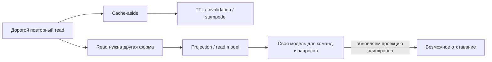

Для карточки начнём с самого частого пути — повторного чтения одного товара. К форме данных вернёмся, когда
понадобится искать сразу по тысячам карточек.

## Разбор примера. Что покупатель увидит в карточке

### Ситуация

Карточка товара стала медленной: цена, остаток, рейтинг и промо-статус собираются из нескольких таблиц и внешних
источников. Команда решила сохранять собранный ответ при первом чтении и возвращать копию при следующих (cache-aside).

### Наивное решение

Положить весь JSON карточки в Redis на час и считать проблему решенной. Если цена изменилась, дождаться TTL. Если товар
пропал, тоже дождаться TTL. Если кэш пустой, каждый запрос сам идет в базу и заново собирает карточку.

### Что ломается

В 12:00 Анна открывает `product:42` и видит свои 900 ₽. В 12:01 Борис получает тот же JSON, хотя его цена —
1000 ₽. Кэш сработал за миллисекунду, ключ ещё свеж, но ответ неверен уже для второго покупателя. Через час срок
записи истечёт, и сто одновременных читателей могут запустить сто одинаковых загрузок.

### Улучшение

Под общим ключом оставим общую часть — название, фото и рейтинг. Для примера договоримся, что рейтинг может отставать
на пять минут. Персональную цену добавим после чтения общей части с учётом текущих условий покупателя. При покупке
команда проверит действующую цену и зарезервирует остаток атомарно. Для одновременных промахов организуем одну общую
загрузку на ключ внутри экземпляра сервиса.

### Почему это работает

Ключ описывает, какие запросы взаимозаменяемы. Время жизни (time to live, TTL) задаёт срок повторного использования копии. Проверка остатка
при записи защищает последнюю единицу товара, даже если карточку успели открыть сто человек. Эффект измерим двумя
разными способами — числом чтений базы на всплеске и числом успешных резервов последнего товара.

## Цели

После лекции вы сможете подобрать ключ и срок жизни для конкретного ответа, разобрать промах под нагрузкой и решить,
достаточно ли экрану SQL-запроса или нужна своя модель чтения. Для отдельной проекции вы сможете указать, кто её
обновляет, как заметить отставание и что увидит покупатель сразу после записи.

## Почему работа с данными становится узким местом

Пока приложение маленькое, запрос к базе часто выглядит как простая деталь реализации: вызвали репозиторий, получили
объект, вернули ответ. В реальной системе стоимость такого запроса складывается из нескольких факторов:

- сетевой round trip от приложения до хранилища;
- время выполнения запроса;
- блокировки и конкуренция за одни и те же строки;
- join по нескольким таблицам;
- маппинг строк базы в доменные объекты и DTO;
- сериализация ответа;
- повторение одного и того же запроса тысячами пользователей.

Нормализация базы помогает хранить данные без лишнего дублирования и защищать инварианты. Но чтение часто хочет другое:
один готовый документ, одну карточку товара, один список с уже посчитанными полями, один результат поиска без сложной
сборки из десяти таблиц.

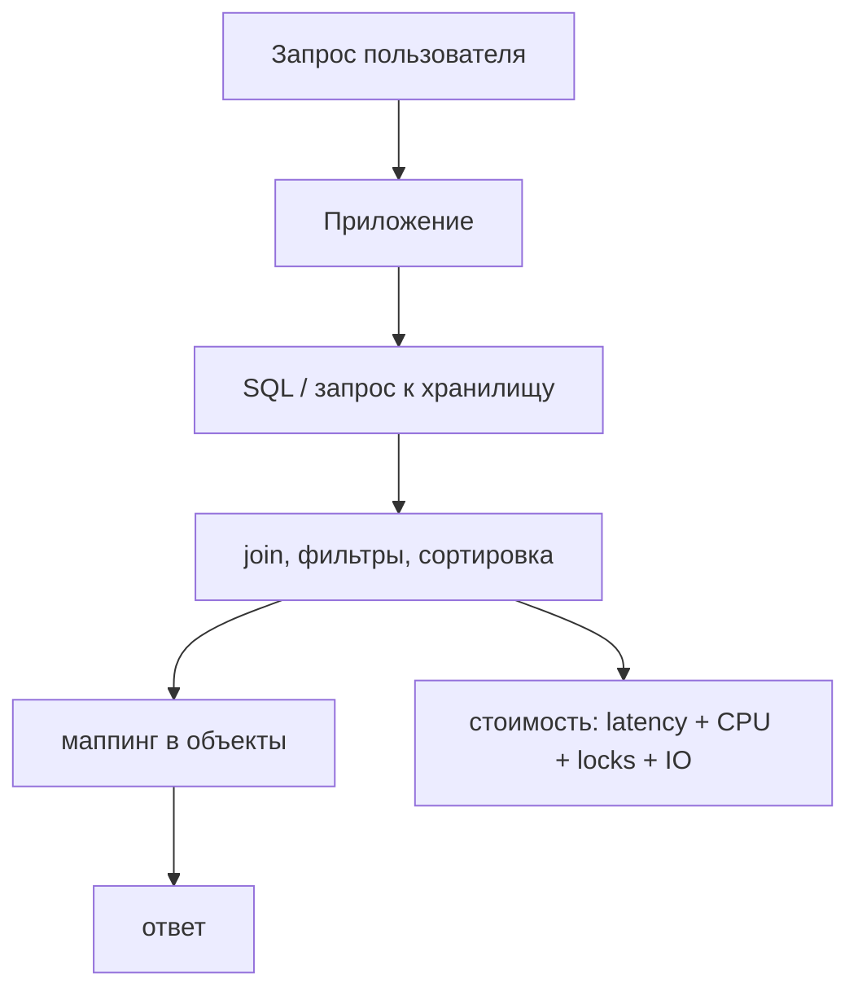

Паттерны работы с данными появляются там, где эта стоимость становится заметной и измеримой.

## Кэширование

Кэш — это быстрое хранилище копий данных или результатов вычислений. Обычно кэш стоит ближе к приложению, чем основная
база, и отвечает быстрее. При первом запросе данных в кэше может не быть. Это cache miss. Приложение идет в источник
истины, получает данные, кладет их в кэш и отвечает пользователю. При следующем запросе происходит cache hit: ответ
возвращается из кэша без обращения к основной базе.

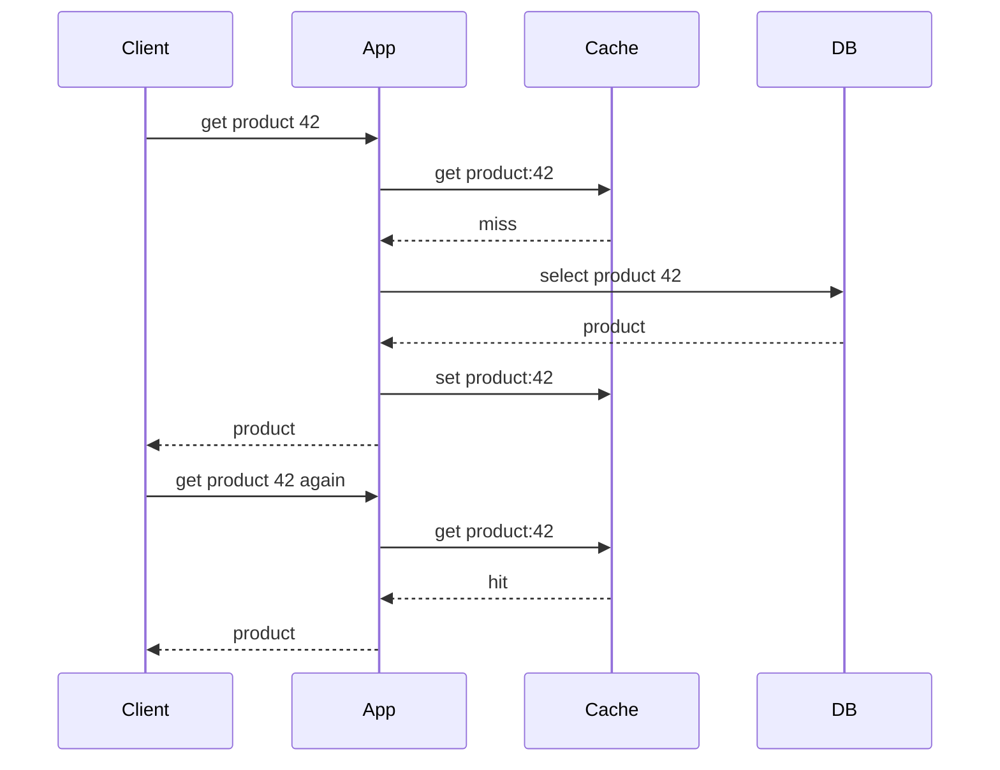

::: warning Не добавляйте кэш без измеримой проблемы
Кэширование почти всегда ускоряет удачный повторный read, но добавляет новые классы ошибок: устаревшие данные,
инвалидацию, дополнительные настройки, метрики и сценарии отказа. Если проблему можно решить индексом, оптимизацией
запроса или нормальным масштабированием базы, кэш может быть лишним.
:::

## Цена кэша

| Что выигрываем                         | Чем платим                                                        |
|----------------------------------------|-------------------------------------------------------------------|
| Меньше обращений к основной базе       | Нужно решать, когда копия становится недействительной             |
| Меньше latency на частых запросах      | Появляется риск stale data                                        |
| Меньше нагрузки при всплесках чтения   | Нужны eviction policy, лимиты памяти и мониторинг                 |
| Возможность пережить деградацию базы   | Нужно понимать, какие устаревшие данные допустимо показывать      |
| Быстрая отдача дорогих вычислений      | Нужно обновлять результат при изменении входных данных            |

::: warning Кэш не является источником истины
Источник истины — это хранилище, где данные считаются окончательными для бизнес-операций. Кэш можно потерять, очистить,
перестроить и прогреть заново. Если потеря кэша ломает бизнес-данные, это уже не кэш, а часть основной модели хранения.
:::

## Где может жить кэш

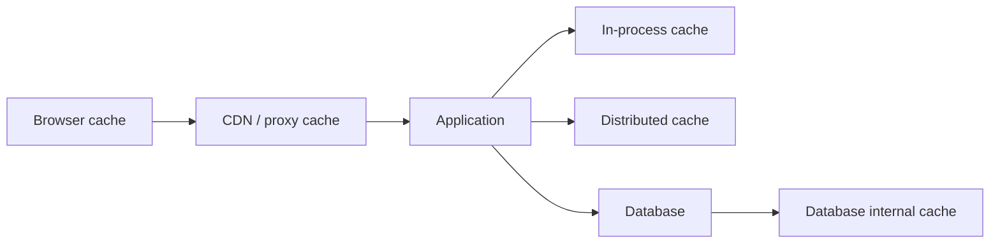

| Уровень                         | Что обычно кэширует                         | Плюсы                                      | Ограничения                                      |
|---------------------------------|---------------------------------------------|--------------------------------------------|--------------------------------------------------|
| Browser                         | статические файлы, HTTP-ответы              | бесплатно для сервера, близко к клиенту    | сложно принудительно обновлять                   |
| CDN / proxy                     | публичные страницы, изображения, API GET    | хорошо держит массовый трафик              | плохо подходит для персональных данных           |
| Application in-process          | справочники, настройки, горячие объекты     | очень быстро, просто начать                | каждый экземпляр приложения имеет свой кэш       |
| Distributed cache               | карточки, результаты запросов, справочники    | общий кэш для нескольких экземпляров       | сеть, сериализация, отдельная точка эксплуатации |
| Database internal cache         | страницы данных, планы запросов             | встроен в СУБД                              | приложение почти не управляет политиками         |

::: only kotlin
В Kotlin/JVM in-process cache часто опирается на JVM-библиотеки вроде Caffeine или обычные коллекции с синхронизацией.
Допустимый срок расхождения копий определяет, хватит ли локального TTL или понадобится общее хранилище.
:::

::: only csharp
В .NET есть `IMemoryCache` для локального кэша и `IDistributedCache` для внешнего. Названия хорошо отражают
архитектурную разницу: первый ускоряет конкретный процесс, второй разделяется между экземплярами приложения.
:::

::: only java
В Java часто встречаются Caffeine, Ehcache, Spring Cache и Redis. Аннотации вроде `@Cacheable` удобны, но опасны, если
команда не договорилась о ключах, TTL, invalidation и допустимой stale data.
:::

::: only go
В Go локальный кэш обычно выглядит как библиотека или структура с `map`, mutex и TTL. Простота реализации не отменяет
сложность инвалидации, особенно если сервис запущен в нескольких репликах.
:::

## In-process и out-of-process cache

Сервис запущен в 5 репликах. Каждая реплика кэширует карточку товара локально. Пользователь обновил цену через
реплику 1. Реплики 2-5 отдают старую цену, пока TTL не истечёт. Это — главная проблема in-process cache в
распределённом окружении.

In-process cache живет внутри процесса приложения: например, `Map`, `ConcurrentHashMap`, `MemoryCache` или библиотека
на уровне языка. Out-of-process cache живет отдельно: Redis, Memcached или другой сервис.

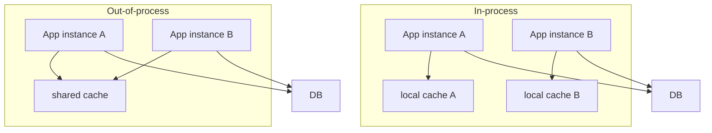

| Вопрос                         | In-process cache                         | Out-of-process cache                           |
|--------------------------------|------------------------------------------|------------------------------------------------|
| Скорость                       | максимальная, без сети                   | быстрая, но есть сетевой вызов                 |
| Простота старта                | высокая                                  | нужен отдельный сервис                         |
| Несколько экземпляров сервиса  | у каждого своя копия                     | общий кэш                                      |
| Инвалидация                    | сложнее синхронизировать между инстансами | проще централизовать                           |
| Потеря процесса приложения     | кэш теряется вместе с процессом          | кэш живет отдельно                             |
| Типичные данные                | локальные настройки, маленькие справочники | карточки, результаты дорогих запросов |

## Cache-aside: базовый паттерн

Cache-aside, или lazy loading, — самый частый прикладной вариант. Приложение само решает, когда идти в кэш, когда идти в
базу и когда записывать результат обратно в кэш.

Алгоритм:

1. Сначала читаем из кэша.
2. Если запись найдена и не протухла, возвращаем ее.
3. Если записи нет, читаем из основного хранилища.
4. Кладем результат в кэш.
5. Возвращаем результат клиенту.

Для двух последовательных запросов `p-42` ожидаем один вызов репозитория. Обычные словари здесь обслуживают один поток.
При параллельных запросах потребуется безопасный доступ к кэшу, а для объединения промахов — single flight.

::: multi-code "Cache-aside: чтение товара"

```kotlin
class ProductService(
    private val repository: ProductRepository,
    private val cache: MutableMap<String, Product>
) {
    fun getProduct(id: String): Product {
        return cache.getOrPut(id) {
            repository.findById(id)
        }
    }
}
```

```kotlin playground
data class Product(val id: String, val title: String)

class ProductRepository {
    var dbCalls = 0

    fun findById(id: String): Product {
        dbCalls += 1
        println("DB: loading product $id")
        return Product(id, "Mechanical keyboard")
    }
}

class ProductService(
    private val repository: ProductRepository,
    private val cache: MutableMap<String, Product>
) {
    fun getProduct(id: String): Product {
        val cached = cache[id]
        if (cached != null) {
            println("CACHE: hit for $id")
            return cached
        }

        println("CACHE: miss for $id")
        val product = repository.findById(id)
        cache[id] = product
        return product
    }
}

fun main() {
    val repository = ProductRepository()
    val service = ProductService(repository, mutableMapOf())

    println(service.getProduct("p-42"))
    println(service.getProduct("p-42"))
    check(repository.dbCalls == 1)
    println("DB calls: ${repository.dbCalls}")
}
```

```csharp
public sealed class ProductService
{
    private readonly ProductRepository _repository;
    private readonly Dictionary<string, Product> _cache = new();

    public ProductService(ProductRepository repository)
    {
        _repository = repository;
    }

    public Product GetProduct(string id)
    {
        if (_cache.TryGetValue(id, out var cached))
            return cached;

        var product = _repository.FindById(id);
        _cache[id] = product;
        return product;
    }
}
```

```java
class ProductService {
    private final ProductRepository repository;
    private final Map<String, Product> cache = new HashMap<>();

    ProductService(ProductRepository repository) {
        this.repository = repository;
    }

    Product getProduct(String id) {
        var cached = cache.get(id);
        if (cached != null) {
            return cached;
        }

        var product = repository.findById(id);
        cache.put(id, product);
        return product;
    }
}
```

```go
type ProductService struct {
    repository ProductRepository
    cache      map[string]Product
}

func NewProductService(repository ProductRepository) ProductService {
    return ProductService{
        repository: repository,
        cache:      map[string]Product{},
    }
}

func (s ProductService) GetProduct(id string) Product {
    if product, ok := s.cache[id]; ok {
        return product
    }

    product := s.repository.FindByID(id)
    s.cache[id] = product
    return product
}
```

:::

Cache-aside прост, но именно приложение отвечает за все детали: ключи, TTL, инвалидацию, сериализацию, обработку ошибок
и метрики.

## Метрики кэша

Кэш без метрик легко становится источником случайной сложности. Минимальный набор наблюдения:

| Метрика                     | Что означает                                      | Что диагностирует                                      |
|-----------------------------|---------------------------------------------------|--------------------------------------------------------|
| Hit rate                    | доля запросов, найденных в кэше                   | насколько кэш вообще полезен                           |
| Miss rate                   | доля проверок кэша без пригодной записи          | непрогретый кэш, плохие ключи, слишком короткий TTL    |
| Latency                     | время ответа кэша                                 | сетевые проблемы, перегрузку кэш-сервиса               |
| Memory usage                | занятая память                                    | приближение к лимиту, риск агрессивного вытеснения     |
| Eviction rate               | частота удаления из-за нехватки памяти            | слишком маленький кэш или неверная eviction policy     |
| Staleness                   | насколько данные отстают от источника истины      | риск неверных ответов пользователю                     |
| Error rate                  | ошибки чтения и записи кэша                       | деградацию Redis/Memcached/сети                        |
| Backend load after misses   | нагрузка на базу после промахов                   | cache stampede и неудачный прогрев                     |

Сто проверок холодного ключа могут дать сто промахов и одну загрузку. Поэтому считайте обращения к базе отдельно.
Сравните также p95 времени **всего запроса** до и после кэширования. Быстрый ответ Redis сам по себе ничего
не говорит о времени сборки персональной части карточки.

::: tip Начинайте с cache-aside и метрик
Для большинства учебных и прикладных систем разумный первый шаг - cache-aside для дорогого read-сценария, TTL, лимит
памяти и графики hit rate/miss rate. Более сложные стратегии должны появляться после наблюдения, а не вместо него.
:::

## Что стоит кэшировать

Хороший кандидат для кэша обычно имеет несколько признаков:

- часто читается;
- редко меняется;
- дорого вычисляется или дорого читается из базы;
- допускает небольшое отставание;
- имеет понятный ключ;
- не содержит данных, которые опасно показать после изменения прав доступа;
- не является единственным источником бизнес-решения.

| Стоит кэшировать                             | Обычно не стоит кэшировать                              |
|----------------------------------------------|---------------------------------------------------------|
| карточку товара                              | результат проведения платежа                            |
| справочник стран или валют                   | факт списания денег                                     |
| публичный профиль с коротким TTL             | данные с мгновенно меняющимися правами доступа          |
| результат дорогого поиска                    | объект, который меняется чаще, чем читается             |
| агрегированную статистику за прошлый день    | уникальный ответ, который почти никогда не повторяется  |

## TTL, инвалидация и вытеснение

Эти три термина часто смешивают, но они отвечают на разные вопросы.

| Механизм      | Вопрос                                            | Пример                                                       |
|---------------|---------------------------------------------------|--------------------------------------------------------------|
| TTL           | когда запись считается устаревшей по времени      | хранить карточку товара 5 минут                              |
| Инвалидация   | какое событие делает запись неверной              | удалить `product:42`, когда изменили цену                    |
| Вытеснение    | что удалить, когда кэшу не хватает памяти         | удалить давно неиспользуемые записи по LRU                   |

Положили цену в кэш в 12:00 с TTL пять минут. Цена изменилась в 12:00:10. Без других действий читатели могут видеть
старое значение ещё 4 минуты 50 секунд. Обычно приложение сначала фиксирует изменение в базе, затем удаляет ключ.
Если удалить раньше, параллельный читатель успеет снова заполнить кэш до фиксации новой цены.

Даже правильный порядок оставляет гонку. Читатель мог получить старую цену *до* фиксации, а записать её в кэш *после*
удаления. TTL ограничивает жизнь такой копии с момента её помещения. Для более строгих требований сохраняют номер последней инвалидации и атомарно проверяют его
при заполнении или читают авторитетное состояние в момент операции.

В примере часы передаём параметром. При записи в момент 1000 мс с TTL 500 мс значение доступно в 1499 мс.
В 1500 мс чтение уже даёт промах. Положите под ключ остаток 0. До истечения срока такой ответ сообщает, что товара нет. При промахе остаток неизвестен и потребуется чтение склада. В C# наличие показывает результат `TryGet`, в Go — второй результат `Get`. Очистка памяти у ключей, к которым больше не обращаются, — отдельная задача.

::: multi-code "TTL cache: запись со сроком жизни"

```kotlin
data class CacheEntry<T>(
    val value: T,
    val expiresAtMillis: Long
)

class TtlCache<T : Any> {
    private val values = mutableMapOf<String, CacheEntry<T>>()

    fun get(key: String, nowMillis: Long): T? {
        val entry = values[key] ?: return null
        return if (entry.expiresAtMillis > nowMillis) entry.value else null
    }

    fun put(key: String, value: T, nowMillis: Long, ttlMillis: Long) {
        values[key] = CacheEntry(value, nowMillis + ttlMillis)
    }
}
```

```kotlin playground
data class CacheEntry<T>(
    val value: T,
    val expiresAtMillis: Long
)

class TtlCache<T : Any> {
    private val values = mutableMapOf<String, CacheEntry<T>>()

    fun get(key: String, nowMillis: Long): T? {
        val entry = values[key] ?: return null
        if (entry.expiresAtMillis <= nowMillis) {
            values.remove(key)
            return null
        }
        return entry.value
    }

    fun put(key: String, value: T, nowMillis: Long, ttlMillis: Long) {
        values[key] = CacheEntry(value, nowMillis + ttlMillis)
    }
}

fun main() {
    val cache = TtlCache<Int>()
    check(cache.get("stock:42", nowMillis = 999) == null)
    cache.put("stock:42", 0, nowMillis = 1_000, ttlMillis = 500)

    check(cache.get("stock:42", nowMillis = 1_499) == 0)
    check(cache.get("stock:42", nowMillis = 1_500) == null)
    println("1499: остаток 0, 1500: промах")
}
```

```csharp
public sealed record CacheEntry<T>(T Value, long ExpiresAtMillis);

public sealed class TtlCache<T> where T : notnull
{
    private readonly Dictionary<string, CacheEntry<T>> _values = new();

    public bool TryGet(string key, long nowMillis,
        [System.Diagnostics.CodeAnalysis.MaybeNullWhen(false)] out T value)
    {
        if (_values.TryGetValue(key, out var entry) && nowMillis < entry.ExpiresAtMillis)
        {
            value = entry.Value;
            return true;
        }
        value = default;
        return false;
    }

    public void Put(string key, T value, long nowMillis, long ttlMillis)
    {
        _values[key] = new CacheEntry<T>(value, nowMillis + ttlMillis);
    }
}
```

```java
record CacheEntry<T>(T value, long expiresAtMillis) {}

class TtlCache<T> {
    private final Map<String, CacheEntry<T>> values = new HashMap<>();

    T get(String key, long nowMillis) {
        var entry = values.get(key);
        if (entry == null || entry.expiresAtMillis() <= nowMillis) {
            return null;
        }
        return entry.value();
    }

    void put(String key, T value, long nowMillis, long ttlMillis) {
        values.put(key, new CacheEntry<>(value, nowMillis + ttlMillis));
    }
}
```

```go
type CacheEntry[T any] struct {
    Value           T
    ExpiresAtMillis int64
}

type TtlCache[T any] struct {
    values map[string]CacheEntry[T]
}

func NewTtlCache[T any]() *TtlCache[T] {
    return &TtlCache[T]{values: make(map[string]CacheEntry[T])}
}

func (c TtlCache[T]) Get(key string, nowMillis int64) (T, bool) {
    entry, ok := c.values[key]
    var zero T
    if !ok || entry.ExpiresAtMillis <= nowMillis {
        return zero, false
    }
    return entry.Value, true
}

func (c TtlCache[T]) Put(key string, value T, nowMillis int64, ttlMillis int64) {
    c.values[key] = CacheEntry[T]{Value: value, ExpiresAtMillis: nowMillis + ttlMillis}
}
```

:::

## Стратегии вытеснения

Когда кэш ограничен по памяти, он должен удалять часть записей. Это не то же самое, что инвалидация: запись может быть
актуальной, но кэшу все равно нужно освободить место.

| Стратегия       | Что удаляет                                      | Где уместна                                               |
|-----------------|--------------------------------------------------|-----------------------------------------------------------|
| Random          | случайную запись                                 | простая деградация, когда точность не важна               |
| FIFO            | то, что было добавлено раньше всех               | простые очереди, предсказуемый поток данных               |
| LRU             | то, чем дольше всего не пользовались             | пользовательские карточки, справочники, типичный web read |
| LFU             | то, чем пользовались реже всего                  | устойчивые hot keys, повторяющиеся популярные запросы     |

LRU и LFU отвечают на разные вопросы. LRU смотрит на давность последнего обращения. LFU смотрит на частоту обращений.
Если карточку A открыли сто раз утром, а карточку B — один раз только что, LRU из этой пары вытеснит A,
а LFU без старения счётчика — B. Redis приближённо оценивает LRU и LFU. Его политика `volatile-ttl` при нехватке
памяти отдаёт предпочтение ключам с меньшим оставшимся TTL, даже если они ещё свежи.

## Кэширование ошибок и negative caching

Negative caching — это кэширование отрицательного результата: например, "товар не найден" или "такого пользователя нет".
Оно защищает базу от повторяющихся запросов к заведомо отсутствующим данным.

У кэша здесь три состояния — значение найдено, отсутствие подтверждено, запись отсутствует или истекла. В кратких
фрагментах `loadAndCache` сохраняет подтверждённый `NotFound` на короткий TTL. В Playground товар появляется между
вторым и третьим запросом. Часы управляются из примера, поэтому ждать в реальном времени не нужно.

::: multi-code "Negative caching: NotFound на короткий TTL"

```kotlin
sealed interface CachedProduct
data class Found(val product: Product) : CachedProduct
data object NotFound : CachedProduct

fun findProduct(id: String): Product? {
    return when (val cached = cache.get(id, nowMillis())) {
        is Found -> cached.product
        NotFound -> null
        null -> loadAndCache(id)
    }
}
```

```kotlin playground
data class Product(val id: String, val title: String)

sealed interface CachedProduct
data class Found(val product: Product) : CachedProduct
data object NotFound : CachedProduct

class Repository {
    var calls = 0
    val products = mutableMapOf<String, Product>()

    fun findById(id: String): Product? {
        calls++
        return products[id]
    }
}

data class Entry(val result: CachedProduct, val expiresAt: Long)

class ProductLookup(private val repository: Repository) {
    private val cache = mutableMapOf<String, Entry>()

    fun findProduct(id: String, now: Long): Product? {
        val entry = cache[id]
        if (entry != null && now < entry.expiresAt) {
            return when (val result = entry.result) {
                is Found -> result.product
                NotFound -> null
            }
        }
        val product = repository.findById(id)
        cache[id] = if (product == null) Entry(NotFound, now + 2)
                    else Entry(Found(product), now + 60)
        return product
    }
}

fun main() {
    val repo = Repository()
    val lookup = ProductLookup(repo)
    check(lookup.findProduct("42", 0) == null)
    check(lookup.findProduct("42", 1) == null && repo.calls == 1)
    repo.products["42"] = Product("42", "Keyboard")
    check(lookup.findProduct("42", 2)?.title == "Keyboard" && repo.calls == 2)
    println("Два чтения базы: отсутствие в 0 с, товар в 2 с")
}
```

```csharp
public abstract record CachedProduct;
public sealed record Found(Product Product) : CachedProduct;
public sealed record NotFound : CachedProduct;

public Product? FindProduct(string id)
{
    var cached = _cache.Get(id);
    return cached switch
    {
        Found found => found.Product,
        NotFound => null,
        null => LoadAndCache(id)
    };
}
```

```java
sealed interface CachedProduct permits Found, NotFound {}
record Found(Product product) implements CachedProduct {}
record NotFound() implements CachedProduct {}

Product findProduct(String id) {
    var cached = cache.get(id);
    if (cached instanceof Found found) {
        return found.product();
    }
    if (cached instanceof NotFound) {
        return null;
    }
    return loadAndCache(id);
}
```

```go
type CachedProduct struct {
    Product *Product
    Found   bool
}

func (s ProductService) FindProduct(id string) *Product {
    if cached, ok := s.cache.Get(id); ok {
        if !cached.Found {
            return nil
        }
        return cached.Product
    }
    return s.loadAndCache(id)
}
```

:::

::: warning Таймаут и отсутствие товара
При таймауте базы мы не знаем, существует ли товар. Если записать `NotFound`, все покупатели получат ложный ответ
до истечения TTL. Временный отказ можно на короткое время запомнить отдельно и вернуть ошибку доступности.
Неопределённый исход платежа проверяют по идентификатору операции.
:::

## Прогрев кэша

При ленивом заполнении первый покупатель ждёт ответа базы. Прогрев переносит эту работу на время до первого запроса.

| Подход              | Как работает                                                        | Риск                                                    |
|---------------------|---------------------------------------------------------------------|---------------------------------------------------------|
| Ручной              | разработчик или оператор заранее загружает набор ключей             | забыли обновить, человеческий фактор                    |
| Автоматический      | scheduler регулярно загружает данные по расписанию                  | расписание не совпало с реальным поведением             |
| По событиям         | событие в системе запускает обновление связанных ключей              | нужна очередь, обработчики и наблюдаемость               |
| Иерархический       | при малой памяти сначала прогреваются самые важные уровни данных     | сложно выбрать приоритеты                               |
| На основе аналитики | исторические данные подсказывают, что загрузить перед пиком спроса   | модель поведения может измениться                       |

Пример: маркетплейс знает, что вечером перед распродажей резко вырастет интерес к конкретной категории. Можно заранее
прогреть карточки товаров, цены и остатки для этой категории. Но если спрос пойдет не туда, кэш будет занят
малополезными данными, а miss rate останется высоким.

## Паттерны чтения и записи кэша

| Паттерн | Действие | Цена для карточки товара |
|---|---|---|
| Cache-aside | При промахе приложение читает базу и заполняет кэш | Ключи и инвалидация остаются в приложении |
| Read-through | Приложение читает через кэш, который вызывает настроенный загрузчик | Загрузчик должен знать источник карточки |
| Write-through | Слой кэша подтверждает запись после синхронного сохранения в источнике | Обновление цены ждёт записи в базу |
| Write-behind | Слой кэша принимает запись, фоновый процесс переносит её в базу позже | Нужны сохранность буфера, порядок записей и повтор при сбое |
| Refresh-ahead | Кэш заранее перечитывает популярное значение из источника | Часть обновлённых карточек никто не откроет |

В write-behind подтверждённые изменения ещё могут находиться только в буфере. Пока они не перенесены в базу,
очищать этот буфер так же свободно, как кэш результатов чтения, опасно.

Read-through, write-through и write-behind часто требуют поддержки со стороны кэш-платформы или отдельного слоя доступа
к данным. Cache-aside проще всего увидеть и реализовать в учебном коде.

## Проблемы кэширования

Кэширование редко ломается на happy path. Основные проблемы появляются при высокой конкуренции, отказах и изменении
данных.

### Cache stampede

Cache stampede возникает, когда популярный ключ исчезает из кэша, и множество одинаковых запросов одновременно идут в
основную базу.

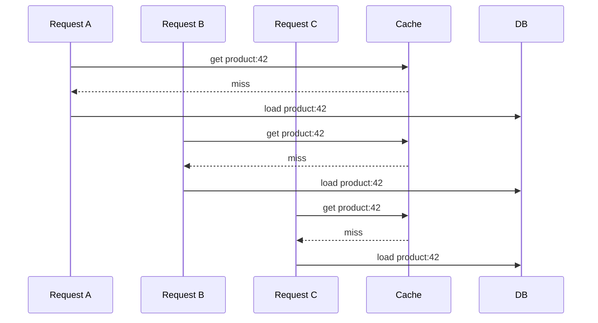

В итоге кэш должен был защищать базу, но в момент истечения TTL сам создал пик нагрузки.

### Single flight

Single flight, или request coalescing, объединяет одинаковые параллельные запросы. Первый запрос идет в базу, остальные
ждут тот же результат.

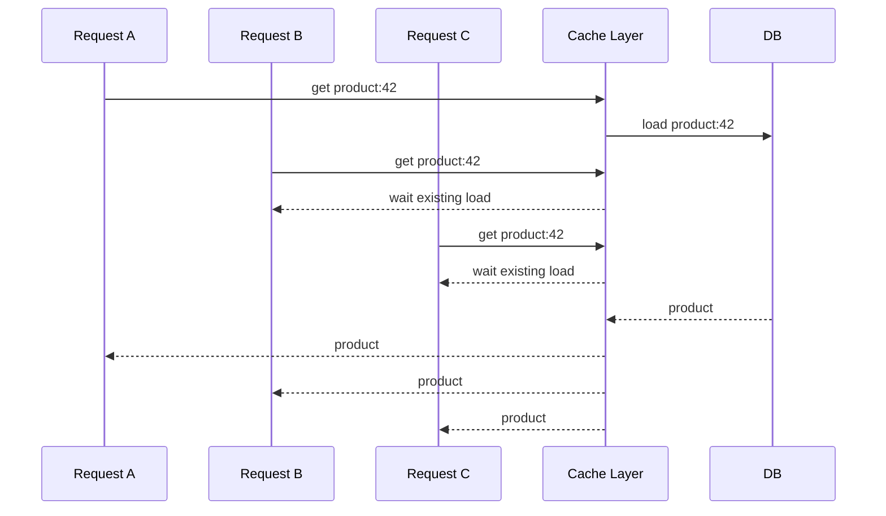

Реестр хранит только незавершённые загрузки. Сначала один вызов атомарно занимает ключ, затем запускает загрузчик.
Остальные получают результат этой попытки, в том числе ошибку. Удаляет запись владелец, когда загрузка окончена.
Долговременное хранение успешного значения с TTL остаётся задачей кэша.

::: multi-code "Одна попытка на ключ, включая общий отказ"

```kotlin
import java.util.concurrent.CompletableFuture
import java.util.concurrent.ConcurrentHashMap

class Flights<T>(private val load: (String) -> CompletableFuture<T>) {
    private val pending = ConcurrentHashMap<String, CompletableFuture<T>>()

    fun get(key: String): CompletableFuture<T> {
        val mine = CompletableFuture<T>()
        pending.putIfAbsent(key, mine)?.let { return it.copy() }

        val source = try {
            load(key)
        } catch (failure: Throwable) {
            CompletableFuture.failedFuture<T>(failure)
        }
        source.whenComplete { value, failure ->
            pending.remove(key, mine)
            if (failure == null) mine.complete(value)
            else mine.completeExceptionally(failure)
        }
        return mine.copy()
    }
}
```

```kotlin playground
import java.util.concurrent.CompletableFuture
import java.util.concurrent.ConcurrentHashMap

class Flights<T>(private val load: (String) -> CompletableFuture<T>) {
    private val pending = ConcurrentHashMap<String, CompletableFuture<T>>()

    fun get(key: String): CompletableFuture<T> {
        val mine = CompletableFuture<T>()
        pending.putIfAbsent(key, mine)?.let { return it.copy() }

        val source = try {
            load(key)
        } catch (failure: Throwable) {
            CompletableFuture.failedFuture<T>(failure)
        }
        source.whenComplete { value, failure ->
            pending.remove(key, mine)
            if (failure == null) mine.complete(value)
            else mine.completeExceptionally(failure)
        }
        return mine.copy()
    }
}

fun main() {
    var calls = 0
    val firstLoad = CompletableFuture<String>()
    val flights = Flights<String> {
        calls++
        if (calls == 1) firstLoad else CompletableFuture.completedFuture("Keyboard")
    }

    val readers = List(3) { flights.get("42") }
    check(calls == 1)
    val timeout = IllegalStateException("timeout")
    firstLoad.completeExceptionally(timeout)
    check(readers.all { runCatching { it.join() }.exceptionOrNull()?.cause === timeout })
    check(flights.get("42").join() == "Keyboard" && calls == 2)
    println("Три отказа, один вызов базы. Повтор вернул Keyboard.")
}
```

```csharp
using System.Collections.Concurrent;

public sealed class Flights<T>(Func<string, Task<T>> load)
{
    private readonly ConcurrentDictionary<string, TaskCompletionSource<T>> pending = new();

    public Task<T> Get(string key)
    {
        var mine = new TaskCompletionSource<T>(TaskCreationOptions.RunContinuationsAsynchronously);
        var current = pending.GetOrAdd(key, mine);
        if (current == mine)
            _ = Finish(key, mine);
        return current.Task;
    }

    private async Task Finish(string key, TaskCompletionSource<T> mine)
    {
        T value;
        try { value = await load(key).ConfigureAwait(false); }
        catch (OperationCanceledException ex)
        {
            pending.TryRemove(key, out _);
            mine.SetCanceled(ex.CancellationToken);
            return;
        }
        catch (Exception ex)
        {
            pending.TryRemove(key, out _);
            mine.SetException(ex);
            return;
        }
        pending.TryRemove(key, out _);
        mine.SetResult(value);
    }
}
```

```java
import java.util.concurrent.*;
import java.util.function.Function;

final class Flights<T> {
    private final ConcurrentMap<String, CompletableFuture<T>> pending = new ConcurrentHashMap<>();
    private final Function<String, CompletableFuture<T>> load;

    Flights(Function<String, CompletableFuture<T>> load) {
        this.load = load;
    }

    CompletableFuture<T> get(String key) {
        var mine = new CompletableFuture<T>();
        var current = pending.putIfAbsent(key, mine);
        if (current != null) return current.copy();

        CompletableFuture<T> source;
        try {
            source = load.apply(key);
        } catch (Throwable failure) {
            source = CompletableFuture.failedFuture(failure);
        }
        source.whenComplete((value, failure) -> {
            pending.remove(key, mine);
            if (failure == null) mine.complete(value);
            else mine.completeExceptionally(failure);
        });
        return mine.copy();
    }
}
```

```go
import "golang.org/x/sync/singleflight"

type Catalog struct {
    flights singleflight.Group
    load    func(string) (Product, error)
}

func (c *Catalog) Get(id string) (Product, error) {
    value, err, _ := c.flights.Do(id, func() (any, error) {
        return c.load(id)
    })
    if err != nil {
        return Product{}, err
    }
    return value.(Product), nil
}
```

:::

Для cache-aside загрузчик ещё раз проверяет кэш после захвата ключа. Другой запрос мог успеть заполнить его между
первым промахом и входом в реестр. Если значение всё ещё отсутствует, загрузчик читает базу и сохраняет успешный
результат перед завершением. При ошибке чтения в кэше ничего не появляется.

**Проверка на отказ.** Остановите первую загрузку `42` на управляемом ожидании и присоедините к ней ещё два запроса.
Отдельный ключ `43` должен загрузиться, пока `42` ждёт. Завершите первую попытку ошибкой. Трое получают один и тот же
исход, база получила один запрос для `42`. Четвёртый вызов `42` должен запустить вторую попытку и вернуть товар.
Один реестр обслуживает одну реплику: при пяти репликах и одном холодном общем ключе возможны пять одновременных загрузок.

::: only kotlin
Пример рассчитан на Kotlin/JVM. Загрузчик возвращает уже начатую асинхронную операцию. Каждый клиент получает копию
`CompletableFuture`, поэтому отмена его ожидания не отменяет результат остальных.
:::

::: only csharp
В `GetOrAdd` передаём сам объект ожидания. Если передать фабрику, которая сразу обращается к базе, словарь при
конкуренции может вызвать её несколько раз.
:::

::: only java
`putIfAbsent` выбирает владельца до вызова загрузчика. Это важно даже для синхронно завершённого future —
обработчик завершения может выполниться сразу. Клиенту отдаём копию future (Java 9+).
:::

::: only go
Одна `singleflight.Group` принадлежит каталогу и используется всеми обработчиками этой реплики. Ветка ошибки
возвращает управление до приведения типа. После завершения вызова группа забывает ключ.
:::

### Fallback и stale data

Иногда лучше отдать устаревшие данные, чем не отдать ничего. Например, новостная лента или каталог товаров могут
показать данные пятиминутной давности, если база временно недоступна. Но платежный баланс или статус посадочного места
так показывать опасно.

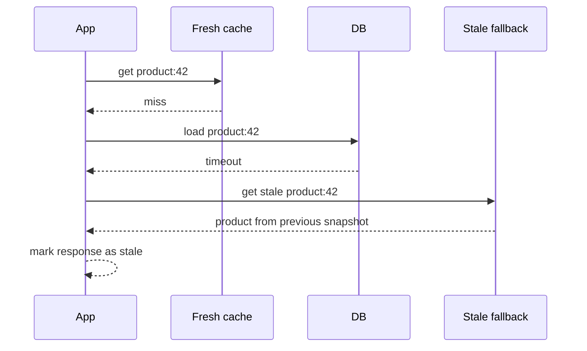

Для fallback последнюю успешную копию сохраняют дольше срока её обычной выдачи. Например, если редакция каталога отдельно разрешила при сбое показывать рейтинг до часа, у ответа указывают время снимка.
В обычном режиме через пять минут нужно обновление. После часа рейтинг скрываем. При жёстком лимите пять минут
резервную копию старше этого срока показывать нельзя.

### Таймауты и заполнение кэша после ответа клиенту

Бывает так: пользовательский запрос уже получил timeout, но база все-таки вернула результат позже. Если этот результат
просто отбросить, следующий пользователь снова попадет в ту же дорогую операцию. Один из вариантов - разделить timeout
клиента и timeout фоновой загрузки:

- клиенту отвечаем быстро: "данные пока недоступны";
- загрузку из базы не всегда отменяем сразу;
- ограничиваем время и число фоновых загрузок, сохраняем результат, только если его версия ещё пригодна;
- следующий запрос получает ответ из кэша.

Это полезно для дорогих read-операций, но опасно для write-операций: нельзя без ведома пользователя продолжать платеж после того, как
пользователь получил неопределенный статус.

## Кэширование в микросервисах

В микросервисной системе кэш может находиться внутри конкретного сервиса, быть общим distributed cache или обновляться
через события.

On-demand вариант похож на обычный cache-aside:

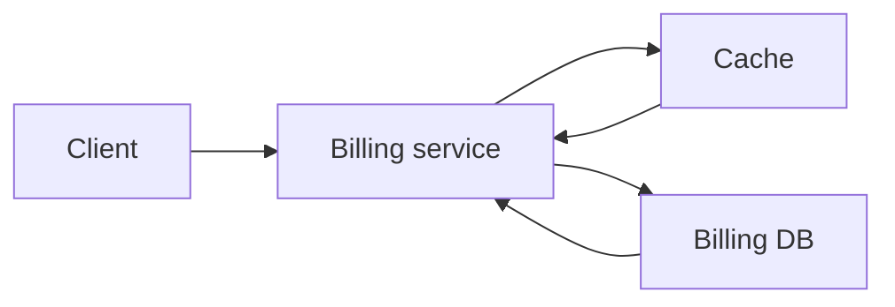

Event-driven вариант использует события, чтобы обновлять или инвалидировать кэш после изменений.

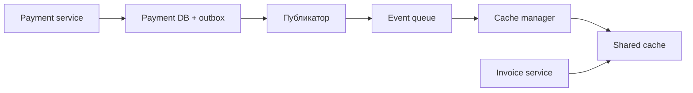

Важно, что очередь событий не делает кэш магически консистентным. Она просто дает место, где можно надежно передать
факт изменения и обработать его отдельным компонентом.

## Redis как инструмент

Redis часто используют как out-of-process cache, потому что он быстрый, держит данные в памяти, поддерживает TTL,
несколько структур данных и удобен как общий кэш для нескольких экземпляров приложения. Паттерны важнее продукта,
но Redis удобно связывает их воедино:

- **Redis Pub/Sub** позволяет уведомить подключённых подписчиков об изменении цены. Доставка — максимум один раз.
  Отключённая реплика пропустит уведомление. Если это допустимо, ограничьте возраст копии через TTL.
- **Redis TTL** ограничивает время жизни ключа, а политика вытеснения определяет, какие ключи освободят память раньше.
- **Redis Lua** позволяет атомарно проверить и изменить ключи на сервере. Внешняя загрузка из базы находится за
  пределами скрипта. Общий Redis сам по себе не объединяет промахи пяти реплик.

::: details Почему Redis часто выбирают для кэша
Redis умеет хранить строки, hash, list, set, sorted set и другие структуры, поддерживает expiration для ключей и хорошо
вписывается в web-нагрузку с большим количеством коротких операций. При этом Redis не отменяет проектных решений:
ключи, TTL, инвалидация, сериализация, retry и наблюдаемость остаются задачей системы.
:::

## От кэша к CQRS {#от-кэша-к-cqrs}

Кэш ускоряет повторное чтение. Но что если проблема не в скорости, а в форме данных? Клиенту нужна карточка с
агрегированными отзывами, персональной ценой и промо-статусом — join из 6 таблиц, 3 внешних вызовов и 2 вычислений.
Кэшировать этот ответ можно, но изменение любой зависимости может потребовать обновления всех затронутых вариантов карточки. Это другая задача.

Например, write model заказа может быть нормализованной:

- `orders`;
- `order_lines`;
- `products`;
- `users`;
- `payments`;
- `shipments`.

А экран "история заказов" хочет один готовый список: дата, номер, статус, сумма, 3 первых товара, адрес доставки и
кнопка повторить заказ. Можно каждый раз собирать это join и мапперами. А можно заранее поддерживать read model,
специально подготовленную для этого экрана.

## Почему нагрузка чтения и записи различается

CRUD выглядит симметрично: create, read, update, delete. В реальных приложениях нагрузка часто асимметрична: чтений
гораздо больше, чем изменений.

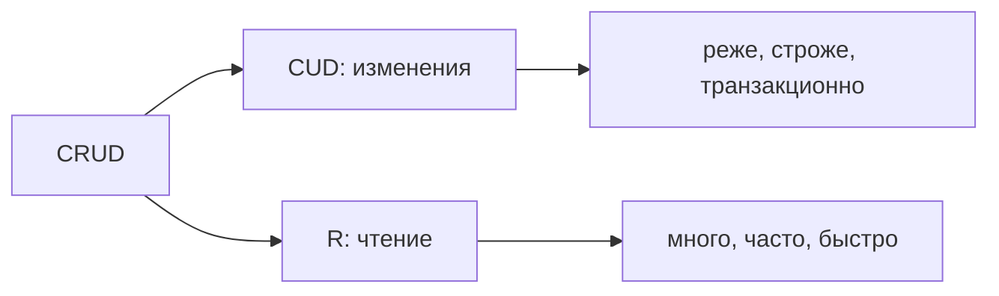

В социальной сети большинство пользователей читает ленту чаще, чем публикует. В маркетплейсе люди смотрят каталог и
карточки товаров чаще, чем покупают. В учебной системе студенты читают расписание чаще, чем администратор его меняет.

## Разные требования к CUD и R

| Сторона                    | Главные требования                                      | Типичная сложность                                      |
|----------------------------|----------------------------------------------------------|---------------------------------------------------------|
| Write side: create/update/delete | инварианты, транзакции, валидация, права, доменная логика | сложные агрегаты, правила, Unit of Work                 |
| Read side: query/read      | скорость, фильтры, сортировка, поиск, разные представления | проекции, денормализация, индексы, полнотекстовый поиск |

Write side защищает инварианты, а read side отвечает на вопросы с учётом прав читателя и требуемой свежести. Попытка сделать одну модель
одинаково удобной для обеих сторон часто приводит к разрастанию репозиториев и мапперов.

## Как разрастается репозиторий

Посмотрим на ту же проблему со стороны профиля покупателя. Теперь один и тот же человек появляется на нескольких экранах, в том числе в списке авторов комментариев.

Пока экран один, репозиторий выглядит аккуратно: создать пользователя, обновить, удалить, получить по id. Потом появляются
экранные запросы, отчеты, фильтры и связи с другими агрегатами. Через некоторое время `UserRepository` начинает знать о
планах оплаты, комментариях, проектах, биллинге и аналитике.

::: multi-code "Разросшийся UserRepository" {playground=off}

```kotlin
interface UserRepository {
    fun create(user: User)
    fun update(user: User)
    fun delete(id: UserId)

    fun getById(id: UserId): User
    fun findRecentActive(): List<User>
    fun findBySearchString(search: String): List<User>
    fun findAllOnFreePlan(): List<User>
    fun findAllWithoutBillingInformation(): List<User>
    fun findWhoCommentedArticleInProject(projectId: ProjectId): List<User>
}
```

```csharp
public interface IUserRepository
{
    void Create(User user);
    void Update(User user);
    void Delete(UserId id);

    User GetById(UserId id);
    User[] FindRecentActive();
    User[] FindBySearchString(string search);
    User[] FindAllOnFreePlan();
    User[] FindAllWithoutBillingInformation();
    User[] FindWhoCommentedArticleInProject(ProjectId projectId);
}
```

```java
interface UserRepository {
    void create(User user);
    void update(User user);
    void delete(UserId id);

    User getById(UserId id);
    List<User> findRecentActive();
    List<User> findBySearchString(String search);
    List<User> findAllOnFreePlan();
    List<User> findAllWithoutBillingInformation();
    List<User> findWhoCommentedArticleInProject(ProjectId projectId);
}
```

```go
type UserRepository interface {
    Create(user User)
    Update(user User)
    Delete(id UserID)

    GetByID(id UserID) User
    FindRecentActive() []User
    FindBySearchString(search string) []User
    FindAllOnFreePlan() []User
    FindAllWithoutBillingInformation() []User
    FindWhoCommentedArticleInProject(projectID ProjectID) []User
}
```

:::

Проблема не в количестве методов как таковом. Проблема в смешении смыслов. Методы для изменения агрегата и методы для
экранных выборок начинают жить в одном интерфейсе, хотя меняются по разным причинам.

## Маппинг и сложность чтения

Даже если репозиторий не разрастается, часто разрастается слой маппинга. Один и тот же доменный объект нужен в разных
представлениях:

- краткая карточка пользователя;
- профиль;
- автор комментария;
- участник проекта;
- строка отчета;
- результат поиска.

::: multi-code "Маппинг доменной модели в read view" {playground=off}

```kotlin
class UserToShortViewMapper : Mapper<User, UserShortView> {
    override fun map(user: User): UserShortView {
        return UserShortView(
            id = user.id.value,
            displayName = user.profile.displayName,
            avatarUrl = user.profile.avatarUrl
        )
    }
}
```

```csharp
public sealed class UserToShortViewMapper : IMapper<User, UserShortView>
{
    public UserShortView Map(User user)
    {
        return new UserShortView(
            user.Id.Value,
            user.Profile.DisplayName,
            user.Profile.AvatarUrl);
    }
}
```

```java
class UserToShortViewMapper implements Mapper<User, UserShortView> {
    public UserShortView map(User user) {
        return new UserShortView(
            user.id().value(),
            user.profile().displayName(),
            user.profile().avatarUrl()
        );
    }
}
```

```go
type UserToShortViewMapper struct{}

func (m UserToShortViewMapper) Map(user User) UserShortView {
    return UserShortView{
        ID:          user.ID.Value,
        DisplayName: user.Profile.DisplayName,
        AvatarURL:   user.Profile.AvatarURL,
    }
}
```

:::

Если таких преобразований становится много, возникает вопрос: может быть, read side должна хранить данные сразу в форме,
удобной для чтения?

## CQRS

CQRS — Command Query Responsibility Segregation. В практическом смысле это разделение ответственности между моделью
записи и моделью чтения.

- Command меняет состояние системы.
- Query читает состояние системы.
- Write model защищает бизнес-инварианты.
- Read model задаёт форму ответа на запрос. Скорость проверяют измерениями.

CQRS не обязан означать микросервисы, разные базы и Event Sourcing. Минимальная идея проще: не заставлять одну модель
одновременно быть идеальной для записи и идеальной для чтения.

::: warning CQRS не равен микросервисам
Можно использовать CQRS внутри одного монолита и одной базы. Можно иметь микросервисы без CQRS. Можно разделить read и
write код, но оставить одну схему хранения. Название паттерна не требует сразу строить распределенную систему.
:::

У карточки товара запросу нужны название, средняя оценка и число отзывов. Команда «зарезервировать единицу» проверяет
остаток и меняет резерв в транзакции. Для неё ни средняя оценка, ни форма карточки роли не играют. Такое расхождение
в требованиях объясняет, зачем выделять две модели, даже если обе пока живут в одном процессе.

## Read model и write model

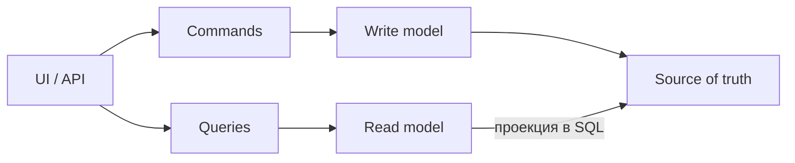

Write model может быть нормализованной, объектной и богатой бизнес-правилами. Read model может быть денормализованной:
например, одна таблица или документ уже содержит все поля, которые нужны экрану.

| Write model                              | Read model                                      |
|------------------------------------------|-------------------------------------------------|
| защищает инварианты                      | отдает готовые представления                    |
| использует агрегаты и транзакции         | использует проекции и индексы                   |
| выбирает структуру под правила изменения                       | часто денормализует данные                      |
| оптимизирована под корректные изменения  | оптимизирована под быстрые query                |
| обычно является источником истины        | может быть перестроена из write side            |

## Когда CQRS не нужен

Прежде чем погружаться в варианты реализации, стоит отсечь случаи, когда CQRS — лишняя сложность.

Если одна модель удобна для записи и чтения, а медленный запрос ускоряется индексом, оставьте обычный CRUD.
Количество чтений само по себе ничего не решает. Если командам и запросам тесно в одной модели, начните с общей базы.
Требование немедленно видеть изменения совместимо с таким разделением. Для отдельной асинхронной проекции нужно
дополнительно договориться о допустимой задержке и восстановлении после сбоев.

## Вариант 1: одна база, две модели в коде

Самый мягкий вариант CQRS: приложение разделяет command handlers и query handlers, но использует одну базу и одну
схему.

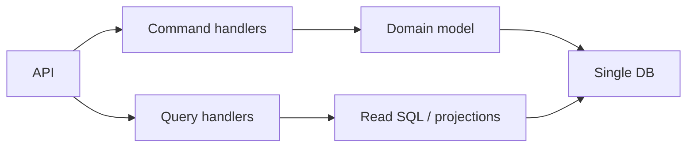

Плюсы:

- проще внедрить;
- не появляется отдельное хранилище;
- read и write код уже разделены;
- можно постепенно выделять горячие read-сценарии.

Минусы:

- база остается общей точкой нагрузки;
- read model еще не хранится отдельно;
- сложные запросы могут по-прежнему быть дорогими.

## Вариант 2: одна база, разные схемы

Второй вариант: write side пишет в нормализованные таблицы, а read side читает из денормализованных read-таблиц или
materialized views в той же базе.

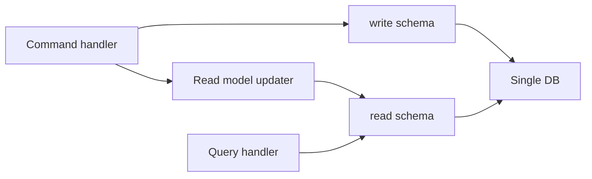

Плюсы:

- read-запросы становятся проще;
- можно подготовить данные под конкретные экраны;
- обе схемы обслуживает одна СУБД.

Минусы:

- данные дублируются;
- нужно обновлять read schema;
- write может стать медленнее, если read schema обновляется синхронно.

## Вариант 3: разные сервисы и разные хранилища

Третий вариант: write side и read side могут быть разными сервисами с разными хранилищами. Например, write side хранит
заказы в PostgreSQL, а read side держит поисковую модель в Elasticsearch или быстрые карточки в Redis.

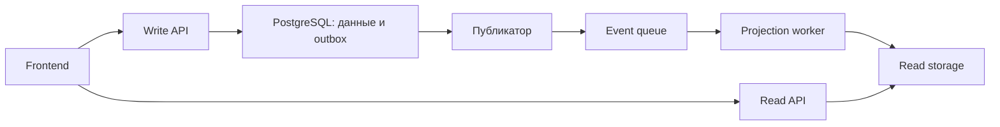

Плюсы:

- read и write масштабируются независимо;
- можно выбрать разные технологии хранения;
- сложные read-сценарии не давят на write database.

Минусы:

- выше эксплуатационная сложность;
- почти неизбежна eventual consistency;
- нужны очереди, retry, outbox, мониторинг lag;
- сложнее локальная разработка и тестирование.

## Как обновлять read model

Есть два базовых варианта.

Если обе модели в одной базе, обработчик может изменить их в одной транзакции. Читатель увидит обе записи после commit. Два последовательных вызова к разным хранилищам такой атомарности не дают.

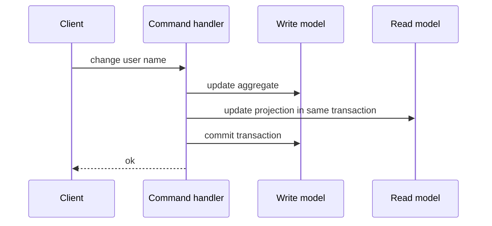

Асинхронное обновление: command handler меняет write model и публикует событие. Отдельный обработчик позже обновляет
read model.

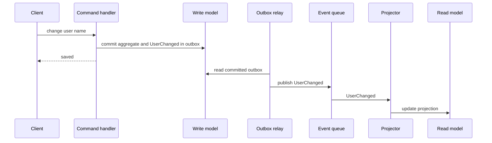

| Подход       | Плюсы                                      | Минусы                                                  |
|--------------|--------------------------------------------|---------------------------------------------------------|
| Синхронный   | read model сразу актуальна                 | write медленнее, больше связность                       |
| Асинхронный  | write быстрее, read side можно масштабировать | чтение может отставать до обработки события                   |

## Команды, запросы и обработчики

Команда выражает намерение изменить систему. Handler загружает агрегат, проверяет бизнес-правила, меняет write model и
фиксирует факт изменения. В следующих фрагментах репозиторий и накопитель событий участвуют в одной единице работы. Отклонённая смена имени не создаёт события, успешная готовит запись для outbox.

::: multi-code "Command handler: смена имени пользователя" {playground=off}

```kotlin
data class ChangeUserNameCommand(
    val userId: UserId,
    val newName: String
)

class ChangeUserNameCommandHandler(
    private val users: UserRepository,
    private val events: DomainEvents
) {
    fun handle(command: ChangeUserNameCommand): Result {
        val user = users.getById(command.userId)

        if (!user.canChangeNameTo(command.newName)) {
            return Result.error("Name cannot be changed")
        }

        user.changeName(command.newName)
        users.save(user)
        events.add(UserChanged(command.userId))
        return Result.ok()
    }
}
```

```csharp
public sealed record ChangeUserNameCommand(UserId UserId, string NewName);

public sealed class ChangeUserNameCommandHandler
{
    private readonly IUserRepository _users;
    private readonly IDomainEvents _events;

    public Result Handle(ChangeUserNameCommand command)
    {
        var user = _users.GetById(command.UserId);

        if (!user.CanChangeNameTo(command.NewName))
            return Result.Error("Name cannot be changed");

        user.ChangeName(command.NewName);
        _users.Save(user);
        _events.Add(new UserChanged(command.UserId));
        return Result.Ok();
    }
}
```

```java
record ChangeUserNameCommand(UserId userId, String newName) {}

class ChangeUserNameCommandHandler {
    private final UserRepository users;
    private final DomainEvents events;

    Result handle(ChangeUserNameCommand command) {
        var user = users.getById(command.userId());

        if (!user.canChangeNameTo(command.newName())) {
            return Result.error("Name cannot be changed");
        }

        user.changeName(command.newName());
        users.save(user);
        events.add(new UserChanged(command.userId()));
        return Result.ok();
    }
}
```

```go
type ChangeUserNameCommand struct {
    UserID  UserID
    NewName string
}

type ChangeUserNameCommandHandler struct {
    users  UserRepository
    events DomainEvents
}

func (h ChangeUserNameCommandHandler) Handle(command ChangeUserNameCommand) Result {
    user := h.users.GetByID(command.UserID)

    if !user.CanChangeNameTo(command.NewName) {
        return ResultError("name cannot be changed")
    }

    user.ChangeName(command.NewName)
    h.users.Save(user)
    h.events.Add(UserChanged{UserID: command.UserID})
    return ResultOK()
}
```

:::

Запрос списка авторов не меняет предметное состояние. Экран получает DTO с именем и аватаром, без загрузки агрегата пользователя. Доступ к проекту проверяется до выборки.

::: multi-code "Read query: готовая read model" {playground=off}

```kotlin
data class UserShortView(
    val id: String,
    val displayName: String,
    val avatarUrl: String?
)

class UserQueries(private val readDb: UserReadDb) {
    fun findProjectCommenters(projectId: String): List<UserShortView> {
        return readDb.findCommenters(projectId)
    }
}
```

```csharp
public sealed record UserShortView(
    string Id,
    string DisplayName,
    string? AvatarUrl);

public sealed class UserQueries
{
    private readonly IUserReadDb _readDb;

    public UserShortView[] FindProjectCommenters(string projectId)
    {
        return _readDb.FindCommenters(projectId);
    }
}
```

```java
record UserShortView(String id, String displayName, String avatarUrl) {}

class UserQueries {
    private final UserReadDb readDb;

    List<UserShortView> findProjectCommenters(String projectId) {
        return readDb.findCommenters(projectId);
    }
}
```

```go
type UserShortView struct {
    ID          string
    DisplayName string
    AvatarURL   *string
}

type UserQueries struct {
    readDB UserReadDB
}

func (q UserQueries) FindProjectCommenters(projectID string) []UserShortView {
    return q.readDB.FindCommenters(projectID)
}
```

:::

## Обновление read model по событию

Projection handler принимает событие и обновляет read model. Он не принимает бизнес-решение заново: решение уже принято
write side. Его задача - привести read representation к новому состоянию.

::: multi-code "Read model updater: UserChanged" {playground=off}

```kotlin
data class UserChanged(val userId: UserId)

class UserShortViewUpdater(
    private val users: UserRepository,
    private val readDb: UserReadDb
) : EventHandler<UserChanged> {
    override fun handle(event: UserChanged) {
        val user = users.getById(event.userId)
        readDb.upsert(
            UserShortView(
                id = user.id.value,
                displayName = user.profile.displayName,
                avatarUrl = user.profile.avatarUrl
            )
        )
    }
}
```

```csharp
public sealed record UserChanged(UserId UserId);

public sealed class UserShortViewUpdater : IEventHandler<UserChanged>
{
    private readonly IUserRepository _users;
    private readonly IUserReadDb _readDb;

    public void Handle(UserChanged @event)
    {
        var user = _users.GetById(@event.UserId);
        _readDb.Upsert(new UserShortView(
            user.Id.Value,
            user.Profile.DisplayName,
            user.Profile.AvatarUrl));
    }
}
```

```java
record UserChanged(UserId userId) {}

class UserShortViewUpdater implements EventHandler<UserChanged> {
    private final UserRepository users;
    private final UserReadDb readDb;

    public void handle(UserChanged event) {
        var user = users.getById(event.userId());
        readDb.upsert(new UserShortView(
            user.id().value(),
            user.profile().displayName(),
            user.profile().avatarUrl()
        ));
    }
}
```

```go
type UserChanged struct {
    UserID UserID
}

type UserShortViewUpdater struct {
    users  UserRepository
    readDB UserReadDB
}

func (u UserShortViewUpdater) Handle(event UserChanged) {
    user := u.users.GetByID(event.UserID)
    u.readDB.Upsert(UserShortView{
        ID:          user.ID.Value,
        DisplayName: user.Profile.DisplayName,
        AvatarURL:   user.Profile.AvatarURL,
    })
}
```

:::

Здесь событие несёт только идентификатор — обработчик перечитывает актуальный профиль. Два последовательных повтора
одного уведомления запишут одну строку по ключу пользователя. При параллельной обработке старый снимок всё ещё может
записаться последним. Для такого режима передают версию вместе со снимком и атомарно применяют обновление, только
если входящая версия новее сохранённой. Пусть в хранилище проекции есть уникальный ключ `user_id`. Тогда для **полных снимков** достаточно одной условной
записи. В SQL ниже двоеточием обозначены параметры.

```sql
INSERT INTO user_short_view (user_id, display_name, avatar_url, version)
VALUES (:id, :name, :avatar, :version)
ON CONFLICT (user_id) DO UPDATE SET
    display_name = excluded.display_name,
    avatar_url = excluded.avatar_url,
    version = excluded.version
WHERE excluded.version > user_short_view.version;
```

Подайте последовательно «Анна, v18», повтор того же снимка и «Аня, v17». В строке останется «Анна, v18».
Для события-приращения вроде «добавлен один отзыв» пропуск версии уже меняет итог. Для удаления нужен отдельный
сигнал и сохранённая версия удаления, чтобы старый снимок не воскресил профиль.

## Unit of Work, ChangeTracker и уведомления

В примере смены имени `save` и `events.add` подготавливают изменения одной единицы работы (Unit of Work).
Трекер изменений ORM помогает найти затронутые сущности **до** фиксации. Вид события определяет доменная операция.

Декоратор оборачивает уже знакомый обработчик смены имени. Внутренняя функция получает транзакцию и команду. Например, в Kotlin она вызывает `ChangeUserNameCommandHandler(tx.users, tx.events).handle(command)`. Репозиторий записывает профиль в таблицу пользователей, а декоратор помещает события в таблицу outbox той же базы. Для каждого вызова создаётся свой накопитель событий.

В примере `UnitOfWork.run` фиксирует транзакцию только при успешном результате. При отказе, исключении или ошибке записи он выполняет откат. Вариант Go возвращает ошибку хранилища внутри результата. `Result` во всех вкладках — тип результата этой команды.

::: multi-code "Декоратор команды сохраняет события в той же транзакции" {playground=off}

```kotlin
fun withOutbox(
    uow: UnitOfWork,
    inner: (WriteTx, ChangeUserNameCommand) -> Result
): (ChangeUserNameCommand) -> Result = { command ->
    uow.run { tx ->
        val result = inner(tx, command)
        if (result.isSuccess) {
            tx.outbox.appendAll(tx.events.pending())
        }
        result
    }
}
```

```csharp
using System;

static class CommandDecorators
{
    public static Func<ChangeUserNameCommand, Result> WithOutbox(
        IUnitOfWork uow, Func<IWriteTx, ChangeUserNameCommand, Result> inner)
    {
        return command => uow.Run(tx =>
        {
            var result = inner(tx, command);
            if (result.IsSuccess)
                tx.Outbox.AppendAll(tx.Events.Pending());
            return result;
        });
    }
}
```

```java
import java.util.function.BiFunction;
import java.util.function.Function;

final class CommandDecorators {
    static Function<ChangeUserNameCommand, Result> withOutbox(
            UnitOfWork uow, BiFunction<WriteTx, ChangeUserNameCommand, Result> inner) {
        return command -> uow.run(tx -> {
            var result = inner.apply(tx, command);
            if (result.isSuccess()) {
                tx.outbox().appendAll(tx.events().pending());
            }
            return result;
        });
    }
}
```

```go
func WithOutbox(
    uow UnitOfWork,
    inner func(WriteTx, ChangeUserNameCommand) Result,
) func(ChangeUserNameCommand) Result {
    return func(command ChangeUserNameCommand) Result {
        return uow.Run(func(tx WriteTx) Result {
            result := inner(tx, command)
            if result.IsSuccess() {
                if err := tx.Outbox.AppendAll(tx.Events.Pending()); err != nil {
                    return ResultStorageError(err)
                }
            }
            return result
        })
    }
}
```

:::

Проверьте декоратор на сбое вставки в outbox. После отката в таблице пользователей осталось прежнее имя, в outbox нет новой строки. При успешном повторе видно новое имя и одну строку `UserChanged`. Эту строку позднее прочитает отдельный отправитель.

Что произойдёт, если сначала записать профиль, а потом вызвать публикацию в брокер из того же процесса?
Сбой между этими шагами оставит в базе новое имя, а в проекции — старое. При использовании outbox после перезапуска
публикатор найдёт неподтверждённую запись и отправит её. Если он упал после отправки, но до отметки об успехе, возможен
дубль. Поэтому потребитель применяет событие идемпотентно. Подробнее — в [лекции 12](/lectures/12).

## Eventual consistency

Сразу после успешной записи проекция может показывать прежнее состояние. Eventual consistency означает, что, если новые изменения прекратились, а доставка и обработка восстановились, проекция в итоге догонит источник. Фиксированный срок из этого свойства не следует.

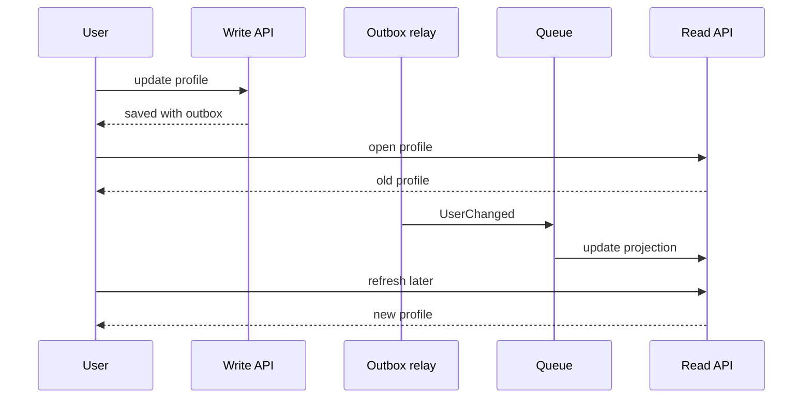

::: details Что такое eventual consistency простыми словами
Если пользователь изменил имя и сразу открыл страницу профиля, он может на секунду увидеть старое имя. Это не значит,
что запись потерялась. Это значит, что read model еще не догнала write model. Для одних сценариев это нормально, для
других недопустимо.
:::

Eventual consistency приемлема только тогда, когда бизнес и пользовательский опыт выдерживают задержку. В банковском
балансе, продаже последнего билета или управлении доступом требования обычно строже, чем в обновлении публичного
профиля или поискового индекса.

## Как жить с eventual consistency

Пусть цена товара зафиксирована как версия 18, а карточка показывает версию 17. Интерфейс редактора может дождаться
версии 18 с ограниченным таймаутом или сразу показать результат команды. Другому покупателю можно показать карточку
в пределах обещанного срока свежести. При оформлении заказа сервер заново проверяет условия продажи.

Есть несколько практических приемов:

- показать пользователю статус "изменения приняты, обновление появится через несколько секунд";
- после write читать свежие данные напрямую из write side для этого пользователя, если нужен read-your-writes;
- блокировать повторное действие до завершения projection;
- показывать `lastUpdatedAt` или "данные актуальны на";
- использовать outbox и retry, чтобы событие не потерялось;
- измерять время от commit до применения события и возраст старейшего необработанного события — последний показатель растёт даже при остановке обработчика;
- договориться с бизнесом о компенсациях, если редкий конфликт дешевле, чем строгая синхронизация.

Два покупателя могут видеть один остаток. В нашем магазине второй получит отказ при резервировании, пока первый
сохраняет подтверждённый заказ. Если магазин разрешает предзаказ, второй заказ можно принять с другим сроком поставки.
Это отдельное бизнес-правило.

## Кэш vs CQRS read model

Кэш и read model похожи тем, что оба ускоряют чтение. Но смысл у них разный.

| Вопрос                    | Кэш                                             | CQRS read model                                      |
|---------------------------|--------------------------------------------------|------------------------------------------------------|
| Что хранит                | копию ответа или объекта                         | специально спроектированное представление            |
| Источник истины           | основная база                                    | write model                                          |
| Можно ли очистить         | обычно да, кэш восстановится                     | можно, но часто нужен процесс перестроения projection |
| Главная цель              | не повторять дорогую операцию                    | читать данные в форме, удобной для query             |
| Обновление                | TTL, invalidation, refresh                       | SQL по общей базе, синхронная или отложенная проекция            |
| Типичный риск             | устаревшая копия                                 | отставание асинхронной проекции                                 |

Если дорогой запрос уже возвращает подходящую форму и часто повторяется, проверьте, окупится ли кэш. Если query каждый раз собирает неудобную форму
из сложной write model, стоит рассмотреть read model.

## Чеклист выбора решения

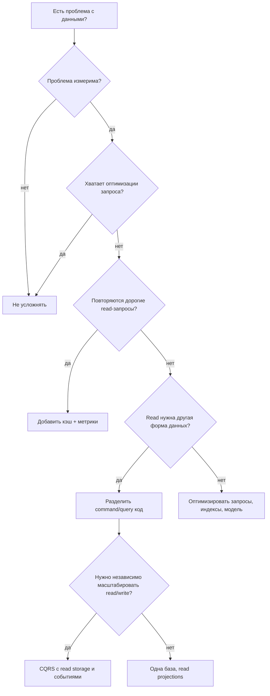

Практический порядок обычно такой:

1. Измерить проблему.
2. Проверить индексы, запросы и простую модель.
3. Добавить cache-aside для дорогого повторного чтения.
4. Ввести отдельные query handlers, если read и write код начинают мешать друг другу.
5. Выделять read model только для конкретных сценариев.
6. Переходить к отдельному read storage только при реальной потребности в масштабировании или другой технологии поиска.

## Резюме

Кэширование — это способ сократить повторную стоимость чтения или вычисления. Оно требует ключей, TTL, инвалидации,
eviction policy, метрик и ясного понимания stale data. Начинать стоит с простых решений: cache-aside, короткий TTL,
наблюдение за hit rate и miss rate.

CQRS — это способ разделить модель записи и модель чтения. Он полезен, когда write side должна защищать сложные
инварианты, а read side должна быстро отдавать разные представления данных. CQRS можно применять постепенно: сначала
разделить command/query код, потом добавить read projections, и только при необходимости выделять отдельные хранилища.

Главный критерий для обоих подходов один: дополнительная сложность должна окупаться измеримой пользой.

Остановите проектор, оставив сеть исправной. Карточка всё ещё показывает одну клавиатуру, хотя склад уже принял последний резерв. Экран отстал из-за очереди. Сколько покупателей видят такой ответ и как долго? Чтобы ответить, сравните показанную версию с версией в источнике и временем её фиксации. Попадание в кэш само по себе измеряет только повторное использование копии. Из этой проверки в [лекции 14](/lectures/14#observability) получится показатель качества для пользователя.

## Дополнительное чтение

### Кэш и параллельные загрузки

- [Microsoft Azure Architecture Center — Cache-Aside](https://learn.microsoft.com/en-us/azure/architecture/patterns/cache-aside) — в каком порядке обновить источник и удалить копию.
- [Amazon Builders’ Library — Caching challenges and strategies](https://aws.amazon.com/builders-library/caching-challenges-and-strategies/) — отказ зависимости, отрицательные ответы и два срока свежести.
- [Go — пакет singleflight](https://pkg.go.dev/golang.org/x/sync/singleflight) — пример с двумя перекрывающимися вызовами и контракт общей попытки.
- [Redis — Key eviction](https://redis.io/docs/latest/develop/reference/eviction/) — выбор записи при нехватке памяти.
- [Redis — Pub/Sub](https://redis.io/docs/latest/develop/pubsub/) — что происходит с уведомлением при отключении подписчика.

### Модели команд и запросов

- [Martin Fowler — CQRS](https://martinfowler.com/bliki/CQRS.html) — как расхождение моделей чтения и записи влияет на выбор границы разделения.
- [Microsoft Azure Architecture Center — CQRS](https://learn.microsoft.com/en-us/azure/architecture/patterns/cqrs) — варианты с общей базой и с отдельными хранилищами.
- [Chris Richardson — Transactional Outbox](https://microservices.io/patterns/data/transactional-outbox.html) — фиксация события вместе с данными и причина повторной доставки.

## Вопросы для самопроверки

1. Чем cache miss отличается от cache hit?
2. Почему кэш не должен быть источником истины?
3. Чем TTL отличается от инвалидации?
4. Когда LRU может быть лучше FIFO?
5. Какие ошибки можно кэшировать, а какие нельзя?
6. Что такое cache stampede?
7. Как single flight снижает нагрузку на базу?
8. Когда можно отдавать stale data через fallback cache?
9. Почему на экране каталога чтений может быть больше, чем записей? Достаточно ли этого для CQRS?
10. Какие требования обычно важны для write model?
11. Какие требования обычно важны для read model?
12. Чем CQRS read model отличается от обычного кэша?
13. При каких условиях отставшая асинхронная проекция догонит источник?
14. Где в такой архитектуре нужен outbox?
15. Какие признаки говорят, что CQRS пока не нужен?

## Мини-практика

У карточки `42` общий рейтинг и персональная скидка. Рейтинг разрешено показывать с отставанием до пяти минут.
На складе одна клавиатура. Сервис работает в пяти репликах.

1. Выпишите содержимое общего ключа и поля, добавляемые для конкретного покупателя. Покажите ответы Анне и Борису
   с разными скидками при одном попадании в общий кэш.
2. Направьте сто запросов одной реплике на пустой ключ. Удерживайте загрузчик до присоединения всех участников.
   Проверьте число загрузок при успехе и при отказе, затем немедленно повторите запрос. Объясните, что изменится
   при распределении запросов между пятью репликами.
3. В 12:00 записан рейтинг, в 12:01 пришёл новый отзыв, уведомление об изменении потерялось. Когда перестанет
   выдаваться старая копия при абсолютном TTL пять минут? Используйте источник без собственного отставания.
4. Для выдачи по рейтингу выберите между запросом SQL и отдельной проекцией. Если выбрали проекцию, проиграйте
   получение полных снимков версий 18, 18, 17. Затем два покупателя одновременно пытаются купить последний товар.
   Укажите, где проверяется остаток.

::: details Как проверить решение
Общая запись не содержит скидки. При ста перекрывающихся запросах в одном реестре база получает один вызов,
включая случай общей ошибки. После ошибки новый запрос доводит счётчик до двух. Пять отдельных реестров могут начать
по загрузке каждый. В 12:05 старая запись истекает. Условное обновление проекции оставит версию 18 после дубля
и запоздалой версии 17. Независимо от формы чтения атомарное резервирование на стороне записи может подтвердить
только одну покупку.
:::
