# Лекция 14. DevOps, SRE и Observability

В пятницу команда выкатила новое правило скидки. Тесты прошли, сервис заказов отвечает на проверку здоровья. Через двадцать минут поддержка присылает номера заказов, по которым покупатели всё ещё ждут подтверждения оплаты. Как дежурному решить, стоит ли остановить релиз? Как узнать, у кого уже списаны деньги?

В этой лекции пройдём тот же путь второй раз, уже с позиции команды, которая проектирует поставку и эксплуатацию сервиса. DevOps помогает довести изменение до пользователя, SRE (Site Reliability Engineering) задаёт измеримую цель надёжности, а наблюдаемость (observability) помогает объяснить, что случилось с конкретным заказом.

::: tip Как работать с примерами
Выберите язык примера. На вкладке Kotlin откройте Playground, чтобы поменять входные данные и сравнить результат со своим прогнозом.
:::

## Путь изменения

Правило скидки живёт в доменной модели. После изменения разработчик запускает тесты и проверяет контракт API. Система поставки собирает образ и развёртывает новую версию на части экземпляров. Когда первые запросы попадают на эти экземпляры, команда уже может сравнить их с предыдущей версией.

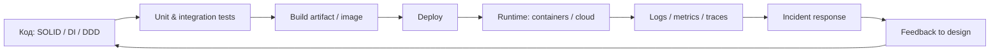

Связи с предыдущими лекциями прямые: DI делает код тестируемым
([Лекция 2](/lectures/02#di-и-тесты)), тесты попадают в pipeline
([Лекция 3](/lectures/03#зачем-разработчику-тестирование)), локальную БД можно запустить из образа
([Лекция 9](/lectures/09#инфраструктурныи-контекст-где-живет-база-данных)), API и очереди требуют понятных контрактов
([Лекция 10](/lectures/10#четыре-уровня-обмена), [Лекция 11](/lectures/11#контракт-сообщения)), Saga/Outbox требуют
операторской видимости ([Лекция 12](/lectures/12#наблюдаемость-и-эксплуатация)), а кэш/CQRS должны иметь метрики
([Лекция 13](/lectures/13#метрики-кэша)).

## Разбор релиза сервиса заказов

### Ситуация

Новое правило доступно первым десяти процентам покупателей. Внешний симптом один и тот же и для медленного банка, и для ошибки в обработчике скидки — клиент видит «Ожидание оплаты».

### Наивное решение

Дать новой версии весь трафик, как только процесс запустился и CPU вернулся в норму. При жалобе найти заказ по номеру в логе API и предложить клиенту повторить оплату.

### Что ломается

API уже ответил, а вызов платёжного шлюза завершился тайм-аутом. Банк мог принять платёж и не успеть вернуть ответ в отведённые две секунды. Повторное списание и откат кода никак не проясняют исход первого вызова.

### Улучшение

Дежурный приостанавливает расширение выкладки и сравнивает время оплаты и долю технических ошибок у обеих версий. По номеру заказа находит событие ожидания, а по идентификатору трассы переходит к вызову шлюза. Пока результат неизвестен, заказ остаётся в ожидании. Обработчик сверяет статус платежа у провайдера по идентификатору операции. Повтор допустим по контракту провайдера с тем же ключом идемпотентности.

### Почему это работает

Каждый шаг отвечает на свой вопрос. Сравнение версий проверяет гипотезу о регрессии. Трасса указывает границу, за которой возникла задержка. Запись у платёжного провайдера позволяет завершить уже начатую операцию. Остановить дальнейшую выкладку можно ещё до того, как станет известна причина.

## Почему старый процесс ломался

Классическая проблема разработки не в том, что люди не хотят работать вместе. Проблема в том, что процесс часто устроен
так, будто команды могут долго работать отдельно, а потом безболезненно соединить результаты. Разработчики пишут код,
эксплуатация узнает о требованиях к окружению перед релизом, безопасность приходит на приемку, бизнес долго не видит
работающий продукт.

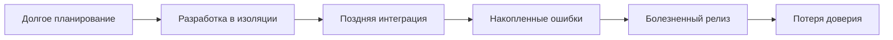

Разрыв проявляется по-разному для разных участников.

| Участник | Что обычно болело | Чего хотелось |
|---|---|---|
| Разработчики | дедлайны, ручные релизы, "у меня работает" | быстро получить результат проверки и не чинить окружение вручную |
| Эксплуатация | невоспроизводимые серверы, неясные требования, ночные выкладки | описанное окружение и предсказуемый релиз |
| Безопасность | подключение перед сдачей, игнорирование некритичных замечаний | раннее участие и автоматические проверки |
| Бизнес | неизвестные сроки, рост стоимости, поздняя демонстрация результата | частые поставки и понятный риск |

DevOps появился как ответ на этот разрыв. При небольших частых изменениях разработка, эксплуатация и безопасность видят результат достаточно рано, чтобы исправить его до следующей выкладки.

## DevOps: культура, практики и роль

DevOps объединяет совместную ответственность за сервис и инженерные практики, которые её поддерживают. Например, разработчик добавляет тест оплаты, специалист по эксплуатации помогает измерить задержку у пользователей, и оба заранее договариваются, при каком сигнале остановят выкладку.

В некоторых командах есть должность DevOps-инженера. Этот человек может поддерживать сборку, окружения и управление секретами. За поведение кода после релиза по-прежнему отвечает команда сервиса.

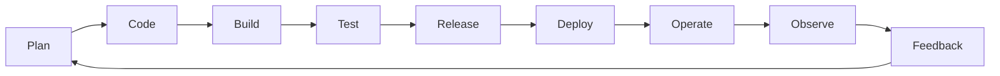

| Практика | Что дает | Типичный результат |
|---|---|---|
| Continuous Integration (CI) | частую интеграцию изменений | частое слияние в основную ветку и быстрые автоматические проверки |
| Continuous Delivery | готовность выпускать в любой момент | релизный артефакт и проверенный staging |
| Continuous Deployment | автоматический выпуск после успешных проверок | после проверок выпуск запускается автоматически |
| Infrastructure as Code | воспроизводимое окружение | Terraform, Kubernetes manifests, Helm charts |
| Контейнеризация | один образ с приложением и его зависимостями | OCI image, Dockerfile, image registry |
| Управление конфигурацией | отделение настроек от кода | config maps, environment variables, feature flags |
| Управление секретами | безопасное хранение ключей | Vault, cloud secret manager, sealed secrets |
| Observability | диагностику production | метрики, логи, трейсы, дашборды, алерты |
| Security scanning | раннее обнаружение уязвимостей | SAST, dependency scan, image scan |

## Pipeline от commit до production

Pipeline — это формализованный путь изменения. Он не должен быть набором героических ручных действий. Если команда
каждый раз вспоминает, какие команды запускать перед релизом, процесс еще не стал инженерным.

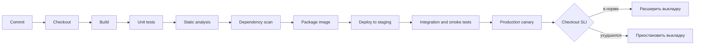

Для сервиса заказов договоримся о двух маршрутах. Для предлагаемого изменения достаточно сборки и проверок. После слияния в основную ветку pipeline повторяет их для итогового коммита и выдаёт образ для выкладки. Схема ниже — описание этапов в YAML.

```yaml
pull_request:
  - build_and_test
  - check_contracts_and_dependencies
main_after_merge:
  - build_and_test
  - check_contracts_and_dependencies
  - build_scan_and_push_image
  - deploy_image_by_digest_to_staging
  - run_integration_and_checkout_smoke_tests
  - deploy_same_digest_to_production_canary
  - compare_checkout_signals_before_expanding
```

Проверочный заказ на staging проходит через тестовый платёжный шлюз. В production новая версия сначала получает небольшую долю трафика (canary). Если на ней растёт доля зависших заказов, команда останавливает расширение выкладки. При continuous delivery решение о выпуске может принимать человек. При continuous deployment успешно прошедшие проверки запускают выпуск автоматически.

::: warning Pipeline не спасает плохой дизайн
Pipeline быстрее показывает проблемы, но не делает архитектуру автоматически хорошей. Если сервис нельзя протестировать,
настроить или откатить без ручных правок, автоматизация только подчеркнет этот долг.
:::

## Контейнеризация

В [лекции 9](/lectures/09#инфраструктурныи-контекст-где-живет-база-данных) команда поднимала PostgreSQL в Docker для локальной разработки. Теперь образ нужен для поставки самого сервиса.

Контейнеризация решает ключевую DevOps-проблему: артефакт, который прошел проверки в pipeline, можно тем же
способом запустить в staging и production.

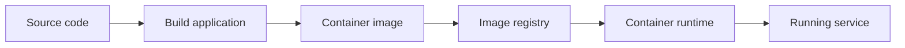

| Понятие | Что означает |
|---|---|
| Image | неизменяемый шаблон с приложением и зависимостями |
| Container | запущенный экземпляр image |
| Registry | хранилище images, из которого окружения забирают артефакты |
| Runtime | среда, которая запускает контейнеры |
| Orchestrator | система, которая управляет множеством контейнеров, например Kubernetes |

Важно не путать контейнер с виртуальной машиной. Контейнер обычно легче и быстрее стартует, но разделяет ядро хоста.
Настройки сети, секреты и лимиты ресурсов зависят от окружения. Тег образа можно переназначить. Pipeline сохраняет digest опубликованного образа, а staging и production получают ссылку вида `имя@sha256:…` на одно и то же содержимое.

## Infrastructure as Code и GitOps

Infrastructure as Code (IaC) позволяет хранить описание инфраструктуры в коде, обсуждать изменения на ревью и воспроизводить их в другом окружении. Код может задавать последовательность действий или желаемое состояние. Например, команда записывает, сколько экземпляров сервиса заказов должно работать и какой digest они запускают.

| Подход | Кто применяет изменение | Что произойдёт после ручной правки |
|---|---|---|
| Ручная настройка | Инженер меняет окружение напрямую | Расхождение придётся найти и описать |
| IaC с запуском из CI | Pipeline применяет проверенный код | Следующая сверка может обнаружить расхождение |
| GitOps | Агент сам получает версию декларации и сверяет её с окружением | Агент пытается вернуть систему к заданному состоянию |

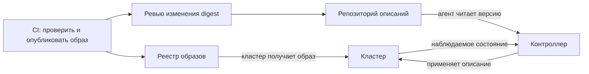

GitOps обычно держится на четырех идеях:

- инфраструктура и приложения описаны декларативно;
- каждая версия описания неизменяема и доступна в истории (обычно в Git);
- агент сам забирает новую версию описания;
- фактическое состояние постоянно сравнивается с желаемым.

::: details Почему простой deploy-скрипт еще не GitOps
Deploy-скрипт может быть полезен, но он обычно отвечает на вопрос "какие команды выполнить". В GitOps агент регулярно проверяет, достигнуто ли желаемое состояние. Если образ недоступен в реестре, контроллер обнаружит расхождение и повторит попытку. Команде всё равно придётся восстановить доступ к образу.
:::

## Смежные роли

На дежурстве полезно знать, кто может остановить выкладку, кто видит платёжный контракт и кто поддерживает кластер. Названия должностей зависят от компании. В таблице — примеры зон работы.

::: details Сравнительная таблица ролей

| Роль | За что обычно отвечает | Пример для команды заказов |
|---|---|---|
| DevOps-инженер | Сборка, поставка и окружения | Доставить проверенный образ на часть экземпляров |
| SRE | Надёжность, дежурства, снижение повторяющейся ручной работы | Договориться о SLO и проверить, когда алерт вызовет человека |
| Platform Engineer | Внутренняя платформа для команд | Предоставить шаблон сервиса с готовой передачей контекста трассировки |
| Cloud Engineer | Облачные сети, доступ и вычислительные ресурсы | Обеспечить связь сервиса с хранилищем и ограничить права записи |
| DevSecOps Engineer | Проверки безопасности при разработке и поставке | Встроить поиск секретов в проверку изменений |
| MLOps Engineer | Обучение, поставка и наблюдение за моделями | Связать версию модели скидок с данными, на которых её обучали |

:::

## Как оценить процесс поставки

Для одного сервиса DORA предлагает следить за пятью показателями в динамике. Три описывают пропускную способность поставки, ещё два — её нестабильность.

| Группа | Показатель | Что считает команда заказов |
|---|---|---|
| Пропускная способность | Change lead time | Время от коммита до его развёртывания в production |
| Пропускная способность | Deployment frequency | Число развёртываний в production за период |
| Пропускная способность | Failed deployment recovery time | Время восстановления после неудачной выкладки, потребовавшей немедленного вмешательства |
| Нестабильность | Change fail rate | Доля выкладок, после которых потребовалось немедленно вмешаться |
| Нестабильность | Deployment rework rate | Доля всех выкладок, выполненных вне плана из-за инцидентов в production |

За неделю команда сделала десять выкладок. Одна сломала оплату. Чтобы восстановить сервис, понадобились две внеплановые выкладки, обе вошли в эти десять и сами прошли успешно. Тогда change fail rate равен 1/10, а deployment rework rate — 2/10. Независимый сбой банка скажется на покупателях, но его длительность сама по себе не входит во время восстановления после неудачной выкладки. Эти показатели характеризуют поставку сервиса всей командой. [Руководство DORA](https://dora.dev/guides/dora-metrics/)

## SRE и надежность как инженерная дисциплина

Частота релизов ничего не говорит покупателю, который ждёт результата оплаты. Как сформулировать обещание, которое команда сможет проверить? Возьмём один сценарий и договоримся, где именно считать события.

- **SLI** (service level indicator) — измеряемая характеристика сервиса. В примере считаем на шлюзе долю корректных запросов на оплату, получивших определённый результат за две секунды. Подтверждение и штатный отказ банка считаем хорошими исходами. Тайм-аут и технический сбой — плохими. Каждый входящий запрос учитываем один раз, внутренние повторы к банку отдельно в знаменатель не входят.
- **SLO** (service level objective) задаёт цель для этого индикатора. В скользящем окне 30 дней доля хороших запросов должна быть не ниже 99,9 %.
- **SLA** (service level agreement) — соглашение с заказчиком об уровне сервиса и последствиях его нарушения. Внутреннюю цель команда может выбрать строже договорной.
- **Бюджет ошибок** (error budget) — допустимая доля плохих событий за окно. Для нашей цели это 0,1 %. Если подходящих запросов за окно не было, значение SLI не определено.

За 30 дней шлюз увидел 1 000 000 подходящих запросов, из них 650 плохих. Допустимы 1 000 плохих запросов, осталось 350. Фактический SLI равен 99,935 %, израсходовано 65 % бюджета. Его остаток помогает решить, каким изменениям дать ход. Например, при исчерпанном бюджете команда откладывает рискованные релизы, но выпускает исправление причины сбоя.

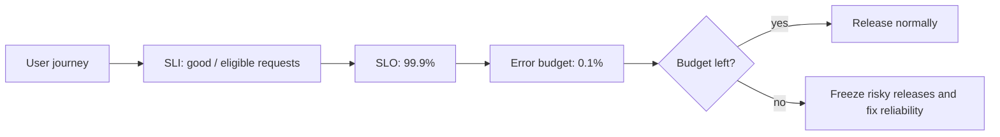

В примерах фиксируем именно SLO 99,9 %. Для неотрицательного числа запросов достаточно целого деления на 1 000. При 999 запросах даже одна ошибка нарушила бы цель. Отрицательный остаток показывает размер превышения. На вход подаём счётчики за одно окно, где число ошибок лежит от нуля до числа запросов.

::: multi-code "Бюджет ошибок для SLO 99,9 %"

```kotlin
fun allowedFailures(requests: Long): Long = requests / 1_000

fun remainingBudget(requests: Long, failed: Long): Long =
    allowedFailures(requests) - failed
```

```kotlin playground
fun allowedFailures(requests: Long): Long = requests / 1_000

fun remainingBudget(requests: Long, failed: Long): Long =
    allowedFailures(requests) - failed

fun main() {
    check(allowedFailures(999) == 0L)
    check(remainingBudget(1_000, 2) == -1L)
    println(allowedFailures(1_000_000))
    println(remainingBudget(1_000_000, 650))
}
```

```csharp
long AllowedFailures(long requests) => requests / 1_000;
long RemainingBudget(long requests, long failed) => AllowedFailures(requests) - failed;

Console.WriteLine(AllowedFailures(1_000_000));
Console.WriteLine(RemainingBudget(1_000_000, 650));
```

```java
class Main {
    static long allowedFailures(long requests) { return requests / 1_000; }
    static long remainingBudget(long requests, long failed) {
        return allowedFailures(requests) - failed;
    }

    public static void main(String[] args) {
        System.out.println(allowedFailures(1_000_000));
        System.out.println(remainingBudget(1_000_000, 650));
    }
}
```

```go
package main

import "fmt"

func allowedFailures(requests int64) int64 { return requests / 1_000 }
func remainingBudget(requests, failed int64) int64 {
    return allowedFailures(requests) - failed
}

func main() {
    fmt.Println(allowedFailures(1_000_000))
    fmt.Println(remainingBudget(1_000_000, 650))
}
```

:::

::: details Сколько бюджета расходует быстрый ответ со старой ценой?
Вернёмся к карточке из [лекции 13](/lectures/13#метрики-кэша). У команды есть ещё одно обещание: спустя 30 секунд после фиксации новой цены покупатель должен видеть эту версию или более свежую. Для каждого ответа сравниваем показанную версию с последней версией, зафиксированной в источнике к моменту за 30 секунд до ответа. Это позволяет проверить свежесть даже при нескольких изменениях подряд.

За 30 дней все 1 000 000 запросов карточки получили HTTP 200 за 80 мс. Из них 1 200 ответов нарушили условие свежести. При цели 99,9 % получаем 998 800 хороших ответов, SLI 99,88 % и превышение бюджета на 200 ответов. Возраст старейшего необработанного события поможет найти причину. Возраст записи в кэше сам по себе её не доказывает: цена могла оставаться верной весь день.
:::

## Monitoring: black box и white box

Monitoring отвечает на вопрос: "известная проверка показала проблему или нет?" В простом виде выделяют black box и
white box мониторинг.

| Тип | Что видит | Что не видит | Примеры | Когда полезен |
|---|---|---|---|---|
| Black box | поведение снаружи | внутреннюю причину | HTTP probe, ping, synthetic transaction | проверить, доступен ли сервис пользователю |
| White box | внутренние сигналы | пользовательский путь целиком | CPU, memory, queue depth, app metrics | понять, что происходит внутри компонента |

Если балансировщик отвечает на `GET /health`, это еще не доказывает, что пользователь может оформить заказ. Заказ может
ломаться из-за платежного сервиса, базы данных, очереди или ошибки авторизации. Поэтому black box и white box не
заменяют друг друга.

Разделим три решения. **Liveness** отвечает, поможет ли перезапуск зависшего процесса. **Readiness** определяет, можно ли сейчас направлять этому экземпляру новый трафик. Независимая синтетическая проверка проходит путь покупателя и замечает сбой даже тогда, когда все экземпляры готовы принимать запросы. Если банк замедлился сразу для всех экземпляров, их массовый перезапуск только добавит проблем.

Ниже собираем сводку для дежурного по непустому набору проверок. Любой DOWN даёт DOWN, иначе любой DEGRADED даёт DEGRADED. Для работающего API и медленного платёжного сервиса ожидаем DEGRADED. Решение маршрутизатора о приёме трафика задаётся отдельно.

::: multi-code "Health check result"

```kotlin
enum class HealthStatus { UP, DEGRADED, DOWN }

data class HealthCheckResult(
    val service: String,
    val status: HealthStatus,
    val details: String
)
```

```kotlin playground
enum class HealthStatus { UP, DEGRADED, DOWN }

data class HealthCheckResult(
    val service: String,
    val status: HealthStatus,
    val details: String
)

fun overallStatus(results: List<HealthCheckResult>): HealthStatus =
    when {
        results.any { it.status == HealthStatus.DOWN } -> HealthStatus.DOWN
        results.any { it.status == HealthStatus.DEGRADED } -> HealthStatus.DEGRADED
        else -> HealthStatus.UP
    }

fun main() {
    val checks = listOf(
        HealthCheckResult("api", HealthStatus.UP, "accepting requests"),
        HealthCheckResult("payments", HealthStatus.DEGRADED, "high latency")
    )

    println("Overall status: ${overallStatus(checks)}")
    checks.forEach { println("${it.service}: ${it.status} (${it.details})") }
}
```

```csharp
public enum HealthStatus { Up, Degraded, Down }

public sealed record HealthCheckResult(
    string Service,
    HealthStatus Status,
    string Details
);

public static class HealthSummary
{
    public static HealthStatus OverallStatus(IEnumerable<HealthCheckResult> results)
    {
        if (results.Any(r => r.Status == HealthStatus.Down)) return HealthStatus.Down;
        if (results.Any(r => r.Status == HealthStatus.Degraded)) return HealthStatus.Degraded;
        return HealthStatus.Up;
    }
}
```

```java
import java.util.List;

enum HealthStatus { UP, DEGRADED, DOWN }

record HealthCheckResult(
    String service,
    HealthStatus status,
    String details
) {}

class HealthSummary
{
    static HealthStatus overallStatus(List<HealthCheckResult> results) {
        if (results.stream().anyMatch(r -> r.status() == HealthStatus.DOWN)) {
            return HealthStatus.DOWN;
        }
        if (results.stream().anyMatch(r -> r.status() == HealthStatus.DEGRADED)) {
            return HealthStatus.DEGRADED;
        }
        return HealthStatus.UP;
    }
}
```

```go
package main

type HealthStatus string

const (
    Up HealthStatus = "UP"
    Degraded HealthStatus = "DEGRADED"
    Down HealthStatus = "DOWN"
)

type HealthCheckResult struct {
    Service string
    Status HealthStatus
    Details string
}

func overallStatus(results []HealthCheckResult) HealthStatus {
    status := Up
    for _, result := range results {
        if result.Status == Down { return Down }
        if result.Status == Degraded { status = Degraded }
    }
    return status
}
```

:::

## Observability

Observability — это способность понять внутреннее состояние системы по внешним сигналам, которые она отдает. Monitoring
чаще работает с заранее известными проверками. Observability нужна, когда по сигналам нужно проверить новую гипотезу. Например, дежурный сравнивает задержку оплаты между регионами, версиями сервиса и платёжными провайдерами.

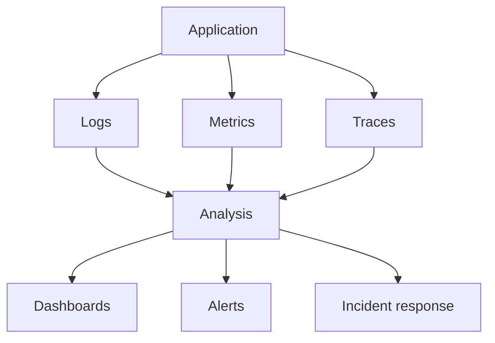

OpenTelemetry предоставляет API, SDK и средства экспорта телеметрии. Сервис передаёт собранные данные в выбранную командой систему хранения и анализа. Важно заранее договориться, какие операции измеряются и какие идентификаторы связывают записи.

::: only kotlin
В Kotlin/JVM корутина может продолжить выполнение на другом потоке. Если логгер читает идентификаторы из привязанного к потоку MDC, перенесите снимок уже заполненного MDC вместе с корутиной:

```kotlin
val tracingContext = MDCContext() // kotlinx-coroutines-slf4j
withContext(Dispatchers.IO + tracingContext) {
    logger.info("payment processing") // MDC.get("traceId") доступен
    paymentService.charge(order)
}
```

`MDCContext` из kotlinx-coroutines-slf4j переносит поля логов. За активный span и отправку контекста в следующем HTTP-запросе отвечает интеграция с трейсингом.
:::

::: only csharp
В .NET `Activity` описывает участок трассы, а `Meter` служит для создания инструментов метрик. При записи через `ILogger` передавайте номер заказа параметром шаблона сообщения: обработчик сможет сохранить его отдельным полем для поиска.
:::

::: only java
В Java агент OpenTelemetry может автоматически инструментировать поддерживаемые HTTP-клиенты и серверы. Если обработчик платёжного ответа запускается в собственном пуле потоков, проверьте, что задаче передан текущий контекст. Иначе продолжение работы может появиться отдельной трассой.
:::

::: only go
Go 1.21+ имеет `slog` в стандартной библиотеке — структурированные логи без внешней зависимости для самого логгера. Фрагмент использует API OpenTelemetry для чтения активного span:

```go
import (
    "context"
    "log/slog"

    "go.opentelemetry.io/otel/trace"
)

func HandleOrder(ctx context.Context, orderID string) {
    fields := []slog.Attr{slog.String("orderId", orderID)}
    span := trace.SpanFromContext(ctx).SpanContext()
    if span.IsValid() {
        fields = append(fields, slog.String("traceId", span.TraceID().String()))
    }
    slog.LogAttrs(ctx, slog.LevelInfo, "processing order", fields...)
}
```

Внутри Go-процесса активный span доступен через `context.Context` — тот же механизм, что и для cancellation и timeout.
Передавайте полученный контекст из middleware в обработчик и дальше в репозиторий. Для сети клиентская инструментация записывает его в заголовки запроса.
:::

## Метрики

У дежурного 50 записей о тайм-ауте. Чтобы оценить масштаб, нужен знаменатель: 50 ошибок на 100 запросов и на миллион запросов требуют разной реакции. Чтобы отличить повторы одной оплаты от независимых покупок, понадобятся записи с идентификатором операции.

Метрика — числовой сигнал во времени. Обычно встречаются три базовых типа:

| Тип | Что измеряет | Пример |
|---|---|---|
| Counter | накопленное число событий с возможным сбросом при перезапуске | `http_requests_total` |
| Gauge | текущее значение | `queue_size`, `memory_used_bytes` |
| Histogram | распределение значений | `http_request_duration_seconds` |

Для пользовательских запросов часто используют RED:

- **Rate** — сколько запросов приходит за единицу времени;
- **Errors** — сколько запросов завершается ошибкой;
- **Duration** — сколько запросы выполняются.

Для ресурсов часто используют USE:

- **Utilization** — насколько ресурс занят;
- **Saturation** — есть ли очередь и нехватка ресурса;
- **Errors** — есть ли ошибки ресурса.

::: warning Не каждый высокий график должен будить человека
Высокая загрузка CPU сама по себе не всегда проблема. Если сервис держит SLO, очередь не растет и пользователи не страдают, это
может быть нормальная утилизация ресурса. Алерт нужен там, где требуется действие.
:::

Два запроса к одному маршруту дали HTTP 200 за 42 мс и HTTP 500 за 170 мс. Ожидаем по одному запросу в каждой группе статуса и два наблюдения длительности. Передавайте шаблон маршрута, например `/orders/{id}`. Если передать `/orders/42` или trace id как метку, каждый новый идентификатор создаст отдельный временной ряд. В Playground наблюдения сохраняются в памяти, чтобы можно было увидеть, что получит система метрик.

::: multi-code "Измерение duration и status"

```kotlin
interface Metrics {
    fun incrementCounter(name: String, tags: Map<String, String>)
    fun recordDuration(name: String, millis: Long, tags: Map<String, String>)
}
```

```kotlin playground
interface Metrics {
    fun incrementCounter(name: String, tags: Map<String, String>)
    fun recordDuration(name: String, millis: Long, tags: Map<String, String>)
}

class InMemoryMetrics : Metrics {
    private val counters = mutableMapOf<String, Int>()
    private val durations = mutableListOf<Pair<String, Long>>()

    override fun incrementCounter(name: String, tags: Map<String, String>) {
        val key = "$name$tags"
        counters[key] = (counters[key] ?: 0) + 1
    }

    override fun recordDuration(name: String, millis: Long, tags: Map<String, String>) {
        durations += "$name$tags" to millis
    }

    fun printSnapshot() {
        println("Counters:")
        counters.forEach { (key, value) -> println("  $key = $value") }
        println("Durations:")
        durations.forEach { (key, value) -> println("  $key = ${value}ms") }
    }
}

fun handleRequest(route: String, status: Int, durationMillis: Long, metrics: Metrics) {
    val tags = mapOf("route" to route, "status" to status.toString())
    metrics.incrementCounter("http_requests_total", tags)
    metrics.recordDuration("http_request_duration_milliseconds", durationMillis, tags)
}

fun main() {
    val metrics = InMemoryMetrics()
    handleRequest("/orders", 200, 42, metrics)
    handleRequest("/orders", 500, 170, metrics)
    metrics.printSnapshot()
}
```

```csharp
public interface IMetrics
{
    void IncrementCounter(string name, IReadOnlyDictionary<string, string> tags);
    void RecordDuration(string name, long millis, IReadOnlyDictionary<string, string> tags);
}

public static class RequestMetrics
{
    public static void HandleRequest(string route, int status, long durationMillis, IMetrics metrics)
    {
        var tags = new Dictionary<string, string>
        {
            ["route"] = route,
            ["status"] = status.ToString()
        };

        metrics.IncrementCounter("http_requests_total", tags);
        metrics.RecordDuration("http_request_duration_milliseconds", durationMillis, tags);
    }
}
```

```java
import java.util.Map;

interface Metrics {
    void incrementCounter(String name, Map<String, String> tags);
    void recordDuration(String name, long millis, Map<String, String> tags);
}

class RequestMetrics
{
    static void handleRequest(String route, int status, long durationMillis, Metrics metrics) {
        var tags = Map.of(
            "route", route,
            "status", Integer.toString(status)
        );

        metrics.incrementCounter("http_requests_total", tags);
        metrics.recordDuration("http_request_duration_milliseconds", durationMillis, tags);
    }
}
```

```go
package main

import "fmt"

type Metrics interface {
    IncrementCounter(name string, tags map[string]string)
    RecordDuration(name string, millis int64, tags map[string]string)
}

func HandleRequest(route string, status int, durationMillis int64, metrics Metrics) {
    tags := map[string]string{
        "route":   route,
        "status": fmt.Sprintf("%d", status),
    }

    metrics.IncrementCounter("http_requests_total", tags)
    metrics.RecordDuration("http_request_duration_milliseconds", durationMillis, tags)
}
```

:::

## Логи

Лог — запись о событии. Простейший лог выглядит как строка текста, но для production-систем чаще полезнее
структурированные логи: у каждой записи есть поля, по которым можно фильтровать и агрегировать.

Важные идентификаторы:

- **request id** — идентификатор конкретного входящего запроса;
- **correlation id** — идентификатор бизнес-операции, которая может пройти через несколько запросов;
- **trace id** — идентификатор распределенной трассы.

| Уровень | Когда использовать | Пример |
|---|---|---|
| trace | максимально подробная диагностика | вход в низкоуровневый метод |
| debug | диагностика при разработке и расследовании | выбранная ветка алгоритма |
| info | нормальное значимое событие | заказ создан |
| warn | подозрительная ситуация без немедленного отказа | повторная попытка платежа |
| error | операция завершилась ошибкой | не удалось списать оплату |

Для сбора и обработки логов часто используют Fluent Bit или Fluentd, Logstash, Elasticsearch, ClickHouse, Loki, Grafana
и Kibana. Инструменты меняются, но контур обычно похож: собрать, распарсить, сохранить, визуализировать, при
необходимости породить алерт.

Один заказ может породить несколько запросов и трасс. Для поиска конкретного ожидания сохраним номер заказа и идентификатор текущей трассы разными полями. Номер карты, токен и содержимое платёжного запроса в запись не включаем. Ниже ровно три поля, которые можно передать структурированному логгеру. Кодирование значений для формата хранения выполняет его обработчик.

::: multi-code "Поля события ожидания оплаты"

```kotlin
fun paymentEvent(orderId: String, traceId: String): Map<String, String> =
    mapOf("event" to "payment_pending", "orderId" to orderId, "traceId" to traceId)
```

```kotlin playground
fun paymentEvent(orderId: String, traceId: String): Map<String, String> =
    mapOf("event" to "payment_pending", "orderId" to orderId, "traceId" to traceId)

fun main() {
    val fields = paymentEvent("ord-42", "a0892f3577b34da6a3ce929d0e0e4736")
    println(fields.getValue("event"))
    println(fields.getValue("orderId"))
}
```

```csharp
static Dictionary<string, string> PaymentEvent(string orderId, string traceId) =>
    new() { ["event"] = "payment_pending", ["orderId"] = orderId, ["traceId"] = traceId };

var fields = PaymentEvent("ord-42", "a0892f3577b34da6a3ce929d0e0e4736");
Console.WriteLine(fields["event"]);
Console.WriteLine(fields["orderId"]);
```

```java
import java.util.Map;

class OrderLog {
    static Map<String, String> paymentEvent(String orderId, String traceId) {
        return Map.of("event", "payment_pending", "orderId", orderId, "traceId", traceId);
    }
}
```

```go
package main

func paymentEvent(orderID, traceID string) map[string]string {
    return map[string]string{
        "event": "payment_pending", "orderId": orderID, "traceId": traceID,
    }
}
```

:::

## Трейсинг

95-й процентиль времени оформления заказа вырос с 200 до 400 мс: теперь около 95 % запросов укладываются в 400 мс. Это повод открыть несколько трасс медленных запросов и сравнить их с обычными для того же маршрута и версии. Посмотрим, как выглядит одна такая трасса.

Трейсинг показывает путь запроса через систему. Это особенно важно в микросервисах: пользователь видит один запрос, а
внутри он может пройти через gateway, несколько сервисов, брокер сообщений и базу данных.

- **Trace** — вся трасса одной операции.
- **Span** — отдельный участок работы внутри trace.
- **Trace id** — идентификатор всей трассы.
- **Span id** — идентификатор конкретного span.
- **Parent span** — родительская операция, из контекста которой начат текущий span.

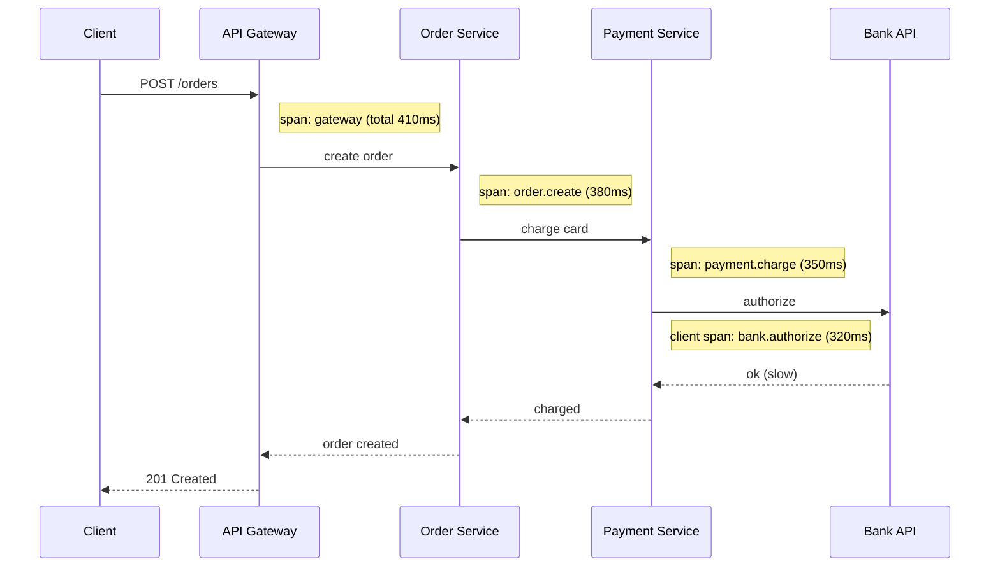

Из 410 мс один вызов банка занял 320 мс. На схеме показано время, которое наблюдал клиент Bank API: сюда входит и сеть. Внешней трассы банка у команды может не быть. Длительности вложенных span нельзя складывать — родитель уже включает ожидание дочернего вызова. Одного наблюдения достаточно для гипотезы, а её распространённость проверяем по другим трассам и метрикам.

Чтобы переход между сервисами был виден, вызывающая сторона записывает контекст в заголовок `traceparent`, принимающая извлекает его и создаёт дочерний span. Для очереди контекст можно передать в метаданных сообщения. Одного совпадающего номера заказа недостаточно, чтобы восстановить родителя.

В примере четыре записи одной полной учебной трассы. Короткие идентификаторы условны. Записи связывает `parentSpanId`, поэтому даже при перестановке элементов вывод должен сохранить цепочку от `POST /orders` до `bank.authorize`.

::: multi-code "Ручная модель span"

```kotlin
data class Span(
    val traceId: String,
    val spanId: String,
    val parentSpanId: String?,
    val name: String,
    val durationMillis: Long
)
```

```kotlin playground
data class Span(
    val traceId: String,
    val spanId: String,
    val parentSpanId: String?,
    val name: String,
    val durationMillis: Long
)

fun printTrace(spans: List<Span>) {
    val byParent = spans.groupBy { it.parentSpanId }

    fun printChildren(parentId: String?, indent: String) {
        for (span in byParent[parentId].orEmpty()) {
            println("$indent${span.name}: ${span.durationMillis}ms")
            printChildren(span.spanId, "$indent  ")
        }
    }

    printChildren(null, "")
}

fun main() {
    val trace = listOf(
        Span("t-1", "s-1", null, "POST /orders", 410),
        Span("t-1", "s-2", "s-1", "OrderService.create", 380),
        Span("t-1", "s-3", "s-2", "PaymentService.charge", 350),
        Span("t-1", "s-4", "s-3", "bank.authorize", 320)
    )

    printTrace(trace.reversed())
}
```

```csharp
public sealed record Span(string TraceId, string SpanId, string? ParentSpanId,
    string Name, long DurationMillis);

public static class TracePrinter
{
    public static void PrintTrace(IReadOnlyList<Span> spans, string? parent = null, string indent = "")
    {
        foreach (var span in spans.Where(item => item.ParentSpanId == parent))
        {
            Console.WriteLine($"{indent}{span.Name}: {span.DurationMillis}ms");
            PrintTrace(spans, span.SpanId, indent + "  ");
        }
    }
}
```

```java
import java.util.List;
import java.util.Objects;

record Span(String traceId, String spanId, String parentSpanId, String name, long durationMillis) {}

class TracePrinter {
    // Начальный вызов: printTrace(spans, null, "").
    static void printTrace(List<Span> spans, String parent, String indent) {
        for (var span : spans) {
            if (Objects.equals(span.parentSpanId(), parent)) {
                System.out.printf("%s%s: %dms%n", indent, span.name(), span.durationMillis());
                printTrace(spans, span.spanId(), indent + "  ");
            }
        }
    }
}
```

```go
package main

import "fmt"

type Span struct {
    TraceID        string
    SpanID         string
    ParentSpanID   string
    Name           string
    DurationMillis int64
}

// Начальный вызов: printTrace(spans, "", "").
func printTrace(spans []Span, parent, indent string) {
    for _, span := range spans {
        if span.ParentSpanID == parent {
            fmt.Printf("%s%s: %dms\n", indent, span.Name, span.DurationMillis)
            printTrace(spans, span.SpanID, indent + "  ")
        }
    }
}
```

:::

Приложение можно инструментировать с OpenTelemetry, а хранить и искать собранные трассы — в Jaeger, Zipkin или Grafana Tempo.

## Алерты

Дежурного интересуют два вопроса: как быстро расходуется бюджет и продолжается ли сбой сейчас? **Burn rate** — отношение доли плохих событий в выбранном окне к допустимой по SLO. При цели 99,9 % доля ошибок 1,6 % даёт скорость 16×. Скорость 1× соответствует темпу, при котором за полное окно SLO будет израсходован весь бюджет, если доля ошибок сохранится.

Возьмём одно правило немедленного вызова из SRE Workbook для 30-дневного SLO. Считаем скорость отдельно за час и за последние пять минут. Если обе превышают 14,4×, вызываем дежурного. Длинное окно показывает, насколько велика доля ошибок за час. Короткое проверяет, сохранялась ли высокая доля в последние пять минут. Достаточно интенсивный короткий всплеск может превысить оба порога. Порог и окна команда подбирает под трафик и стоимость реакции. При малом числе запросов полезна дополнительная синтетическая проверка пути оплаты.

| Состояние | Реакция в примере |
|---|---|
| Превышены оба порога | Вызвать дежурного, открыть инструкцию по оплатам, проверить активную выкладку |
| Часовая скорость ещё высокая, последние пять минут в норме | Проверить восстановление и проследить за зависшими заказами |
| CPU вырос, платежи проходят и запас ресурсов есть | Оставить сигнал на дашборде |

Код реализует только это правило вызова. На входе две уже рассчитанные скорости для окон с трафиком. Для 16× и 18× ожидаем вызов, для 16× и 0,2× — нет. При пустом окне скорость неизвестна, и состояние сбора данных нужно проверять отдельно.

::: multi-code "Вызвать ли дежурного по двум окнам"

```kotlin
fun shouldPage(burn1h: Double, burn5m: Double): Boolean =
    burn1h > 14.4 && burn5m > 14.4
```

```kotlin playground
fun shouldPage(burn1h: Double, burn5m: Double): Boolean =
    burn1h > 14.4 && burn5m > 14.4

fun main() {
    println(shouldPage(16.0, 18.0))
    println(shouldPage(16.0, 0.2))
    check(!shouldPage(14.4, 18.0))
}
```

```csharp
static bool ShouldPage(double burn1h, double burn5m) =>
    burn1h > 14.4 && burn5m > 14.4;

Console.WriteLine(ShouldPage(16.0, 18.0));
Console.WriteLine(ShouldPage(16.0, 0.2));
```

```java
class PaymentAlert {
    static boolean shouldPage(double burn1h, double burn5m) {
        return burn1h > 14.4 && burn5m > 14.4;
    }
}
```

```go
package main

func shouldPage(burn1h, burn5m float64) bool {
    return burn1h > 14.4 && burn5m > 14.4
}
```

:::

## Incident response и postmortem

Во время инцидента команда сначала ограничивает ущерб для пользователей. Расследование причины может продолжаться и после восстановления сервиса.

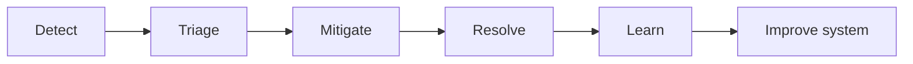

Вернёмся к пятничной выкладке. Ошибки затронули обе версии, и в медленных трассах обе ждали Bank API. Дежурный остановил расширение выкладки и связался с владельцем платёжной интеграции. Когда шлюз восстановился, скорость расхода бюджета снизилась. Теперь нужно сверить исходы зависших операций у провайдера, обновить статусы заказов и убедиться, что отставание сокращается. Только после этой проверки команда снова открывает выкладку.

На разборе инцидента (postmortem) обнаружилось, что при тайм-ауте поддержка советовала оформить заказ заново. Владелец интеграции добавляет в runbook поиск платежа по идентификатору операции, а команда заказов добавляет тест «банк принял платёж, ответ потерян». Критерий для теста — одно списание и один завершённый заказ после сверки.

Blameless postmortem не означает, что никто не отвечал за действия. Он означает, что разбор ищет системные причины:
почему ошибка была возможна, почему ее не заметили раньше, почему rollback был сложным, почему runbook не помог.

| Плохой разбор | Хороший разбор |
|---|---|
| ищет виноватого | ищет условия, которые сделали ошибку вероятной |
| заканчивается фразой "быть внимательнее" | заканчивается изменениями в проверках, инструментах и процессе |
| скрывает неудобные факты | фиксирует timeline и решения |
| не имеет владельцев follow-up | назначает конкретные действия и сроки |

## DevSecOps

DevSecOps встраивает безопасность в поток разработки. Это не отдельная проверка перед релизом, а постоянная обратная
связь: разработчик видит проблему с зависимостью, секретом или конфигурацией тогда, когда исправить ее еще дешево.

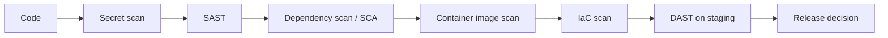

Основные практики:

| Практика | Что проверяет | Где встраивается | Конкретный пример |
|---|---|---|---|
| SAST (статический анализ) | уязвимые паттерны в исходном коде | merge request, CI | `OrderRepository.kt:42` — SQL injection через string concatenation |
| SCA (анализ компонентов) | уязвимости и лицензии зависимостей | CI, dependency update bot | сканер сопоставил версию библиотеки в сборке с бюллетенем поставщика |
| Secret scanning | случайно закоммиченные ключи | pre-commit, repository scan, CI | `config.yaml` содержит `STRIPE_SECRET_KEY=sk_live_...` |
| Container image scanning | уязвимости в base image и пакетах | после сборки image | отчёт указывает на пакет с известной уязвимостью в конкретном digest образа |
| DAST (динамический анализ) | поведение работающего приложения снаружи | staging или test environment | тест на стенде проверяет защиту операции изменения заказа от межсайтового запроса |
| IaC scanning | небезопасные настройки инфраструктуры | review Terraform/Kubernetes manifests | описание хранилища заказов запрашивает публичный доступ вопреки политике команды |
| Compliance checks | соответствие политикам и стандартам | pipeline gates, audit reports | проверка политики обнаружила пропущенный журнал изменений прав доступа |


Для сервиса заказов команда блокирует слияние при найденном секрете и требует проверки конфигурации хранилища. Если в репозиторий уже попал действующий ключ, его отзывают и заменяют. Удаление строки из следующего коммита само по себе оставляет ключ действующим.

## Platform Engineering

Platform Engineering делает внутреннюю платформу продуктом для разработчиков. Идея проста: если каждая команда заново
собирает репозиторий, pipeline, деплой, секреты, метрики и runbook, организация теряет время и получает разные уровни
качества. Платформа предлагает готовый путь от шаблона сервиса до первой выкладки. Команда может пройти его самостоятельно.

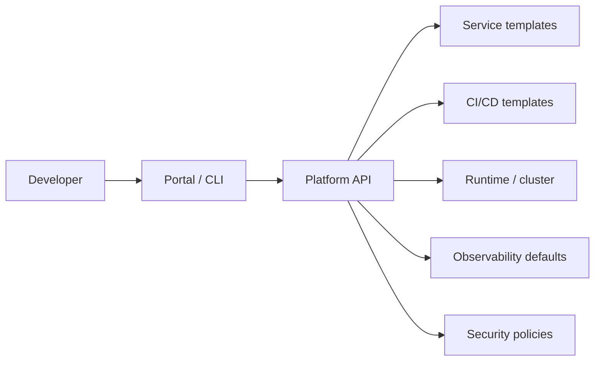

Self-service сценарий может выглядеть так:

1. Разработчик выбирает шаблон сервиса.
2. Платформа создает репозиторий, базовый код, pipeline и окружения.
3. Сервис сразу получает стандартные health checks, метрики, логи, trace propagation и security policies.
4. Команда меняет бизнес-логику, а не собирает инфраструктурный скелет с нуля.

В нашем примере платформа даёт библиотеку для передачи trace context и готовый дашборд. Команда заказов определяет, какие исходы операции считать хорошими. По времени до первого работающего сервиса и отзывам команд можно проверить, помогает ли шаблон.

## MLOps и почему это отдельная ветка

MLOps похож на DevOps по цели: быстрее и надежнее доводить результат до production. Но объект поставки сложнее. У
обычного сервиса основные артефакты — код и образ контейнера. У ML-системы важны еще данные, признаки, модель, метрики качества и
дрейф данных.

| Область | DevOps | MLOps |
|---|---|---|
| Основной артефакт | приложение, image, конфигурация | модель, dataset, feature pipeline, serving code |
| Versioning | код и инфраструктура | код, данные, признаки, модель |
| Pipeline | build-test-deploy | train-validate-register-deploy-monitor |
| Production-риск | ошибки, latency, availability | ошибки сервиса плюс degradation качества модели |
| Monitoring | RED/USE, logs, traces | telemetry сервиса плюс data drift и model performance |

Если скидку начинает выбирать модель, ошибок HTTP может по-прежнему быть мало, хотя рекомендации стали хуже. Команда сохраняет версию модели и признаки, проверяет изменение распределения входных данных, а после появления фактических результатов оценивает качество прогнозов. Сам по себе дрейф входов ещё не доказывает падение качества.

## Что должен делать обычный разработчик

Даже если в команде есть отдельные DevOps-, SRE- и security-специалисты, разработчик влияет на сопровождаемость системы
каждым сервисом и каждой библиотекой.

Практический минимум:

- отдельно задавать liveness, readiness и проверку пользовательского сценария;
- писать структурированные логи с request id, correlation id или trace id;
- передавать trace context в вызовы между доверенными сервисами по согласованному контракту;
- отдавать важные бизнес- и технические метрики;
- не хранить секреты в коде и конфигурации репозитория;
- понимать, что делает pipeline и какие проверки блокируют merge;
- писать миграции так, чтобы rollout и rollback были возможны;
- проектировать деградацию: что делать, если зависимость недоступна;
- обсуждать SLO пользовательских сценариев, а не только uptime сервера.

Эти требования связаны со всем курсом. Архитектура, микросервисы, отказоустойчивость, паттерны данных и тестирование
становятся практичными только тогда, когда систему можно собрать, развернуть, наблюдать и безопасно изменить.

## Ретроспектива курса

Вы начали с одного класса, который делал всё сам. В сервисе заказов его обязанности разделены. Правило скидки можно проверить отдельно, заменить платёжный клиент в тесте и в production проследить исполнение заказа через границы сервисов.

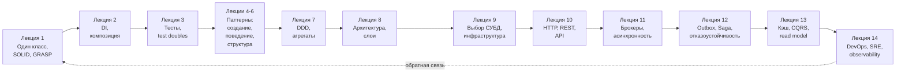

Тест из лекции 3 теперь защищает правило скидки при каждой сборке. Контракт из лекции 10 определяет, как сервис распознаёт повтор запроса. История операции из лекции 12 помогает дежурному восстановить статус заказа после тайм-аута.

## Итоги

DevOps ускоряет и стабилизирует поставку изменений. SRE переводит надежность в измеримые цели и помогает управлять
риском через SLO и error budget. Observability дает материал для диагностики production: метрики показывают тенденции,
логи дают события, трейсы показывают путь запроса. DevSecOps встраивает безопасность в поток разработки. Platform
Engineering снижает когнитивную нагрузку команд, превращая инфраструктурные практики в удобный внутренний продукт.

Разработчик не обязан быть специалистом во всех этих областях. Но он обязан писать код так, чтобы его можно было
собрать, проверить, развернуть, наблюдать, защитить и сопровождать.

Так курс замыкается на первой идее: конструирование ПО — это управление стоимостью изменений. В начале это были классы,
интерфейсы и зависимости. В конце — pipeline, SLO, инциденты и обратная связь из production. Между ними нет разрыва:
плохо выбранная граница в коде становится сложным тестом, сложным деплоем, сложной диагностикой и дорогим изменением.

## Вопросы для самопроверки

1. Как узнать, что в production попал именно тот образ, который прошёл проверку на staging?
2. Как различить выкладку, потребовавшую вмешательства, и внеплановую выкладку для исправления инцидента?
3. При каком числе плохих запросов из 1 000 000 SLO 99,9 % ещё соблюдён в точности? Что изменится, если при том же числе запросов плохих ответов станет на один больше?
4. Почему зелёный liveness совместим с массовым отказом оплат? Какая проверка воспроизведёт сбой глазами покупателя?
5. Где хранить номер заказа, чтобы отыскать один тайм-аут и не создавать временной ряд на каждого покупателя?
6. Что можно установить по клиентскому span длительностью 320 мс, а что придётся спросить у банка?
7. Кто и по каким данным решает, можно ли повторить попытку списания?

## Мини-практика

Вы дежурите по сервису заказов. За последние 30 дней из миллиона корректных запросов на оплату 650 получили техническую ошибку или не уложились в две секунды. За последний час таких запросов 160 из 10 000, за последние пять минут — 20 из 1 000. Обе версии сервиса принимают трафик. Поддержка сообщает, что заказ `ord-42` завис после запроса к банку.

1. Запишите SLI, SLO и остаток бюджета. Рассчитайте скорость расхода в обоих коротких окнах и примените правило вызова дежурного из лекции.
2. Набросайте путь образа от коммита до canary. Отметьте тест, который остановит релиз при ошибке скидки, и способ проверить совпадение образов. Назовите одну проверку безопасности до выпуска. У новой реплики процесс отвечает, но пока загружается конфигурация, принимать заказы рано. Другая реплика уже обслуживала запросы, затем зависла. Какие пробы различат эти случаи и что Kubernetes сделает после порога неудач?
3. Составьте короткую инструкцию для дежурного. Укажите метрику для сравнения версий, поле лога для поиска заказа, span для локализации задержки и источник истины для исхода платежа. Запишите действие до выяснения исхода и критерий восстановления.
4. Предположим, что ответы банка восстановились, но часть событий об оплате осталась в очереди недоставленных сообщений (DLQ). Какие данные нужны, чтобы безопасно запустить обработку снова? Добавьте в инструкцию технический сигнал и показатель результата для покупателей.

::: details Сверка решения
За окно SLI равен 999 350 / 1 000 000 = 99,935 %. При SLO 99,9 % осталось 350 плохих запросов до границы. За час доля плохих запросов составила 1,6 %, за пять минут — 2 %. Скорости 16× и 20× превышают 14,4× одновременно. Дежурного вызывают уже сейчас, хотя месячный бюджет ещё положителен.

Тест расчёта скидки и проверка зависимостей проходят до выкладки, staging и canary получают один digest. Пока реплика загружает конфигурацию, её readiness-проверка удерживает её вне числа готовых получателей трафика сервиса. Если зависшая реплика перестаёт отвечать на локальную liveness-проверку, после заданного числа неудач kubelet перезапускает её контейнер. Сравниваем долю плохих оплат по версиям. По `orderId` находим событие ожидания и по `traceId` — клиентский span запроса к банку. Приостанавливаем расширение выкладки, сверяем платёж у провайдера. Для восстановления проверяем новые оплаты в коротком окне и завершение сверки ранее зависших заказов.

Для DLQ проверяем причину отказа и возраст самого старого события. Перед повторной обработкой сверяем идентификатор операции и убеждаемся, что повтор уже применённого события не приведёт к новому списанию. Следим и за очередью, и за числом заказов, которые остаются в ожидании сверх допустимого времени.
:::

## Дополнительное чтение

### Поставка и эксплуатация

- [DORA. Software delivery performance metrics](https://dora.dev/guides/dora-metrics/) — пять показателей поставки одного сервиса.
- [Docker. Pull an image by digest](https://docs.docker.com/reference/cli/docker/image/pull/#pull-an-image-by-digest-immutable-identifier) — как закрепить версию образа.
- [OpenGitOps. Principles](https://opengitops.dev/) — четыре условия для GitOps.
- [Kubernetes. Liveness, Readiness, and Startup Probes](https://kubernetes.io/docs/concepts/workloads/pods/probes/) — действия при разных результатах проверок.

### Надёжность и диагностика

- [Google SRE Workbook. Implementing SLOs](https://sre.google/workbook/implementing-slos/) — выбор событий и измеримого результата.
- [Google SRE Workbook. Alerting on SLOs](https://sre.google/workbook/alerting-on-slos/) — скорость расхода бюджета и несколько окон наблюдения.
- [OpenTelemetry. Context propagation](https://opentelemetry.io/docs/concepts/context-propagation/) — связь операций между сервисами.
- [Prometheus. Instrumentation](https://prometheus.io/docs/practices/instrumentation/) — выбор метрик и цена каждой новой комбинации меток.
- [Google SRE. Postmortem Culture](https://sre.google/sre-book/postmortem-culture/) — разбор обстоятельств инцидента и последующие действия.

### Практики команд

- [OWASP DevSecOps Guideline](https://owasp.org/projects/devsecops-guideline) — проверки безопасности в процессе поставки.
- [CNCF Platforms White Paper](https://tag-app-delivery.cncf.io/whitepapers/platforms/) — внутренняя платформа как продукт для команд.
- [Google Cloud. Practitioners Guide to MLOps](https://services.google.com/fh/files/misc/practitioners_guide_to_mlops_whitepaper.pdf) — жизненный цикл данных и модели.
