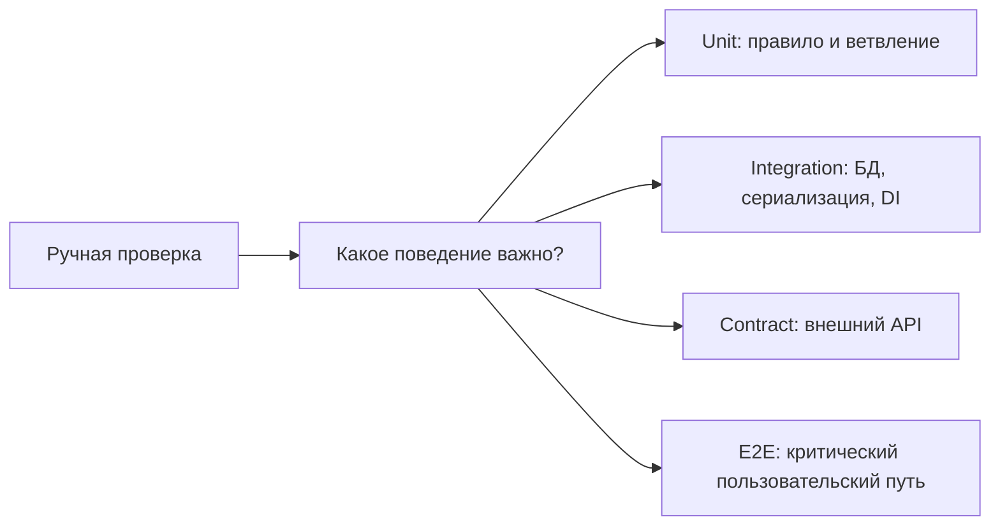
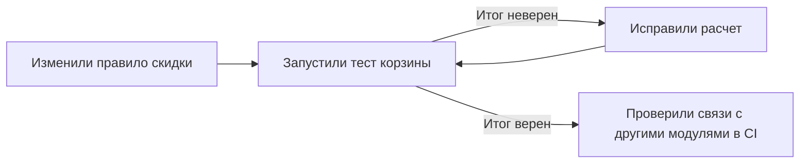
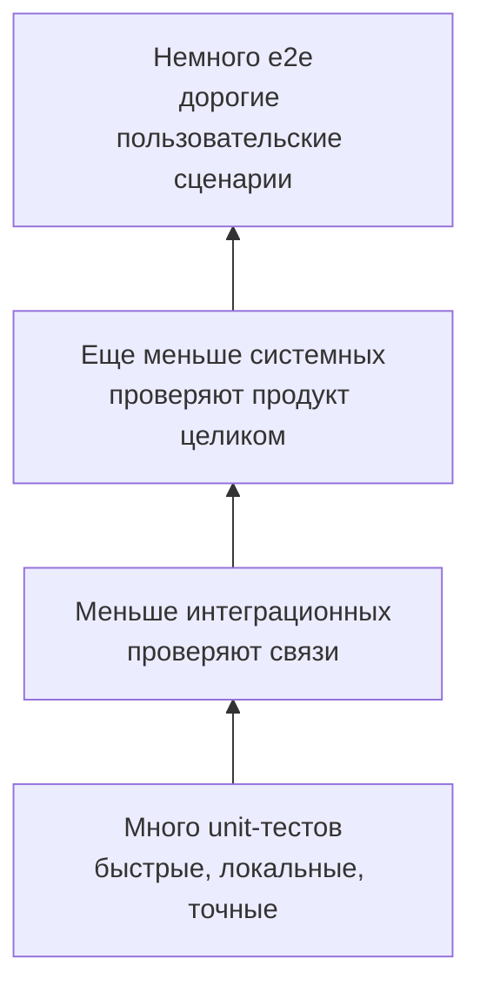
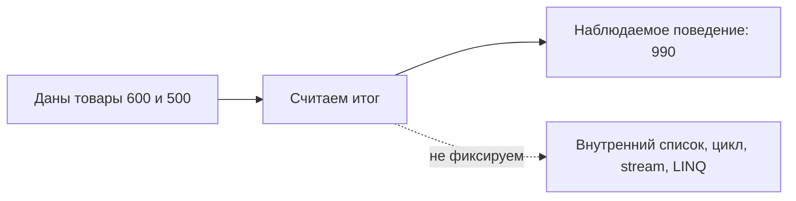
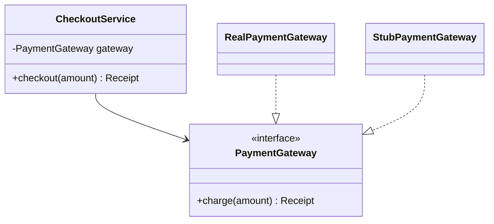
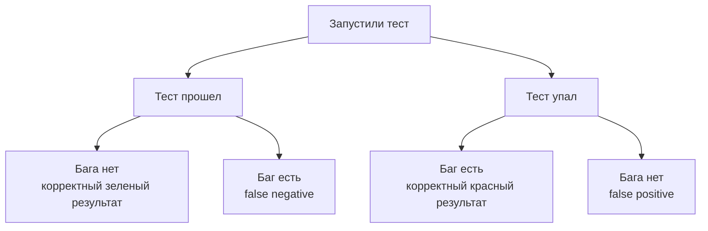
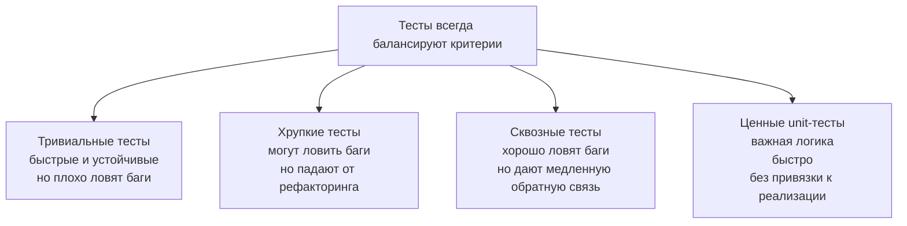
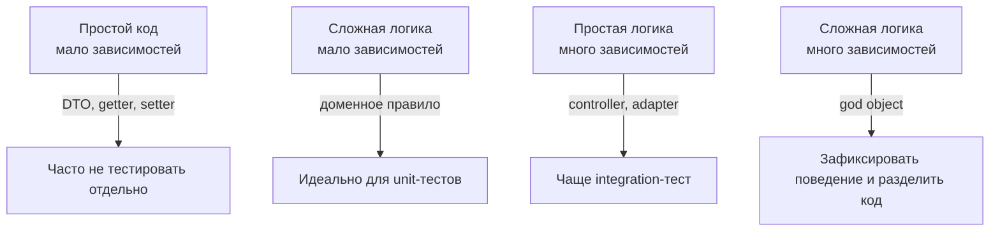
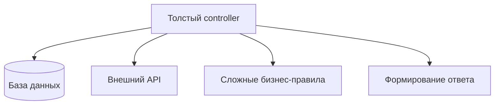
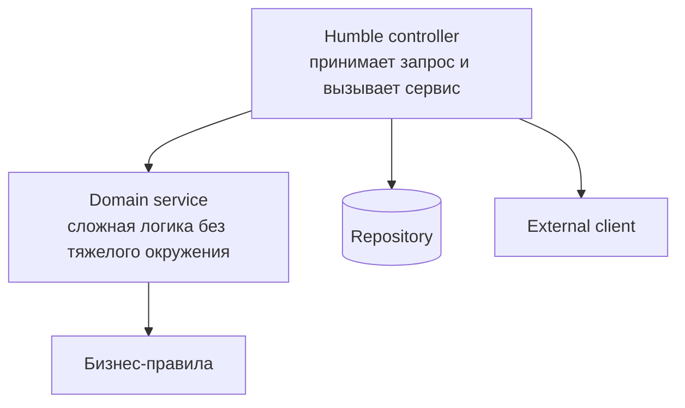

---
requires:
  - lecture: 2
    reason: "тестовые двойники передаются через DI; сценарий продолжается"
---

# Лекция 3. Принципы эффективного юнит-тестирования

В чеке за товары на 600 и 500 рублей появилась сумма 1100 вместо ожидаемых 990. Какой тест мог бы
обнаружить пропавшую скидку до выпуска приложения? Начнём с расчёта корзины, затем проверим оплату
и отправку уведомлений. Для каждого случая выберем наблюдаемый результат и границу проверки.

После прочтения вы должны уметь:

- объяснить, чем различаются юнит-тест, интеграционный тест и сквозная проверка;
- написать простой тест по правилу Arrange-Act-Assert;
- понять, что именно проверяет тест: выход, состояние или взаимодействие;
- отличить stub, fake, spy и mock;
- увидеть хрупкий тест, который привязан к реализации;
- решить, что тестировать unit-тестами, что проверять интеграционно, а что сначала рефакторить;
- выбрать, какие зависимости заменить двойниками и где проверить их настоящие реализации.

## Сквозной сценарий

В [Лекции 2](/lectures/02#di-и-тесты) мы передали `FakePaymentGateway` в `OrderService` вместо реального шлюза — это
был тестовый двойник. По сумме в памяти мы проверили, сколько сервис передал шлюзу по одному заказу. Теперь
`OrderService` считает итог заказа, проверяет скидку, обращается к платежному шлюзу и публикует событие. Первый импульс —
открыть приложение вручную, нажать кнопку "Оплатить" и посмотреть, что случится. Это полезно один раз, но плохо работает
как инженерная обратная связь: ручная проверка медленная, неполная и зависит от внешних систем.

В этой лекции мы будем постепенно сужать вопрос. Вместо "работает ли все приложение?" спросим:

- правильно ли считается скидка при заданных товарах;
- вызывает ли сервис платеж только после проверки заказа;
- что делать, если внешний API оплаты недоступен;
- какие проверки оставить unit-тестами, а какие вынести на интеграционный уровень.



## Разбор ошибки в расчёте скидки {#worked-example-хрупкии-тест-против-теста-поведения}

### Ситуация

`OrderService` должен применить скидку, если сумма заказа достигла 1000 рублей. Пользователю неважно, как метод внутри
разбивает вычисление на private-функции; важно, какой итог он получит.

### Наивное решение

Первый тест требует одного вызова вспомогательного метода `applyDiscount`. Если тот по ошибке вернёт исходные 1100 рублей, тест всё равно пройдёт.

### Что ломается

Разработчик переносит верное вычисление в корзину и удаляет прежний вызов. В чеке по-прежнему 990 рублей, но тот же тест теперь падает.

### Улучшение

Сложите в корзину товары за 600 и 500 рублей, вызовите расчёт и сравните итог с 990. Это три шага Arrange–Act–Assert. Для другого требования меняется наблюдение. Например, если отменённый заказ оплачивать нельзя, проверка должна обнаружить любую попытку списания.

### Почему это работает

Хороший unit-тест дает свободу менять внутреннюю форму кода. Он фиксирует договоренность с внешним миром: результат,
состояние или важное взаимодействие на границе процесса.

## Зачем разработчику тестирование

Тестирование - это не отдельная фаза, где кто-то после разработчика пытается доказать, что программа сломана. Для
разработчика тесты прежде всего дают обратную связь: изменил код, запустил проверку, быстро понял, осталась ли система в
ожидаемом состоянии.

Если ошибка в расчёте скидки обнаружилась локально, разработчик видит входные данные и место изменения. Ошибка, найденная отделом тестирования, уже превращается в
баг-репорт, triage, назначение исполнителя и повторную проверку. Ошибка в production добавляет пользователей, данные,
поддержку, релизы исправлений и репутационный ущерб.



::: tip Практический смысл
Хороший тест - это не доказательство, что багов больше нет. Это дешевый способ быстро узнать, что важное поведение
системы все еще работает.
:::

## Карта видов тестирования

Сравним проверки по охвату. Можно проверить вычисление скидки в памяти, запись заказа в базу, собранное приложение через его публичный интерфейс или весь путь покупателя до квитанции. Сквозной сценарий иногда охватывает несколько систем, поэтому названия категорий могут пересекаться.

Обычно уровни тестирования объясняют пирамидой. Внизу много быстрых дешевых тестов, наверху меньше дорогих и медленных
тестов, которые зато ближе к реальному пользовательскому сценарию.

::: details Полная карта классификаций
Тестирование классифицируют по разным признакам. Эти классификации не конкурируют: один и тот же тест может быть
автоматизированным, динамическим, функциональным, white-box и unit-тестом одновременно.

| Признак           | Варианты                          | Что отличает                                                                                     |
|-------------------|-----------------------------------|--------------------------------------------------------------------------------------------------|
| Характер сценария | Позитивное / негативное           | Проверяем ожидаемый успешный путь или реакцию на ошибку, сбой, неверные данные.                  |
| Запуск кода       | Статическое / динамическое        | Анализируем код без запуска или выполняем программу.                                             |
| Автоматизация     | Ручное / автоматизированное       | Человек проходит сценарий сам или сценарий выполняет инструмент.                                 |
| Требования        | Функциональное / нефункциональное | Проверяем поведение продукта или свойства вроде скорости, удобства, безопасности.                |
| Знание системы    | Black box / gray box / white box  | Тест выводят из внешнего контракта, частичных сведений о реализации или её внутренней структуры.                   |
| Уровень           | Unit / integration / system / e2e | Проверяем маленькую единицу поведения, связь модулей, систему целиком или пользовательский путь. |
:::



::: warning Не превращайте пирамиду в лозунг
Пирамида не означает, что все нужно проверять unit-тестами. Она говорит, что дорогие проверки не должны быть первым и
единственным способом узнать, что код сломан.
:::

## Что такое unit-тест

Unit-тест проверяет небольшую единицу наблюдаемого поведения в изоляции от ненужного окружения. Важно слово
"поведения": unit - это не обязательно один класс или один метод. Иногда единицей является функция, иногда доменный
объект, иногда небольшая группа классов, которые вместе реализуют правило предметной области.

Unit-тест должен быть быстрым, повторяемым и понятным. Он не должен требовать реальной сети, внешнего API, общей базы
данных, ручной подготовки окружения или специального порядка запуска.

| Уровень      | Что проверяет                                  | Обычно хорошо подходит для                                | Главный риск                                  |
|--------------|------------------------------------------------|-----------------------------------------------------------|-----------------------------------------------|
| Unit         | Небольшое поведение в контролируемом окружении | Доменная логика, расчеты, правила валидации, ветвления    | Слишком много моков и привязка к реализации   |
| Integration  | Совместную работу нескольких компонентов       | Репозитории с БД, сериализация, DI-конфигурация, адаптеры | Медленнее и сложнее в подготовке              |
| System       | Собранную систему как целое                    | Проверка приложения через публичный интерфейс             | Сложнее локализовать причину ошибки           |
| End-to-end   | Сквозной путь через участвующие компоненты      | От оформления заказа до квитанции и уведомления           | Дорого поддерживать окружение                 |

Функциональный тест проверяет требование к поведению. Правило «от 1000 рублей действует скидка»
можно проверить и одним вызовом корзины, и оформлением заказа через сайт. Требование одно,
а охват, скорость и причины возможного падения различаются.

::: tip Короткое определение
Unit-тест хорош, когда быстро отвечает на конкретный вопрос о поведении: "при таких условиях этот участок системы делает
то, что должен?".
:::

## Первый пример: один тест по правилу 3A

Правило 3A делит тест на три видимых шага:

- Arrange - подготовить данные и зависимости;
- Act - выполнить проверяемое действие;
- Assert - проверить результат.

Во всех четырёх вкладках действует одно правило. При сумме от 1000 рублей включительно покупатель платит 90% стоимости. В учебном примере цены целые и неотрицательные, сумма корзины помещается в 32-битное целое, дробную часть конечной суммы отбрасываем.

::: multi-code "Unit-тест по правилу 3A"

```kotlin
import kotlin.test.Test
import kotlin.test.assertEquals

class CartTest {
    @Test
    fun appliesDiscountForLargeOrder() {
        // Arrange
        val cart = Cart()
        cart.add(600)
        cart.add(500)

        // Act
        val total = cart.total()

        // Assert
        assertEquals(990, total)
    }
}

class Cart {
    private val prices = mutableListOf<Int>()

    fun add(price: Int) {
        prices += price
    }

    fun total(): Int {
        val sum = prices.sum()
        return if (sum >= 1000) (sum.toLong() * 9 / 10).toInt() else sum
    }
}
```

```kotlin playground
import kotlin.test.assertEquals

class Cart {
    private val prices = mutableListOf<Int>()

    fun add(price: Int) {
        prices += price
    }

    fun total(): Int {
        val sum = prices.sum()
        return if (sum >= 1000) (sum.toLong() * 9 / 10).toInt() else sum
    }
}

fun main() {
    // Arrange
    val cart = Cart()
    cart.add(600)
    cart.add(500)

    // Act
    val total = cart.total()

    // Assert
    assertEquals(990, total)
    println("Test passed: total = $total")
}
```

```csharp
using System.Collections.Generic;
using System.Linq;
using Xunit;

public class CartTests
{
    [Fact]
    public void AppliesDiscountForLargeOrder()
    {
        // Arrange
        var cart = new Cart();
        cart.Add(600);
        cart.Add(500);

        // Act
        var total = cart.Total();

        // Assert
        Assert.Equal(990, total);
    }
}

public class Cart
{
    private readonly List<int> prices = new();

    public void Add(int price) => prices.Add(price);

    public int Total()
    {
        var sum = prices.Sum();
        return sum >= 1000 ? (int)((long)sum * 9 / 10) : sum;
    }
}
```

```java
import org.junit.jupiter.api.Test;
import java.util.ArrayList;
import java.util.List;

import static org.junit.jupiter.api.Assertions.assertEquals;

class CartTest {
    @Test
    void appliesDiscountForLargeOrder() {
        // Arrange
        Cart cart = new Cart();
        cart.add(600);
        cart.add(500);

        // Act
        int total = cart.total();

        // Assert
        assertEquals(990, total);
    }
}

class Cart {
    private final List<Integer> prices = new ArrayList<>();

    void add(int price) {
        prices.add(price);
    }

    int total() {
        int sum = prices.stream().mapToInt(Integer::intValue).sum();
        return sum >= 1000 ? (int)((long)sum * 9 / 10) : sum;
    }
}
```

```go
package cart

import "testing"

func TestAppliesDiscountForLargeOrder(t *testing.T) {
    // Arrange
    cart := NewCart()
    cart.Add(600)
    cart.Add(500)

    // Act
    total := cart.Total()

    // Assert
    if total != 990 {
        t.Fatalf("expected 990, got %d", total)
    }
}

type Cart struct {
    prices []int
}

func NewCart() *Cart {
    return &Cart{}
}

func (c *Cart) Add(price int) {
    c.prices = append(c.prices, price)
}

func (c *Cart) Total() int {
    sum := 0
    for _, price := range c.prices {
        sum += price
    }
    if sum >= 1000 {
        return int(int64(sum) * 9 / 10)
    }
    return sum
}
```

:::

Для этого теста неважно, как `Cart` хранит товары: в `MutableList`, `ArrayList`, массиве или SQL-таблице. Он проверяет наблюдаемое поведение: если в корзине товары на 600 и 500, итог должен быть 990. Именно поэтому такой тест переживет
рефакторинг внутреннего хранения, но упадет при изменении бизнес-правила скидки.



::: warning Не прячьте смысл теста
Даже если язык позволяет записать подготовку, действие и проверку в одну строку, такой тест сложнее читать и сложнее
чинить. Тест - это документация поведения, а документация должна быть разборчивой.
:::

::: only kotlin
> **Kotlin.** В реальном проекте такой тест обычно лежит в `src/test` и запускается через Gradle или Maven. Playground
> здесь нужен только для живой демонстрации идеи Arrange-Act-Assert.
:::

::: only csharp
> **C#.** Атрибут `[Fact]` - форма xUnit для теста без параметров. Для набора входных данных обычно используют
> параметризованные тесты.
:::

::: only java
> **Java.** В JUnit 5 тестовый метод помечается `@Test`, а проверки часто импортируются статически из
> `org.junit.jupiter.api.Assertions`.
:::

::: only go
> **Go.** Стандартный пакет `testing` считает тестом функцию вида `TestXxx(t *testing.T)`. Ошибка фиксируется через
> `t.Fatal`, `t.Fatalf` или похожие методы.
>
> Самый характерный Go-паттерн тестирования — **table-driven tests**. Вместо отдельной функции на каждый случай, все
> входы и ожидаемые результаты собираются в таблицу:
>
> ```go
> func TestApplyDiscount(t *testing.T) {
>     tests := []struct {
>         name     string
>         total    int
>         expected int
>     }{
>         {"below threshold", 999, 999},
>         {"at threshold", 1000, 900},
>         {"just above threshold", 1001, 900},
>         {"large total", 1000000000, 900000000},
>     }
>     for _, tt := range tests {
>         t.Run(tt.name, func(t *testing.T) {
>             got := ApplyDiscount(tt.total)
>             if got != tt.expected {
>                 t.Errorf("ApplyDiscount(%d) = %d, want %d", tt.total, got, tt.expected)
>             }
>         })
>     }
> }
> ```
>
> `t.Run` создаёт подтест для каждой строки — при падении видно, какой именно случай сломался.
:::

### Параметризованные тесты

Когда одну и ту же логику нужно проверить на нескольких наборах данных, каждый язык предлагает свой механизм. Вместо
дублирования тестовых функций, данные собираются в таблицу:

Строка для 1000 отличает условие `>= 1000` от `> 1000`. Для 1001 итог до округления равен 900,9 рубля, после округления — 900. Для 1 миллиарда проверяем, что расчёт не переполнил 32-битный промежуточный результат.

::: multi-code "Параметризованные тесты" {playground=off}

```kotlin
import org.junit.jupiter.params.ParameterizedTest
import org.junit.jupiter.params.provider.CsvSource
import kotlin.test.assertEquals

class DiscountTest {
    @ParameterizedTest
    @CsvSource("999,999", "1000,900", "1001,900", "1000000000,900000000")
    fun appliesDiscount(total: Int, expected: Int) {
        assertEquals(expected, applyDiscount(total))
    }
}

fun applyDiscount(total: Int): Int =
    if (total >= 1000) (total.toLong() * 9 / 10).toInt() else total
```

```csharp
using Xunit;

public class DiscountTests
{
    [Theory]
    [InlineData(999, 999)]
    [InlineData(1000, 900)]
    [InlineData(1001, 900)]
    [InlineData(1_000_000_000, 900_000_000)]
    public void AppliesDiscount(int total, int expected)
    {
        Assert.Equal(expected, ApplyDiscount(total));
    }

    static int ApplyDiscount(int total) =>
        total >= 1000 ? (int)((long)total * 9 / 10) : total;
}
```

```java
import org.junit.jupiter.params.ParameterizedTest;
import org.junit.jupiter.params.provider.CsvSource;

import static org.junit.jupiter.api.Assertions.assertEquals;

class DiscountTest {
    @ParameterizedTest
    @CsvSource({"999,999", "1000,900", "1001,900", "1000000000,900000000"})
    void appliesDiscount(int total, int expected) {
        assertEquals(expected, applyDiscount(total));
    }

    static int applyDiscount(int total) {
        return total >= 1000 ? (int)((long)total * 9 / 10) : total;
    }
}
```

```go
package cart

import "testing"

func ApplyDiscount(total int) int {
    if total >= 1000 {
        return int(int64(total) * 9 / 10)
    }
    return total
}

func TestApplyDiscount(t *testing.T) {
    tests := []struct {
        total, expected int
    }{
        {999, 999}, {1000, 900}, {1001, 900},
        {1_000_000_000, 900_000_000},
    }
    for _, tt := range tests {
        got := ApplyDiscount(tt.total)
        if got != tt.expected {
            t.Errorf("ApplyDiscount(%d) = %d, want %d",
                tt.total, got, tt.expected)
        }
    }
}
```

:::

::: only kotlin
> **Kotlin.** Помимо JUnit `@ParameterizedTest`, библиотека Kotest предлагает другой DSL:
>
> ```kotlin
> class DiscountSpec : StringSpec({
>     "applies 10% discount above threshold" {
>         applyDiscount(1500) shouldBe 1350
>     }
>     "no discount below threshold" {
>         applyDiscount(500) shouldBe 500
>     }
> })
> ```
>
> `shouldBe` читается как утверждение на естественном языке. Выбор между `kotlin.test` и Kotest — вопрос вкуса команды.
:::

::: only csharp
> **C#.** `[Fact]` — тест без параметров. `[Theory]` с `[InlineData]` — параметризованный тест. Для сложных данных
> есть `[MemberData]` и `[ClassData]`, позволяющие передавать объекты вместо примитивов.
:::

## Что именно проверяет тест

Тесты отличаются не только уровнем, но и тем, что они наблюдают.

| Стиль             | Что проверяем                                      | Когда подходит                                                      | Риск                                                   |
|-------------------|----------------------------------------------------|---------------------------------------------------------------------|--------------------------------------------------------|
| Output-based      | Вернулся правильный результат для заданного входа  | Чистые функции, расчеты, форматирование, правила предметной области | Можно пропустить важные побочные эффекты               |
| State-based       | Объект или хранилище перешли в нужное состояние    | Агрегаты, коллекции, команды, меняющие состояние                    | Можно начать проверять слишком много деталей           |
| Interaction-based | Была выполнена нужная коммуникация между объектами | Уведомления, отправка события, вызов внешнего шлюза                 | Самый хрупкий стиль, если проверяет внутренний процесс |

Output-based тест обычно самый устойчивый: он не знает, как код получил результат, и проверяет только наблюдаемое
поведение.

::: multi-code "Output-based: проверяем результат"

```kotlin
import kotlin.test.Test
import kotlin.test.assertEquals

class PriceFormatterTest {
    @Test
    fun formatsPriceWithCurrency() {
        val formatted = PriceFormatter.format(1250, "RUB")

        assertEquals("1250 RUB", formatted)
    }
}

object PriceFormatter {
    fun format(amount: Int, currency: String): String = "$amount $currency"
}
```

```kotlin playground
import kotlin.test.assertEquals

object PriceFormatter {
    fun format(amount: Int, currency: String): String = "$amount $currency"
}

fun main() {
    val formatted = PriceFormatter.format(1250, "RUB")
    assertEquals("1250 RUB", formatted)
    println(formatted)
}
```

```csharp
using Xunit;

public class PriceFormatterTests
{
    [Fact]
    public void FormatsPriceWithCurrency()
    {
        var formatted = PriceFormatter.Format(1250, "RUB");

        Assert.Equal("1250 RUB", formatted);
    }
}

public static class PriceFormatter
{
    public static string Format(int amount, string currency) => $"{amount} {currency}";
}
```

```java
import org.junit.jupiter.api.Test;

import static org.junit.jupiter.api.Assertions.assertEquals;

class PriceFormatterTest {
    @Test
    void formatsPriceWithCurrency() {
        String formatted = PriceFormatter.format(1250, "RUB");

        assertEquals("1250 RUB", formatted);
    }
}

class PriceFormatter {
    static String format(int amount, String currency) {
        return amount + " " + currency;
    }
}
```

```go
package pricing

import (
    "fmt"
    "testing"
)

func TestFormatsPriceWithCurrency(t *testing.T) {
    formatted := FormatPrice(1250, "RUB")

    if formatted != "1250 RUB" {
        t.Fatalf("expected %q, got %q", "1250 RUB", formatted)
    }
}

func FormatPrice(amount int, currency string) string {
    return fmt.Sprintf("%d %s", amount, currency)
}
```

:::

::: details State-based: проверяем состояние
State-based тест полезен, когда смысл операции именно в изменении состояния.

```kotlin
import kotlin.test.Test
import kotlin.test.assertTrue

class OrderTest {
    @Test
    fun marksOrderAsPaid() {
        val order = Order()

        order.markPaid()

        assertTrue(order.isPaid)
    }
}

class Order {
    var isPaid: Boolean = false
        private set

    fun markPaid() {
        isPaid = true
    }
}
```

:::

::: details Interaction-based: проверяем взаимодействие
Interaction-based тест нужен, когда результатом поведения является коммуникация с зависимостью: например, отправить
уведомление после оплаты.

```kotlin
import kotlin.test.Test
import kotlin.test.assertEquals

class OrderServiceTest {
    @Test
    fun sendsNotificationForOrder() {
        val notifier = SpyNotifier()
        val service = OrderService(notifier)

        service.pay("order-1")

        assertEquals(listOf("order-1"), notifier.sentOrderIds)
    }
}

interface Notifier {
    fun sendPaymentReceived(orderId: String)
}

class SpyNotifier : Notifier {
    val sentOrderIds = mutableListOf<String>()

    override fun sendPaymentReceived(orderId: String) {
        sentOrderIds += orderId
    }
}

class OrderService(private val notifier: Notifier) {
    fun pay(orderId: String) {
        notifier.sendPaymentReceived(orderId)
    }
}
```

:::

## Тестируемость кода и зависимости

Связь с лекцией 2 прямая: DIP и DI нужны не только ради красивой архитектуры. Они делают код проверяемым. Если класс сам
создает зависимость через `new`, достает ее из Service Locator или читает глобальную конфигурацию, тесту трудно
подставить управляемое поведение.

Пусть операция возвращает квитанцию после успешной оплаты. Ошибка в сумме или отказ провайдера должны дойти до вызывающего кода. Сначала сервис сам выбирает сетевой шлюз.

```kotlin
class CheckoutService {
    private val gateway = RealPaymentGateway()

    fun checkout(amount: Int): Receipt {
        return gateway.charge(amount)
    }
}
```

Здесь тест не может заменить `RealPaymentGateway` без специальных приемов. Если настоящий шлюз ходит в сеть, unit-тест
перестает быть unit-тестом.

Хороший вариант: сервис зависит от интерфейса, а конкретная реализация приходит извне.



::: multi-code "DI делает сервис тестируемым" {playground=off}

```kotlin
data class Receipt(val id: String, val amount: Int)

interface PaymentGateway {
    fun charge(amount: Int): Receipt
}

class CheckoutService(private val gateway: PaymentGateway) {
    fun checkout(amount: Int): Receipt {
        require(amount > 0) { "amount must be positive" }
        return gateway.charge(amount)
    }
}
```

```csharp
using System;

public record Receipt(string Id, int Amount);

public interface IPaymentGateway
{
    Receipt Charge(int amount);
}

public class CheckoutService
{
    private readonly IPaymentGateway gateway;

    public CheckoutService(IPaymentGateway gateway)
    {
        this.gateway = gateway;
    }

    public Receipt Checkout(int amount)
    {
        if (amount <= 0) throw new ArgumentException("amount must be positive");
        return gateway.Charge(amount);
    }
}
```

```java
record Receipt(String id, int amount) {}

interface PaymentGateway {
    Receipt charge(int amount);
}

class CheckoutService {
    private final PaymentGateway gateway;

    CheckoutService(PaymentGateway gateway) {
        this.gateway = gateway;
    }

    Receipt checkout(int amount) {
        if (amount <= 0) {
            throw new IllegalArgumentException("amount must be positive");
        }
        return gateway.charge(amount);
    }
}
```

```go
package checkout

import "errors"

type Receipt struct {
    ID     string
    Amount int
}

type PaymentGateway interface {
    Charge(amount int) (Receipt, error)
}

type CheckoutService struct {
    gateway PaymentGateway
}

func NewCheckoutService(gateway PaymentGateway) CheckoutService {
    return CheckoutService{gateway: gateway}
}

func (s CheckoutService) Checkout(amount int) (Receipt, error) {
    if amount <= 0 {
        return Receipt{}, errors.New("amount must be positive")
    }
    return s.gateway.Charge(amount)
}
```

:::

В этом тесте шлюз играет роль заглушки (stub). Он возвращает детерминированную квитанцию,
чтобы мы могли проверить результат `checkout`. Сохранение платежей и работу сети здесь не моделируем.

::: multi-code "Заглушка платёжного шлюза"

```kotlin
import kotlin.test.Test
import kotlin.test.assertEquals

class CheckoutServiceTest {
    @Test
    fun returnsReceiptFromPaymentGateway() {
        val gateway = StubPaymentGateway()
        val service = CheckoutService(gateway)

        val receipt = service.checkout(1500)

        assertEquals(Receipt("test-receipt", 1500), receipt)
    }
}

class StubPaymentGateway : PaymentGateway {
    override fun charge(amount: Int): Receipt = Receipt("test-receipt", amount)
}
```

```kotlin playground
import kotlin.test.assertEquals

data class Receipt(val id: String, val amount: Int)

interface PaymentGateway {
    fun charge(amount: Int): Receipt
}

class CheckoutService(private val gateway: PaymentGateway) {
    fun checkout(amount: Int): Receipt {
        require(amount > 0) { "amount must be positive" }
        return gateway.charge(amount)
    }
}

class StubPaymentGateway : PaymentGateway {
    override fun charge(amount: Int): Receipt = Receipt("test-receipt", amount)
}

fun main() {
    val gateway = StubPaymentGateway()
    val service = CheckoutService(gateway)

    val receipt = service.checkout(1500)

    assertEquals(Receipt("test-receipt", 1500), receipt)
    println("Test passed: $receipt")
}
```

```csharp
using Xunit;

public class CheckoutServiceTests
{
    [Fact]
    public void ReturnsReceiptFromPaymentGateway()
    {
        var gateway = new StubPaymentGateway();
        var service = new CheckoutService(gateway);

        var receipt = service.Checkout(1500);

        Assert.Equal(new Receipt("test-receipt", 1500), receipt);
    }

    [Fact]
    public void ReportsUnavailableGateway()
    {
        var service = new CheckoutService(new UnavailableGateway());

        Assert.Throws<GatewayUnavailable>(() => service.Checkout(1500));
    }
}

public sealed class GatewayUnavailable : System.Exception { }

public sealed class UnavailableGateway : IPaymentGateway
{
    public Receipt Charge(int amount) => throw new GatewayUnavailable();
}

public class StubPaymentGateway : IPaymentGateway
{
    public Receipt Charge(int amount) => new("test-receipt", amount);
}
```

```java
import org.junit.jupiter.api.Test;

import static org.junit.jupiter.api.Assertions.assertEquals;
import static org.junit.jupiter.api.Assertions.assertThrows;

class CheckoutServiceTest {
    @Test
    void returnsReceiptFromPaymentGateway() {
        PaymentGateway gateway = new StubPaymentGateway();
        CheckoutService service = new CheckoutService(gateway);

        Receipt receipt = service.checkout(1500);

        assertEquals(new Receipt("test-receipt", 1500), receipt);
    }

    @Test
    void reportsUnavailableGateway() {
        PaymentGateway unavailable = amount -> { throw new GatewayUnavailable(); };
        CheckoutService service = new CheckoutService(unavailable);

        assertThrows(GatewayUnavailable.class, () -> service.checkout(1500));
    }
}

class GatewayUnavailable extends RuntimeException {}

class StubPaymentGateway implements PaymentGateway {
    public Receipt charge(int amount) {
        return new Receipt("test-receipt", amount);
    }
}
```

```go
package checkout

import (
    "errors"
    "testing"
)

func TestReturnsReceiptFromPaymentGateway(t *testing.T) {
    gateway := StubPaymentGateway{}
    service := NewCheckoutService(gateway)

    receipt, err := service.Checkout(1500)
    if err != nil {
        t.Fatal(err)
    }

    if receipt != (Receipt{ID: "test-receipt", Amount: 1500}) {
        t.Fatalf("unexpected receipt: %+v", receipt)
    }
}

var errGatewayUnavailable = errors.New("gateway unavailable")

type UnavailableGateway struct{}

func (UnavailableGateway) Charge(amount int) (Receipt, error) {
    return Receipt{}, errGatewayUnavailable
}

func TestReportsUnavailableGateway(t *testing.T) {
    service := NewCheckoutService(UnavailableGateway{})

    _, err := service.Checkout(1500)
    if !errors.Is(err, errGatewayUnavailable) {
        t.Fatalf("expected unavailable gateway, got %v", err)
    }
}

type StubPaymentGateway struct{}

func (StubPaymentGateway) Charge(amount int) (Receipt, error) {
    return Receipt{ID: "test-receipt", Amount: amount}, nil
}
```

:::

Если шлюз недоступен, вызывающему коду нужна ошибка, а не подтверждение оплаты. Эту ветку можно воспроизвести заглушкой, которая при любом обращении сообщает о недоступности. Положительная сумма важна для эксперимента: с нулевой суммой сервис вернёт ошибку ещё до вызова шлюза.

::: details Как воспроизвести отказ провайдера в Kotlin
В Kotlin используйте те же `PaymentGateway` и `CheckoutService`, что в примере выше. Отдельный тип ошибки позволяет проверить, какая именно неудача дошла до клиента.

```kotlin
import kotlin.test.Test
import kotlin.test.assertFailsWith

class GatewayUnavailable : RuntimeException()

class UnavailableGateway : PaymentGateway {
    override fun charge(amount: Int): Receipt = throw GatewayUnavailable()
}

class CheckoutFailureTest {
    @Test
    fun reportsUnavailableGateway() {
        val service = CheckoutService(UnavailableGateway())

        assertFailsWith<GatewayUnavailable> { service.checkout(1500) }
    }
}
```

:::

В Java и C# тест ожидает ошибку типа `GatewayUnavailable`, а в Go получает её вторым возвращаемым значением и проверяет через `errors.Is`. Узнать, как настоящий HTTP-адаптер разбирает ответ провайдера, можно отдельной проверкой адаптера.

## Test doubles: fake, stub, mock

Тестовый двойник — объект, который заменяет настоящую зависимость в тесте. В разговоре часто говорят "мок" про любой
двойник, но для точности полезно различать роли. Проще всего увидеть разницу через историю нарастающих потребностей:

1. Сначала конструктор требует `Logger`, но в тесте логирование неважно. Нужен объект, который просто компилируется — это **dummy** (в этой ветке к переданному `Logger` никто не обращается).
2. Потом тесту нужна валюта, но реальный API курсов недоступен. Нужен объект, который *отвечает заранее* — это **stub** (`StubExchangeRates(rate = 90)`).
3. Тест становится сложнее: нужен полноценный репозиторий, который хранит и отдаёт данные, но без настоящей БД. Нужна *упрощённая рабочая реализация* — это **fake** (`InMemoryOrderRepository`).
4. Теперь важно знать, *что именно* тестируемый код отправил во внешний сервис. Нужен объект, который *запоминает вызовы* — это **spy** (`SpyMailer` с полем `sent`).
5. Если тест задаёт ожидаемый вызов `send` с аргументами, а двойник или библиотека сверяет его с фактическим вызовом, двойник играет роль **mock**. Ту же гарантию «одно письмо» можно проверить через spy, сравнив длину его журнала и содержимое записи.

| Вид двойника | Что делает                                                                 | Пример                                                        |
|--------------|----------------------------------------------------------------------------|---------------------------------------------------------------|
| Dummy        | Передается только потому, что параметр обязателен; в тесте не используется | `NoOpLogger` для конструктора                                 |
| Fake         | Рабочая упрощенная реализация                                              | In-memory repository вместо настоящей БД                      |
| Stub         | Возвращает заранее заданные ответы                                         | Курс валют всегда равен 90                                    |
| Spy          | Запоминает, как с ним взаимодействовали                                    | Список отправленных уведомлений                               |
| Mock         | Проверяет ожидаемое взаимодействие                                         | "Метод `send` должен быть вызван один раз с таким сообщением" |

Главное различие для этой лекции: stub помогает подготовить состояние мира, mock проверяет взаимодействие. Если тест
получил неожиданный результат, проверьте и расчёт, и данные заглушки. Если не выполнено ожидание mock, выясните, входил ли этот вызов в контракт.

::: multi-code "Stub и spy в одном сценарии"

```kotlin
import kotlin.test.Test
import kotlin.test.assertEquals

class InvoiceServiceTest {
    @Test
    fun sendsInvoiceWithConvertedAmount() {
        val rates = StubExchangeRates(rate = 90)
        val mailer = SpyMailer()
        val service = InvoiceService(rates, mailer)

        service.sendInvoice("client@example.com", dollars = 10)

        assertEquals(listOf("client@example.com:900"), mailer.sent)
    }
}

interface ExchangeRates {
    fun usdToRub(): Int
}

class StubExchangeRates(private val rate: Int) : ExchangeRates {
    override fun usdToRub(): Int = rate
}

interface Mailer {
    fun send(email: String, body: String)
}

class SpyMailer : Mailer {
    val sent = mutableListOf<String>()

    override fun send(email: String, body: String) {
        sent += "$email:$body"
    }
}

class InvoiceService(
    private val rates: ExchangeRates,
    private val mailer: Mailer
) {
    fun sendInvoice(email: String, dollars: Int) {
        val rubles = dollars * rates.usdToRub()
        mailer.send(email, rubles.toString())
    }
}
```

```kotlin playground
import kotlin.test.assertEquals

interface ExchangeRates {
    fun usdToRub(): Int
}

class StubExchangeRates(private val rate: Int) : ExchangeRates {
    override fun usdToRub(): Int = rate
}

interface Mailer {
    fun send(email: String, body: String)
}

class SpyMailer : Mailer {
    val sent = mutableListOf<String>()

    override fun send(email: String, body: String) {
        sent += "$email:$body"
    }
}

class InvoiceService(
    private val rates: ExchangeRates,
    private val mailer: Mailer
) {
    fun sendInvoice(email: String, dollars: Int) {
        val rubles = dollars * rates.usdToRub()
        mailer.send(email, rubles.toString())
    }
}

fun main() {
    val rates = StubExchangeRates(rate = 90)
    val mailer = SpyMailer()
    val service = InvoiceService(rates, mailer)

    service.sendInvoice("client@example.com", dollars = 10)

    assertEquals(listOf("client@example.com:900"), mailer.sent)
    println(mailer.sent)
}
```

```csharp
using System.Collections.Generic;
using Xunit;

public class InvoiceServiceTests
{
    [Fact]
    public void SendsInvoiceWithConvertedAmount()
    {
        var rates = new StubExchangeRates(90);
        var mailer = new SpyMailer();
        var service = new InvoiceService(rates, mailer);

        service.SendInvoice("client@example.com", 10);

        Assert.Equal(new[] { "client@example.com:900" }, mailer.Sent);
    }
}

public interface IExchangeRates
{
    int UsdToRub();
}

public class StubExchangeRates : IExchangeRates
{
    private readonly int rate;

    public StubExchangeRates(int rate) => this.rate = rate;

    public int UsdToRub() => rate;
}

public interface IMailer
{
    void Send(string email, string body);
}

public class SpyMailer : IMailer
{
    public List<string> Sent { get; } = new();

    public void Send(string email, string body) => Sent.Add($"{email}:{body}");
}

public class InvoiceService
{
    private readonly IExchangeRates rates;
    private readonly IMailer mailer;

    public InvoiceService(IExchangeRates rates, IMailer mailer)
    {
        this.rates = rates;
        this.mailer = mailer;
    }

    public void SendInvoice(string email, int dollars)
    {
        var rubles = dollars * rates.UsdToRub();
        mailer.Send(email, rubles.ToString());
    }
}
```

```java
import org.junit.jupiter.api.Test;
import java.util.List;

import static org.junit.jupiter.api.Assertions.assertEquals;

class InvoiceServiceTest {
    @Test
    void sendsInvoiceWithConvertedAmount() {
        StubExchangeRates rates = new StubExchangeRates(90);
        SpyMailer mailer = new SpyMailer();
        InvoiceService service = new InvoiceService(rates, mailer);

        service.sendInvoice("client@example.com", 10);

        assertEquals(List.of("client@example.com:900"), mailer.sent());
    }
}

interface ExchangeRates {
    int usdToRub();
}

class StubExchangeRates implements ExchangeRates {
    private final int rate;

    StubExchangeRates(int rate) {
        this.rate = rate;
    }

    public int usdToRub() {
        return rate;
    }
}

interface Mailer {
    void send(String email, String body);
}

class SpyMailer implements Mailer {
    private final List<String> sent = new java.util.ArrayList<>();

    public void send(String email, String body) {
        sent.add(email + ":" + body);
    }

    List<String> sent() {
        return sent;
    }
}

class InvoiceService {
    private final ExchangeRates rates;
    private final Mailer mailer;

    InvoiceService(ExchangeRates rates, Mailer mailer) {
        this.rates = rates;
        this.mailer = mailer;
    }

    void sendInvoice(String email, int dollars) {
        int rubles = dollars * rates.usdToRub();
        mailer.send(email, Integer.toString(rubles));
    }
}
```

```go
package invoice

import (
    "strconv"
    "testing"
)

func TestSendsInvoiceWithConvertedAmount(t *testing.T) {
    rates := StubExchangeRates{Rate: 90}
    mailer := &SpyMailer{}
    service := NewInvoiceService(rates, mailer)

    service.SendInvoice("client@example.com", 10)

    if len(mailer.Sent) != 1 || mailer.Sent[0] != "client@example.com:900" {
        t.Fatalf("unexpected sent messages: %#v", mailer.Sent)
    }
}

type ExchangeRates interface {
    UsdToRub() int
}

type StubExchangeRates struct {
    Rate int
}

func (r StubExchangeRates) UsdToRub() int {
    return r.Rate
}

type Mailer interface {
    Send(email string, body string)
}

type SpyMailer struct {
    Sent []string
}

func (m *SpyMailer) Send(email string, body string) {
    m.Sent = append(m.Sent, email+":"+body)
}

type InvoiceService struct {
    rates ExchangeRates
    mailer Mailer
}

func NewInvoiceService(rates ExchangeRates, mailer Mailer) InvoiceService {
    return InvoiceService{rates: rates, mailer: mailer}
}

func (s InvoiceService) SendInvoice(email string, dollars int) {
    rubles := dollars * s.rates.UsdToRub()
    s.mailer.Send(email, strconv.Itoa(rubles))
}
```

:::

::: warning Не мокайте все подряд
Если каждый соседний объект заменен mock-объектом, тест начинает проверять не поведение системы, а текущий сценарий
вызовов. Такой тест часто ломается при нормальном рефакторинге.
:::

## Хрупкие тесты и ложные срабатывания

Тест полезен, когда его результату можно доверять. Есть две неприятные ошибки обратной связи:

- false positive - тест упал, но продукт не сломан;
- false negative - тест прошел, но в продукте есть баг.



False negative опасен тем, что баг уходит дальше. False positive опасен тем, что команда перестает доверять тестам:
"опять упало что-то неважное". После этого даже настоящий красный тест начинают игнорировать.

Классический источник false positive - тестирование внутренней реализации вместо наблюдаемого результата. Представим,
что есть HTML-renderer сообщения. Плохой тест проверяет, что renderer вызвал `renderHeader`, потом `renderBody`, потом
`renderFooter`. После рефакторинга renderer может начать собирать секции другим способом, но итоговый HTML останется
верным. Такой тест упадет без поломки продукта.

Плохая идея:

```kotlin
// Хрупко: тест знает порядок внутренних вызовов.
val calls = inOrder(renderer)
calls.verify(renderer).renderHeader(message)
calls.verify(renderer).renderBody(message)
calls.verify(renderer).renderFooter(message)
```

Более устойчивый тест проверяет *результат*, а не *процесс*:

```kotlin
import kotlin.test.Test
import kotlin.test.assertContains

class MessageRendererTest {
    @Test
    fun rendersMessageAsHtml() {
        val renderer = MessageRenderer()

        val html = renderer.render(Message("Hello", "Text"))

        assertContains(html, "<h1>Hello</h1>")
        assertContains(html, "<main>Text</main>")
    }
}
```

Теперь представьте рефакторинг: разработчик объединил `renderHeader` и `renderBody` в один метод `renderContent`.
Хрупкий тест с `verify` упал — хотя итоговый HTML не изменился. Устойчивый тест прошёл, потому что он проверяет
наблюдаемый результат. Именно это делает его ценным.

::: warning Главный признак хрупкости
Если после рефакторинга без изменения внешнего поведения тест нужно переписывать, тест слишком сильно привязан к
реализации.
:::

## Четыре критерия хорошего unit-теста

Качество набора тестов нельзя надежно измерить только процентом покрытия. Coverage показывает, какие строки выполнялись,
но не говорит, проверили ли мы важное поведение и сможет ли тест пережить рефакторинг.

Хороший unit-тест балансирует четыре критерия:

| Критерий                    | Вопрос для самопроверки                                                  | Признак проблемы                                                            |
|-----------------------------|--------------------------------------------------------------------------|-----------------------------------------------------------------------------|
| Защита от багов             | Этот тест может поймать реальную ошибку в важной логике?                 | Тест проверяет getter, setter или очевидный конструктор.                    |
| Устойчивость к рефакторингу | Упадет ли тест, если реализация изменится, а поведение останется тем же? | Тест проверяет порядок внутренних вызовов без причины.                      |
| Быстрая обратная связь      | Можно ли запускать тест часто и локально?                                | Тест ходит в сеть, долго поднимает окружение или зависит от очереди.        |
| Простота поддержки          | Понятно ли по имени и структуре, что сломалось?                          | В тесте много setup-кода, несколько несвязанных assert и непонятные данные. |



Конкретный пример trade-off: тест с mock проверяет, что `OrderService` вызвал `repository.save(order)` ровно один раз
с конкретным аргументом. Это хорошая защита от бага (если `save` не вызовется — тест поймает). Но тест привязан к
реализации: если разработчик вынесет сохранение в `UnitOfWork` и вызовет `unitOfWork.commit()`, тест сломается, хотя
заказ по-прежнему сохраняется. Тест, проверяющий *результат* через fake repository (`assertEquals(order, repo.findById(id))`),
устойчивее к рефакторингу, но может пропустить баг, если fake некорректно имитирует real storage.

::: tip Как относиться к coverage
Низкое покрытие важной бизнес-логики - тревожный сигнал. Высокое покрытие само по себе не доказывает качество: можно
выполнить 90% строк и почти ничего не проверить.
:::

## Что тестировать, а что сначала менять

Не весь код одинаково полезно покрывать unit-тестами. Удобная модель - посмотреть на две оси: сложность логики и число
зависимостей.



| Тип кода                                  | Пример                                                 | Что делать                                                  |
|-------------------------------------------|--------------------------------------------------------|-------------------------------------------------------------|
| Простой код без зависимостей              | DTO, простые свойства, очевидный mapping               | Не тратить отдельный unit-тест без причины.                 |
| Сложная логика без зависимостей           | Расчет скидки, правила допуска, переходы статусов      | Покрывать unit-тестами в первую очередь.                    |
| Простой orchestration-код с зависимостями | Controller, handler, adapter                           | Проверять интеграционно или небольшими interaction-тестами. |
| Сложный код с большим числом зависимостей | God object, толстый controller, сервис на тысячу строк | Зафиксировать важный сценарий, затем выделить и проверить правило отдельно. |

Например, если `ReportGenerator` смешивает чтение файла с вычислением среднего, сначала зафиксируйте известный результат через его публичный метод. Затем выделяйте расчёт и повторяйте исходную проверку после каждого изменения. Если два компонента отдельно работают, остаётся проверить общую договорённость. Модуль, передающий сумму в рублях, и шлюз, принимающий копейки, способны успешно пройти собственные тесты и ошибиться при подключении.

## Humble Object

Humble Object - прием, который помогает тестировать код, смешавший сложную логику и сложное окружение. Идея простая:
оставить "скромному" объекту взаимодействие с окружением, а важную логику вынести в отдельный объект без тяжелых
зависимостей.

До рефакторинга:



После рефакторинга:



Пусть в каждой строке файла записано одно целое число. Отчёт показывает сумму и среднее с округлением к нулю. Пустой файл считается ошибкой входных данных. Сначала чтение и расчёт находятся в одном методе:

```kotlin
class ReportGenerator {
    fun generate(path: String): String {
        val lines = File(path).readLines()         // I/O
        require(lines.isNotEmpty()) { "empty report" }
        val total = lines.sumOf { it.toInt().toLong() }     // logic
        val avg = total / lines.size               // logic
        return "total=$total, avg=$avg"             // formatting
    }
}
```

Временный файл со строками `2` и `3` позволяет проверить `generate` ещё до рефакторинга. Ожидаем строку `total=5, avg=2`. Сохраним эту проверку и вынесем расчёт в отдельную функцию:

```kotlin
data class Stats(val total: Long, val avg: Long)

fun computeStats(values: List<Int>): Stats {
    require(values.isNotEmpty()) { "empty report" }
    val total = values.sumOf { it.toLong() }
    return Stats(total, total / values.size)
}

class ReportGenerator {
    fun generate(path: String): String {
        val values = File(path).readLines().map { it.toInt() }
        val stats = computeStats(values)
        return "total=${stats.total}, avg=${stats.avg}"
    }
}
```

Теперь `computeStats(listOf(2, 3))` возвращает `Stats(5L, 2L)`, а пустой список приводит к `IllegalArgumentException`. Обе ветви можно проверить без файловой системы, а `ReportGenerator` — humble object, который только
связывает I/O и логику.

В MVC это проявляется естественно: controller не должен быть местом, где живет вся предметная область. Он связывает
входной запрос, модель и ответ. Сложные правила уходят в модель или доменный сервис, где их можно быстро проверить
unit-тестами.

::: tip Практическое правило
Если для unit-теста приходится создавать половину приложения, тест подсказывает архитектурную проблему. Часто это не
"сложно написать тест", а "сложно пользоваться этим кодом отдельно".
:::

## Когда мокать зависимости

::: discussion
Вокруг моков есть несколько школ.

В лондонской школе участникам со значимым поведением часто задают ожидания. В примере с заказом можно потребовать, чтобы склад зарезервировал нужное количество товара. Изменение внутреннего протокола иногда потребует изменить и тест.

В классической школе для того же заказа можно взять настоящий небольшой склад в памяти и проверить остаток после операции. Двойник пригодится, если настоящий участник делает проверку дорогой или непредсказуемой.

Подход, который популяризирует Владимир Хориков (Khorikov), предлагает смотреть не только на "внутреннее" и "внешнее",
а на управляемость зависимости. Практичный компромисс формулируется так:

- управляемая зависимость доступна только через ваше приложение: например, его собственную БД не читают другие сервисы напрямую;
- с неуправляемой зависимостью взаимодействуют и внешние потребители. Даже принадлежащая вашей команде очередь служит границей контракта, если её сообщения читает другой сервис.

| Зависимость | Что использовать в тесте правила | Что требует отдельной проверки |
|-------------|----------------------------------|--------------------------------|
| Собственная БД | Расчёту цен БД не нужна. Для сценария сохранения можно взять репозиторий в памяти. | Настоящая БД проверяет запросы, ограничения и транзакции. |
| Файловая система | Чистой функции передать готовый список чисел. | Временный файл проверяет чтение и разбор строк. |
| Сторонний API оплаты | Заглушка отвечает успехом или отказом. Для подсчёта попыток списания подойдёт spy. | Тест с локальным HTTP-сервером проверяет запрос адаптера. Совместимость с провайдером подтверждают сверкой контракта с его стороной или проверкой в его тестовой среде. |
| Внешняя очередь | Запись отправленных событий позволяет проверить содержание сообщения. | Интеграционная проверка с брокером подтверждает публикацию. |
| Часы и генератор случайных чисел | Передать фиксированное время или последовательность значений. | Граничные даты и ветвления можно проверить без ожидания. |
| Доменный объект | Создать экземпляр с нужным состоянием. | Операции объекта проверяются через его публичное поведение. |

Чтобы воспроизвести отказ в оплате, задайте ответ шлюза через stub. Чтобы проверить отправку письма, запишите вызов через spy. Сохранение заказа в настоящей БД проверьте отдельно интеграционным тестом.
:::

::: warning Мок - инструмент, а не цель
Если тест проще и надежнее с настоящим объектом, используйте настоящий объект. Mock пригодится, когда само взаимодействие входит в проверяемый контракт, например списание ровно одной суммы за заказ.
:::

## Практический чеклист перед коммитом

Перед тем как оставить тест в проекте, проверьте его как обычный production-код:

- название теста описывает поведение, а не имя метода;
- структура Arrange-Act-Assert читается без расшифровки;
- один тест проверяет одну идею;
- данные в тесте минимальны, но объясняют сценарий;
- нет реальной сети, времени, рандома и общей базы без явного контроля;
- test double выбран по роли: stub готовит ответ, spy/mock проверяет взаимодействие, fake упрощает инфраструктуру;
- тест не зависит от порядка внутренних вызовов без важной причины;
- падение теста объясняет, что именно сломалось;
- тест можно запускать локально часто и быстро;
- при рефакторинге без изменения поведения тест не должен требовать переписывания.

## Итоги

Unit-тесты нужны не для красивого процента покрытия. Их главная ценность - быстрая и надежная обратная связь о важном
поведении системы.

Ключевые идеи лекции:

- тестирование - часть разработки, потому что ранняя ошибка дешевле поздней;
- unit-тест проверяет небольшую единицу поведения, а не обязательно один класс;
- Arrange-Act-Assert делает тест читаемым;
- output-based тесты обычно устойчивее interaction-based тестов;
- через DI тест передаёт сервису фиксированный курс валют или регистратор отправленных писем;
- stub, fake, spy и mock решают разные задачи;
- хороший тест ловит реальные баги, быстро запускается, легко поддерживается и не ломается от рефакторинга;
- перед разделением сложного кода полезно зафиксировать важное поведение через доступную границу;
- для ответа внешнего шлюза подходит stub, для наблюдаемого вызова — spy или mock, для доменного правила — настоящие объекты.

На семинаре эти идеи обычно закрепляются через конкретный тестовый фреймворк: как создать тестовый проект, как запускать
тесты автоматически и как постепенно довести тесты до CI/CD. Production-путь этих проверок вернется в
[Лекции 14](/lectures/14#pipeline-от-commit-до-production), где тесты станут частью pipeline от commit до production.

## Дополнительное чтение

Подборка помогает повторить общую карту тестирования и отдельно углубиться в unit-тесты.

### Виды и уровни тестирования

- [Виды тестирования](https://ru.hexlet.io/blog/posts/vidy-testirovaniya) — самая простая вводная карта этапов и видов тестирования.
- [Общие сведения о тестировании](https://habr.com/ru/articles/549054/) — более подробный обзор терминов и подходов.

### Unit-тестирование

- [Martin Fowler, Mocks Aren’t Stubs](https://martinfowler.com/articles/mocksArentStubs.html) — один заказ и склад, два способа проверить выдачу товара.
- [Vladimir Khorikov, When to Mock](https://enterprisecraftsmanship.com/posts/when-to-mock/) — как внешние потребители влияют на выбор границы теста.
- [Go Wiki, TableDrivenTests](https://go.dev/wiki/TableDrivenTests) — как оформить вход и ожидаемый результат одной строкой таблицы.

- [Знакомство с юнит-тестами](https://habr.com/ru/articles/169381/) — стартовая статья о назначении и устройстве unit-тестов.
- [Принципы эффективного unit-тестирования](https://software-testing.ru/library/testing/testing-automation/3894-unit-tests1) — материал о качествах полезных unit-тестов.

## Вопросы для самопроверки

1. Почему unit-тест проверяет единицу поведения, а не обязательно один метод или один класс?
2. Чем Arrange-Act-Assert помогает читать тест через полгода после написания?
3. Почему output-based test обычно устойчивее interaction-based test?
4. В чем разница между stub, fake, spy и mock?
5. Почему не стоит мокать собственную доменную модель без сильной причины?
6. Когда controller или adapter лучше проверять интеграционным тестом, а не unit-тестом?
7. Как DI из [Лекции 2](/lectures/02#di-и-тесты) помогает тестируемости, но не заменяет хороший дизайн?
8. Что означает фраза "тест проверяет поведение, а не реализацию"?

## Мини-практика

Продолжите сценарий `OrderService` из начала лекции.

1. Выберите одно бизнес-правило заказа: скидка, минимальная сумма, запрет оплаты отмененного заказа или расчет доставки.
2. Запишите один тест в формате Arrange-Act-Assert без привязки к конкретному фреймворку.
3. Для каждой зависимости выберите настоящий объект или двойник. Объясните, нужен ли вам известный ответ, журнал вызовов или упрощённая работающая реализация.
4. Проверьте тест вопросом: "если я переименую private method или изменю порядок внутренних вызовов, тест должен упасть?"

Если ответ на последний вопрос "да", тест, скорее всего, слишком сильно привязан к реализации. Вернитесь к разделу
[Что именно проверяет тест](/lectures/03#что-именно-проверяет-тест) и переформулируйте assert через наблюдаемое
поведение.

::: details Как проверить своё решение
Для правила скидки примеры «999 → 999» и «1000 → 900» различают две стороны порога. Замените
`>=` на `>`: второй пример должен упасть. Верните правильное условие и вынесите расчёт в отдельную
функцию: оба примера должны остаться зелёными. Для запрета оплаты отменённого заказа передайте
сервису шлюз, записывающий списания. После отказа список списаний должен остаться пустым.
:::
