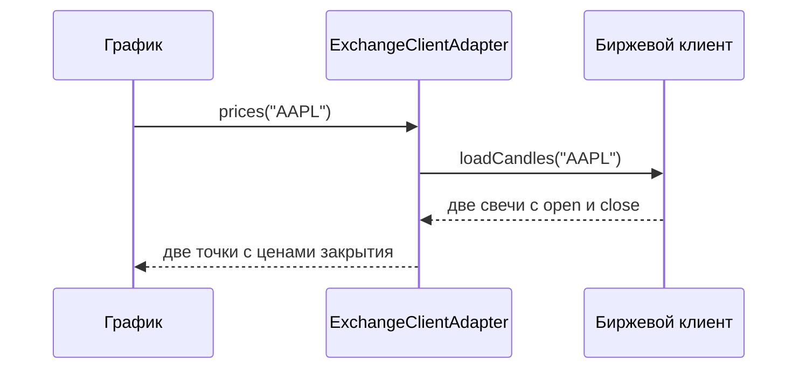
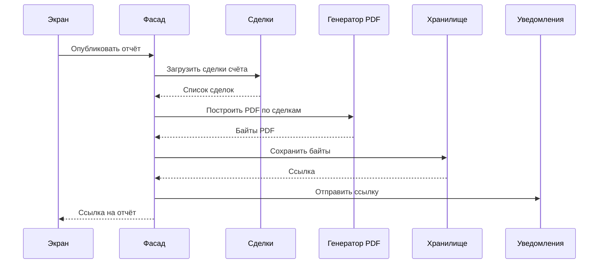
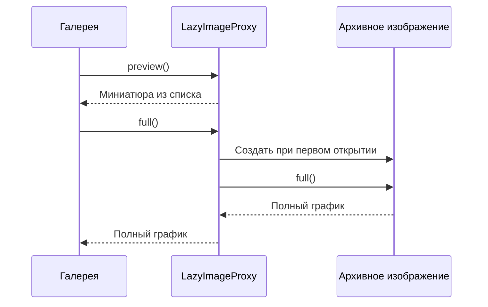
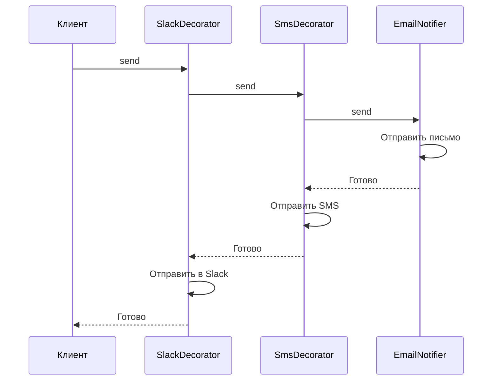
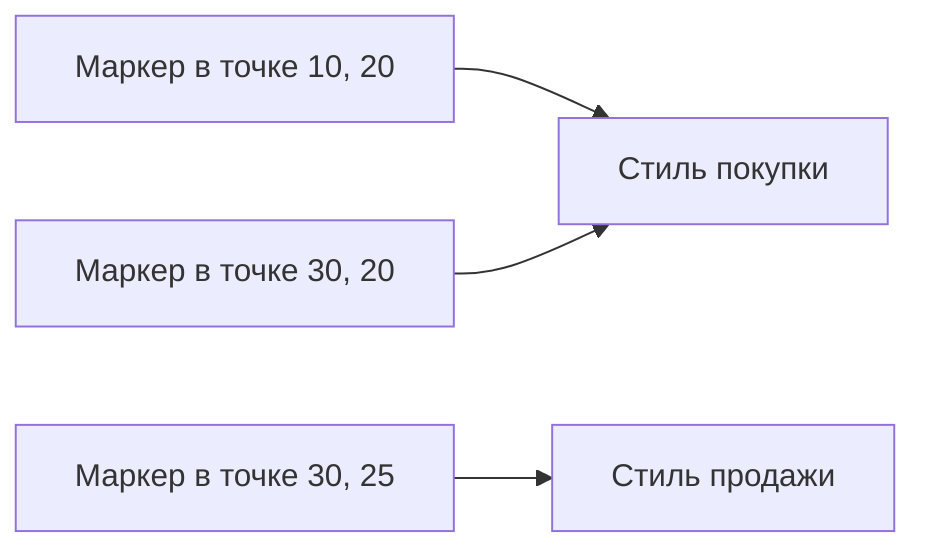
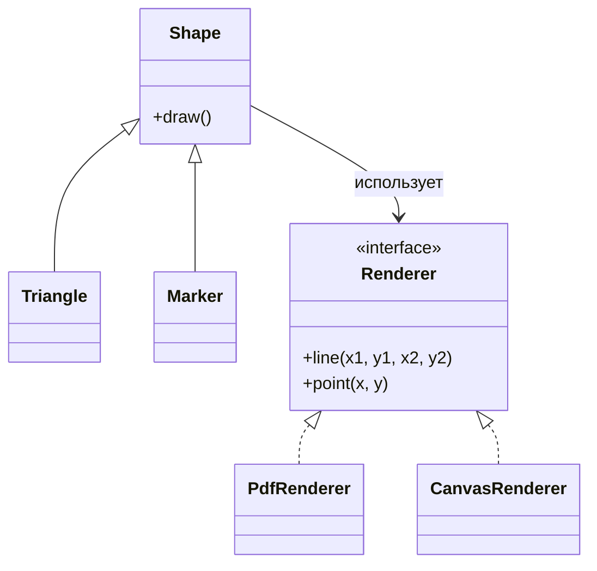
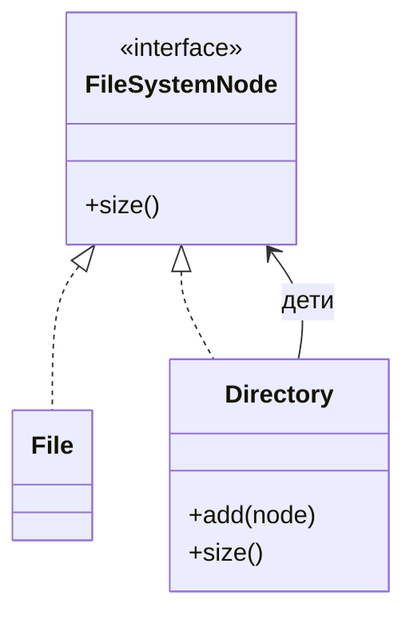

---
recommends:
  - lecture: 1
    reason: "наследование, композиция и SOLID"
  - lecture: 4
    reason: "классификация GoF"
---

# Лекция 6. Структурные паттерны проектирования

## Сквозной сценарий

В приложении брокера появляется кнопка «Отчёт по сделкам». На графике нужны цены закрытия с биржи, клиенту — PDF со сделками и уведомление о готовности. В списке отчётов достаточно миниатюры графика. Полное изображение откроют лишь у нескольких отчётов. Даже на одном таком экране у команды возникает несколько разных задач проектирования.

В предыдущих лекциях мы решали, как создавать объекты и как распределять между ними работу. Здесь вопрос другой:

> Как соединить уже существующие объекты так, чтобы клиентский код стал проще, стабильнее или экономнее?

Слово *клиент* здесь означает код, который вызывает операцию. Для поставщика котировок клиентом будет график, для сервиса публикации отчёта — экран приложения. Проследим, что каждый из них должен знать о своих соседях.

## Одинаковая обёртка, разные причины

### Ситуация

Сегодня PDF создаёт библиотека с методом `render(template, data)`. Экран вызывает привычный `export(report)`. Завтра тот же экспорт понадобится фоновой задаче. Она должна создавать дорогой клиент библиотеки только при первом экспорте, а команда хочет видеть, сколько отчётов удалось построить.

### Наивное решение

Напишем `ReportPdfWrapper`. Он переводит отчёт в формат библиотеки, хранит клиент, пишет метрику, сохраняет PDF и рассылает письма. Пока вызов один и всё проходит успешно, решение выглядит удобным.

### Что ломается

Сервис сохранил PDF, но почтовый сервер не подтвердил отправку вовремя. Повторить весь вызов? Если первое письмо успело уйти, адресат получит второе. А если счётчик увеличивается при каждой попытке, один отчёт попадёт в статистику дважды. По названию `Wrapper` невозможно понять, где провести границу повтора.

### Улучшение

Оставим экрану одну операцию публикации. Внутри неё адаптер переводит отчёт в аргументы SDK (библиотеки поставщика), заместитель управляет созданием клиента, а декоратор измеряет экспорт. Сохранение и отправка письма идут после успешного построения PDF. Только построение из неизменного входа можно безопасно повторить в этом примере: по условию оно возвращает байты и ничего не публикует.

### Почему это работает

Теперь у каждого изменения есть адрес. Если поставщик переименовал поле, проверяем преобразование в адаптере. Если библиотека открывается уже при показе списка, считаем, сколько раз заместитель создаёт клиент. Если два сбоя дали три «успешных отчёта», смотрим, что именно измеряет декоратор. Когда экспорт сводится к одному дешёвому локальному вызову, достаточно самого адаптера.

## Карта структурных паттернов

| Что мешает клиенту | Что меняем | Паттерн |
|---|---|---|
| Биржа возвращает свечи, график ожидает точки | Переводим запрос и результат на границе библиотеки | Adapter (адаптер) |
| Экран знает весь порядок публикации | Даём ему одну операцию для готового сценария | Facade (фасад) |
| Открытие списка загружает полные изображения | Ставим перед изображением объект с тем же контрактом | Proxy (заместитель) |
| Каналы уведомлений приходится сочетать попарно | Собираем независимые дополнения в цепочку | Decorator (декоратор) |
| У тысяч маркеров графика повторяется оформление | Выносим общие данные в разделяемый объект | Flyweight (легковес) |

В [классификации GoF](/lectures/04#классификация-паттернов-gof) к структурным относятся ещё Bridge и Composite. К ним вернёмся на примере отрисовки документа и дерева его элементов.

В первых четырёх задачах часто встречается **делегирование**: объект принимает запрос и поручает часть работы другому. Объектную композицию здесь понимаем широко — поведение целого собирается из его частей. Из одного поля со ссылкой нельзя узнать, кто создал вложенный объект, владеет им и отвечает за его освобождение. У легковеса вообще может не быть объекта, которому он пересылает вызовы.

## Adapter

График ожидает `MarketDataProvider`: по тикеру он получает последовательность точек «время — цена закрытия». У биржевого клиента есть данные, но его метод `loadCandles` отдаёт свечи. Свеча описывает интервал торгов и может содержать несколько цен. Если график начнёт сам выбирать поле `close`, тот же выбор придётся повторить при экспорте отчёта.

**Adapter** реализует ожидаемый клиентом контракт и переводит вызов в операции доступного объекта. В примере порядок точек совпадает с порядком свечей, время уже приведено поставщиком к формату графика. Открытие и закрытие нарочно различаются: подмена одного поля другим должна быть заметна.



::: multi-code "Adapter: от свечей к точкам графика"

```kotlin
data class Candle(val time: String, val open: Double, val close: Double)
data class PricePoint(val time: String, val value: Double)

fun interface ExchangeClient {
    fun loadCandles(ticker: String): List<Candle>
}

interface MarketDataProvider {
    fun prices(symbol: String): List<PricePoint>
}

class ExchangeClientAdapter(private val client: ExchangeClient) : MarketDataProvider {
    override fun prices(symbol: String): List<PricePoint> =
        client.loadCandles(symbol).map { PricePoint(it.time, it.close) }
}
```

```kotlin playground
data class Candle(val time: String, val open: Double, val close: Double)
data class PricePoint(val time: String, val value: Double)

fun interface ExchangeClient {
    fun loadCandles(ticker: String): List<Candle>
}

interface MarketDataProvider {
    fun prices(symbol: String): List<PricePoint>
}

class ExchangeClientAdapter(private val client: ExchangeClient) : MarketDataProvider {
    override fun prices(symbol: String): List<PricePoint> =
        client.loadCandles(symbol).map { PricePoint(it.time, it.close) }
}

fun main() {
    val client = ExchangeClient { symbol ->
        check(symbol == "AAPL")
        listOf(Candle("10:00", 99.0, 101.5), Candle("10:01", 101.5, 102.0))
    }
    val provider: MarketDataProvider = ExchangeClientAdapter(client)
    val points = provider.prices("AAPL")
    check(points == listOf(PricePoint("10:00", 101.5), PricePoint("10:01", 102.0)))
    val empty = ExchangeClientAdapter(ExchangeClient { emptyList() })
    check(empty.prices("AAPL").isEmpty())
    val offline = IllegalStateException("Exchange offline")
    val unavailable = ExchangeClientAdapter(ExchangeClient { throw offline })
    check(runCatching { unavailable.prices("AAPL") }.exceptionOrNull() === offline)
    println(points)
}
```

```csharp
public sealed record Candle(string Time, decimal Open, decimal Close);
public sealed record PricePoint(string Time, decimal Value);

public interface IExchangeClient
{
    IReadOnlyList<Candle> LoadCandles(string ticker);
}

public interface IMarketDataProvider
{
    IReadOnlyList<PricePoint> Prices(string symbol);
}

public sealed class ExchangeClientAdapter(IExchangeClient client) : IMarketDataProvider
{
    public IReadOnlyList<PricePoint> Prices(string symbol) =>
        client.LoadCandles(symbol).Select(c => new PricePoint(c.Time, c.Close)).ToList();
}
```

```java
import java.util.List;

record Candle(String time, double open, double close) {}
record PricePoint(String time, double value) {}

interface ExchangeClient {
    List<Candle> loadCandles(String ticker);
}

interface MarketDataProvider {
    List<PricePoint> prices(String symbol);
}

record ExchangeClientAdapter(ExchangeClient client) implements MarketDataProvider {
    public List<PricePoint> prices(String symbol) {
        return client.loadCandles(symbol).stream()
            .map(c -> new PricePoint(c.time(), c.close()))
            .toList();
    }
}
```

```go
type Candle struct {
    Time string
    Open, Close float64
}

type PricePoint struct {
    Time string
    Value float64
}

type ExchangeClient interface {
    LoadCandles(ticker string) ([]Candle, error)
}

type MarketDataProvider interface {
    Prices(symbol string) ([]PricePoint, error)
}

type ExchangeClientAdapter struct{ Client ExchangeClient }

func (a ExchangeClientAdapter) Prices(symbol string) ([]PricePoint, error) {
    candles, err := a.Client.LoadCandles(symbol)
    if err != nil {
        return nil, err
    }
    points := make([]PricePoint, 0, len(candles))
    for _, c := range candles {
        points = append(points, PricePoint{Time: c.Time, Value: c.Close})
    }
    return points, nil
}
```

:::

Для первой свечи с открытием 99 и закрытием 101,5 график получит точку (10:00, 101,5). Пустая успешная выборка даст ноль точек. Ошибка соединения означает, что наличие котировок неизвестно: её нужно передать вызывающему коду согласно контракту. Замена ошибки пустым списком нарисовала бы достоверно выглядящий пустой график. Тип `Candle` изображает уже разобранный ответ SDK. Если поставщик отдаёт сырой JSON, проверка полей нужна на границе разбора.

### Object Adapter и Class Adapter

У GoF редактор работает с фигурами, а библиотечный текстовый виджет умеет сообщать свои размеры в другом представлении. Адаптер вычисляет границы, нужные редактору. Авторы показывают две реализации: адаптер объекта хранит экземпляр виджета, адаптер класса наследует его реализацию и выполняет контракт фигуры. В нашей версии клиент биржи передан извне. Можно подставить тестовый экземпляр или готовый клиент с нужными настройками соединения.

В Java и C# целевой контракт может быть интерфейсом, тогда для адаптера класса достаточно одного доступного для наследования базового класса. Когда задача состоит в подключении уже созданного объекта или SDK запрещает наследование, проще использовать композицию.

::: only go
В Go интерфейс задаёт потребитель. Если тип уже имеет метод с подходящей сигнатурой и поведением, его можно передать напрямую. Здесь `LoadCandles` и `Prices` различаются и именем, и типом результата, поэтому адаптер действительно выполняет работу.
:::

::: warning Типичная ошибка
Поставщик прислал цены в центах, а контракт графика требует доллары — перевод единиц относится к адаптации. Решение «исключать убыточные сделки из отчёта» относится к правилам отчёта. Спрятав его в адаптере, мы изменим данные у всех клиентов биржи.
:::

## Facade

Для одной кнопки «Опубликовать» экрану пришлось бы загрузить сделки, построить PDF, передать байты в хранилище и сообщить клиенту ссылку. Фоновая выгрузка повторила бы эту последовательность. **Facade** даёт обоим клиентам одну операцию `publish`. Специализированному клиенту по-прежнему может понадобиться прямой доступ к построению PDF, например для предпросмотра.



Ниже подсистемы переданы функциями. Такая форма делает видимым главное: кто знает порядок и кто передаёт результат одного шага следующему. В примере сделки обозначены строками.

::: multi-code "Facade: публикация отчёта" {playground=off}

```kotlin
class ReportFacade(
    private val load: (String) -> List<String>,
    private val render: (List<String>) -> ByteArray,
    private val store: (ByteArray) -> String,
    private val notifyReady: (String, String) -> Unit
) {
    fun publish(account: String): String {
        val trades = load(account)
        val pdf = render(trades)
        val link = store(pdf)
        notifyReady(account, link)
        return link
    }
}
```

```csharp
public sealed class ReportFacade(
    Func<string, IReadOnlyList<string>> load,
    Func<IReadOnlyList<string>, byte[]> render,
    Func<byte[], string> store,
    Action<string, string> notifyReady)
{
    public string Publish(string account)
    {
        var trades = load(account);
        var pdf = render(trades);
        var link = store(pdf);
        notifyReady(account, link);
        return link;
    }
}
```

```java
import java.util.List;
import java.util.function.BiConsumer;
import java.util.function.Function;

record ReportFacade(
    Function<String, List<String>> load,
    Function<List<String>, byte[]> render,
    Function<byte[], String> store,
    BiConsumer<String, String> notifyReady
) {
    String publish(String account) {
        var trades = load.apply(account);
        var pdf = render.apply(trades);
        var link = store.apply(pdf);
        notifyReady.accept(account, link);
        return link;
    }
}
```

```go
type ReportFacade struct {
    Load        func(account string) ([]string, error)
    Render      func(trades []string) ([]byte, error)
    Store       func(pdf []byte) (string, error)
    NotifyReady func(account, link string) error
}

func (f ReportFacade) Publish(account string) (string, error) {
    trades, err := f.Load(account)
    if err != nil {
        return "", err
    }
    pdf, err := f.Render(trades)
    if err != nil {
        return "", err
    }
    link, err := f.Store(pdf)
    if err != nil {
        return "", err
    }
    if err := f.NotifyReady(account, link); err != nil {
        return "", err
    }
    return link, nil
}
```

:::

Подставьте хранилище, которое возвращает `/reports/42.pdf`. Именно эта ссылка должна прийти в уведомление и вернуться экрану. Если хранилище сообщает об ошибке, уведомление не отправляется. Если сбой произошёл при отправке письма, файл уже сохранён. Одна операция фасада сама по себе не даёт атомарности — гарантии «либо всё, либо ничего».

Тот же вопрос возникает при оформлении заказа: склад зарезервировал товар, банк списал деньги, а служба доставки недоступна. Фасад избавляет экран от знания трёх API. Для восстановления система отдельно хранит состояние заказа и решает, повторить доставку или вернуть деньги. Простое повторение `placeOrder` опасно.

### Фасад и слои

Границу фасада удобно проверять по запросам клиента. Экрану нужны публикация и её результат. Правило расчёта комиссии принадлежит модели сделок, выбор шрифта — генератору PDF. Когда в один фасад попадают ещё и возвраты платежей, смена адреса, экспорт котировок и настройки профиля, у него появляются независимые причины для изменений. Разделите его по задачам клиентов.

::: only go
В Go фасадом может служить экспортированная функция пакета. Структура из примера нужна для хранения настроенного набора зависимостей. Упрощение конкретного сценария можно проверить в обоих вариантах по коду вызывающей стороны.
:::

## Proxy

В списке отчётов сто миниатюр. Полные графики лежат в архиве, а пользователь открывает один или два. Если конструктор каждого изображения открывает архив, первый экран заплатит за работу, которая почти никому не понадобится.

**Proxy** предоставляет клиенту тот же контракт, что и реальный объект, и управляет доступом к нему. Галерея вызывает `preview()` при показе списка и `full()` при открытии изображения. Миниатюра уже есть в данных списка. Заместитель может вернуть её сразу, а при первом `full()` получить настоящий объект через фабрику. Строки ниже обозначают содержимое изображений, чтобы сравнить результаты без файлов и сети. Миниатюра и фабрика относятся к одной версии графика.



::: multi-code "Proxy: открытие графика из архива"

```kotlin
interface Image {
    fun preview(): String
    fun full(): String
}

class LazyImageProxy(private val thumbnail: String, open: () -> Image) : Image {
    private val original: Image by lazy(open)

    override fun preview(): String = thumbnail
    override fun full(): String = original.full()
}
```

```kotlin playground
interface Image {
    fun preview(): String
    fun full(): String
}

class LazyImageProxy(private val thumbnail: String, open: () -> Image) : Image {
    private val original: Image by lazy(open)

    override fun preview(): String = thumbnail
    override fun full(): String = original.full()
}

fun main() {
    var opened = 0
    var fullReads = 0
    val thumbnail = "small-42"
    val galleryImage: Image = LazyImageProxy(thumbnail) {
        opened++
        object : Image {
            override fun preview() = thumbnail
            override fun full(): String {
                fullReads++
                return "large-42"
            }
        }
    }
    repeat(2) { check(galleryImage.preview() == "small-42") }
    check(opened == 0)
    repeat(2) { check(galleryImage.full() == "large-42") }
    check(opened == 1 && fullReads == 2)
    println("Открытий архива: $opened, чтений графика: $fullReads")
}
```

```csharp
public interface IImage
{
    string Preview();
    string Full();
}

public sealed class LazyImageProxy(string thumbnail, Func<IImage> open) : IImage
{
    private readonly Lazy<IImage> original = new(open);

    public string Preview() => thumbnail;
    public string Full() => original.Value.Full();
}
```

```java
import java.util.function.Supplier;

interface Image {
    String preview();
    String full();
}

final class LazyImageProxy implements Image {
    private final String thumbnail;
    private final Supplier<Image> open;
    private Image original;

    LazyImageProxy(String thumbnail, Supplier<Image> open) {
        this.thumbnail = thumbnail;
        this.open = open;
    }

    public String preview() { return thumbnail; }

    private synchronized Image original() {
        if (original == null) {
            original = open.get();
        }
        return original;
    }

    public String full() { return original().full(); }
}
```

```go
import "sync"

type Image interface {
    Preview() string
    Full() string
}

type LazyImageProxy struct {
    thumbnail string
    original  func() Image
}

func NewLazyImageProxy(thumbnail string, open func() Image) *LazyImageProxy {
    return &LazyImageProxy{thumbnail: thumbnail, original: sync.OnceValue(open)}
}

func (p *LazyImageProxy) Preview() string { return p.thumbnail }
func (p *LazyImageProxy) Full() string    { return p.original().Full() }
```

:::

После двух просмотров миниатюры архив открывали ноль раз. Два вызова `full()` затем один раз запрашивают объект у фабрики, но дважды читают полный график. Здесь переиспользуется **объект**, а решение кешировать ещё и результат чтения потребовало бы отдельного правила о свежести данных.

### Виды Proxy

| Что контролирует заместитель | Как ведёт себя запрос | Что входит в контракт |
|---|---|---|
| Создание тяжёлого объекта (виртуальный Proxy) | Дешёвые операции можно выполнить локально | Когда впервые потребуется дорогая работа |
| Права доступа (защищающий Proxy) | Запрещённый запрос не дойдёт до объекта | Каким способом клиент узнает об отказе |
| Связь с удалённым объектом (удалённый Proxy) | Локальный вызов превращается в обмен сообщениями | Ожидание, недоступность и ошибки сети |
| Доступ к кешированному результату | Попадание в кеш обходит исходный сервис | Срок годности и условия обновления результата |

Одинаковые сигнатуры ещё не гарантируют взаимозаменяемости. Если контракт обещает последнюю котировку, кеш со вчерашним значением его нарушает. Клиент может получить реализацию напрямую или через внедрение зависимостей (DI): вызывающему коду в обоих случаях нужны одни и те же правила результата и ошибки.

::: only csharp
`Lazy<IImage>` с фабрикой запоминает успешно созданный объект. В стандартном режиме он также запоминает исключение фабрики. Если сеть должна получить вторую попытку, политику восстановления нужно выбрать отдельно.
:::

::: only go
`sync.OnceValue` (Go 1.21+) возвращает функцию, которая однократно вычисляет значение. В примере фабрика всегда успешно возвращает изображение. Если у открытия есть штатная ошибка, её стоит выразить в сигнатуре и решить, можно ли пробовать снова.
:::

## Decorator

После публикации отчёта один клиент хочет письмо, второй — письмо и SMS, дежурная команда — ещё и сообщение в Slack. Наследование фиксирует каждую комбинацию в имени класса: `EmailSmsNotifier`, `EmailSlackNotifier`, `EmailSmsSlackNotifier`. При трёх независимо включаемых дополнениях уже восемь наборов, включая пустой.

**Decorator** сохраняет общий интерфейс компонента и добавляет работу до или после делегирования. В редакторе Lexi авторы GoF так оборачивают элемент документа рамкой и полосами прокрутки. Элемент внутри по-прежнему умеет рисоваться, а порядок обрамления определяет, что именно прокручивается. В уведомлениях такой же порядок можно увидеть в журнале отправок.

Соберём `Slack(Sms(Email))`. В нашем примере каждый декоратор сначала вызывает вложенный объект и лишь потом отправляет сообщение в свой канал. Вывод в консоль заменяет настоящую отправку.

::: multi-code "Decorator: уведомления о готовности"

```kotlin
interface Notifier {
    fun send(message: String)
}

class EmailNotifier(private val email: String) : Notifier {
    override fun send(message: String) {
        println("Email to $email: $message")
    }
}

abstract class NotifierDecorator(
    private val wrappee: Notifier
) : Notifier {
    override fun send(message: String) {
        wrappee.send(message)
    }
}

class SmsDecorator(
    wrappee: Notifier,
    private val phone: String
) : NotifierDecorator(wrappee) {
    override fun send(message: String) {
        super.send(message)
        println("SMS to $phone: $message")
    }
}

class SlackDecorator(
    wrappee: Notifier,
    private val channel: String
) : NotifierDecorator(wrappee) {
    override fun send(message: String) {
        super.send(message)
        println("Slack $channel: $message")
    }
}
```

```kotlin playground
interface Notifier {
    fun send(message: String)
}

class EmailNotifier(private val email: String) : Notifier {
    override fun send(message: String) {
        println("Email to $email: $message")
    }
}

abstract class NotifierDecorator(
    private val wrappee: Notifier
) : Notifier {
    override fun send(message: String) {
        wrappee.send(message)
    }
}

class SmsDecorator(
    wrappee: Notifier,
    private val phone: String
) : NotifierDecorator(wrappee) {
    override fun send(message: String) {
        super.send(message)
        println("SMS to $phone: $message")
    }
}

class SlackDecorator(
    wrappee: Notifier,
    private val channel: String
) : NotifierDecorator(wrappee) {
    override fun send(message: String) {
        super.send(message)
        println("Slack $channel: $message")
    }
}

fun main() {
    val notifier: Notifier =
        SlackDecorator(
            SmsDecorator(
                EmailNotifier("user@example.com"),
                phone = "+79990000000"
            ),
            channel = "#reports"
        )

    notifier.send("Отчёт готов")
}
```

```csharp
public interface INotifier
{
    void Send(string message);
}

public sealed class EmailNotifier : INotifier
{
    private readonly string _email;

    public EmailNotifier(string email)
    {
        _email = email;
    }

    public void Send(string message) =>
        Console.WriteLine($"Email to {_email}: {message}");
}

public abstract class NotifierDecorator : INotifier
{
    private readonly INotifier _wrappee;

    protected NotifierDecorator(INotifier wrappee)
    {
        _wrappee = wrappee;
    }

    public virtual void Send(string message)
    {
        _wrappee.Send(message);
    }
}

public sealed class SmsDecorator : NotifierDecorator
{
    private readonly string _phone;

    public SmsDecorator(INotifier wrappee, string phone) : base(wrappee)
    {
        _phone = phone;
    }

    public override void Send(string message)
    {
        base.Send(message);
        Console.WriteLine($"SMS to {_phone}: {message}");
    }
}

public sealed class SlackDecorator : NotifierDecorator
{
    private readonly string _channel;

    public SlackDecorator(INotifier wrappee, string channel) : base(wrappee)
    {
        _channel = channel;
    }

    public override void Send(string message)
    {
        base.Send(message);
        Console.WriteLine($"Slack {_channel}: {message}");
    }
}
```

```java
interface Notifier {
    void send(String message);
}

final class EmailNotifier implements Notifier {
    private final String email;

    EmailNotifier(String email) {
        this.email = email;
    }

    public void send(String message) {
        System.out.println("Email to " + email + ": " + message);
    }
}

abstract class NotifierDecorator implements Notifier {
    private final Notifier wrappee;

    protected NotifierDecorator(Notifier wrappee) {
        this.wrappee = wrappee;
    }

    public void send(String message) {
        wrappee.send(message);
    }
}

final class SmsDecorator extends NotifierDecorator {
    private final String phone;

    SmsDecorator(Notifier wrappee, String phone) {
        super(wrappee);
        this.phone = phone;
    }

    public void send(String message) {
        super.send(message);
        System.out.println("SMS to " + phone + ": " + message);
    }
}

final class SlackDecorator extends NotifierDecorator {
    private final String channel;

    SlackDecorator(Notifier wrappee, String channel) {
        super(wrappee);
        this.channel = channel;
    }

    public void send(String message) {
        super.send(message);
        System.out.println("Slack " + channel + ": " + message);
    }
}
```

```go
import "fmt"

type Notifier interface {
    Send(message string)
}

type EmailNotifier struct {
    Email string
}

func (n EmailNotifier) Send(message string) {
    fmt.Printf("Email to %s: %s\n", n.Email, message)
}

type SmsDecorator struct {
    Wrappee Notifier
    Phone   string
}

func (d SmsDecorator) Send(message string) {
    d.Wrappee.Send(message)
    fmt.Printf("SMS to %s: %s\n", d.Phone, message)
}

type SlackDecorator struct {
    Wrappee Notifier
    Channel string
}

func (d SlackDecorator) Send(message string) {
    d.Wrappee.Send(message)
    fmt.Printf("Slack %s: %s\n", d.Channel, message)
}
```

:::

Порядок отправки — email, SMS, Slack. Вызов входит в цепочку со стороны Slack, но оба декоратора выполняют свою отправку на обратном пути. Здесь один базовый компонент и два декоратора.



Базовый компонент в этой сборке всегда шлёт письмо. Если тестовой среде нужен только Telegram, используйте отправитель Telegram как самостоятельный компонент. Если все каналы совершенно равноправны и между ними нет вложенного поведения, простой список отправителей и цикл часто читаются лучше.

### Важность порядка

Пусть кеш изначально пуст и дважды запрашивается один отчёт. В цепочке `Log(Cache(repository))` внешний журнал увидит два запроса, а репозиторий — один. В цепочке `Cache(Log(repository))` журнал и репозиторий увидят по одному запросу. Здесь счётчик заодно подсказывает, что вы измеряете: обращения клиента или обращения к хранилищу.

С повторами цена ошибки выше. Если внешний декоратор повторит всю рассылку при сбое Slack, письмо и SMS могут уйти второй раз. В экспорте отчёта ограничьте повтор временной ошибкой и числом попыток. Для операции с внешним эффектом нужно отдельно обеспечить идемпотентность — повтор того же запроса имеет тот же эффект, что и однократное выполнение.

::: only kotlin
Запись `class LoggingNotifier(private val inner: Notifier) : Notifier by inner` позволяет переопределить только интересующие методы. Если сам `inner` внутри своего метода вызывает другой свой метод, такой вызов остаётся внутри `inner`. Делегирование не перехватывает его автоматически.
:::

::: only go
В примере поле `Wrappee` именованное, поэтому вызов `d.Wrappee.Send(message)` явный. В Go можно также встроить интерфейс как поле: его методы при соблюдении правил языка попадут в набор методов структуры. Получателем такого вызова остаётся вложенный объект.
:::

## Flyweight

На графике сто тысяч маркеров сделок. Позиции различаются, но вариантов оформления всего двадцать. Здесь уже нет вызова, который нужно перехватить. Дорогим стало представление данных: если каждый маркер владеет своей копией одинакового описания стиля, память расходуется на дубликаты.

**Flyweight** позволяет множеству элементов одновременно использовать общее представление. Критерий разделения — зависимость от контекста. Цвет и значок стиля имеют один смысл у всех его пользователей: это **внутреннее** (*intrinsic*) состояние. Координаты относятся к конкретному появлению значка: это **внешнее** (*extrinsic*) состояние. Если две сделки совпали по координатам, координаты всё равно принадлежат отдельным сделкам.



В следующем фрагменте фабрика живёт столько же, сколько график, и используется одним потоком. Ключ содержит все параметры оформления. Пара полей не зависит от выбора символа-разделителя в имени значка или цвете. Такую же фабрику можно использовать для частиц в игре: спрайт и цвет разделяются, координаты и скорость остаются у частицы.

::: multi-code "Flyweight: общий стиль, разные координаты"

```kotlin
data class StyleKey(val icon: String, val color: String)

class MarkerStyle(val key: StyleKey) {
    fun draw(x: Int, y: Int) = "${key.icon} ${key.color} at $x,$y"
}

class StyleFactory {
    private val styles = mutableMapOf<StyleKey, MarkerStyle>()

    fun get(icon: String, color: String): MarkerStyle {
        val key = StyleKey(icon, color)
        return styles.getOrPut(key) { MarkerStyle(key) }
    }
}

data class Marker(val x: Int, val y: Int, val style: MarkerStyle) {
    fun draw() = style.draw(x, y)
}
```

```kotlin playground
data class StyleKey(val icon: String, val color: String)

class MarkerStyle(val key: StyleKey) {
    fun draw(x: Int, y: Int) = "${key.icon} ${key.color} at $x,$y"
}

class StyleFactory {
    private val styles = mutableMapOf<StyleKey, MarkerStyle>()

    fun get(icon: String, color: String): MarkerStyle {
        val key = StyleKey(icon, color)
        return styles.getOrPut(key) { MarkerStyle(key) }
    }
}

data class Marker(val x: Int, val y: Int, val style: MarkerStyle) {
    fun draw() = style.draw(x, y)
}

fun main() {
    val factory = StyleFactory()
    val a = Marker(10, 20, factory.get("buy", "green"))
    val b = Marker(30, 20, factory.get("buy", "green"))
    check(a.style === b.style)
    check(a.draw() != b.draw())
    check(factory.get("a|b", "c") !== factory.get("a", "b|c"))
    println(a.draw())
    println(b.draw())
}
```

```csharp
public sealed record StyleKey(string Icon, string Color);

public sealed class MarkerStyle(StyleKey key)
{
    public string Draw(int x, int y) => $"{key.Icon} {key.Color} at {x},{y}";
}

public sealed class StyleFactory
{
    private readonly Dictionary<StyleKey, MarkerStyle> styles = new();

    public MarkerStyle Get(string icon, string color)
    {
        var key = new StyleKey(icon, color);
        if (!styles.TryGetValue(key, out var style))
        {
            style = new MarkerStyle(key);
            styles.Add(key, style);
        }
        return style;
    }
}

public sealed record Marker(int X, int Y, MarkerStyle Style)
{
    public string Draw() => Style.Draw(X, Y);
}
```

```java
import java.util.HashMap;
import java.util.Map;

record StyleKey(String icon, String color) {}

record MarkerStyle(StyleKey key) {
    String draw(int x, int y) {
        return key.icon() + " " + key.color() + " at " + x + "," + y;
    }
}

final class StyleFactory {
    private final Map<StyleKey, MarkerStyle> styles = new HashMap<>();

    MarkerStyle get(String icon, String color) {
        return styles.computeIfAbsent(new StyleKey(icon, color), MarkerStyle::new);
    }
}

record Marker(int x, int y, MarkerStyle style) {
    String draw() { return style.draw(x, y); }
}
```

```go
import "fmt"

type styleKey struct{ icon, color string }
type MarkerStyle struct{ key styleKey }

func (s *MarkerStyle) Draw(x, y int) string {
    return fmt.Sprintf("%s %s at %d,%d", s.key.icon, s.key.color, x, y)
}

type StyleFactory struct{ styles map[styleKey]*MarkerStyle }

func (f *StyleFactory) Get(icon, color string) *MarkerStyle {
    if f.styles == nil {
        f.styles = make(map[styleKey]*MarkerStyle)
    }
    key := styleKey{icon, color}
    if style, ok := f.styles[key]; ok {
        return style
    }
    style := &MarkerStyle{key: key}
    f.styles[key] = style
    return style
}

type Marker struct {
    X, Y int
    Style *MarkerStyle
}

func (m Marker) Draw() string { return m.Style.Draw(m.X, m.Y) }
```

:::

### Когда Flyweight действительно нужен

Проверка состоит из двух частей. Сначала убедитесь, что маркеры с одинаковым ключом ссылаются на один объект и всё ещё рисуются в разных точках. Затем сравните расход памяти на одинаковом наборе сделок до и после. Первая проверка доказывает разделение объектов, вторая измеряет его пользу.

Если было 100 000 **отдельных** описаний по 64 байта, это 6 400 000 байт. При 20 общих описаниях и условной ссылке в 8 байт на каждом маркере получим 801 280 байт до учёта таблицы фабрики, ключей, заголовков объектов и выравнивания. Это оценка по заданным размерам. Если загрузчик и раньше отдавал всем один и тот же спрайт, его пиксели нельзя сто тысяч раз записать в графу экономии. Когда почти у каждого маркера свой стиль, таблица может занять больше памяти, чем удастся сэкономить.

Общий стиль безопаснее сделать неизменяемым. Чтобы перекрасить одну сделку, маркеру назначают другую ссылку на стиль или создают новый маркер с нужным стилем. Изменение объекта по общей ссылке перекрасило бы и соседей. Срок жизни таблицы тоже важен: глобальная фабрика с бесконечным числом ключей удержит все встреченные стили.

::: only kotlin
У `value class` другое назначение. На JVM компилятор иногда хранит только базовое значение, а в обобщённых или допускающих `null` контекстах может понадобиться упаковка в объект. Даже когда упаковки нет, общего каталога стилей от этого не возникает.
:::

::: only csharp
`string.Intern` возвращает канонический экземпляр строки. У `readonly record struct` семантика значения: при присваивании копируется значение полей. Сам тип не гарантирует размещение вне кучи и не организует общий каталог экземпляров.
:::

::: only java
`Integer.valueOf(int)` гарантированно переиспользует объекты для значений от −128 до 127 включительно и может кешировать другие. Для сравнения двух объектов `Integer` по значению используйте `equals`. В тесте самой фабрики уместно проверить идентичность, если важно, вернули ли два вызова один и тот же объект.
:::

::: only go
`sync.Pool` подходит для временных объектов вроде рабочих буферов. Полученный буфер используют, затем возвращают в пул, откуда он может исчезнуть. Маркерам графика, напротив, нужно одновременно держать ссылки на одно и то же оформление. Эту задачу решает таблица стилей с ключом.
:::

## Как различать похожие паттерны

Пусть в ревью появился класс, который хранит ссылку на сервис и вызывает его метод. Какое изменение оправдывает появление класса?

| Вопрос к автору | Пример ответа | Что проверить |
|---|---|---|
| Какой контракт ожидает клиент? | «Биржа возвращает свечи, графику нужны точки» | Adapter переводит аргументы, данные и ошибки с сохранением смысла |
| Какую последовательность пришлось бы знать клиенту? | «Чтобы опубликовать отчёт, экран знает четыре подсистемы» | Facade даёт точку входа, по которой клиент получает нужный результат |
| Кто решает, будет ли вызван реальный объект? | «Миниатюра уже здесь, за полным графиком пойдём в архив» | Proxy контролирует доступ и выполняет обещания интерфейса |
| Какое дополнение можно снять или переставить? | «К письму можно по выбору добавить SMS или Slack» | Decorator сохраняет интерфейс и допускает композицию |
| Какие данные можно использовать совместно? | «Те же двадцать стилей нужны ста тысячам маркеров» | Flyweight разделяет оформление, сохраняя отдельные позиции |

Логирование само по себе не определяет паттерн. Если заместитель проверяет право чтения архива и журналирует отказы, основная задача объекта — контроль доступа. Если измерение времени можно независимо включить вокруг любого `Image`, его удобно оформить декоратором. В одной сборке оба объекта могут стоять рядом.

У адаптера и фасада внешние сигнатуры тоже могут совпадать. Важнее ответ на вопрос «что случится, если его убрать?». Без адаптера график перестанет понимать ответ биржи. Без фасада PDF по-прежнему можно опубликовать, но каждому клиенту придётся собрать операцию из шагов самостоятельно.

::: only java
У графика можно увидеть тот же выбор при чтении файла. Если разборщик принимает `Reader`, оберните байтовый поток в `InputStreamReader` с кодировкой файла — разборщик получит символы. Если потребителю по-прежнему нужен `InputStream`, `BufferedInputStream` сохранит байтовый интерфейс и добавит буферизацию. Проверьте своё объяснение по типу данных, которые читает клиент. [Документация InputStreamReader](https://docs.oracle.com/en/java/javase/21/docs/api/java.base/java/io/InputStreamReader.html) · [Документация BufferedInputStream](https://docs.oracle.com/en/java/javase/21/docs/api/java.base/java/io/BufferedInputStream.html)
:::

## Bridge и Composite: что осталось за рамками основной лекции

### Bridge

У отчёта два способа вывода — экран и PDF — и несколько видов фигур. Завтра понадобится SVG и появится новый тип маркера. Если назвать классы `CanvasCircle`, `PdfCircle`, `CanvasMarker`, `PdfMarker`, то каждый следующий формат придётся добавлять сразу для всех видов фигур.

**Bridge** разделяет две оси изменений. Фигура хранит ссылку на исполнителя, который умеет рисовать небольшим набором примитивов. Например, треугольник может потребовать от исполнителя только три отрезка. Для него оба существующих исполнителя уже готовы. Добавление SVG, в свою очередь, требует реализации набора примитивов для SVG.



Цена независимости — общий словарь примитивов. Если для новой фигуры требуется операция, которую ни один исполнитель ещё не поддерживает, изменятся обе стороны. Adapter был нужен для уже обнаруженной несовместимости, а здесь мы заранее оставили место для развития обеих сторон.

### Composite

**Composite** нужен, когда отдельный элемент и группа элементов образуют дерево, а клиенту нужна одинаковая операция над обоими. В редакторе Lexi строка документа содержит глифы — элементы, умеющие отрисоваться. В отчёте раздел таким же образом может содержать строки и подразделы.

Возьмём знакомую файловую систему. В учебной модели дерево обходится без циклов и ссылок на один файл из разных каталогов. Файл знает свой размер, каталог суммирует размеры детей. Для каталога с файлом в 10 байт и вложенной папкой с файлом в 20 байт клиент единожды вызывает `size()` и получает 30.



Общим сделали только осмысленный для всех узлов запрос `size()`. Операция `add` осталась у каталога. Декоратор обычно оборачивает один компонент и дополняет его работу, а здесь один узел объединяет результаты произвольного числа детей.

## Связь с SOLID

Адаптер локализует изменение формата SDK (принцип единственной ответственности, SRP). График зависит от контракта котировок, который сформулирован в терминах графика (инверсия зависимостей, DIP). Состав уведомлений можно расширить новым декоратором без правки отправителя почты (открытость к расширению, OCP). Фасад даёт экрану ровно те операции, которые нужны для его сценария (разделение интерфейсов, ISP).

Самая строгая проверка здесь — **подстановка**, LSP. Если и исходное изображение, и заместитель обещают миниатюру одной версии, результат должен совпадать, каким бы способом его ни получили. А если один из объектов неожиданно требует новых прав или возвращает вчерашнюю версию, общий интерфейс сам по себе клиента не спасёт.

## Итоги

Когда разбираете чужой код, начните с клиента. Для графика важна совместимость формата, для экрана публикации — короткая операция, для галереи — момент первого дорогого обращения. Каналы уведомлений меняются независимо, а тысячи маркеров могут разделять оформление. Эти пять наблюдений объясняют выбор паттернов лучше, чем число классов на диаграмме.

После порождающих, поведенческих и структурных паттернов курс переходит к границам более крупных частей приложения. В [лекции о DDD](/lectures/07#зачем-ddd) речь пойдёт о том, где действуют общие понятия и правила предметной области, а в [лекции об архитектуре](/lectures/08#зачем-вообще-архитектура) — о границах модулей и направлении зависимостей.

## Дополнительное чтение

### Первоисточники и разборы

- [Gamma, Helm, Johnson, Vlissides. Design Patterns](https://www.informit.com/store/design-patterns-elements-of-reusable-object-oriented-9780321770462) — семь структурных паттернов в главе 4.
- [GoF. Designing a Document Editor, глава 2 (PDF)](https://courses.cs.duke.edu/compsci308/spring25/readings/gof_chap2.pdf) — как в Lexi дерево документа, рамки, прокрутка и оконные платформы приводят к разным проектным решениям.
- [Refactoring.Guru. Структурные паттерны](https://refactoring.guru/ru/design-patterns/structural-patterns) — иллюстрированный каталог на русском языке.
- [Metanit. Декоратор в C#](https://metanit.com/sharp/patterns/4.1.php) — второй пример сборки дополнений с общим интерфейсом.
- [Авито. Паттерны и практики написания кода](https://avito.tech/patterns#seasons) — разбор семи структурных паттернов в выпусках 5–7.

### Детали реализации

- [Kotlin. Delegation](https://kotlinlang.org/docs/delegation.html) — переопределение операций и вызовы внутри делегата.
- [Go. Пакет sync](https://pkg.go.dev/sync) — назначение `OnceValue` и гарантии временного пула.
- [AWS Builders’ Library. Timeouts, retries, and backoff with jitter](https://aws.amazon.com/builders-library/timeouts-retries-and-backoff-with-jitter/) — почему повтор после тайм-аута требует учёта побочных эффектов.

## Вопросы для самопроверки

1. Для графика получена свеча с открытием 99 и закрытием 101,5. Где выбрать нужное поле? Что увидит график, если биржа вернула ошибку?
2. Файл сохранён, но отправка ссылки прервалась. Что фасад уже сделал? Какие сведения нужны для повторной отправки?
3. Галерея дважды показала одну миниатюру и дважды открыла оригинал. Сколько раз вызваны фабрика и `full()` исходного объекта?
4. В каком порядке отправятся сообщения в цепочке `Sms(Slack(Email))`, если каждый декоратор делегирует перед собственной отправкой?
5. Два маркера используют один стиль. Как перекрасить только один из них? Как проверить экономию, если текстуры уже разделялись?
6. Какое изменение в отчёте проверяет независимость двух сторон Bridge? Какой вызов одинаково осмыслен для файла и каталога в Composite?

::: details Сверить ответы
1. Поле `close` выбирает адаптер. Ошибку биржи нужно передать согласно контракту источника.
2. Файл уже существует. Для восстановления нужны его ссылка, получатель и сведения о том, была ли доставка подтверждена. При неопределённом исходе помогает поддержка идемпотентной отправки с тем же ключом.
3. Один вызов фабрики, два чтения `full()` у исходного объекта.
4. Email, Slack, SMS.
5. Запросить стиль нового цвета и назначить его нужному маркеру. Сравнить фактическую память на одном наборе маркеров, считая уже разделяемую текстуру один раз.
6. Добавление фигуры из существующих примитивов сохраняет реализации вывода. И файл, и каталог отвечают на запрос `size()`.
:::

## Мини-практика

В сервисе отчётов меняется PDF-библиотека. Приложение вызывает `ReportExporter.export(report)`, а новый SDK предлагает `PdfClient.render(template, data)`. Конструктор клиента дорогой. Построение PDF по неизменному отчёту возвращает байты без внешних побочных эффектов. Публикация сохраняет эти байты и отправляет ссылку.

Нарисуйте цепочку вызовов и реализуйте её на любом языке курса. Фабрику PDF-клиента, генератор, хранилище и уведомления замените счётчиками с журналом вызовов. Для аудита нужна одна запись об окончательном исходе публикации; метрика попыток должна учитывать каждый вызов SDK. Разрешена одна повторная попытка построения PDF при временной ошибке.

| Что подать | По чему проверить результат |
|---|---|
| Создать сервис и показать список отчётов | Фабрика PDF-клиента вызвана 0 раз |
| Запросить публикацию; первый `render` сообщил о временной ошибке, второй вернул PDF | Клиент создан 1 раз, SDK получил тот же шаблон и данные 2 раза, метрика попыток равна 2. Файл сохранён 1 раз, ссылка отправлена 1 раз, в аудите 1 успех |
| В новой публикации оба вызова `render` завершились временной ошибкой | 2 попытки, 0 сохранений, 0 отправок, в аудите 1 отказ. Ошибка доступна клиенту |
| Сгенерировать 100 000 ячеек, использующих 20 различных комбинаций стиля | В фабрике этого отчёта 20 стилей; одинаковые ключи дают общий объект. Координаты и текст каждой ячейки сохраняются |

Объясните напарнику две границы вашего решения: почему повтор окружает построение PDF, а запись об исходе охватывает публикацию целиком, и при каком измеренном расходе памяти вы оставили бы ячейки без фабрики стилей.
