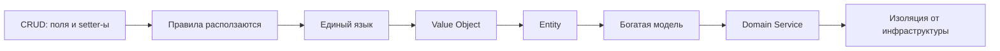
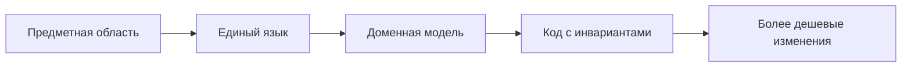
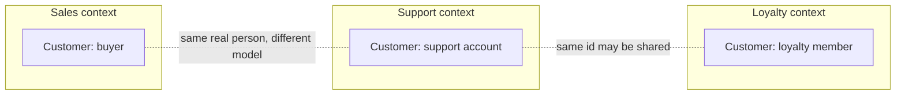
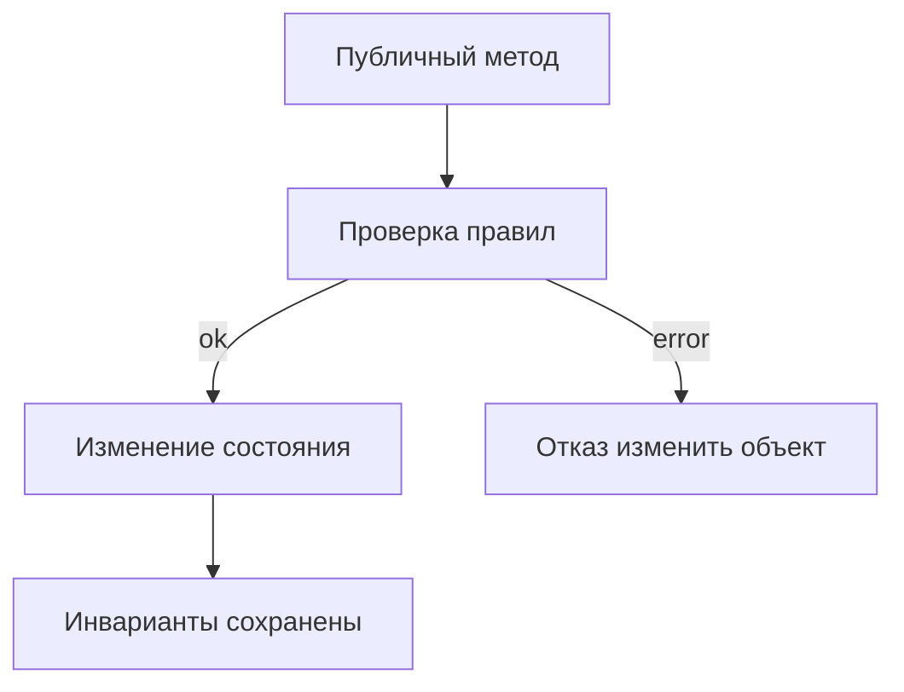
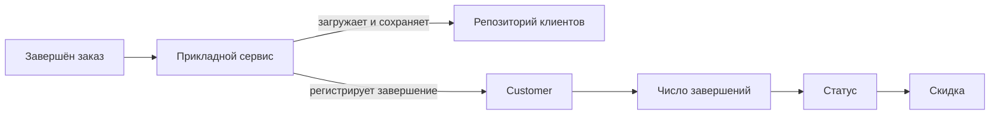
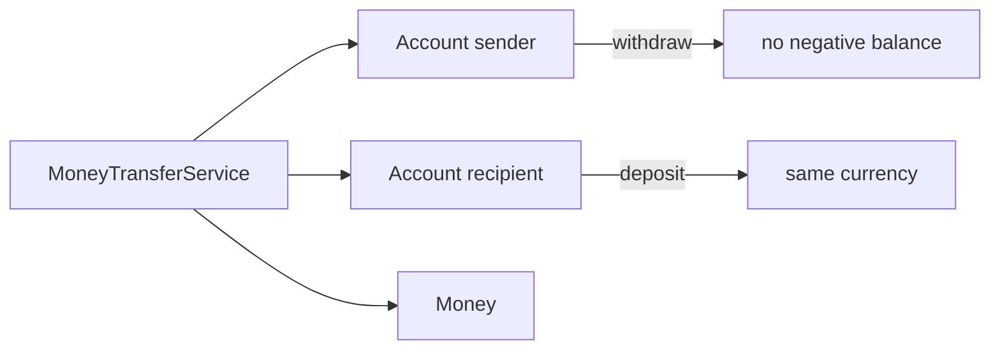
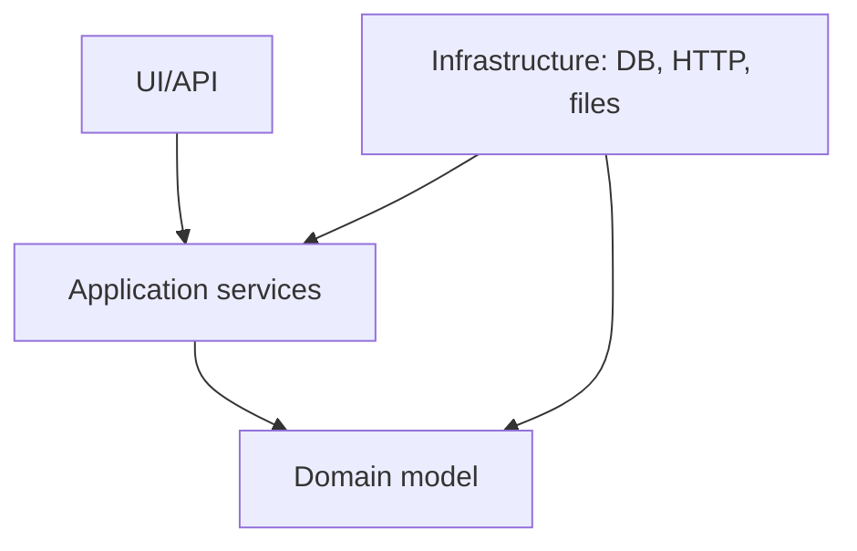
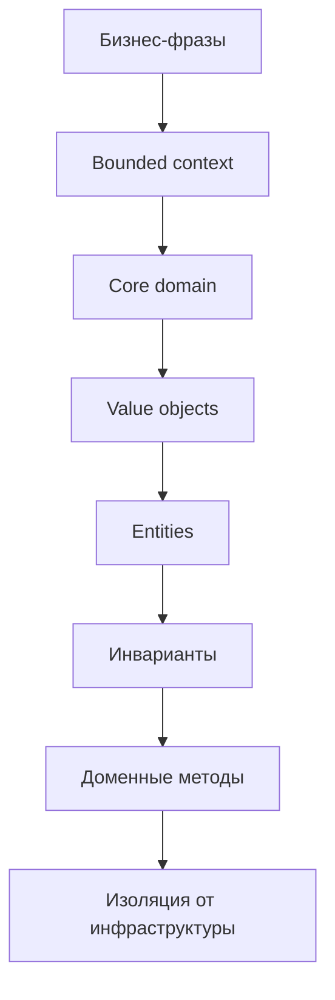

# Лекция 7. Предметно-ориентированное проектирование

У Ады два завершённых заказа. Она оформила третий, но ещё не получила его. На сайте уже появилась скидка 10 %, а оператор поддержки видит 0 %. Чтобы исправить расхождение, сначала придётся договориться, какой заказ программа лояльности считает завершённым.

**Предметно-ориентированное проектирование** (*Domain-Driven Design*, DDD) строит программу вокруг модели, которую разработчики уточняют вместе со знатоками предметной области. В этой лекции проследим одну такую договорённость от разговора с экспертом до метода, теста и границы транзакции.

::: tip Как читать примеры
Выберите Kotlin, C#, Java или Go. Короткие фрагменты показывают устройство модели. В запускаемых примерах Kotlin можно изменить входные данные и проверить, какое правило сработает.
:::

## Сквозной сценарий

Начнём с обычной таблицы `customers`. В ней хранятся email, число завершённых заказов, статус и скидка. Эксперт программы лояльности уточняет правило. Оформление заказа само по себе ничего не меняет. Когда отдел продаж подтверждает завершение, Loyalty засчитывает заказ. Третий завершённый заказ даёт Silver и 10 %, десятый — Gold и 20 %. До третьего заказа действует Bronze и 0 %.

В сквозном примере каждый завершённый заказ передаётся в модель ровно один раз. Это условие примера пригодится дальше, когда мы обсудим доставку событий.



Раньше мы спрашивали, от каких классов зависит код. Теперь спрашиваем, выражает ли он смысл предметной области и какие правила модель сохраняет при каждом изменении. Такие правила называют **инвариантами**. Подробнее о зависимостях — в лекциях [о SOLID](/lectures/01#solid) и [о DI](/lectures/02#dip-и-di). Архитектурные границы, которые позволяют изолировать такую модель, подробно появятся в
[Лекции 8](/lectures/08#ports-and-adapters).

## Разбор на примере программы лояльности

<a id="worked-example-поле-в-таблице-против-доменного-правила"></a>

### Ситуация

В программе лояльности у клиента есть email, число завершенных заказов, статус и скидка. Бизнес говорит: статус нельзя
назначить руками, он вычисляется из истории заказов.

### Наивное решение

Сделать CRUD-модель с публичными setter-ами: `email`, `completedOrders`, `status`, `discountPercent`. Controller или
service будет "аккуратно" выставлять правильные значения перед сохранением.

### Что ломается

Любой слой может записать `Gold` без нужного числа заказов или поставить скидку `200`. Правило существует в памяти
разработчика, а не в модели. Новый endpoint, импорт CSV или миграционный скрипт легко обходят инвариант.

### Улучшение

Выделить value objects для email и процента скидки, а entity `Customer` сделать единственным местом, где меняется число
завершенных заказов и пересчитывается статус. Application service координирует сценарий, но не назначает статус руками.

### Почему это работает

Теперь экран и выгрузка получают скидку из одного правила. Если у Ады два завершённых заказа, оба увидят 0 %. После регистрации третьего оба увидят 10 %. Прямой импорт в базу остаётся отдельным путём записи и тоже должен соблюдать это правило.

## Цели

После этой статьи вы должны уметь:

- объяснять разницу между данными, доменной моделью и бизнес-логикой;
- отличать анемичную модель от богатой доменной модели;
- выделять value object в обычных примитивах вроде строк и чисел;
- отличать entity от value object;
- формулировать инварианты доменного объекта;
- объяснять bounded context и ubiquitous language;
- понимать, почему доменная модель должна быть изолирована от инфраструктуры;
- выбирать место для логики: value object, entity, domain service или application service;
- видеть компромисс между полнотой доменной модели, её изоляцией и стоимостью запросов.

## Зачем DDD

Большинство приложений начинается одинаково: есть экран, форма, таблица в базе данных и несколько сервисов. Пока правила
простые, такой подход кажется достаточным. Проблемы появляются позже: скидка зависит от статуса, статус зависит от
истории заказов, у корпоративного адреса появляется собственное правило, а разные отделы используют слово "клиент" в разных смыслах.

Если эти правила разложены по контроллерам, сервисам, хранимым процедурам и UI-валидации, разработчик не видит систему
целиком. Чтобы понять, почему у клиента скидка 10 %, приходится искать все места, где кто-то мог изменить поле
`discount`.

DDD нужен не для красивых диаграмм. Он нужен, чтобы сделать бизнес-правила видимыми и проверяемыми.

| Мотив           | Что дает DDD                         | Что происходит без него                         |
|-----------------|--------------------------------------|-------------------------------------------------|
| Инженерный      | Правила рядом с моделью              | Логика размазана по сервисам, UI и базе данных  |
| Командный       | Единый язык с доменными экспертами   | Бизнес и разработчики говорят разными словами   |
| Архитектурный   | Границы контекстов и ответственности | Одна "универсальная" модель ломается от смыслов |



Важная мысль: DDD не говорит, что каждую задачу надо превращать в сложную объектную модель. Если модуль отправляет email,
импортирует CSV или вызывает стандартный платежный шлюз, часто достаточно обычного процедурного или сервисного кода.
DDD особенно полезен там, где бизнес отличается от конкурентов и где ошибка в правилах стоит дорого.

## Стратегия и тактика

В DDD удобно разделять два уровня.

**Стратегический DDD** отвечает на вопросы: где границы модели, кто какими словами пользуется, какая часть бизнеса
является ядром, какие команды за что отвечают.

**Тактический DDD** отвечает на вопросы: какие типы писать, где держать инварианты, чем entity отличается от value
object, когда нужен domain service.

| Уровень   | Вопрос                       | Примеры                                      |
|-----------|------------------------------|----------------------------------------------|
| Стратегия | Где границы смысла?          | Sales, Support, Billing, Loyalty             |
| Тактика   | Как выразить правила в коде? | `Email`, `Money`, `Customer`, `TransferService` |

Начнём со стратегии. Она подскажет, почему заказ может быть создан в Sales, хотя статус участника в Loyalty ещё прежний. Затем разберём, кто отвечает за изменение статуса и какие данные должны измениться вместе.

## Ограниченный контекст

**Ограниченный контекст** (*bounded context*) — граница, внутри которой модель и язык имеют один согласованный смысл. Один и тот же реальный
объект может выглядеть по-разному в разных контекстах.

Например, слово `Customer` кажется очевидным. Но в разных частях системы оно может означать разные вещи:

- в Sales это покупатель продукта;
- в Support это аккаунт с обращениями, SLA и историей поддержки;
- в Loyalty это участник программы лояльности со статусом и скидкой.



Плохое решение — создать один общий класс `Customer` и использовать его везде. Отдел продаж добавит `LTV`, поддержка —
`LastTicketDate`, бухгалтерия — `TaxId`, маркетинг — `MarketingConsent`. Теперь изменение правил поддержки придётся согласовывать даже с командами, которым обращения клиентов безразличны.

В нашем сценарии полезно разрешить разным контекстам иметь свои модели. Они могут ссылаться на один и тот же `CustomerId`, но
должны явно договориться, кто этим идентификатором владеет, кто может его назначать и кто только читает. Например, Sales сообщает о завершении заказа с идентификатором покупателя, а Loyalty сопоставляет его с участником своей программы. Размер скидки вычисляет Loyalty. Обоим контекстам достаточно согласовать смысл сообщения и идентификаторов. Они могут даже жить в одном процессе.

::: warning Общая модель не всегда экономит код
Повторить маленький тип в двух bounded context часто дешевле, чем держать один общий тип, который вынужден обслуживать
несколько разных смыслов.
:::

## Ядро и поддомены

<a id="core-supporting-generic-domain"></a>

Не все части системы одинаково важны для бизнеса. Поддомен — часть предметной области. Его роль зависит от задач организации. Ограниченный контекст, в свою очередь, задаёт границы конкретной модели этой работы.

| Роль поддомена       | Смысл                              | Как проектировать                                      |
|------------------|------------------------------------|--------------------------------------------------------|
| Core domain      | То, что отличает бизнес            | Вкладывать максимум внимания, DDD особенно полезен     |
| Supporting subdomain | Важен, но не уникален              | Проектировать аккуратно, без чрезмерной сложности      |
| Generic subdomain   | Стандартная задача                 | Можно купить, взять готовую библиотеку или SaaS        |

Для интернет-магазина уникальная программа лояльности может быть core domain. Отправка email, хранение файлов и
стандартная авторизация чаще являются generic subdomain. Внутренний каталог промокодов может быть supporting subdomain: он
важен для работы, но не обязательно делает бизнес уникальным.

В примере Эрика Эванса транспортная компания хочет надёжнее выполнять условия доставки. В ядро попадают маршрут и требования к доставке, а выставление счетов играет вспомогательную роль. Для сервиса выставления счетов приоритеты могли бы быть другими. [Эрик Эванс, пример грузоперевозок](https://hillside.net/plop/plop2002/final/DomainDrivenDesign_Excerpt_PLoP2002.pdf)

Практическое следствие: богатую модель нужно в первую очередь строить там, где правила являются конкурентным преимуществом
или источником риска. Не обязательно проектировать одинаково глубоко все модули.

## Единый язык

**Ubiquitous language** — единый язык разработчиков и экспертов внутри ограниченного контекста. Это не просто словарь в Confluence. Слова из
бизнес-разговора должны попадать в требования, тесты, имена классов, методы и события.

В разговоре «клиент сделал заказ» звучит вполне понятно, пока команда не пытается посчитать скидку. Оформленный, оплаченный и завершённый заказы могут приходиться на разные дни. Мы спросили эксперта, какой из них засчитывается, и получили имя для операции.

::: multi-code "Какой заказ засчитывает Loyalty?" {playground=off}

```kotlin
// Мы получили подтверждение завершения заказа.
customer.registerCompletedOrder()
```

```csharp
customer.RegisterCompletedOrder();
```

```java
customer.registerCompletedOrder();
```

```go
err := customer.RegisterCompletedOrder()
```

:::

Теперь эксперт может проверить тест по названию: «Третий завершённый заказ даёт Silver». Если правила изменятся и статус станет зависеть от оплаты, название теста заставит нас обсудить и саму операцию.

Единый язык живой. Его нужно чистить: переименовывать неточные классы, исправлять устаревшие термины, договариваться о
словах между командами. Это особенно важно в core domain: там ошибка в смысле слова меняет поведение продукта.

## Анемичная модель

Мы определили *где* границы (bounded context), *каким языком* говорим (ubiquitous language) и *что* является ядром бизнеса
(core domain). Теперь — *как* внутри bounded context строить модель, которая сама защищает свои правила. Начнём с того,
как выглядит модель, которая этого *не* делает.

**Anemic domain model** — модель, в которой объект хранит данные, но не защищает свои правила. Обычно у нее публичные
поля или сеттеры, а вся логика лежит во внешних сервисах.

Такую модель легко создать из таблицы базы данных: взяли колонки, сделали поля, добавили getters/setters. Но объект
получился пассивным. Он не знает, валиден ли он.

::: multi-code "Анемичная модель клиента" {playground=off}

```kotlin
data class Customer(
    var id: String,
    var email: String,
    var orders: Int,
    var discountPercent: Int,
    var status: String,
    var isEmployee: Boolean
)
```

```csharp
public sealed class Customer
{
    public string Id { get; set; } = "";
    public string Email { get; set; } = "";
    public int Orders { get; set; }
    public int DiscountPercent { get; set; }
    public string Status { get; set; } = "Bronze";
    public bool IsEmployee { get; set; }
}
```

```java
public class Customer {
    public String id;
    public String email;
    public int orders;
    public int discountPercent;
    public String status;
    public boolean employee;
}
```

```go
type Customer struct {
    ID              string
    Email           string
    Orders          int
    DiscountPercent int
    Status          string
    IsEmployee      bool
}
```

:::

Что здесь не так:

- `email` — просто строка, туда можно записать `hello`;
- `discountPercent` — любое число, включая `-10` и `150`;
- `status` можно назначить руками, не учитывая количество заказов;
- `isEmployee` смешивает два факта: адрес в домене компании и трудовые отношения. В нашей программе учитывается только первое;
- любой сервис может поменять поле и забыть одно из правил.

В такой системе нельзя посмотреть на `Customer` и понять, какие правила защищают клиента. Нужно искать все сервисы,
контроллеры, фоновые задачи и, возможно, хранимые процедуры.

## Инварианты

**Инвариант** — правило, которое должно оставаться истинным после создания объекта и после каждой операции над ним.

В нашей модели можно проверить следующие правила.

- email должен быть валидным;
- скидка находится в диапазоне от 0 до 100;
- баланс счета не может стать отрицательным;
- статус клиента соответствует количеству завершенных заказов;
- признак корпоративного адреса вычисляется по доменной части email;
- оба баланса после перевода сохраняют свои валюты, а сумма остатков при переводе внутри одной валюты сохраняется. Совпадение валют — предусловие операции.



Главный прием богатой модели: внешний код не должен менять важные поля напрямую. Он должен вызвать метод предметной
области, а метод уже проверит инварианты и либо изменит объект, либо откажет.

::: warning Инвариант не должен жить только в голове
Если правило есть в требованиях, но не выражено в типах или методах, команда будет нарушать его случайно. Чем важнее
правило, тем ближе оно должно быть к доменному объекту.
:::

## Value Object

Email — не просто `String`. Money — не просто `Double`. Percentage — не просто `Int`. Когда вы храните скидку как `Int`,
ничто не мешает поставить `-50` или `300`. Когда email — строка, `"hello"` проходит компиляцию. Отдельный тип даёт проверке одно имя и одно место. Насколько надёжно она защищает модель, зависит от того, как язык позволяет создать значение.

**Value object** — объект-значение. Он описывает значение в предметной области, не имеет собственной идентичности и
сравнивается по содержимому.

Типичные признаки value object:

- описывает или измеряет что-то в домене;
- обычно неизменяемый;
- валидирует себя при создании;
- сравнивается по значениям;
- может содержать поведение без побочных эффектов;
- при изменении заменяется целиком.

| Примитив | Value Object      | Почему                                                  |
|----------|-------------------|---------------------------------------------------------|
| `String` | `Email`           | Есть формат, локальная часть и доменная часть           |
| `Int`    | `DiscountPercent` | Есть диапазон и смысл процента                          |
| `Decimal` | `Money`          | Сумма и валюта образуют значение. Правила знака и масштаба задаёт контекст |
| `String` | `CustomerId`      | Нельзя перепутать с `OrderId`                           |

Проблема, которую решает value object, часто называется **primitive obsession** или в контексте строк — *stringly typed*.
Если все является строкой, компилятор не помогает отличить email от id заказа, а доменные проверки легко забыть.

Для учебной формы договоримся о небольшом формате. Слева от единственной `@` разрешим латинские буквы, цифры и символы `._+-`. Справа ждём две или более части из латинских букв и цифр, разделённые точкой. Регистр домена при создании приводим к нижнему, регистр левой части сохраняем. Это правило нашей программы. Доставку почты и принадлежность адреса человеку проверяют отдельным подтверждением.

::: only kotlin
`value class` даёт адресу отдельный тип. Фабрика проверяет текст и сохраняет адрес в принятой форме. JVM может упаковывать такие значения, например в обобщённой коллекции.
:::

::: only csharp
Для `Email` используем ссылочный `record` со сравнением по значению. У структуры `default(Email)` мог бы обойти конструктор. Для процента нулевое значение подходит, поэтому здесь удобен `readonly record struct`.
:::

::: only java
Компактный конструктор `record` может проверить и нормализовать параметры до присваивания полям. Сгенерированное сравнение затем работает с сохранённым адресом.
:::

::: only go
Объявление `type Email string` создаёт именованный тип, однако явное преобразование допускает произвольную строку. Структура с неэкспортируемым полем ограничивает запись границами пакета. Значение `Email{}` всё равно возможно, поэтому при приёме адреса в модель проверяем, что он задан.
:::

::: multi-code "Value Object: Email и DiscountPercent"

```kotlin
@JvmInline
value class Email private constructor(val value: String) {
    fun domain(): String = value.substringAfter('@')

    companion object {
        private val format = Regex("[A-Za-z0-9._+-]+@[A-Za-z0-9]+([.][A-Za-z0-9]+)+")

        fun parse(raw: String): Email {
            require(format.matches(raw)) { "Invalid email" }
            val domain = raw.substringAfter('@').lowercase()
            return Email(raw.substringBefore('@') + "@" + domain)
        }
    }
}

@JvmInline
value class DiscountPercent(val value: Int) {
    init {
        require(value in 0..100) { "Discount must be from 0 to 100" }
    }
}
```

```kotlin playground
@JvmInline
value class Email private constructor(val value: String) {
    fun domain(): String = value.substringAfter('@')

    companion object {
        private val format = Regex("[A-Za-z0-9._+-]+@[A-Za-z0-9]+([.][A-Za-z0-9]+)+")

        fun parse(raw: String): Email {
            require(format.matches(raw)) { "Invalid email" }
            val domain = raw.substringAfter('@').lowercase()
            return Email(raw.substringBefore('@') + "@" + domain)
        }
    }
}

@JvmInline
value class DiscountPercent(val value: Int) {
    init {
        require(value in 0..100) { "Discount must be from 0 to 100" }
    }
}

fun main() {
    val email = Email.parse("ada@company.com")
    val discount = DiscountPercent(10)

    println("Email domain: ${email.domain()}")
    println("Discount: ${discount.value}%")

    check(email == Email.parse("ada@COMPANY.COM"))
    for (bad in listOf("@", "a@@b.com", "ada@", "a b@company.com")) {
        check(runCatching { Email.parse(bad) }.isFailure)
    }
    check(DiscountPercent(0).value == 0 && DiscountPercent(100).value == 100)
    val invalidEmail = runCatching { Email.parse("not-an-email") }
    val invalidDiscount = runCatching { DiscountPercent(150) }

    println("Invalid email accepted: ${invalidEmail.isSuccess}")
    println("Invalid discount accepted: ${invalidDiscount.isSuccess}")
}
```

```csharp
public sealed record Email
{
    public string Value { get; }
    public Email(string value)
    {
        if (value is null || !System.Text.RegularExpressions.Regex.IsMatch(
                value, @"\A[A-Za-z0-9._+-]+@[A-Za-z0-9]+([.][A-Za-z0-9]+)+\z"))
            throw new ArgumentException("Invalid email");
        var at = value.IndexOf('@');
        Value = value[..(at + 1)] + value[(at + 1)..].ToLowerInvariant();
    }

    public string Domain() => Value[(Value.IndexOf('@') + 1)..];
}

public readonly record struct DiscountPercent
{
    public int Value { get; }

    public DiscountPercent(int value)
    {
        if (value is < 0 or > 100)
            throw new ArgumentOutOfRangeException(nameof(value));

        Value = value;
    }
}
```

```java
public record Email(String value) {
    public Email {
        if (value == null || !value.matches("[A-Za-z0-9._+-]+@[A-Za-z0-9]+([.][A-Za-z0-9]+)+")) {
            throw new IllegalArgumentException("Invalid email");
        }
        int at = value.indexOf('@');
        value = value.substring(0, at + 1) + value.substring(at + 1).toLowerCase(java.util.Locale.ROOT);
    }

    public String domain() {
        return value.substring(value.indexOf('@') + 1);
    }
}

public record DiscountPercent(int value) {
    public DiscountPercent {
        if (value < 0 || value > 100) {
            throw new IllegalArgumentException("Discount must be from 0 to 100");
        }
    }
}
```

```go
package main

import (
    "fmt"
    "strings"
    "regexp"
)

type Email struct {
    value string
}

var emailFormat = regexp.MustCompile(`^[A-Za-z0-9._+-]+@[A-Za-z0-9]+([.][A-Za-z0-9]+)+$`)

func NewEmail(value string) (Email, error) {
    if !emailFormat.MatchString(value) {
        return Email{}, fmt.Errorf("invalid email")
    }
    local, domain, _ := strings.Cut(value, "@")
    return Email{value: local + "@" + strings.ToLower(domain)}, nil
}

func (email Email) Domain() string {
    _, domain, _ := strings.Cut(email.value, "@")
    return domain
}

type DiscountPercent struct {
    value int
}

func NewDiscountPercent(value int) (DiscountPercent, error) {
    if value < 0 || value > 100 {
        return DiscountPercent{}, fmt.Errorf("discount must be from 0 to 100")
    }
    return DiscountPercent{value: value}, nil
}
```

:::

Попробуйте создать два адреса `ada@company.com` и `ada@COMPANY.COM`. Они равны по принятому правилу. Адрес `a@@b.com` и скидка 150 % будут отклонены при создании. Проценты 0 и 100 допустимы.

## Entity

**Entity** (сущность) — доменный объект с идентичностью. Его состояние может меняться, но он остается тем же объектом.

`Email.parse("ada@company.com")` и еще один `Email.parse("ada@company.com")` — это одно и то же значение. А `Customer` с тем же
`CustomerId`, но другим email, может быть тем же клиентом в другой момент времени.

| Признак           | Value Object                         | Entity                                      |
|-------------------|--------------------------------------|---------------------------------------------|
| Идентичность      | Нет собственной идентичности         | Есть id или другой устойчивый идентификатор |
| Изменяемость      | Обычно неизменяемый                  | Может менять состояние                      |
| Равенство         | По значениям                         | Обычно по идентичности                      |
| Главная задача    | Защитить смысл значения              | Защитить жизненный цикл и инварианты        |
| Пример            | `Email`, `Money`, `DiscountPercent`  | `Customer`, `Account`, `Order`              |

Entity не должна превращаться в объект с публичными сеттерами. Если состояние меняется, изменение должно проходить через
метод предметной области.

Ада сменила адрес. В Sales и в Loyalty это по-прежнему покупатель с тем же идентификатором внутри соответствующего контекста. Два экземпляра класса, загруженные в разные моменты, могут представлять одного клиента и содержать разные снимки его состояния. В коде ниже для такого сравнения берём `CustomerId` явно.

`CustomerId` здесь оборачивает уже выданный идентификатор. Уникальность выдачи обеспечивает источник идентификаторов. Перейдём к поведению той же сущности.

## Богатая доменная модель

**Rich domain model** — модель, где данные и операции, защищающие эти данные, находятся рядом. Это не значит, что вся
логика обязана быть внутри одного класса. Это значит, что изменение состояния не должно происходить в обход объекта,
который владеет этим состоянием.



Переход от анемичной модели к богатой обычно выглядит так:

| Было                         | Стало                                                |
|------------------------------|------------------------------------------------------|
| `customer.discount = 150`    | `DiscountPercent` не создастся                       |
| `customer.status = "Gold"`   | `customer.registerCompletedOrder()` сам пересчитает статус    |
| `service` меняет поля        | `service` вызывает доменный метод                    |
| `isEmployee` хранится отдельно | Признак корпоративной почты вычисляется по `Email.domain()`             |
| `email` — строка             | `Email` валидирует формат и предоставляет `domain()` |

После двух завершений у Ады Bronze. Третье меняет вычисляемый статус на Silver. Данные заказа и список покупок для этого не нужны.

::: multi-code "Богатая модель: заказ меняет статус клиента"

```kotlin
class Customer(
    val id: CustomerId,
    val email: Email
) {
    var completedOrders: Int = 0
        private set

    val status: CustomerStatus
        get() = CustomerStatus.fromOrders(completedOrders)

    val discount: DiscountPercent
        get() = DiscountPercent(status.discountPercent)

    fun registerCompletedOrder() {
        completedOrders = Math.incrementExact(completedOrders)
    }
}
```

```kotlin playground
@JvmInline
value class CustomerId(val value: String)

@JvmInline
value class Email private constructor(val value: String) {
    fun domain(): String = value.substringAfter('@')

    companion object {
        private val format = Regex("[A-Za-z0-9._+-]+@[A-Za-z0-9]+([.][A-Za-z0-9]+)+")

        fun parse(raw: String): Email {
            require(format.matches(raw)) { "Invalid email" }
            val domain = raw.substringAfter('@').lowercase()
            return Email(raw.substringBefore('@') + "@" + domain)
        }
    }
}

@JvmInline
value class DiscountPercent(val value: Int) {
    init {
        require(value in 0..100) { "Discount must be from 0 to 100" }
    }
}

enum class CustomerStatus(val discountPercent: Int) {
    Bronze(0),
    Silver(10),
    Gold(20);

    companion object {
        fun fromOrders(orders: Int): CustomerStatus = when {
            orders >= 10 -> Gold
            orders >= 3 -> Silver
            else -> Bronze
        }
    }
}

class Customer(
    val id: CustomerId,
    val email: Email
) {
    var completedOrders: Int = 0
        private set

    val status: CustomerStatus
        get() = CustomerStatus.fromOrders(completedOrders)

    val discount: DiscountPercent
        get() = DiscountPercent(status.discountPercent)

    val hasCorporateEmail: Boolean
        get() = email.domain() == "company.com"

    fun registerCompletedOrder() {
        completedOrders = Math.incrementExact(completedOrders)
    }
}

fun main() {
    val customer = Customer(CustomerId("c-7"), Email.parse("ada@company.com"))

    println("${customer.status}: ${customer.discount.value}%")
    repeat(2) { customer.registerCompletedOrder() }
    check(customer.status == CustomerStatus.Bronze && customer.discount.value == 0)
    customer.registerCompletedOrder()
    check(customer.status == CustomerStatus.Silver && customer.discount.value == 10)
    println("${customer.status}: ${customer.discount.value}%")
    repeat(6) { customer.registerCompletedOrder() }
    check(customer.status == CustomerStatus.Silver)
    customer.registerCompletedOrder()
    check(customer.status == CustomerStatus.Gold && customer.discount.value == 20)
    println("${customer.status}: ${customer.discount.value}%")
    println("Corporate email: ${customer.hasCorporateEmail}")
}
```

```csharp
public readonly record struct CustomerId(string Value);
public enum CustomerStatus { Bronze, Silver, Gold }

public sealed class Customer
{
    public CustomerId Id { get; }
    public Email Email { get; }
    public int CompletedOrders { get; private set; }

    public CustomerStatus Status => CompletedOrders switch
    {
        >= 10 => CustomerStatus.Gold,
        >= 3 => CustomerStatus.Silver,
        _ => CustomerStatus.Bronze
    };

    public DiscountPercent Discount => new(Status switch
    {
        CustomerStatus.Gold => 20,
        CustomerStatus.Silver => 10,
        _ => 0
    });

    public bool HasCorporateEmail => Email.Domain() == "company.com";

    public Customer(CustomerId id, Email email)
    {
        Id = id;
        Email = email ?? throw new ArgumentNullException(nameof(email));
    }

    public void RegisterCompletedOrder()
    {
        CompletedOrders = checked(CompletedOrders + 1);
    }
}
```

```java
public record CustomerId(String value) {
}

public enum CustomerStatus {
    Bronze(0),
    Silver(10),
    Gold(20);

    private final int discountPercent;

    CustomerStatus(int discountPercent) {
        this.discountPercent = discountPercent;
    }

    public int discountPercent() {
        return discountPercent;
    }

    public static CustomerStatus fromOrders(int orders) {
        if (orders >= 10) return Gold;
        if (orders >= 3) return Silver;
        return Bronze;
    }
}

public final class Customer {
    private final CustomerId id;
    private final Email email;
    private int completedOrders;

    public Customer(CustomerId id, Email email) {
        this.id = id;
        this.email = java.util.Objects.requireNonNull(email);
    }

    public int completedOrders() {
        return completedOrders;
    }

    public CustomerStatus status() {
        return CustomerStatus.fromOrders(completedOrders);
    }

    public DiscountPercent discount() {
        return new DiscountPercent(status().discountPercent());
    }

    public boolean hasCorporateEmail() {
        return email.domain().equals("company.com");
    }

    public void registerCompletedOrder() {
        completedOrders = Math.incrementExact(completedOrders);
    }
}
```

```go
// В этом фрагменте используются пакеты fmt и math.
type CustomerID string

type CustomerStatus string

const (
    Bronze CustomerStatus = "Bronze"
    Silver CustomerStatus = "Silver"
    Gold   CustomerStatus = "Gold"
)

type Customer struct {
    id              CustomerID
    email           Email
    completedOrders int
}

func NewCustomer(id CustomerID, email Email) (*Customer, error) {
    if email.value == "" {
        return nil, fmt.Errorf("email is required")
    }
    return &Customer{id: id, email: email}, nil
}

func (customer *Customer) RegisterCompletedOrder() error {
    if customer.email.value == "" || customer.completedOrders == math.MaxInt {
        return fmt.Errorf("invalid customer or order count limit reached")
    }
    customer.completedOrders++
    return nil
}

func (customer Customer) Status() CustomerStatus {
    switch {
    case customer.completedOrders >= 10:
        return Gold
    case customer.completedOrders >= 3:
        return Silver
    default:
        return Bronze
    }
}

func (customer Customer) Discount() (DiscountPercent, error) {
    switch customer.Status() {
    case Gold:
        return NewDiscountPercent(20)
    case Silver:
        return NewDiscountPercent(10)
    default:
        return NewDiscountPercent(0)
    }
}

func (customer Customer) HasCorporateEmail() bool {
    return customer.email.Domain() == "company.com"
}
```

:::

Обратите внимание: в примере нет метода `setStatus` и поля `discountPercent`, которое можно изменить снаружи. Статус и
скидка являются следствием количества завершенных заказов. Это и есть защита инварианта.

::: only kotlin
Для состояний с разными данными может пригодиться `sealed interface`. Например, у отправленного заказа есть трек-номер, у черновика — позиции. Исчерпывающий `when` помогает обработать все формы состояния. Допустимость перехода проверяет операция заказа: попытка отправить отменённый заказ должна завершиться отказом.
:::

::: only go
Метод регистрации получает указатель на `Customer`, чтобы обновить ту же сущность. Фабрика возвращает указатель, а метод проверяет и пустой экземпляр, который Go разрешает создать без фабрики.
:::

## Где должна жить логика

Не вся логика должна быть внутри entity. Важно выбрать правильный уровень.

| Логика                         | Где держать                         | Почему                                      |
|--------------------------------|-------------------------------------|---------------------------------------------|
| Проверка формата email         | `Email` value object                | Это правило значения                        |
| Добавление заказа клиенту      | `Customer` entity                   | Операция меняет состояние клиента           |
| Перевод между двумя счетами | Доменный сервис | Операция имеет предметное имя и не принадлежит одному счёту |
| Загрузка клиента из БД | Прикладной сервис вызывает репозиторий | Реализация доступа к БД живёт в инфраструктуре                          |
| Проверка доступа к сценарию | Прикладной сервис | Предметные ограничения, например лимит перевода, по-прежнему проверяет домен |
| Отрисовка ошибки               | UI/controller                       | Это представление                           |

**Прикладной сервис** (*application service*) координирует сценарий приложения: загрузить данные, проверить права, открыть транзакцию,
вызвать доменную операцию, сохранить результат. Он не должен решать, какая скидка положена клиенту.

Представьте два обработчика. Первый принимает HTTP-запросы, второй обрабатывает данные при импорте. Если каждый из них решает, когда поставить Gold, очередное изменение порога придётся вносить дважды. В рабочем варианте оба вызывают один сценарий. Репозиторий здесь означает интерфейс загрузки и сохранения клиента. Фрагмент показывает тело операции внутри транзакции.

```kotlin
fun onOrderCompleted(id: CustomerId) {
    val customer = repo.findById(id)
    customer.registerCompletedOrder()
    repo.save(customer)
}
```

Если два заказа могут завершиться одновременно, сохранение должно учитывать версию клиента или блокировать его запись. Иначе оба обработчика могут прочитать 2 и записать 3, хотя Ада завершила уже четыре заказа.

**Доменный сервис** (*domain service*) выражает доменную операцию, которую по смыслу нельзя отнести к одной сущности или одному объекту-значению.

## Domain Service

В программе лояльности у изменения статуса есть естественный владелец — участник. У перевода между счетами два участника с разными ролями. Назовём операцию `transfer` и отдадим её доменному сервису. Счёт отвечает за свой баланс, сервис — за результат перевода целиком.

Договоримся о правилах примера. Поддерживаются USD и EUR. Число в `Money` — целое количество центов: `Money(100, "USD")` означает один доллар. Нулевой баланс допустим. Перевод возможен между разными счетами в одной валюте на положительную сумму в пределах остатка. Обмена валют и комиссий здесь нет.

Пусть у отправителя 100 центов USD, а у получателя 25 центов EUR. После успешного списания 40 центов получатель откажет в зачислении. Сервис хранит исходные значения обоих балансов и при отказе восстанавливает их. Для двух счетов USD результат успешного перевода был бы 60 и 65 центов.



::: multi-code "Domain Service: перевод денег"

```kotlin
class MoneyTransferService {
    fun transfer(from: Account, to: Account, amount: Money) {
        require(from.id != to.id && amount.amount > 0) { "Invalid transfer" }
        val fromBefore = from.balance()
        val toBefore = to.balance()
        try {
            from.withdraw(amount)
            to.deposit(amount)
        } catch (error: Exception) {
            from.restoreBalance(fromBefore)
            to.restoreBalance(toBefore)
            throw error
        }
    }
}
```

```kotlin playground
data class Money(val amount: Int, val currency: String) {
    init {
        require(amount >= 0) { "Money cannot be negative" }
        require(currency == "USD" || currency == "EUR") { "Unsupported currency" }
    }
}

class Account(
    val id: String,
    initialBalance: Money
) {
    private var balance: Money = initialBalance

    fun balance(): Money = balance

    internal fun restoreBalance(snapshot: Money) {
        balance = snapshot
    }

    fun withdraw(amount: Money) {
        require(amount.currency == balance.currency) { "Currency mismatch" }
        require(balance.amount >= amount.amount) { "Not enough money" }
        balance = Money(balance.amount - amount.amount, balance.currency)
    }

    fun deposit(amount: Money) {
        require(amount.currency == balance.currency) { "Currency mismatch" }
        balance = Money(Math.addExact(balance.amount, amount.amount), balance.currency)
    }
}

class MoneyTransferService {
    fun transfer(from: Account, to: Account, amount: Money) {
        require(from.id != to.id && amount.amount > 0) { "Invalid transfer" }
        val fromBefore = from.balance()
        val toBefore = to.balance()
        try {
            from.withdraw(amount)
            to.deposit(amount)
        } catch (error: Exception) {
            from.restoreBalance(fromBefore)
            to.restoreBalance(toBefore)
            throw error
        }
    }
}

fun main() {
    val sender = Account("a-1", Money(100, "USD"))
    val recipient = Account("a-2", Money(25, "USD"))
    val service = MoneyTransferService()

    service.transfer(sender, recipient, Money(40, "USD"))

    check(sender.balance() == Money(60, "USD") && recipient.balance() == Money(65, "USD"))
    check(runCatching { service.transfer(sender, sender, Money(1, "USD")) }.isFailure)
    check(runCatching { service.transfer(sender, recipient, Money(0, "USD")) }.isFailure)
    println("Sender: ${sender.balance().amount}")
    println("Recipient: ${recipient.balance().amount}")

    val overdraft = runCatching {
        service.transfer(sender, recipient, Money(1000, "USD"))
    }
    check(overdraft.isFailure)
    check(sender.balance() == Money(60, "USD"))
    check(recipient.balance() == Money(65, "USD"))
    println("Overdraft accepted: ${overdraft.isSuccess}")

    val euroRecipient = Account("a-3", Money(25, "EUR"))
    val wrongCurrency = runCatching {
        service.transfer(sender, euroRecipient, Money(40, "USD"))
    }
    check(wrongCurrency.isFailure)
    check(sender.balance() == Money(60, "USD"))
    check(euroRecipient.balance() == Money(25, "EUR"))
    println("Rejected transfer preserved both balances")

    val fullRecipient = Account("a-4", Money(Int.MAX_VALUE, "USD"))
    val overflow = runCatching {
        service.transfer(sender, fullRecipient, Money(1, "USD"))
    }
    check(overflow.isFailure)
    check(sender.balance() == Money(60, "USD"))
    check(fullRecipient.balance() == Money(Int.MAX_VALUE, "USD"))
    println("Recipient overflow preserved both balances")
}
```

```csharp
public sealed record Money
{
    public int Amount { get; }
    public string Currency { get; }

    public Money(int amount, string currency)
    {
        if (amount < 0)
            throw new ArgumentOutOfRangeException(nameof(amount));
        if (currency != "USD" && currency != "EUR")
            throw new ArgumentException("Unsupported currency");

        Amount = amount;
        Currency = currency;
    }
}

public sealed class Account
{
    public string Id { get; }
    public Money Balance { get; private set; }

    public Account(string id, Money initialBalance)
    {
        Id = id;
        Balance = initialBalance ?? throw new ArgumentNullException(nameof(initialBalance));
    }

    internal void RestoreBalance(Money snapshot)
    {
        Balance = snapshot;
    }

    public void Withdraw(Money amount)
    {
        EnsureSameCurrency(amount);
        if (Balance.Amount < amount.Amount)
            throw new InvalidOperationException("Not enough money");

        Balance = new Money(Balance.Amount - amount.Amount, Balance.Currency);
    }

    public void Deposit(Money amount)
    {
        EnsureSameCurrency(amount);
        Balance = new Money(checked(Balance.Amount + amount.Amount), Balance.Currency);
    }

    private void EnsureSameCurrency(Money amount)
    {
        if (amount.Currency != Balance.Currency)
            throw new InvalidOperationException("Currency mismatch");
    }
}

public sealed class MoneyTransferService
{
    public void Transfer(Account from, Account to, Money amount)
    {
        if (from.Id == to.Id || amount.Amount <= 0)
            throw new ArgumentException("Invalid transfer");
        var fromBefore = from.Balance;
        var toBefore = to.Balance;
        try
        {
            from.Withdraw(amount);
            to.Deposit(amount);
        }
        catch (Exception)
        {
            from.RestoreBalance(fromBefore);
            to.RestoreBalance(toBefore);
            throw;
        }
    }
}
```

```java
public record Money(int amount, String currency) {
    public Money {
        if (amount < 0) {
            throw new IllegalArgumentException("Money cannot be negative");
        }
        if (!"USD".equals(currency) && !"EUR".equals(currency)) {
            throw new IllegalArgumentException("Unsupported currency");
        }
    }
}

public final class Account {
    private final String id;
    private Money balance;

    public Account(String id, Money initialBalance) {
        this.id = id;
        this.balance = java.util.Objects.requireNonNull(initialBalance);
    }

    public String id() { return id; }

    public Money balance() {
        return balance;
    }

    void restoreBalance(Money snapshot) {
        balance = snapshot;
    }

    public void withdraw(Money amount) {
        ensureSameCurrency(amount);
        if (balance.amount() < amount.amount()) {
            throw new IllegalStateException("Not enough money");
        }
        balance = new Money(balance.amount() - amount.amount(), balance.currency());
    }

    public void deposit(Money amount) {
        ensureSameCurrency(amount);
        balance = new Money(Math.addExact(balance.amount(), amount.amount()), balance.currency());
    }

    private void ensureSameCurrency(Money amount) {
        if (!balance.currency().equals(amount.currency())) {
            throw new IllegalArgumentException("Currency mismatch");
        }
    }
}

public final class MoneyTransferService {
    public void transfer(Account from, Account to, Money amount) {
        if (java.util.Objects.equals(from.id(), to.id()) || amount.amount() <= 0) {
            throw new IllegalArgumentException("Invalid transfer");
        }
        Money fromBefore = from.balance();
        Money toBefore = to.balance();
        try {
            from.withdraw(amount);
            to.deposit(amount);
        } catch (RuntimeException error) {
            from.restoreBalance(fromBefore);
            to.restoreBalance(toBefore);
            throw error;
        }
    }
}
```

```go
package main

import (
    "fmt"
    "math"
)

type Money struct {
    amount   int32
    currency string
}

func NewMoney(amount int32, currency string) (Money, error) {
    if amount < 0 {
        return Money{}, fmt.Errorf("money cannot be negative")
    }
    if currency != "USD" && currency != "EUR" {
        return Money{}, fmt.Errorf("unsupported currency")
    }
    return Money{amount: amount, currency: currency}, nil
}

type Account struct {
    id      string
    balance Money
}

func NewAccount(id string, initialBalance Money) (*Account, error) {
    if initialBalance.currency == "" {
        return nil, fmt.Errorf("initial balance currency is required")
    }
    return &Account{id: id, balance: initialBalance}, nil
}

func (account *Account) restoreBalance(snapshot Money) {
    account.balance = snapshot
}

func (account *Account) Withdraw(amount Money) error {
    if amount.currency == "" || amount.currency != account.balance.currency {
        return fmt.Errorf("currency mismatch")
    }
    if account.balance.amount < amount.amount {
        return fmt.Errorf("not enough money")
    }
    account.balance.amount -= amount.amount
    return nil
}

func (account *Account) Deposit(amount Money) error {
    if amount.currency == "" || amount.currency != account.balance.currency {
        return fmt.Errorf("currency mismatch")
    }
    if amount.amount > math.MaxInt32 - account.balance.amount {
        return fmt.Errorf("recipient balance overflow")
    }
    nextBalance, err := NewMoney(account.balance.amount + amount.amount, account.balance.currency)
    if err != nil {
        return err
    }
    account.balance = nextBalance
    return nil
}

type MoneyTransferService struct{}

func (service MoneyTransferService) Transfer(from *Account, to *Account, amount Money) error {
    if from == nil || to == nil || from.id == to.id || amount.amount <= 0 {
        return fmt.Errorf("invalid transfer")
    }
    fromBefore, toBefore := from.balance, to.balance
    if err := from.Withdraw(amount); err != nil {
        return err
    }
    if err := to.Deposit(amount); err != nil {
        from.restoreBalance(fromBefore)
        to.restoreBalance(toBefore)
        return err
    }
    return nil
}
```

:::

Запустите пример. При нехватке средств отказ происходит до списания. При несовпадении валюты получателя с валютой перевода и при переполнении баланса получателя — после списания. Во всех трёх случаях проверьте **оба** остатка. Суммировать остатки в разных валютах нельзя.

В последовательном примере в памяти деньги — неизменяемые значения, а восстановление снимка сводится к присваиванию. При параллельном доступе старый снимок мог бы затереть успешную чужую запись. При хранении обоих счетов в одной БД прикладной сервис открывает транзакцию, защищает обе записи от конкурирующего изменения (например, блокирует их в устойчивом порядке), загружает балансы, вызывает доменную операцию и сохраняет оба результата. При ошибке вся транзакция откатывается. [Пример перевода в документации PostgreSQL](https://www.postgresql.org/docs/current/tutorial-transactions.html)

## Агрегат и его корень

<a id="агрегатный-корень"></a>

Вернёмся в Sales. Заказ в USD может содержать несколько позиций. Количество в каждой положительно, все цены выражены в валюте заказа. При добавлении позиции оба условия должны выполняться сразу. Это и есть подсказка для выбора границы.

**Агрегат** (*aggregate*) объединяет сущности и объекты-значения, согласованность которых нужно поддерживать при одном изменении. Корень агрегата (*aggregate root*) — сущность, через которую внешний код обращается к этому целому. У нас это `Order`. В другой задаче агрегат может состоять из единственной сущности. Вон Вернон показывает цену слишком широкой границы на примере продукта и его бэклога: независимые изменения начинают конфликтовать при сохранении. [Vaughn Vernon, Effective Aggregate Design, часть I](https://www.dddcommunity.org/wp-content/uploads/files/pdf_articles/Vernon_2011_1.pdf)

Фрагмент использует тот же `Money(amount, currency)` с целыми центами, что и перевод. Начальный итог пустого заказа задаёт валюту. Сделаем итог доступным для чтения. При добавлении проверим всё до того, как изменить позиции.

```kotlin
@JvmInline value class OrderId(val value: String)
@JvmInline value class ProductId(val value: String)
data class OrderLine(val product: ProductId, val quantity: Int, val price: Money)

class Order(val id: OrderId, currency: String) {
    private val items = mutableListOf<OrderLine>()
    val lines: List<OrderLine> get() = items.toList()
    var total: Money = Money(0, currency)
        private set

    fun addLine(product: ProductId, quantity: Int, price: Money) {
        require(quantity > 0 && price.currency == total.currency)
        val lineCost = Math.multiplyExact(price.amount, quantity)
        val next = Money(Math.addExact(total.amount, lineCost), total.currency)
        items.add(OrderLine(product, quantity, price))
        total = next
    }
}
```

Пустой заказ в USD имеет итог 0 центов USD. Две единицы товара по 125 центов дают 250 центов USD. Попытка добавить товар за 125 евроцентов оставляет одну строку и прежний итог. Снаружи можно прочитать снимок позиций. Любое изменение сохранённого заказа проходит через корень; отдельный репозиторий позиций здесь не нужен.

## Доменные события

<a id="domain-events"></a>

Когда у Ады стало три завершённых заказа, программа повысила её до Silver. «Участник повышен до Silver» — **доменное событие** (*domain event*), факт в прошедшем времени, который интересует других участников процесса. Команда `registerCompletedOrder` просит выполнить действие. Событие `CustomerPromoted` сообщает, чем оно закончилось.

Ниже вариант метода из `Customer`. Он возвращает событие вызывающему коду только в момент смены статуса. Время передаёт прикладной сервис. Чтобы воспроизвести переход, тест может передать фиксированное значение.

```kotlin
data class CustomerPromoted(
    val customerId: CustomerId,
    val newStatus: CustomerStatus,
    val at: java.time.Instant
)

// Метод внутри Customer, у которого status вычисляется по completedOrders.
fun registerCompletedOrder(at: java.time.Instant): CustomerPromoted? {
    val previous = status
    completedOrders = Math.incrementExact(completedOrders)
    return if (status != previous) CustomerPromoted(id, status, at) else null
}
```

Третье завершение даёт одно событие Silver, четвёртое — ни одного, десятое — одно событие Gold. Внутренний обработчик может использовать событие в том же процессе. Если о повышении нужно сообщить другой системе, опасно сначала послать сообщение, а потом пытаться сохранить клиента. Один вариант — записать изменение клиента и исходящее сообщение в одной транзакции, после фиксации отправить сообщение из этой записи. Такой способ называется *transactional outbox*. Если внешняя система получит сообщение о повышении дважды, обработчик может записать идентификатор события вместе с назначением награды в одной локальной транзакции. Повтор той же доставки тогда оставит одну награду. Такое же правило нужно на входе в Loyalty: повтор сообщения Sales об одном заказе не должен увеличивать счётчик второй раз. [Обмен сообщениями](/lectures/11) и [исходящие сообщения в транзакции](/lectures/12#transaction-outbox).

## Изоляция доменной модели

Чтобы проверить правило скидки, должно быть достаточно числа завершённых заказов. Соединение с БД, сеть и системные часы понадобятся прикладному коду, который получает входные данные и сохраняет результат. Инфраструктура может зависеть от домена, но домен не должен зависеть от инфраструктуры.



Стрелка на схеме показывает зависимость кода. Например, адаптер хранения реализует интерфейс репозитория, которым пользуется приложение.

Active Record удобен в маленьких приложениях: объект сам знает, как сохранить себя в базу. Но для сложного core domain
это смешивает бизнес-правила и persistence. Если `Customer.save()` содержит SQL, доменная модель уже знает про способ
хранения и хуже тестируется.

Отдельная ловушка — скрытые зависимости вроде `now()` внутри entity. Если метод сам берет текущее время, его результат
зависит от внешнего мира. В доменном коде лучше принимать время как значение.

::: multi-code "Время как значение, а не скрытая зависимость"

```kotlin
class Subscription {
    var activatedAt: Instant? = null
        private set

    fun activate(now: Instant) {
        require(activatedAt == null) { "Already activated" }
        activatedAt = now
    }
}
```

```kotlin playground
import java.time.Instant

class Subscription {
    var activatedAt: Instant? = null
        private set

    fun activate(now: Instant) {
        require(activatedAt == null) { "Already activated" }
        activatedAt = now
    }
}

fun main() {
    val subscription = Subscription()
    subscription.activate(Instant.parse("2026-07-05T12:00:00Z"))

    println("Activated at: ${subscription.activatedAt}")

    val secondActivation = runCatching {
        subscription.activate(Instant.parse("2026-07-06T12:00:00Z"))
    }
    check(secondActivation.isFailure)
    check(subscription.activatedAt == Instant.parse("2026-07-05T12:00:00Z"))
    println("Second activation accepted: ${secondActivation.isSuccess}")
}
```

```csharp
public sealed class Subscription
{
    public DateTimeOffset? ActivatedAt { get; private set; }

    public void Activate(DateTimeOffset now)
    {
        if (ActivatedAt is not null)
            throw new InvalidOperationException("Already activated");

        ActivatedAt = now;
    }
}
```

```java
import java.time.Instant;

public final class Subscription {
    private Instant activatedAt;

    public Instant activatedAt() {
        return activatedAt;
    }

    public void activate(Instant now) {
        if (activatedAt != null) {
            throw new IllegalStateException("Already activated");
        }
        activatedAt = java.util.Objects.requireNonNull(now);
    }
}
```

```go
package main

import (
    "fmt"
    "time"
)

type Subscription struct {
    activatedAt *time.Time
}

func (subscription *Subscription) Activate(now time.Time) error {
    if subscription.activatedAt != nil {
        return fmt.Errorf("already activated")
    }
    subscription.activatedAt = &now
    return nil
}

func (subscription Subscription) ActivatedAt() (time.Time, bool) {
    if subscription.activatedAt == nil {
        return time.Time{}, false
    }
    return *subscription.activatedAt, true
}
```

:::

Application service может вызвать системные часы, получить `now` и передать его в домен. Так доменная операция остается
детерминированной: одинаковые входные данные дают одинаковый результат.

## Трилемма DDD

Иногда правило нельзя проверить только локальным состоянием одного объекта. Например: "email клиента должен быть
уникален". Чтобы это узнать, нужно посмотреть на других клиентов или на индекс в базе данных.

Владимир Хориков разбирает именно смену email, когда для решения нужны сведения о других клиентах. Его «трилемма» описывает компромисс между полнотой модели (все бизнес-решения собраны в домене), её чистотой (домен не обращается за пределы процесса) и стоимостью внешних обращений. [Владимир Хориков, Domain model purity vs. domain model completeness](https://enterprisecraftsmanship.com/posts/domain-model-purity-completeness/)

| Как узнать, свободен ли адрес | Что получает команда | Цена решения |
|---|---|---|
| Сущность запрашивает репозиторий | Решение целиком в домене, возможен точечный поиск | Вызов метода теперь зависит от внешнего чтения |
| Прикладной сервис сам решает, можно ли менять адрес | Чистая сущность, возможен точечный поиск | Правило распределено между слоями |
| Сущности передают всех остальных клиентов | Все данные для решения уже в памяти | Ради одного адреса приходится загружать большой набор |

Идти за всеми клиентами нет нужды, если запрос заранее известен. Прикладной сервис может найти владельца **конкретного** адреса. Передадим в домен проверенный адрес и идентификатор найденного владельца. В одном вызове нельзя случайно применить результат поиска одного адреса к другому. Владелец вправе оставить себе свой адрес.

::: multi-code "Смена email по результату поиска владельца" {playground=off}

```kotlin
data class EmailLookup(val candidate: Email, val owner: CustomerId?)

// Вариант Customer, в котором email имеет закрытый setter.
fun changeEmail(lookup: EmailLookup) {
    require(lookup.owner == null || lookup.owner == id) { "Email is already taken" }
    email = lookup.candidate
}
```

```csharp
public sealed record EmailLookup(Email Candidate, CustomerId? Owner);

// Метод Customer. У свойства Email закрытый setter.
public void ChangeEmail(EmailLookup lookup)
{
    if (lookup.Owner is not null && lookup.Owner != Id)
        throw new InvalidOperationException("Email is already taken");
    Email = lookup.Candidate ?? throw new ArgumentNullException(nameof(lookup.Candidate));
}
```

```java
public record EmailLookup(Email candidate, java.util.Optional<CustomerId> owner) {}

// Метод Customer. Поле email в этом варианте может меняться.
public void changeEmail(EmailLookup lookup) {
    if (lookup.owner().isPresent() && !lookup.owner().get().equals(id)) {
        throw new IllegalStateException("Email is already taken");
    }
    email = java.util.Objects.requireNonNull(lookup.candidate());
}
```

```go
type EmailLookup struct {
    Candidate Email
    Owner     *CustomerID
}

func (customer *Customer) ChangeEmail(lookup EmailLookup) error {
    if lookup.Candidate.value == "" {
        return fmt.Errorf("email is required")
    }
    if lookup.Owner != nil && *lookup.Owner != customer.id {
        return fmt.Errorf("email is already taken")
    }
    customer.email = lookup.Candidate
    return nil
}
```

:::

Между чтением и записью адрес может занять другой участник. Если два участника одновременно выбирают `ada@company.com`, оба поиска могут вернуть «свободен». Предварительная проверка даёт понятную ошибку в обычном случае. Гарантию при гонке обеспечивает уникальное ограничение на обязательный нормализованный ключ адреса в Loyalty. Правило сравнения ключа в БД должно совпадать с правилом `Email`. При конфликте сохранения одна транзакция откатывается, прикладной сервис сообщает «адрес уже занят» и отбрасывает несохранённую изменённую копию клиента. После повторной загрузки у него прежний адрес. [PostgreSQL, проверка уникальности при записи](https://www.postgresql.org/docs/current/index-unique-checks.html)

## Практический алгоритм проектирования

Когда вы начинаете проектировать доменную модель, двигайтесь не от таблиц, а от смысла.

1. Выписать бизнес-фразы доменных экспертов.
2. Найти bounded context: где слова меняют смысл.
3. Определить core domain: где находится уникальность бизнеса.
4. Выделить value objects: email, деньги, проценты, идентификаторы, диапазоны.
5. Выделить entities: объекты с жизненным циклом и идентичностью.
6. Записать инварианты для каждого важного объекта.
7. Закрыть сеттеры и публичные mutable-поля.
8. Перенести операции, меняющие состояние, в entity.
9. Выделить предметные операции без естественного владельца в доменные сервисы. Загрузку, транзакцию и сохранение поручить прикладному сервису.
10. Проверить, не зависит ли домен от SQL, HTTP, ORM, часов и файловой системы.



Этот алгоритм не гарантирует идеальную модель с первого раза. Доменная модель почти всегда уточняется по мере разговора
с экспертами и появления новых сценариев. Но он помогает начать с правильного места: не с базы данных, а с правил.

## Антипаттерны

В контексте этой лекции особенно опасны:

- primitive obsession и stringly typed API: все выражено строками, числами и bool;
- anemic domain model: объект хранит данные, но не защищает правила;
- business logic in controllers: контроллер начинает решать, какая скидка положена;
- business logic in stored procedures: ключевые правила спрятаны в базе;
- Active Record для сложного core domain: домен знает о persistence;
- универсальный `Customer` на все bounded context;
- флаги состояния, которые можно вычислить;
- публичные setters для полей с бизнес-смыслом;
- доменные методы, которые сами вызывают системное время или внешние сервисы.

::: details Когда анемичная модель допустима
Если модуль почти не содержит бизнес-правил и является CRUD-интерфейсом к справочнику, богатая модель может быть
избыточной. DDD не требует усложнять каждую таблицу. Важнее уметь отличить простой справочник от core domain, где правила
и инварианты действительно важны.
:::

## Резюме

- DDD начинается с языка и границ, а не с классов.
- Bounded context защищает модель от смешения разных смыслов.
- Core domain требует больше внимания, чем generic subdomain.
- Ubiquitous language связывает разговоры, требования, тесты и код.
- Value object убирает primitive obsession и валидирует значение при создании.
- Entity защищает идентичность, жизненный цикл и инварианты.
- Rich domain model не дает объекту легко перейти в невалидное состояние.
- Domain service выражает предметную операцию без естественного владельца. За загрузку и фиксацию отвечает прикладной сервис.
- Инфраструктура должна зависеть от домена, а не домен от инфраструктуры.
- Иногда приходится выбирать компромисс между полнотой доменной модели, её изоляцией и стоимостью запросов.

Следующий шаг — защитить такую модель на уровне приложения. Если домен выражен хорошо, но контроллеры, ORM и HTTP-клиенты
все равно прорастают внутрь бизнес-правил, инварианты снова становятся хрупкими. Поэтому дальше мы переходим к
[enterprise-архитектурам](/lectures/08#поворот-ddd-domain-first): слоям, Ports and Adapters, Onion и Clean Architecture.

## Дополнительное чтение

### Моделирование и границы

- [Эрик Эванс. Domain-Driven Design Reference](https://www.domainlanguage.com/wp-content/uploads/2016/05/DDD_Reference_2015-03.pdf) — справочник по языку, контекстам, сущностям, значениям и агрегатам.
- [Мартин Фаулер. Bounded Context](https://martinfowler.com/bliki/BoundedContext.html) — как один «счётчик» в энергокомпании обозначает и физический прибор, и точку подключения.
- [Мартин Фаулер. Value Object](https://martinfowler.com/bliki/ValueObject.html) — равенство координат и денежных сумм по значению.
- [Мартин Фаулер. Anemic Domain Model](https://martinfowler.com/bliki/AnemicDomainModel.html) — почему прикладной слой может оставаться тонким поверх богатой модели.
- [Вон Вернон. Effective Aggregate Design, часть I](https://www.dddcommunity.org/wp-content/uploads/files/pdf_articles/Vernon_2011_1.pdf) — как независимые изменения продукта обнаруживают неверную границу агрегата.
- [Владимир Хориков. DDD Trilemma](https://enterprisecraftsmanship.com/posts/domain-model-purity-completeness/) — три способа проверить уникальность email и цена каждого.
- [Microsoft. Domain events: Design and implementation](https://learn.microsoft.com/en-us/dotnet/architecture/microservices/microservice-ddd-cqrs-patterns/domain-events-design-implementation) — обработка события внутри приложения и передача факта другой системе.

### Видеозаписи из лекции

<a id="основы-ddd"></a>

- [Эрик Эванс. What is DDD](https://www.youtube.com/watch?v=pMuiVlnGqjk) — вводное видео по предметно-ориентированному проектированию.
- [Ограниченные контексты](https://www.youtube.com/watch?v=am-HXycfalo) — видео о bounded contexts.
- [Пример моделирования DDD](https://www.youtube.com/watch?v=T29WzvaPNc8&t=1718s) — разбор моделирования на практическом примере.

### Статьи и заметки

- [Стратегическое проектирование](https://habr.com/ru/articles/316438/) — обзор базовых понятий DDD.
- [Тактическое проектирование](https://habr.com/ru/articles/316890/) — продолжение обзора.
- [Что такое DDD?](https://habr.com/ru/articles/497656/) — мотивация и практический смысл подхода.

## Вопросы для самопроверки

1. Ада меняет адрес. Какой объект-значение заменяется? По чему мы узнаём ту же сущность?
2. Как Sales и Loyalty понимают «заказ»? Какую информацию нужно передать через границу контекстов?
3. После завершения четвёртого заказа статус остался Silver. Какие данные меняются? Нужно ли событие повышения?
4. У отправителя USD, у получателя EUR. За какую гарантию отвечает счёт, за какую — доменный сервис, за какую при сохранении — прикладной сервис и БД?
5. Почему закрытый список позиций заказа помогает защитить валюту итога? Почему возвращать исходный изменяемый список опасно?
6. Почему два запроса могут одновременно получить ответ «email свободен»? Как узнать, какой из них получил адрес?
7. В какой момент для справочника с одной операцией редактирования окупится отдельная доменная модель?

## Мини-практика

Реализуйте участника программы лояльности с устойчивым `CustomerId`, проверяемым `Email` и операцией регистрации завершённого заказа. Статус и скидку внешний код только читает. В тестах последовательно завершайте заказы для одного участника и фиксируйте событие, которое вернула именно последняя операция. Начните с двух завершений. Предскажите статус и скидку после третьего, затем проверьте прогноз вызовом метода. Повторите опыт на переходе с девяти заказов на десять.

::: details Сверить границы статусов

| Завершённых заказов | Статус | Скидка | Событие последней операции |
|---:|---|---:|---|
| 0 | Bronze | 0 % | Событий ещё нет |
| 2 | Bronze | 0 % | Нет |
| 3 | Silver | 10 % | Повышение до Silver |
| 4 | Silver | 10 % | Нет |
| 9 | Silver | 10 % | Нет |
| 10 | Gold | 20 % | Повышение до Gold |
| 11 | Gold | 20 % | Нет |
:::

Проверьте ещё два изменения. Замена `ada@company.com` на свободный `ada@example.org` сохраняет идентификатор и статус. Попытка задать `ada@@example.org` или адрес другого участника оставляет прежнюю почту.

**Задача со звёздочкой.** Sales может повторить сообщение о завершении. Подайте два сообщения о завершении с разными идентификаторами сообщений, но с одним идентификатором заказа, начиная с двух завершений. После обработки ожидаются три завершения, Silver и одно событие повышения. Объясните, где хранится отметка об обработанном заказе и почему она должна фиксироваться вместе с изменением клиента.
