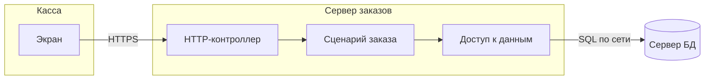
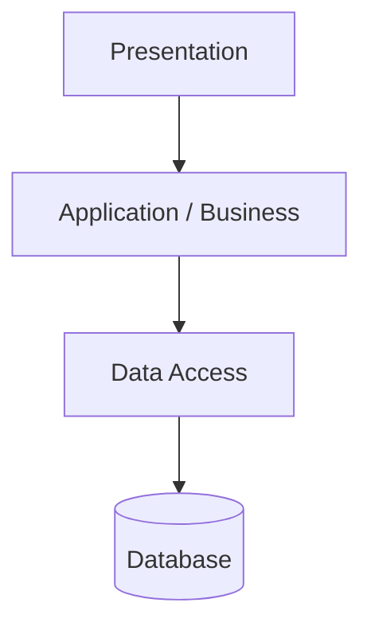
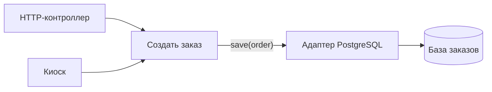
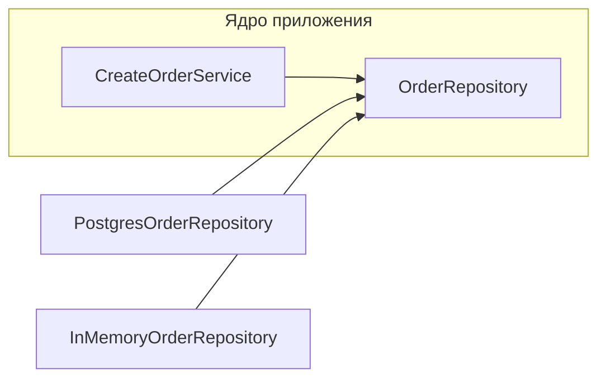
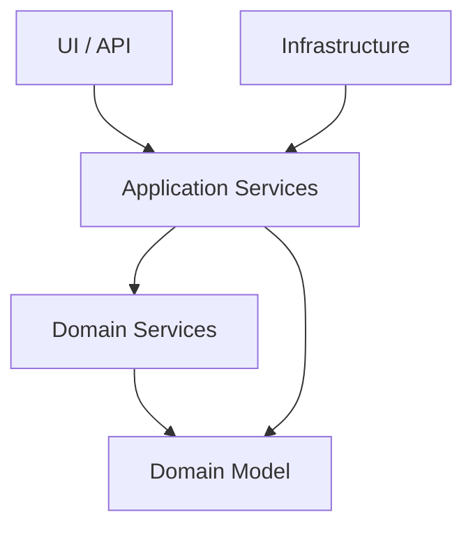
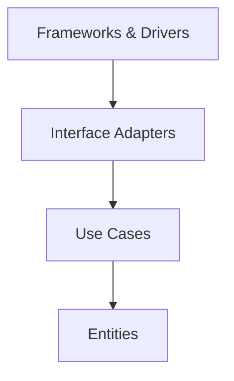
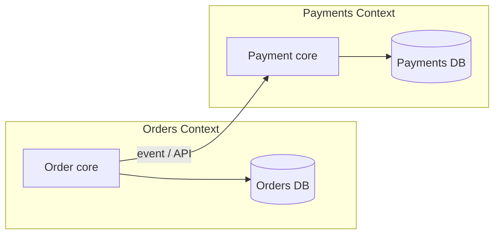
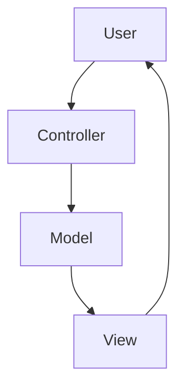
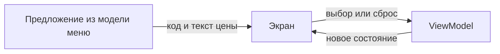

---
requires:
  - lecture: 7
    reason: "domain-first, ограниченные контексты и агрегаты из DDD"
recommends:
  - lecture: 6
    reason: "паттерн Adapter за Ports and Adapters"
---

# Лекция 8. Эволюция Enterprise-архитектур

В кафе появилась вторая касса. Первая принимает заказы по HTTP, а новая должна работать в киоске. Обе продают один и тот же латте за 2,50 €. Сейчас его цену знает только HTTP-контроллер. Придётся ли киоску притворяться браузером или заводить собственный прайс?

До сих пор мы выбирали, как связать два класса и как подменить зависимость в тесте. Теперь вопрос касается всего приложения. Пройдём путь одного заказа от кнопки до записи в базе, а затем посмотрим на ту же кнопку со стороны разработчика экрана.

## Маршрут лекции

У каждой части свой вопрос. **Слои** помогают распределить обязанности. **Ports and Adapters, Onion и Clean** объясняют, как сохранить правила кафе при смене кассы, базы или платёжного провайдера. **Микросервисы** поднимают вопрос о независимом выпуске частей системы. **MVC, MVP и MVVM** помогают разобраться, кто обрабатывает выбор напитка и обновляет экран.

## Когда контроллер начинает управлять всем

### Ситуация

Клиент выбирает напиток, кафе определяет цену, принимает оплату и регистрирует заказ. В учебном меню два напитка — латте за 250 и эспрессо за 200 евроцентов. Остальные коды касса отклоняет. Цену назначает кафе. Касса передаёт код напитка и идентификатор заказа, по которому можно связать заказ с оплатой.

### Наивное решение

В первой версии обработчик напрямую разговаривает с платёжным клиентом и с базой. Вот тот же сценарий в псевдокоде.

```text
принять HTTP-запрос с id и кодом напитка
    если код = "latte", взять цену 250
    иначе если код = "espresso", взять цену 200
    иначе вернуть HTTP 400 «Неизвестный напиток»

    списать сумму через платёжный SDK для этого id
    выполнить INSERT в orders, передав id, код и цену как параметры
    вернуть HTTP 201 «Заказ создан»
```

### Что ломается

Чтобы проверить цену без экрана, приходится подготавливать HTTP-запрос и подменять два технических клиента. Если разработчик киоска скопирует `when`, следующее изменение цены придётся выпускать дважды. Есть и другая проблема. Если платёж прошёл, а запись заказа упала, клиент может заплатить и остаться без заказа.

### Улучшение

Оставим в контроллере чтение запроса и выбор HTTP-ответа. Выбор цены отдадим меню, порядок действий — прикладному сценарию `CreateOrder`. Контракты оплаты и записи заказа сформулируем в терминах кафе. Контроллер, киоск и тест смогут вызвать один сценарий.

### Почему это работает

Киоску больше не нужны типы HTTP, а тесту цены — база и платёжный SDK. Подмена адаптера позволит также воспроизвести сбой записи после списания. Согласование двух операций потребует отдельного решения, к этому вернёмся после примера.

## Карта эволюции

Эти идеи отвечают на разные вопросы. В 2005 году Алистер Кокберн показал приложение, которое можно целиком проверить без настоящего экрана и БД. В 2008 году Джеффри Палермо описал Onion для долгоживущих приложений с доменной моделью в центре. В 2012 году Роберт Мартин сопоставил родственные подходы и сформулировал общее правило направления зависимостей. Команда вполне может применить все три наблюдения к одному заказу.

| Что меняется в кафе | Какую границу исследуем |
|---|---|
| Киоск приходит на смену веб-кассе | Между входным адаптером и сценарием заказа |
| Меняется драйвер БД | Между контрактом хранения и его реализацией |
| Усложняются скидки | Между правилами меню и последовательностью шагов заказа |
| Платежи выпускает отдельная команда | Между модулями или независимо развёртываемыми сервисами |
| Один экран рисует сумму и ошибку | Между состоянием представления и виджетами |

## Зачем вообще архитектура

Архитектура появляется там, где простого работающего кода уже мало. Пока программа маленькая, можно держать все в одном
файле и помнить связи в голове. Когда появляются годы сопровождения, несколько команд, внешние интеграции, разные UI и
тесты, случайные зависимости становятся дорогими.

В кафе есть простой способ оценить границу. Повысьте цену латте, подключите второй терминал, затем попробуйте протестировать отказ оплаты. По списку затронутых модулей и по тому, что пришлось запускать, видно, какие зависимости стоят команде времени.

::: only kotlin
В Kotlin пакеты помогают найти доменную модель, но сами по себе не запрещают импорт из инфраструктуры. Если оформить ядро отдельным Gradle-модулем без зависимости от Ktor и SQL-клиента, такой импорт остановит сборку.
:::

::: only csharp
В C# направление зависимостей видно в ссылках между проектами. Если `Infrastructure` ссылается на `Application`, внутренний проект сможет объявить контракт, а внешний — реализовать его.

:::

::: only java
В Java приложение на Spring может собрать сценарий в конфигурации, а интерфейс, расширяющий `JpaRepository`, оставить внутри адаптера. Тогда для проверки цен нужен обычный объект Java, контекст Spring запускать не придётся.

:::

::: only go
В Go пакет сценария может объявить небольшой интерфейс хранения. Адаптер с нужным набором методов удовлетворяет ему без объявления `implements`. Компилятор проверит совместимость, когда сборочный код передаст адаптер сценарию.
:::

## Layer и Tier

В архитектурных разговорах часто смешивают два разных слова.

**Layer** — логический слой в коде. Например, `Presentation`, `Application`, `Domain`, `Data Access`. Слой задает
ответственность и направление зависимостей внутри программы.

**Tier** — часть системы, выделенная при развёртывании. Например, приложение кассы обращается по сети к серверу заказов, а сервер — к отдельному серверу БД.

Пока касса работает на одном компьютере с локальной SQLite, в её процессе могут сосуществовать три логических слоя. Если вынести хранение в PostgreSQL на отдельном узле, появится сетевая граница. Классы расчёта цены могут остаться прежними. А если запустить две копии сервера заказов за балансировщиком, получится два экземпляра одного tier.



## Слоистая архитектура

Слоистая архитектура — один из самых простых способов навести порядок в приложении. Вместо общего комка кода мы
выделяем уровни ответственности:

- `Presentation` принимает действия пользователя или HTTP-запросы;
- `Application` или `Business` выполняет сценарии приложения;
- `Data Access` знает, как читать и сохранять данные.

Саму базу на схеме показываем отдельно. Слой доступа к данным — код приложения, а СУБД исполняет запросы и хранит записи.



Классическое правило закрытых слоев: верхний слой знает только ближайший нижний. `Presentation` вызывает
`Application`, `Application` вызывает `Data Access`, а `Presentation` не прыгает напрямую в базу.

| Подход | Правило | Когда полезно | Цена |
|---|---|---|---|
| Закрытые слои | Слой обращается только к ближайшему нижнему слою. | Когда нужно жестко удерживать границы и не размазывать ответственность. | Простые операции приходится прокидывать через несколько слоев. |
| Открытые слои | Некоторые слои можно осознанно пропускать. | Когда сценарий технически простой и лишний посредник ничего не добавляет. | Исключения нужно документировать, иначе границы быстро исчезнут. |

Слоистая архитектура хороша простотой. Она понятна новичкам, быстро запускается и часто достаточна для CRUD-приложения,
админки, прототипа или учебного проекта. Но у нее есть риск: если команда думает от базы данных, доменные объекты легко
становятся анемичными структурами, а бизнес-логика начинает жить в сервисах, SQL, контроллерах и обработчиках.

## Прямая зависимость от инфраструктуры

Можно перенести тело контроллера в `OrderService` и передать SQL-клиент через конструктор. Контроллер станет короче. Посмотрите, однако, кто теперь знает имена столбцов. Во всех четырёх фрагментах `sql` — конкретный клиент с привязкой параметров, `order` — заказ с суммой в евроцентах.

::: multi-code "Запись заказа внутри прикладного сервиса" {playground=off}

```kotlin
sql.execute("insert into orders(id, total_cents) values (?, ?)", order.id, order.total.cents)
```

```csharp
sql.Execute("insert into orders(id, total_cents) values (@Id, @Cents)",
    new { order.Id, order.Total.Cents });
```

```java
sql.update("insert into orders(id, total_cents) values (?, ?)", order.id(), order.total().cents());
```

```go
_, err := db.Exec("insert into orders(id, total_cents) values ($1, $2)", order.ID, order.Total.Cents)
if err != nil {
    return err
}
```

:::

Переименуйте `total_cents` в схеме. Исправлять придётся сценарий заказа, хотя кассир по-прежнему принимает ту же сумму. Внедрение зависимости через конструктор решает, где мы собираем объект. Инверсия зависимости решает другой вопрос — кто определяет контракт, на котором разговаривают сценарий и хранилище.

## Поворот DDD: domain-first

В [лекции 7](/lectures/07) мы договорились искать правила в языке предметной области. Попросите кассира описать продажу. «Цена берётся из меню, неизвестный напиток пробить нельзя». Из этого разговора получается операция `priceOf(drink)`. Таблица `orders` сама по себе не подскажет ни эту операцию, ни её владельца.

Этот подход к проектированию вокруг предметной области называют **Domain-Driven Design (DDD)**. При **database-first** отправной точкой служит схема хранения. Это удобно для редактирования справочника, где поля формы действительно соответствуют столбцам. При **domain-first** сначала уточняют понятия и правила бизнеса, затем решают, как их сохранять. Начинать можно и с уже существующей базы. Адаптер переведёт строку таблицы в понятия модели.

Важные идеи DDD для этой лекции:

- **bounded context** задает границу языка и модели: `Order` в контексте продаж и `Order` в контексте доставки могут быть
  разными понятиями;
- **ubiquitous language** помогает коду говорить теми же словами, что и бизнес;
- **anti-corruption layer** защищает модель от чужих форматов, терминов и legacy-кода;
- **rich domain model** полезна там, где есть сложные бизнес-правила, а не только хранение полей.

::: warning DDD не нужно применять везде одинаково
Если часть системы является стандартным CRUD без уникальных правил, полная доменная модель может быть лишней. DDD
особенно полезен в core domain: там, где бизнес отличается от конкурентов и ошибка в правилах стоит дорого.
:::

## Ports and Adapters

В гексагональной архитектуре Кокберна главная граница проходит между приложением и его окружением. **Порт** описывает содержательный разговор через эту границу. «Оформить заказ» и «сохранить заказ» — два разных разговора. Контракт задаёт допустимые данные, результат и значимые для вызывающей стороны ошибки. В коде его можно выразить интерфейсом, функцией или протоколом.

**Адаптер** переводит между контрактом и конкретной технологией. HTTP-контроллер — входной (*driving*, или *primary*) адаптер. Он начинает разговор с приложением. Адаптер PostgreSQL — выходной (*driven*, или *secondary*). К нему обращается само приложение. Ответ базы идёт обратно по тому же пути. Направление ответа не меняет роль адаптера.

Так проходит **вызов во время работы** при сохранении заказа. На этой схеме оставим в стороне оплату. Контроллер и киоск используют один вход.



А так устроены **зависимости исходного кода**. Стрелка означает «ссылается на объявление». Контракт хранения принадлежит ядру, его используют сценарий и оба адаптера.



Это архитектурное применение принципа инверсии зависимостей (DIP). У Кокберна программа рассчитывает скидку. Тестовая оснастка и графический экран подают ей сумму через один порт, а источник ставки скидки можно заменить. У кафе сходный эксперимент — отправить заказ из теста и проверить полученную запись в памяти. У шестиугольника может быть любое число портов. Шесть сторон рисунка не задают число интерфейсов.

## Порты приложения

Операцию, которую приложение выполняет для пользователя, будем называть сценарием (*use case*). У входного порта `CreateOrderUseCase` одна команда — идентификатор заказа и код напитка. Меню проверяет код и возвращает цену. Дальше сценарий вызывает два выходных порта — `PaymentGateway` и `OrderRepository`. Для краткости считаем, что способ оплаты уже привязан к заказу. Ошибку внешней операции адаптер передаёт вызывающей стороне.

Предскажите, до какого шага дойдёт каждый заказ. Что запишется для латте? Дойдёт ли неизвестный напиток до оплаты? Что успеет сделать касса при отказе хранилища и при явном отказе в оплате?

::: multi-code "Порты приложения — создать заказ"

```kotlin
data class Money(val cents: Int)
data class Order(val id: String, val drink: String, val total: Money)
data class CreateOrder(val id: String, val drink: String)

fun priceOf(drink: String): Money = when (drink) {
    "latte" -> Money(250)
    "espresso" -> Money(200)
    else -> throw IllegalArgumentException("Unknown drink")
}

fun interface CreateOrderUseCase { fun create(command: CreateOrder): Order }
fun interface OrderRepository { fun save(order: Order) }
fun interface PaymentGateway { fun charge(id: String, amount: Money) }

class CreateOrderService(
    private val orders: OrderRepository,
    private val payments: PaymentGateway
) : CreateOrderUseCase {
    override fun create(command: CreateOrder): Order {
        val order = Order(command.id, command.drink, priceOf(command.drink))
        payments.charge(order.id, order.total)
        orders.save(order)
        return order
    }
}
```

```kotlin playground
data class Money(val cents: Int)
data class Order(val id: String, val drink: String, val total: Money)
data class CreateOrder(val id: String, val drink: String)

fun priceOf(drink: String): Money = when (drink) {
    "latte" -> Money(250)
    "espresso" -> Money(200)
    else -> throw IllegalArgumentException("Unknown drink")
}

fun interface CreateOrderUseCase { fun create(command: CreateOrder): Order }
fun interface OrderRepository { fun save(order: Order) }
fun interface PaymentGateway { fun charge(id: String, amount: Money) }

class CreateOrderService(
    private val orders: OrderRepository,
    private val payments: PaymentGateway
) : CreateOrderUseCase {
    override fun create(command: CreateOrder): Order {
        val order = Order(command.id, command.drink, priceOf(command.drink))
        payments.charge(order.id, order.total)
        orders.save(order)
        return order
    }
}

fun main() {
    val saved = mutableListOf<Order>()
    val charges = mutableListOf<Pair<String, Money>>()
    val orders = OrderRepository { saved.add(it) }
    val payments = PaymentGateway { id, amount -> charges.add(id to amount) }
    val cafe = CreateOrderService(orders, payments)

    val latte = cafe.create(CreateOrder("o-1", "latte"))
    check(latte.total == Money(250) && saved == listOf(latte))
    check(charges == listOf("o-1" to Money(250)))
    check(priceOf("espresso") == Money(200))

    val unknown = runCatching { cafe.create(CreateOrder("o-2", "tea")) }
    check(unknown.exceptionOrNull() is IllegalArgumentException)
    check(charges.size == 1 && saved.size == 1)

    val offline = CreateOrderService(OrderRepository { error("Storage offline") }, payments)
    val failed = runCatching { offline.create(CreateOrder("o-3", "espresso")) }
    check(failed.exceptionOrNull()?.message == "Storage offline")
    check(charges.last() == ("o-3" to Money(200)))
    val refused = CreateOrderService(orders, PaymentGateway { _, _ -> error("Payment declined") })
    val declined = runCatching { refused.create(CreateOrder("o-4", "latte")) }
    check(declined.exceptionOrNull()?.message == "Payment declined")
    check(saved == listOf(latte))
    println("o-1: 250, tea: rejected, o-3: charged but not saved, o-4: payment declined")
}
```

```csharp
public sealed record Money(int Cents);
public sealed record Order(string Id, string Drink, Money Total);
public sealed record CreateOrder(string Id, string Drink);

public static class Menu
{
    public static Money PriceOf(string drink) => drink switch
    {
        "latte" => new Money(250),
        "espresso" => new Money(200),
        _ => throw new ArgumentException("Unknown drink")
    };
}

public interface ICreateOrderUseCase { Order Create(CreateOrder command); }
public interface IOrderRepository { void Save(Order order); }
public interface IPaymentGateway { void Charge(string id, Money amount); }

public sealed class CreateOrderService(IOrderRepository orders, IPaymentGateway payments)
    : ICreateOrderUseCase
{
    public Order Create(CreateOrder command)
    {
        var order = new Order(command.Id, command.Drink, Menu.PriceOf(command.Drink));
        payments.Charge(order.Id, order.Total);
        orders.Save(order);
        return order;
    }
}
```

```java
record Money(int cents) {}
record Order(String id, String drink, Money total) {}
record CreateOrder(String id, String drink) {}

final class Menu {
    static Money priceOf(String drink) {
        return switch (drink) {
            case "latte" -> new Money(250);
            case "espresso" -> new Money(200);
            default -> throw new IllegalArgumentException("Unknown drink");
        };
    }
}

interface CreateOrderUseCase { Order create(CreateOrder command); }
interface OrderRepository { void save(Order order); }
interface PaymentGateway { void charge(String id, Money amount); }

record CreateOrderService(OrderRepository orders, PaymentGateway payments)
        implements CreateOrderUseCase {
    public Order create(CreateOrder command) {
        var order = new Order(command.id(), command.drink(), Menu.priceOf(command.drink()));
        payments.charge(order.id(), order.total());
        orders.save(order);
        return order;
    }
}
```

```go
package cafe

import "errors"

type Money struct{ Cents int }
type Order struct {
    ID, Drink string
    Total     Money
}
type CreateOrder struct{ ID, Drink string }

func priceOf(drink string) (Money, error) {
    switch drink {
    case "latte":
        return Money{250}, nil
    case "espresso":
        return Money{200}, nil
    default:
        return Money{}, errors.New("unknown drink")
    }
}

type CreateOrderUseCase interface { Create(CreateOrder) (Order, error) }
type OrderRepository interface { Save(Order) error }
type PaymentGateway interface { Charge(string, Money) error }

type CreateOrderService struct {
    orders   OrderRepository
    payments PaymentGateway
}

func (s CreateOrderService) Create(c CreateOrder) (Order, error) {
    total, err := priceOf(c.Drink)
    if err != nil {
        return Order{}, err
    }
    order := Order{ID: c.ID, Drink: c.Drink, Total: total}
    if err := s.payments.Charge(order.ID, total); err != nil {
        return Order{}, err
    }
    if err := s.orders.Save(order); err != nil {
        return Order{}, err
    }
    return order, nil
}
```

:::

В Playground четыре наблюдаемых исхода. Для `o-1` списано 250 евроцентов и сохранён один заказ. Для `tea` оба адаптера остались без новых вызовов. Для `o-3` списаны 200 евроцентов, а сохранение завершилось ошибкой. Для `o-4` платёжный адаптер явно отказал в списании. Исключение дошло до клиента, до записи заказа сценарий не дошёл. Тайм-аут потребовал бы сверки: из отсутствия ответа ещё нельзя узнать, прошёл ли платёж.

::: warning Списание и запись — две операции
Перестановка строк меняет характер сбоя. После записи и до успешной оплаты останется неоплаченный заказ. В рабочей кассе можно сначала сохранить заказ в состоянии «ожидает оплаты», отправлять провайдеру устойчивый ключ операции и по его результату переводить заказ в «оплачен». После тайм-аута важны поддержка идемпотентности у провайдера и сверка статуса. Повтор с тем же ключом должен приводить к одному списанию. В учебном коде такого протокола нет.
:::

## Адаптеры

После успешного создания HTTP-касса возвращает 201. Для неизвестного напитка она возвращает 400. Входной адаптер считывает из HTTP идентификатор и код напитка, вызывает `create` и переводит результат в HTTP-ответ. Тот же сценарий можно вызвать из командной строки. Сборочный код приложения выбирает, какие реализации контрактов оплаты и хранения передать в конструктор.

На выходе сценарий передаёт готовый заказ в `save`. Пусть в этой кассе идентификатор заказа уникален, повторная вставка считается ошибкой. В PostgreSQL это обеспечивает первичный ключ `orders.id`. Ниже только методы адаптера. SQL-клиенты в Kotlin, C# и Java привязывают значения к параметрам и сообщают об ошибке исключением. В Go метод возвращает ошибку драйвера.

::: multi-code "Внутри адаптера PostgreSQL" {playground=off}

```kotlin
override fun save(order: Order) {
    sql.execute("insert into orders(id, drink, total_cents) values (?, ?, ?)",
        order.id, order.drink, order.total.cents)
}
```

```csharp
public void Save(Order order)
{
    sql.Execute("insert into orders(id, drink, total_cents) values (@Id, @Drink, @Cents)",
        new { order.Id, order.Drink, order.Total.Cents });
}
```

```java
public void save(Order order) {
    sql.update("insert into orders(id, drink, total_cents) values (?, ?, ?)",
        order.id(), order.drink(), order.total().cents());
}
```

```go
func (r PostgresOrderRepository) Save(order Order) error {
    _, err := r.db.Exec("insert into orders(id, drink, total_cents) values ($1, $2, $3)",
        order.ID, order.Drink, order.Total.Cents)
    return err
}
```

:::

Два теста отвечают на разные вопросы. Записывающий двойник в Playground подтверждает, какой заказ сценарий передаёт на сохранение. Для SQL-адаптера нужен интеграционный тест на тестовой PostgreSQL со схемой приложения. Сохраните `o-1`, прочитайте поля независимым запросом, затем повторите вставку. Ожидаются `latte`, 250 и ошибка уникальности при повторе. Этот тест репозитория ничего не списывает.

## Onion Architecture

У Джеффри Палермо доменная модель находится в центре. Вокруг неё располагаются службы ядра. Правило для кода простое — внешний слой может ссылаться на любой более внутренний. Количество слоёв зависит от задачи. В кафе меню может прямо вернуть цену. Если скидка зависит от программы лояльности и состава заказа, расчёт можно выделить в доменный сервис. Прикладной сервис организует оплату и запись.



Типичная логика слоев:

- **Domain Model** хранит бизнесовые понятия и инварианты;
- **Domain Service** содержит доменную операцию, которую по смыслу нельзя отнести к одной сущности или одному объекту-значению;
- **Application Service** организует сценарий приложения: транзакция, вызов домена, сохранение, публикация события;
- **Infrastructure** реализует технические детали: база, ORM, HTTP, файлы, очереди;
- **UI/API** является внешним способом вызвать приложение.

Типичная проектная структура Onion:

```
src/
├── Domain/           # Entity, Value Object, Domain Service
├── Application/      # Use Cases, DTOs, port-интерфейсы
├── Infrastructure/   # DB adapters, HTTP clients, файлы
└── Api/              # Controllers, middleware, startup
```

Так можно разложить проект с портами по модулям. Правило проверяется по импортам и ссылкам между модулями. Одних названий папок для этого недостаточно.

`Domain Service` не должен становиться мусорной корзиной для всей логики. Его используют, когда операция действительно
доменная, но ее нельзя честно положить внутрь одного объекта. Например, перевод денег между двумя счетами или расчет
скидки, зависящий от нескольких агрегатов.

## Clean Architecture

Роберт Мартин в Clean Architecture различает правила бизнеса и правила отдельного приложения. В центре находятся entities: самые устойчивые
бизнесовые правила. Вокруг них — use cases, то есть сценарии приложения. Еще дальше — interface adapters, которые
переводят данные между внешним миром и use cases. Самый внешний слой — frameworks and drivers: UI, web framework, DB,
устройства, внешние сервисы.



Главное правило Clean Architecture: зависимости исходного кода направлены внутрь. Use case не импортирует web framework.
Entity не знает про ORM. Adapter может знать про use case, но сценарию достаточно внутреннего контракта.

Данные при выполнении могут идти в любую сторону: пользователь отправляет запрос внутрь, приложение сохраняет данные
наружу, база возвращает результат. Но типы и зависимости должны быть устроены так, чтобы внутренние слои не зависели от
внешних.

У Мартина есть показательный переход через границу. Контроллер вызывает сценарий, сценарий передаёт результат презентеру. Чтобы зависимость исходного кода по-прежнему шла от внешнего слоя к ядру, ядро объявляет интерфейс вывода, а внешний презентер его реализует. Через границу удобно передать сумму и идентификатор заказа в простой структуре. Строка ORM протащила бы в ядро зависимость от устройства БД.

| Какой вопрос задаём | Hexagonal | Onion | Clean |
|---|---|---|---|
| Как вызвать приложение? | Входной порт | Контракт прикладного сервиса | Input boundary сценария |
| Кто считает цену? | Ядро, детали его устройства открыты | Доменная модель или доменный сервис | Правило бизнеса в Entities, порядок шагов в Use Cases |
| Кто умеет сохранять? | Выходной адаптер за портом | Внутренний контракт, внешняя реализация | Адаптер доступа к данным за интерфейсом ядра |

Интерфейс репозитория и выходной интерфейс презентера могут применять один принцип инверсии. У них разные обязанности — сохранить заказ и представить результат сценария.

## Когда Clean будет лишней

::: warning Clean Architecture не должна быть рефлексом
Если приложение маленькое, живет недолго и почти не содержит уникальной бизнес-логики, полная Clean-структура может
стоить дороже, чем сэкономит. Архитектура должна соответствовать сложности задачи.
:::

В справочнике из двух таблиц каждый запрос может проходить через контроллер, сценарий и репозиторий. Если новый слой просто повторяет методы следующего и пересобирает те же поля, исправление одного поля затронет все копии. Другой случай — добавился импорт CSV. Теперь отдельный сценарий редактирования приносит измеримую пользу. И форма, и импорт проверяют запись одним и тем же правилом.

## Микросервисы и границы

Пока касса и оплата выпускаются вместе, им достаточно границ внутри приложения. Если платёжная команда должна выпускать изменения отдельно, можно выделить сервис с собственным контрактом и циклом развёртывания. Внутри конкретного микросервиса можно использовать
слоистую архитектуру, Ports and Adapters, Onion или Clean.

DDD помогает искать границы микросервисов через bounded contexts. Если в разных частях бизнеса разные правила, разные
слова и разные модели, это кандидат на отдельный модуль или сервис. Но физически разносить его по сети нужно только
после оценки цены.



Цена микросервисов:

- сетевые ошибки вместо обычных вызовов методов;
- потребуется согласовывать состояния заказа и платежа при частичных отказах;
- чтобы восстановить историю заказа, придётся связывать записи журналов и трассировки нескольких сервисов;
- для сквозного теста понадобится запускать несколько служб;
- каждый сервис выпускается отдельно, совместимость версий API нужно проверять.

Если касса и платёжный модуль всё равно выходят одним релизом, их можно оставить в модульном монолите. При выделении сервиса придётся решить, что покажет касса, когда запрос уже дошёл до оплаты, а ответ потерялся. Семантику такого обмена разбирает [лекция 10](/lectures/10).

## MV-паттерны на клиенте

Вернёмся к киоску. Покупатель выбирает латте, и экран показывает 2,50 €. Если выбор сбросили, сумму нужно убрать и предложить выбрать напиток. Это правило представления. Окончательную сумму заказа по-прежнему определяет меню кафе.

В семействе **MV-паттернов** модель предоставляет данные и поведение, а представление рисует экран и принимает действия человека. В наших фрагментах клиентская модель уже получила предложение меню с кодом и текстом цены. Посмотрим, кто решает, что теперь должен увидеть покупатель.

## MVC

**Model–View–Controller (MVC)** разделяет модель, представление и обработку ввода. В записке 1979 года Трюгве Реенскауг описал представление как способ показать выбранные свойства модели, а контроллер связал с действиями пользователя. В классическом объяснении:

- **Model** хранит данные и правила;
- **View** отображает состояние модели;
- **Controller** обрабатывает действия пользователя и управляет изменениями.



В классическом Smalltalk MVC контроллер интерпретирует ввод, модель сообщает об изменениях подписчикам, а представление читает её состояние для обновления. Стрелки выше показывают ход взаимодействия. Модель может уведомить наблюдателей, ничего не зная о классе экрана.

У серверного MVC другой привычный цикл. HTTP-контроллер принимает запрос, получает результат сценария и выбирает представление для ответа. Киоск может получать JSON и организовать свой экран по MVP или MVVM независимо от устройства сервера.

## MVP

В **Model–View–Presenter (MVP)** действия пользователя получает презентер. Разберём вариант **Passive View**. Виджет сообщает презентеру о выборе. Презентер решает, какой метод представления вызвать. Для латте это будет `showTotal("2,50 €")`. При сбросе выбора он попросит показать подсказку. Договоримся, что каждый метод заменяет всю строку результата на экране. Поэтому прошлая сумма и сообщение об ошибке не остаются рядом.

::: multi-code "Presenter зависит от интерфейса View" {playground=off}

```kotlin
data class Offer(val code: String, val priceText: String)

interface OrderView {
    fun showTotal(text: String)
    fun showError(message: String)
}

class OrderPresenter(private val view: OrderView) {
    fun select(offer: Offer?) {
        if (offer == null) view.showError("Выберите напиток")
        else view.showTotal(offer.priceText)
    }
}
```

```csharp
public sealed record Offer(string Code, string PriceText);

public interface IOrderView
{
    void ShowTotal(string text);
    void ShowError(string message);
}

public sealed class OrderPresenter(IOrderView view)
{
    public void Select(Offer? offer)
    {
        if (offer is null) view.ShowError("Выберите напиток");
        else view.ShowTotal(offer.PriceText);
    }
}
```

```java
record Offer(String code, String priceText) {}

interface OrderView {
    void showTotal(String text);
    void showError(String message);
}

record OrderPresenter(OrderView view) {
    void select(Offer offer) {
        if (offer == null) view.showError("Выберите напиток");
        else view.showTotal(offer.priceText());
    }
}
```

```go
package cafe

type Offer struct{ Code, PriceText string }
type OrderView interface {
    ShowTotal(string)
    ShowError(string)
}
type OrderPresenter struct{ view OrderView }

func (p OrderPresenter) Select(offer *Offer) {
    if offer == nil {
        p.view.ShowError("Выберите напиток")
        return
    }
    p.view.ShowTotal(offer.PriceText)
}
```

:::

Проверка без окна выглядит так. Передайте презентеру тестовое представление, которое записывает вызовы. Выберите латте, затем сбросьте выбор. В журнале должны быть по порядку `showTotal("2,50 €")` и `showError("Выберите напиток")`. Меню может поменять текст цены, не затронув код презентера.

## MVVM

В **Model–View–ViewModel (MVVM)** представление передаёт действие во ViewModel, а та меняет доступное представлению состояние. Для нашего киоска достаточно трёх полей — выбранный напиток, текст суммы и ошибка. Здесь тестируем сам переход. В приложении механизм привязки данных или подписка на состояние доставит изменения виджетам.



Проделайте тот же опыт с латте и сбросом, затем выберите эспрессо. Теперь интересен снимок состояния после каждого шага.

::: multi-code "ViewModel как состояние экрана"

```kotlin
data class Offer(val code: String, val priceText: String)
data class OrderViewState(val drink: String? = null, val totalText: String = "", val error: String? = null)

class OrderViewModel {
    var state = OrderViewState()
        private set

    fun select(offer: Offer?) {
        state = if (offer == null) OrderViewState(error = "Выберите напиток")
                else OrderViewState(offer.code, offer.priceText)
    }
}
```

```kotlin playground
data class Offer(val code: String, val priceText: String)
data class OrderViewState(val drink: String? = null, val totalText: String = "", val error: String? = null)

class OrderViewModel {
    var state = OrderViewState()
        private set

    fun select(offer: Offer?) {
        state = if (offer == null) OrderViewState(error = "Выберите напиток")
                else OrderViewState(offer.code, offer.priceText)
    }
}

fun main() {
    val vm = OrderViewModel()
    val latte = Offer("latte", "2,50 €")
    vm.select(latte)
    check(vm.state == OrderViewState("latte", "2,50 €"))
    vm.select(null)
    check(vm.state == OrderViewState(error = "Выберите напиток"))
    vm.select(Offer("espresso", "2,00 €"))
    check(vm.state == OrderViewState("espresso", "2,00 €"))
    println(vm.state.totalText)
}
```

```csharp
public sealed record Offer(string Code, string PriceText);
public sealed record OrderViewState(string? Drink = null, string TotalText = "", string? Error = null);

public sealed class OrderViewModel
{
    public OrderViewState State { get; private set; } = new();

    public void Select(Offer? offer)
    {
        State = offer is null
            ? new OrderViewState(Error: "Выберите напиток")
            : new OrderViewState(offer.Code, offer.PriceText);
    }
}
```

```java
record Offer(String code, String priceText) {}
record OrderViewState(String drink, String totalText, String error) {}

final class OrderViewModel {
    private OrderViewState state = new OrderViewState(null, "", null);

    OrderViewState state() { return state; }

    void select(Offer offer) {
        state = offer == null
            ? new OrderViewState(null, "", "Выберите напиток")
            : new OrderViewState(offer.code(), offer.priceText(), null);
    }
}
```

```go
package cafe

type Offer struct{ Code, PriceText string }
type OrderViewState struct{ Drink, TotalText, Error string }
type OrderViewModel struct{ State OrderViewState }

func (vm *OrderViewModel) Select(offer *Offer) {
    if offer == nil {
        vm.State = OrderViewState{Error: "Выберите напиток"}
        return
    }
    vm.State = OrderViewState{Drink: offer.Code, TotalText: offer.PriceText}
}
```

:::

При сбросе выбора прежняя сумма исчезает. Следующий выбор одновременно выставляет новую цену и снимает ошибку. Playground проверяет оба перехода и выводит `2,00 €`. В отличие от теста презентера, здесь нам не понадобился объект, изображающий экран.

## Presentation Model

Мартин Фаулер описывает форму для музыкального каталога. Поле композитора доступно только для классического альбома. Пока это правило живёт в обработчике виджета, проверить его отдельно от формы неудобно. **Presentation Model** хранит признак доступности вместе с остальным состоянием представления. У киоска такой же вопрос можно задать о кнопке «Заказать» — доступна ли она после сброса выбора?

MVVM принадлежит к той же семье решений. Модель представления можно синхронизировать с экраном через обработчики событий или средства привязки платформы. Способ синхронизации сам по себе не отличает эти паттерны.

| Подход | Что происходит после выбора латте | Как проверить |
|---|---|---|
| Классический MVC | Контроллер интерпретирует ввод, модель меняется, представление читает её состояние | Проверить изменение модели и реакцию подписанного представления |
| MVP, Passive View | Презентер вызывает метод представления | Записать вызов `showTotal("2,50 €")` |
| MVVM | ViewModel обновляет доступное экрану состояние | Прочитать `totalText` до и после сброса выбора |
| Presentation Model | Модель представления отражает состояние формы, в том числе доступность команд | Проверить, доступна ли кнопка заказа для текущего выбора |

## Итоговая карта выбора

У кафе могут одновременно быть слоистый сервер, порт оплаты, один развёртываемый модуль и экран с MVVM. Выбор начинается с изменения, которое команда ожидает на практике.

| Условие | Что попробовать | По чему судить |
|---|---|---|
| Небольшой справочник, одна касса | Слои представления, сценариев и доступа к данным | Изменение формы не требует править SQL |
| Добавляются киоск и второй платёжный провайдер | Общий вход в сценарий, порт оплаты, отдельные адаптеры | Тот же тест сценария работает с тестовым адаптером |
| Появляются сложные правила скидок | Выделить доменную политику, отделить её от координации заказа | Правила проверяются примерами из меню без базы и сети |
| Командам нужны отдельные выпуски | Проверить границы модулей и стоимость сетевых отказов | Платёжный сервис можно выпустить без синхронного выпуска кассы |

## Резюме

Мы начали со второй кассы. У неё появился общий с веб-кассой сценарий заказа, у меню осталось одно место для цены, а SQL и платёжный клиент оказались за контрактами ядра. Слои помогают распределять обязанности. Правило зависимостей определяет, чьи типы может использовать код. Граница развёртывания добавляет отдельный вопрос — что будет при отказе сети. На экране похожее разделение позволяет проверить сумму и ошибку без запуска виджетов.

В следующей лекции перейдём от контракта хранения к выбору самой СУБД. Начнём с того, какие задачи заставляли команды менять способ хранения данных. [Лекция 9. Эволюция подходов к хранению данных](/lectures/09#эволюция-подходов-к-хранению-данных).

## Самопроверка

1. Все три слоя работают в одном процессе. Что изменится, если сделать ещё одну копию сервера? А если вынести БД на отдельный узел?
2. Во время выполнения сценарий вызывает PostgreSQL-адаптер. Почему в исходном коде именно адаптер ссылается на контракт ядра?
3. Какой из отказов в Playground может оставить покупателя без заказа после списания? Что нужно узнать перед повторной попыткой?
4. Какие результаты следует сравнить в тестах Passive View и ViewModel после сброса выбора?

::: details Сверка
1. Копия увеличивает число экземпляров одного tier. Удалённая БД добавляет отдельный tier и сетевой переход.
2. Сценарий использует объявление `OrderRepository`, адаптер удовлетворяет этому контракту. При запуске сценарий получает конкретный объект, который реализует этот контракт.
3. Отказ `save` после успешного `charge`. Нужны идентификатор операции и её состояние у провайдера.
4. В первом случае проверяем вызов подсказки у представления, во втором — снимок состояния с пустой суммой, снятым выбором и текстом ошибки.
:::

## Дополнительное чтение

### Архитектура приложения

- [Алистер Кокберн. Hexagonal Architecture](https://alistair.cockburn.us/hexagonal-architecture) — два порта в примере расчёта скидки, тестовый и графический входы.
- [Джеффри Палермо. The Onion Architecture, part 1](https://jeffreypalermo.com/2008/07/the-onion-architecture-part-1/) — доменная модель в центре и реализация репозитория снаружи.
- [Роберт Мартин. The Clean Architecture](https://blog.cleancoder.com/uncle-bob/2012/08/13/the-clean-architecture.html) — как передать результат презентеру при зависимостях внутрь.
- [Джеймс Льюис и Мартин Фаулер. Microservices](https://martinfowler.com/articles/microservices.html) — независимый выпуск, владение данными и проектирование с учётом отказов.

### Представление

- [Трюгве Реенскауг. Models–Views–Controllers](https://zenodo.org/records/3676092/files/1979-12-MVC.pdf) — исходная записка о представлениях модели и вводе пользователя.
- [Мартин Фаулер. GUI Architectures](https://martinfowler.com/eaaDev/uiArchs.html) — один экран в нескольких вариантах организации UI.
- [Мартин Фаулер. Presentation Model](https://martinfowler.com/eaaDev/PresentationModel.html) — пример с альбомами, доступностью полей и синхронизацией формы.
- [Microsoft. Model-View-ViewModel](https://learn.microsoft.com/en-us/dotnet/architecture/maui/mvvm) — команды и доставка изменений представлению в .NET MAUI.

## Мини-практика

Кафе добавляет фильтр-кофе за 180 евроцентов и открывает киоск. Сервер и киоск пока выпускает одна команда. Поставщик оплаты иногда подтверждает списание с задержкой.

1. Добавьте в меню код `filter`. Вызовите сценарий из теста. Для нового заказа должна сохраниться сумма 180 и пройти одно списание на 180. Для неизвестного кода число вызовов обоих адаптеров должно остаться прежним.
2. Нарисуйте путь заказа из киоска. Подпишите, кто вызывает входной порт, кто объявляет выходной, кто его реализует. Другим цветом нанесите ссылки исходного кода. Проверьте себя на замене PostgreSQL — класс сценария должен собраться без драйвера.
3. Передайте экрану предложение `filter` с текстом `1,80 €`. Выберите его, сбросьте выбор, затем выберите латте. Ожидаемая последовательность — `1,80 €`, подсказка без суммы, `2,50 €` без ошибки. Укажите, как будете наблюдать результат в MVP и MVVM.
4. Объясните кассиру, что он увидит, если ответ платёжного провайдера потерялся. Предложите состояние для такого заказа и способ сверки. Проверьте решение мысленным повтором запроса — для одного оплаченного заказа в выписке должна остаться одна операция.

В конце назовите изменение, которое оправдало бы отдельный сервис платежей, и один новый отказ, который команде тогда придётся обрабатывать.
