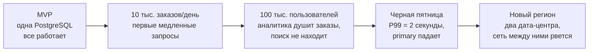
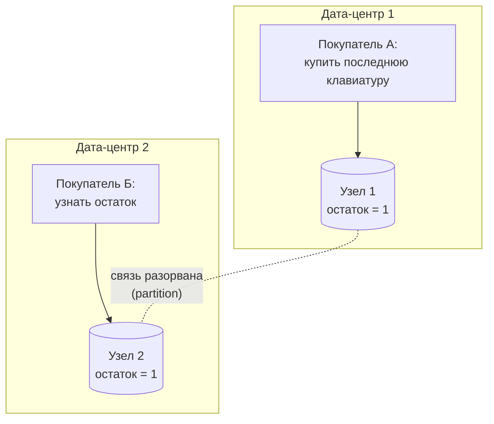
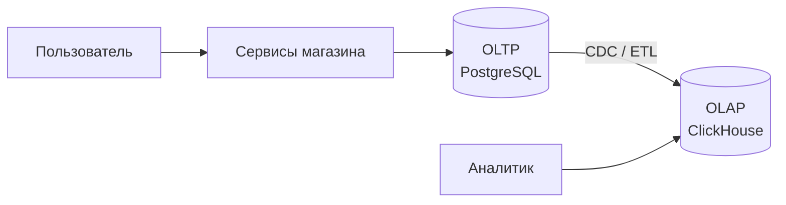
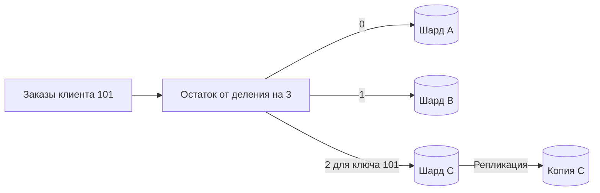
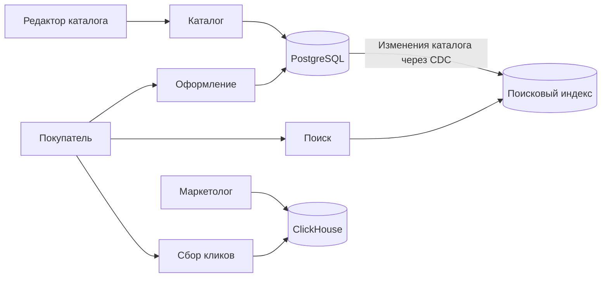

---
recommends:
  - lecture: 7
    reason: "агрегат как единица хранения"
  - lecture: 8
    reason: "database-per-service"
---

# Лекция 9. Сравнительный анализ СУБД в системном дизайне

Маркетолог магазина электроники «Плата» открыл отчет по кликам за год. Через полминуты отчет готов, но за это время несколько покупателей не смогли оформить заказ. Как проверить, виновата ли общая база? И если виновата, что дешевле изменить первым?

В прошлой лекции мы отделяли сервисы друг от друга. Теперь проведем границу вокруг данных. У магазина три разработчика и одна знакомая PostgreSQL под управлением облачного провайдера. Начнем с запроса маркетолога, затем разберем гарантии для заказов, пройдем по двенадцати вопросам выбора СУБД и сравним кандидатов. К концу лекции вы сможете обосновать первый эксперимент и назвать результат, при котором оставите прежнюю архитектуру.

## Сквозной сценарий

У «Платы» пять этапов. Числа ниже — условия учебного примера. Они помогут заметить смену задачи, но сами по себе не определяют момент миграции.



На старте в PostgreSQL живут заказы, каталог, сессии и клики. Со временем у этих данных появляются разные читатели. Покупателю нужен подтвержденный заказ прямо сейчас. Маркетолога устроит вчерашняя граница отчета. Поиск может на несколько секунд отстать от каталога, если при оформлении магазин заново проверяет цену и остаток.

Хранение данных в нескольких системах, выбранных под разные задачи, называют *polyglot persistence*. Владелец каталога может хранить оригинал карточки в PostgreSQL, а поисковую копию — в индексе. И наоборот, несколько сервисов могут пользоваться одним типом СУБД, сохраняя границы доступа к данным. К этому различию мы вернемся при проектировании поиска. [О владении данными в лекции 8](/lectures/08)

## Разбор случая. Один отчет и очередь заказов

### Ситуация

На втором этапе магазин принимает 10 тыс. заказов в день. Маркетолог хочет видеть, сколько посетителей привел каждый рекламный канал и как менялся результат по неделям.

### Наивное решение

У команды уже есть таблица кликов. Самый короткий путь — запустить отчет прямо на рабочей базе.

```sql
SELECT date_trunc('week', clicked_at) AS week,
       utm_source,
       count(*) AS clicks,
       count(DISTINCT user_id) AS visitors
FROM clicks               -- 200 млн строк за год
WHERE clicked_at > now() - interval '1 year'
GROUP BY week, utm_source
ORDER BY week;
```

Запрос группирует клики по неделе и источнику. Если посетитель кликнул трижды за неделю по ссылкам одного источника, он добавит три клика и одного посетителя. Один человек может попасть в несколько групп. Здесь и далее даты отчета считаем в одном заданном часовом поясе.

### Что ломается

Сначала команда смотрит на две временные шкалы. Во время отчета растут число прочитанных блоков и время ожидания диска. Запрос оформления, который обычно завершается быстро, дольше удерживает соединение. Когда заняты все соединения приложения, следующие покупатели ждут уже в очереди пула. Один запрос BI обычно занимает одно клиентское соединение. Даже отдельный пул для BI оставит общими диск, память и процессор.

При последовательном сканировании PostgreSQL читает страницы с целыми строками, хотя отчет использует всего три поля. Часть страниц уже может быть в памяти. Подходящий индекс, отбор партиций по времени или предварительная агрегация изменят объем работы. Посмотрите план и счетчики буферов на стенде с копией данных через `EXPLAIN (ANALYZE, BUFFERS)`. Такой вызов действительно выполняет запрос.

### Улучшение

Маркетологу достаточно отчета до конца вчерашнего дня. Команда сначала пересчитывает недельные итоги по расписанию и читает готовую сводку. При расчете уникальных посетителей за неделю нужен их недельный набор или подходящий алгоритм оценки. Суммирование дневных уникальных посетителей дважды посчитает человека, пришедшего в понедельник и вторник.

Если появятся произвольные срезы, а сводка перестанет покрывать вопросы, «Плата» испытает отдельную аналитическую БД. Туда загрузят копию кликов. На одних и тех же данных команда сравнит результаты старого и нового отчетов, отставание загрузки и P99 оформления заказа под пиковой нагрузкой.

### Почему это работает

Сводка сокращает работу при каждом открытии отчета. Отдельное аналитическое хранилище дополнительно изолирует чтение от оформления заказов. У первого решения есть цена в виде расписания пересчета, у второго добавляются доставка событий и обслуживание базы. Выбор зависит от того, какой отчет нужен маркетологу.

## Почему нельзя выбрать одну БД на все

<span id="эволюция-подходов-к-хранению-данных"></span>

### Карта эволюции

Реляционная модель удобна, когда данные связаны ограничениями, а запросы со временем меняются. В 2000-х у крупных интернет-сервисов появились задачи, для которых короткая операция по ключу и распределение записей между узлами были важнее произвольных соединений. Один из исторических примеров — Dynamo (2007). Для авторов Dynamo в Amazon отправной точкой стала операция — добавить товар в корзину даже при сбое части инфраструктуры. Для этого авторы допускали несколько версий корзины, а при чтении приложение могло объединить содержимое. Такой выбор хорошо сохраняет добавления, но при слиянии в корзине может снова появиться удаленный товар. Для «Платы» это предмет разговора с продуктовой командой. Для уже оплаченного заказа потребуется другой договор. [DeCandia и соавторы, Dynamo, §4.4](https://www.allthingsdistributed.com/files/amazon-dynamo-sosp2007.pdf)

### Теорема CAP

Два дата-центра «Платы» хранят остаток последней клавиатуры. Экскаватор повредил линию между городами. Узлы работают, сообщения между ними теряются.



Пусть в первом городе резервирование уже завершилось, и остаток стал нулевым. Только после этого покупатель во втором городе запрашивает остаток. У местного узла по-прежнему единица. Для него ситуация выглядит точно так же, как если бы в первом городе никто ничего не покупал.

В доказательстве Гилберта и Линч речь об одном регистре с операциями чтения и записи. **C** означает линеаризуемость. Операции выглядят так, будто каждая произошла в один момент между вызовом и ответом, с сохранением порядка неперекрывающихся операций. **A** означает, что каждый запрос, полученный исправным узлом, в конце концов получает результат операции. Фиксированного срока в определении нет. **P** описывает условия, в которых сообщения между частями сети могут теряться сколь угодно долго. При таком разделении гарантировать C и A для всех исполнений невозможно. [Gilbert и Lynch, теорема 1](https://groups.csail.mit.edu/tds/papers/Gilbert/Brewer6.pdf)

Если узел выдаст местную единицу, чтение после завершенной записи нарушит C. Если он будет ждать связи или вернет ошибку недоступности, клиент не получит требуемого результата, и гарантия A нарушена. Корректное «распродано» после согласованной проверки — полноценный результат операции. Для резерва магазин может назначить один узел владельцем последней единицы. В отрезанном от него регионе придется отложить подтверждение. Для просмотра каталога магазин может по-прежнему отвечать локально.

В штатном режиме тоже есть цена. Синхронное подтверждение в другом городе добавляет сетевое ожидание даже при исправной линии. В формулировке PACELC Даниэля Абади этот второй вопрос обозначен буквами E, L и C — *else*, latency, consistency. [Объяснение автора PACELC](https://dbmsmusings.blogspot.com/2010/04/problems-with-cap-and-yahoos-little.html)

### ACID и BASE

При оформлении «Плата» резервирует товар и создает заказ. Покупатель вправе ожидать, что обе записи сохранятся вместе. ACID помогает уточнить это обещание.

| Свойство транзакции | Что проверить в магазине |
|---|---|
| Atomicity, атомарность | Ошибка вставки заказа откатывает уже сделанный резерв. |
| Consistency, сохранение инвариантов | Положительное количество и достаточный остаток проверяются при записи. Правило должен задать разработчик. |
| Isolation, изоляция | Два покупателя одновременно просят последнюю единицу. Условное обновление или подходящий уровень изоляции с повтором транзакции должны исключить двойную продажу. |
| Durability, долговечность | Подтвержденный заказ переживает оговоренный отказ. Потерю целого узла рассматривают отдельно от перезапуска процесса. |

Буква C в ACID относится к допустимым состояниям данных. В CAP та же буква описывает наблюдаемый порядок операций. **BASE** — выражение *Basically Available, Soft state, Eventually consistent*. Оно описывает подход к доступности и сходимости копий. Если новые записи прекратились, связь восстановилась и доставка с разрешением конфликтов продолжается, копии в итоге сойдутся. Само это обещание не задает срок. Поэтому локальная ACID-транзакция заказа вполне совместима с отстающей поисковой копией.

Во всех четырех вкладках адаптер транзакций передает операции с остатком и заказом один контекст. В БД такому контексту соответствует одна транзакция на одном соединении. В запускаемом примере работа идет с отдельной копией состояния в одном потоке. Сбой вставки происходит **после** резерва, поэтому по остатку видно, сработал ли откат.

::: multi-code "Граница транзакции заказа"

```kotlin
interface OrderTx {
    fun reserve(quantity: Int)
    fun insertOrder()
}

fun placeOrder(quantity: Int, transaction: ((OrderTx) -> Unit) -> Unit) {
    require(quantity > 0)
    transaction { tx ->
        tx.reserve(quantity)
        tx.insertOrder()
    }
}
```

```kotlin playground
interface OrderTx {
    fun reserve(quantity: Int)
    fun insertOrder()
}

fun placeOrder(quantity: Int, transaction: ((OrderTx) -> Unit) -> Unit) {
    require(quantity > 0)
    transaction { tx ->
        tx.reserve(quantity)
        tx.insertOrder()
    }
}

data class State(var stock: Int, var orders: Int = 0)

fun main() {
    var saved = State(stock = 5)
    fun transaction(failInsert: Boolean, work: (OrderTx) -> Unit) {
        val draft = saved.copy()
        work(object : OrderTx {
            override fun reserve(quantity: Int) {
                require(draft.stock >= quantity)
                draft.stock -= quantity
            }
            override fun insertOrder() {
                check(!failInsert) { "insert failed" }
                draft.orders++
            }
        })
        saved = draft
    }

    placeOrder(2) { transaction(false, it) }
    check(saved == State(3, 1))
    check(runCatching { placeOrder(1) { transaction(true, it) } }.isFailure)
    check(saved == State(3, 1))
    println(saved)
}
```

```csharp
public interface IOrderTx
{
    void Reserve(int quantity);
    void InsertOrder();
}

public static class Checkout
{
    public static void PlaceOrder(int quantity, System.Action<System.Action<IOrderTx>> transaction)
    {
        if (quantity <= 0) throw new System.ArgumentOutOfRangeException(nameof(quantity));
        transaction(tx => {
            tx.Reserve(quantity);
            tx.InsertOrder();
        });
    }
}
```

```java
import java.util.function.Consumer;

interface OrderTx {
    void reserve(int quantity);
    void insertOrder();
}

final class Checkout {
    static void placeOrder(int quantity, Consumer<Consumer<OrderTx>> transaction) {
        if (quantity <= 0) throw new IllegalArgumentException("quantity");
        transaction.accept(tx -> {
            tx.reserve(quantity);
            tx.insertOrder();
        });
    }
}
```

```go
package main

import "errors"

type OrderTx interface {
    Reserve(quantity int) error
    InsertOrder() error
}

func placeOrder(quantity int, transaction func(func(OrderTx) error) error) error {
    if quantity <= 0 {
        return errors.New("quantity must be positive")
    }
    return transaction(func(tx OrderTx) error {
        if err := tx.Reserve(quantity); err != nil {
            return err
        }
        return tx.InsertOrder()
    })
}
```

:::

После покупки двух клавиатур из пяти и неудачной попытки купить еще одну осталось три клавиатуры и один заказ. Для настоящего резерва PostgreSQL можно выполнить `UPDATE inventory SET stock = stock - $2 WHERE product_id = $1 AND stock >= $2`. Положительность количества проверяем до UPDATE. Если изменилась ровно одна строка, вставляем заказ в той же транзакции. Ноль измененных строк означает, что товар отсутствует или остатка недостаточно. При ошибке откатываем обе операции. Паттерн Unit of Work в ORM дополнительно отслеживает измененные объекты и согласует их запись. [Unit of Work у Мартина Фаулера](https://martinfowler.com/eaaCatalog/unitOfWork.html)

## Выбор СУБД по 12 измерениям

Запишите самую важную операцию так, чтобы ее мог проверить коллега. Для «Платы» это может звучать так: «При 300 оформлениях в секунду 99% ответов укладываются в 200 мс. После подтверждения покупатель сразу видит заказ, а последнюю единицу можно продать один раз». Числа задает команда. Затем заполните короткую карту.

| № | Критерий | Ключевой вопрос |
|---|---|---|
| 1 | Workload | Какие операции конкурируют за ресурсы? |
| 2 | Read/Write Ratio | Что преобладает: чтение или запись? |
| 3 | Latency (P99) | Какой порог должен выдержать 99-й перцентиль? |
| 4 | Consistency | Допустимо ли прочитать устаревшую версию? |
| 5 | Transactions | Критичны ли атомарные многообъектные изменения? |
| 6 | Query Patterns | Какой тип запросов доминирует? |
| 7 | Data Model | Как структурированы бизнес-данные? |
| 8 | Scale | Как вырастут объем данных и пиковая частота записи? |
| 9 | HA & Failover | Сколько данных и времени допускается потерять при сбое? |
| 10 | Ops Complexity | Есть ли в команде эксперты по этой БД? |
| 11 | Licensing & Lock-in | Сможете ли мигрировать к другому вендору? |
| 12 | Ecosystem | Как БД вписывается в текущий стек? |

### 1. Тип нагрузки. OLTP, OLAP и HTAP

Оформление заказа — **OLTP**, короткая транзакция над несколькими строками. Отчет о кликах — **OLAP**, группировка по большой выборке. Задать оба вопроса можно в SQL. Отличаются объем обрабатываемых данных, требования к свежести и цена задержки. **HTAP** объединяет транзакционную и аналитическую обработку в одной системе, например за счет второго представления данных и разделения ресурсов.



На схеме CDC передает изменения исходных данных, а ETL (extract, transform, load) извлекает, преобразует и загружает данные в приемник. Обновлять отчет можно потоком или по расписанию.

Отдельная задача — форма ответа на экране. Команда «Оформить заказ» проверяет остаток, а запрос «Мои заказы» возвращает краткий список. Разделение моделей команд и запросов называется **CQRS**. Они могут использовать общую БД. Если отдельная проекция читателя остановилась, каталог может всё ещё показывать последнюю клавиатуру даже при исправной сети. Окончательное решение о резерве принимает сторона записи. Это отставание можно воспроизвести без сетевого разделения. На вкладках ниже у команды и запроса разные контракты, в Playground список строится из записанных заказов того же покупателя. Это обычное чтение приложения. Само по себе оно не требует аналитической СУБД. [Пример CQRS с общим хранилищем](https://learn.microsoft.com/en-us/azure/architecture/patterns/cqrs)

::: multi-code "CQRS: разделение модели чтения и записи"

```kotlin
data class CreateOrderCommand(val productId: String, val quantity: Int, val customerId: String)
data class OrderSummaryQuery(val customerId: String)

data class OrderSummary(val orderId: String, val productId: String, val quantity: Int)

interface CommandHandler {
    fun handle(command: CreateOrderCommand): String
}

interface QueryHandler {
    fun handle(query: OrderSummaryQuery): List<OrderSummary>
}
```

```kotlin playground
data class CreateOrderCommand(val productId: String, val quantity: Int, val customerId: String)
data class OrderSummaryQuery(val customerId: String)
data class OrderSummary(val orderId: String, val productId: String, val quantity: Int)

interface CommandHandler {
    fun handle(command: CreateOrderCommand): String
}

interface QueryHandler {
    fun handle(query: OrderSummaryQuery): List<OrderSummary>
}

fun main() {
    val orders = mutableMapOf<String, CreateOrderCommand>()
    val commands = object : CommandHandler {
        override fun handle(command: CreateOrderCommand): String {
            require(command.quantity > 0)
            val id = "order-" + (orders.size + 1)
            orders[id] = command
            return id
        }
    }
    val queries = object : QueryHandler {
        override fun handle(query: OrderSummaryQuery) = orders
            .filterValues { it.customerId == query.customerId }
            .map { (id, order) -> OrderSummary(id, order.productId, order.quantity) }
    }

    commands.handle(CreateOrderCommand("kb-1", 2, "customer-42"))
    check(queries.handle(OrderSummaryQuery("customer-7")).isEmpty())
    println(queries.handle(OrderSummaryQuery("customer-42")))
}
```

```csharp
using System.Collections.Generic;

public sealed record CreateOrderCommand(string ProductId, int Quantity, string CustomerId);
public sealed record OrderSummaryQuery(string CustomerId);
public sealed record OrderSummary(string OrderId, string ProductId, int Quantity);

public interface ICommandHandler
{
    string Handle(CreateOrderCommand command);
}

public interface IQueryHandler
{
    IReadOnlyList<OrderSummary> Handle(OrderSummaryQuery query);
}
```

```java
import java.util.List;

record CreateOrderCommand(String productId, int quantity, String customerId) {}
record OrderSummaryQuery(String customerId) {}
record OrderSummary(String orderId, String productId, int quantity) {}

interface CommandHandler {
    String handle(CreateOrderCommand command);
}

interface QueryHandler {
    List<OrderSummary> handle(OrderSummaryQuery query);
}
```

```go
package main

type CreateOrderCommand struct {
    ProductID  string
    Quantity   int
    CustomerID string
}

type OrderSummaryQuery struct {
    CustomerID string
}

type OrderSummary struct {
    OrderID   string
    ProductID string
    Quantity  int
}

type CommandHandler interface {
    Handle(cmd CreateOrderCommand) (string, error)
}

type QueryHandler interface {
    Handle(q OrderSummaryQuery) ([]OrderSummary, error)
}
```

:::

### 2. Соотношение чтения и записи

Карточку клавиатуры читают тысячи раз между изменениями цены. Клики, напротив, непрерывно добавляются, а отчет открывают раз в неделю. Помимо числа запросов считайте байты и строки. Один отчет может прочитать больше данных, чем миллион обращений к карточкам.

В B-дереве индекс ведет по отсортированным страницам к нужному ключу. При вставке страница иногда делится, при чтении диапазона удобно идти по соседним ключам. В PostgreSQL обычный B-tree — индекс над таблицей, строки которой хранятся отдельно. В InnoDB первичный индекс кластеризован, и его листья содержат строки.

В типичном LSM-движке запись попадает в журнал для восстановления и в отсортированную структуру в памяти (memtable). По мере заполнения данные выгружаются в неизменяемые файлы SSTable. Фоновое слияние, *compaction*, переписывает файлы и может убрать устаревшие версии. Чтению иногда приходится проверять несколько файлов. Фильтры Блума позволяют пропустить заведомо неподходящие. Предположение о выигрыше «Плата» проверит на смеси свежих записей и чтений, причем тест должен захватить фоновое слияние.

### 3. Задержка и ее хвост

Черная пятница. Среднее время ответа — 44,9 мс, P99 — две секунды. Например, в выборке из ста запросов 98 заняли по 5 мс, два — по 2 секунды. По правилу ближайшего ранга P99 равен 2 секундам, среднее в этой конкретной выборке — 44,9 мс. Среднее и перцентиль отвечают на разные вопросы.

Если страница ждет десять независимых запросов и у каждого вероятность выйти за порог равна 1%, вероятность хотя бы одного превышения равна `1 − 0,99¹⁰ ≈ 9,56%`. При общем перегруженном диске задержки могут быть связаны. Поэтому измеряйте время самой страницы, включая сеть и ожидание соединения. Для цели «P99 страницы до 200 мс» распределите эти 200 мс между этапами и проверьте весь путь. Сумма отдельных P99 не определяет P99 страницы.

### 4. Какую версию увидит читатель

Покупатель оформил заказ и открыл «Мои заказы». Пусто. Запись подтверждена на основном узле (*primary*), а запрос ушел на асинхронную реплику, которая еще не применила изменение. Для этого экрана нужна гарантия *read-your-writes* — после успешной записи клиент видит ее или более новую версию.

| Гарантия | Что увидит клиент |
|---|---|
| Линеаризуемость | Чтение одного объекта после завершенной записи возвращает ее значение или результат более поздней записи. |
| Последовательная согласованность | Для всех операций существует общий порядок, сохраняющий порядок действий каждого клиента. Реальный порядок между разными клиентами может отличаться. |
| Причинная согласованность | Если ответ на комментарий появился в ленте, доступен и исходный комментарий. Независимые события могут наблюдаться в разном порядке. |
| Сходимость в итоге | После прекращения записей и доставки изменений копии сойдутся. В момент чтения версии могут различаться. |

Простейший маршрут — читать свои заказы с текущего primary после успешного commit, в новой транзакции. Каталог можно читать с доступной реплики. Если реплика временно отсутствует, пример возвращает primary. Проверку здоровья узлов и выбор реплики выполняет вызывающая сторона.

::: multi-code "Куда отправить чтение"

```kotlin
enum class ReadNeed { AFTER_COMMIT, MAY_LAG }

fun readFrom(need: ReadNeed, primary: String, replica: String?): String =
    if (need == ReadNeed.AFTER_COMMIT) primary else replica ?: primary
```

```kotlin playground
enum class ReadNeed { AFTER_COMMIT, MAY_LAG }

fun readFrom(need: ReadNeed, primary: String, replica: String?): String =
    if (need == ReadNeed.AFTER_COMMIT) primary else replica ?: primary

fun main() {
    check(readFrom(ReadNeed.AFTER_COMMIT, "P", "R") == "P")
    check(readFrom(ReadNeed.MAY_LAG, "P", "R") == "R")
    check(readFrom(ReadNeed.MAY_LAG, "P", null) == "P")
    println("P R P")
}
```

```csharp
public enum ReadNeed { AfterCommit, MayLag }

public static class Routing
{
    public static string ReadFrom(ReadNeed need, string primary, string? replica) =>
        need == ReadNeed.AfterCommit ? primary : (replica ?? primary);
}
```

```java
enum ReadNeed { AFTER_COMMIT, MAY_LAG }

final class Routing {
    static String readFrom(ReadNeed need, String primary, String replica) {
        if (need == ReadNeed.AFTER_COMMIT || replica == null) return primary;
        return replica;
    }
}
```

```go
package main

type ReadNeed int
const (
    AfterCommit ReadNeed = iota
    MayLag
)

func readFrom(need ReadNeed, primary string, replica *string) string {
    if need == AfterCommit || replica == nil {
        return primary
    }
    return *replica
}
```

:::

Маршрут решает задачу при действующем primary, на котором сохранился commit. При смене primary на отставшую реплику подтвержденная запись может исчезнуть. Другой вариант для чтения с реплики — передать позицию подтвержденной записи в журнале и дождаться, пока реплика ее применит. Установите бюджет ожидания и резервный маршрут. [Репликация PostgreSQL](https://www.postgresql.org/docs/current/warm-standby.html)

### 5. Граница транзакции

Пока склад и заказы в одной базе, резерв и заказ фиксируются вместе. Пусть склад теперь принадлежит отдельному сервису. Вместе с границей владения изменился смысл ответа «готово».

| Прием | Что можно обещать | Что произойдет при сбое |
|---|---|---|
| Двухфазная фиксация (2PC) | Все участники поддерживают протокол и приходят к одному решению о фиксации. | Участник, уже подготовивший транзакцию, может ждать решения и удерживать ресурсы. |
| Saga, последовательность локальных транзакций | Заказ пройдет через явные состояния, например «ждет резерва» и «подтвержден». | Если следующий шаг сорвался, компенсация снимет резерв. Промежуточное состояние может быть видимым. |
| Transactional outbox | Заказ и запись о необходимости отправить событие фиксируются в одной локальной транзакции. | Отправитель дочитает запись после перезапуска. Повтор доставки возможен, обработчик должен узнавать уже примененное событие. |

Outbox можно использовать для одного из шагов саги. Он сам по себе не резервирует товар в соседнем сервисе. [Разбор transactional outbox](https://microservices.io/patterns/data/transactional-outbox.html) · [Межсервисное взаимодействие](/lectures/10)

### 6. Паттерны запросов

Пройдитесь по экранам магазина глазами базы. Карточка товара читается по идентификатору. Для «Моих заказов за месяц» нужен диапазон дат одного клиента. Для строки поиска важны слова, опечатки и фильтры. Антифрод ищет цепочку связей между аккаунтами. Годовой отчет группирует события по неделям. К каждому запросу запишите условие отбора, порядок, число возвращаемых строк и частоту. Решение об индексе меняется, если «первые 20 заказов» превращаются в «все заказы за пять лет».

### 7. Модель данных

У ноутбука есть объем памяти, у клавиатуры — тип переключателей, у кабеля — длина. Если карточка читается целиком, переменные характеристики удобно вложить в документ. Если по диагонали экрана фильтруют выдачу, понадобятся типизированное значение, единица измерения и индекс. В PostgreSQL можно сочетать обычные столбцы с JSONB, в документной БД — проверять схему и индексировать выбранные поля. Начните со способа изменения и чтения карточки. Формат JSON в HTTP-ответе еще ничего не говорит о физическом хранении.

### 8. Масштабирование

Увеличить память рабочего сервера — *вертикальное масштабирование*. При распределении работы по узлам важно понимать, что именно переезжает.

| Прием | Пример «Платы» | Как проверить пользу |
|---|---|---|
| Репликация | Копия тех же заказов на другом узле | Часть чтений уходит с primary. Проверяем отставание и процедуру переключения. |
| Партицирование | Таблица кликов поделена по месяцам | План отчета за октябрь пропускает сентябрь. Старый месяц можно удалить целиком. |
| Шардирование | Заказы одного клиента расположены на одном из нескольких узлов | Нагрузка записи распределяется, если ключи достаточно равномерны. Отчет по всем клиентам затронет несколько шардов. |

У шарда могут быть свои реплики, а его таблицы могут состоять из партиций. Если проблема в очереди соединений, прежде измерьте время ожидания пула и длительность транзакций. Пул ограничивает параллелизм, но сам по себе не увеличивает скорость диска.

На рисунке запрос клиента 101 попадает на шард C. Копия C хранит те же заказы и может обслуживать чтение с допустимым отставанием.



Пусть у клиентов на Kotlin, C#, Java и Go одна карта шардов в порядке `[A, B, C]`. Ключ — знаковое 64-битное целое. Номер шарда — математический остаток от деления ключа на число шардов `n`, целое от 0 до `n − 1`. Число шардов положительно и помещается в знаковое 32-битное целое. Для отрицательного остатка прибавляем `n` ровно один раз. Это работает и для минимального ключа, у которого положительный аналог не представим в том же типе. Пустая карта — ошибка конфигурации.

::: multi-code "Выбор шарда по идентификатору клиента"

```kotlin
fun shardIndex(customerId: Long, shardCount: Int): Int {
    require(shardCount > 0) { "empty shard map" }
    return Math.floorMod(customerId, shardCount)
}
```

```kotlin playground
fun shardIndex(customerId: Long, shardCount: Int): Int {
    require(shardCount > 0) { "empty shard map" }
    return Math.floorMod(customerId, shardCount)
}

fun main() {
    val shards = listOf("A", "B", "C")
    for (id in listOf(Long.MIN_VALUE, -3L, -1L, 0L, 1L, 3L, 101L, 1L shl 31, 1L shl 32, Long.MAX_VALUE)) {
        println("$id -> " + shards[shardIndex(id, shards.size)])
    }
    check(runCatching { shardIndex(0, 0) }.isFailure)
}
```

```csharp
public static class Router
{
    public static int ShardIndex(long customerId, int shardCount)
    {
        if (shardCount <= 0) throw new System.ArgumentOutOfRangeException(nameof(shardCount));
        long remainder = customerId % shardCount;
        return (int)(remainder < 0 ? remainder + shardCount : remainder);
    }
}
```

```java
final class Router {
    static int shardIndex(long customerId, int shardCount) {
        if (shardCount <= 0) throw new IllegalArgumentException("empty shard map");
        return Math.floorMod(customerId, shardCount);
    }
}
```

```go
package main

import "errors"

func shardIndex(customerID int64, shardCount int32) (int32, error) {
    if shardCount <= 0 {
        return 0, errors.New("empty shard map")
    }
    count := int64(shardCount)
    remainder := customerID % count
    if remainder < 0 {
        remainder += count
    }
    return int32(remainder), nil
}
```

:::

| Ключ клиента | Индекс при `n = 3` | Шард |
|---:|---:|---|
| −9 223 372 036 854 775 808 | 1 | B |
| −3 | 0 | A |
| −1 | 2 | C |
| 0 | 0 | A |
| 1 | 1 | B |
| 3 | 0 | A |
| 101 | 2 | C |
| 2 147 483 648 | 2 | C |
| 4 294 967 296 | 1 | B |
| 9 223 372 036 854 775 807 | 1 | B |

Эта функция годится для фиксированной карты. При четырех шардах клиент 101 попадет на индекс 1, хотя его старые заказы остались на индексе 2. Перед изменением числа **или порядка** узлов нужен план переноса данных. Постоянные логические корзины с отдельной таблицей размещения позволяют переносить корзины по очереди. Consistent hashing тоже уменьшает долю перемещаемых ключей. Ни тот ни другой способ не делит нагрузку одного сверхпопулярного клиента автоматически.

### 9. Доступность и восстановление

В пятницу отказал диск основного сервера. Сервис возобновил прием заказов через 40 минут, на поднятой реплике не хватало последних 15 секунд записей. Это наблюдаемые результаты инцидента. **RTO** — целевой предел времени восстановления, **RPO** — допустимая глубина потери данных, обычно выраженная временем. Если договорились о RTO 5 минут и RPO 0 для отказа одного узла, оба условия нарушены.

Для RPO 0 в таком сценарии подтверждайте commit после долговечной записи на подходящей реплике и повышайте узел, который получил подтвержденные записи. При недоступности обязательной реплики это может задержать запись. Для RTO засеките время от отказа до первой успешной операции, включая обнаружение, выбор primary и переподключение клиентов. От случайного удаления таблицы нужна еще и проверенная резервная копия с возможностью восстановления на нужный момент. Реплика быстро воспроизведет удаление.

### 10. Кто будет дежурить

В «Плате» ClickHouse настраивал один инженер. Перед отпуском он просит коллегу развернуть базу из резервной копии и проверить недельный отчет. Именно здесь видно, что входит в стоимость владения. Посчитайте инфраструктуру, дежурства, обновления, хранение копий и время восстановления. Managed-сервис может взять на себя обслуживание узлов. Права доступа, индексы, лимиты, срок хранения копий и проверку восстановления по-прежнему нужно кому-то поручить.

### 11. Лицензия и стоимость выхода

Юристу понадобится точная версия, редакция и способ предоставления сервиса клиентам. Например, Elastic различает условия готового дистрибутива и варианты лицензии для части исходного кода. Функция поиска в магазине и предоставление клиенту самого поискового сервиса — разные сценарии. Учитывайте условия выбранной поставки. [FAQ Elastic о лицензировании](https://www.elastic.co/pricing/faq/licensing)

Финансовому директору нужен другой ответ. Перенесите выборку из DynamoDB в тестовую PostgreSQL, реализуйте запрос по клиенту и дате заказа и пересчитайте цену выгрузки и объем изменений в приложении. Такой опыт выявляет привязку к формату ключей, индексам, SDK и сервисам облака.

### 12. Инструменты и интеграции

Маркетолог уже использует Grafana. Проверка интеграции — открыть реальный отчет с учетной записью только для чтения, задать фильтр по неделе и увидеть, что запрос укладывается в лимит. Для доставки данных остановите потребителя, запишите изменения и верните его в строй. Убедитесь, что повтор события не удваивает продажи. Наличие коннектора в каталоге еще не отвечает на эти вопросы.

<span id="инфраструктурныи-контекст-где-живет-база-данных"></span>

## Инфраструктурный контекст

### Docker

«Плата» запускает локальную PostgreSQL из образа с общей для команды основной версией. Образ задает программу и окружение, именованный том хранит файлы БД между пересозданиями контейнера. Вот минимальный Compose-файл для локального упражнения.

```yaml
services:
  postgres:
    image: postgres:16
    environment:
      POSTGRES_PASSWORD: dev
      POSTGRES_DB: shop
    ports:
      - "127.0.0.1:5432:5432"
    volumes:
      - pgdata:/var/lib/postgresql/data

volumes:
  pgdata:
```

Запустите `docker compose up -d`. Для приложения на том же компьютере адрес базы — `127.0.0.1:5432`, имя базы — `shop`, пользователь — `postgres`, учебный пароль — `dev`. Для соседнего контейнера в том же Compose-проекте именем хоста будет `postgres`. Строку подключения передают самому приложению. Этот файл запускает только базу.

В промышленной среде StatefulSet в Kubernetes дает экземплярам устойчивые имена и позволяет привязать тома. Репликация, выбор нового primary и резервное копирование требуют дополнительных механизмов. В облачной управляемой БД стоит проверить договор о зонах отказа, срок хранения журнала и процедуру восстановления. Размещение и модель данных — два самостоятельных решения.

## Обзор классов СУБД

К каждому классу подберем запрос из жизни магазина. По запросу легче увидеть, какие данные выгодно хранить рядом и что изменится, когда продукту понадобится новый срез.

### Реляционные. PostgreSQL и MySQL

«Показать заказ с позициями, списанным со склада количеством и адресом доставки». Строки связаны ключами, а корректность подтверждения зависит от нескольких записей. Внешние ключи, ограничения, транзакции и JOIN позволяют выразить это напрямую. PostgreSQL дает B-tree для обычных ключей, GIN для ряда составных типов, полнотекстовый поиск с ранжированием и расширения, включая pg_trgm и pgvector. InnoDB в MySQL также поддерживает транзакции, индексы и восстановление по журналу. Выбор между ними имеет смысл проверять планом конкретного запроса и опытом дежурной команды.

Для «Платы» повод пересмотреть решение — рост ожидания записей после устранения медленных запросов или необходимость обслуживать записи в нескольких регионах. Большое число пользователей без сведений о запросах такой границей не служит.

::: only kotlin
В Kotlin/JVM для PostgreSQL часто используют Exposed (type-safe SQL DSL) или jOOQ, для MySQL - тоже jOOQ или
Spring Data JPA. Выбор ORM/DSL влияет на то, насколько удобно работать с расширениями (JSONB, arrays).
:::

::: only csharp
В .NET для PostgreSQL используется Npgsql + Entity Framework Core (или Dapper для raw SQL). Для MySQL - Pomelo
или MySqlConnector. EF Core абстрагирует различия, но при тюнинге приходится работать с провайдер-специфичными API.
:::

::: only java
В Java для PostgreSQL и MySQL используют JDBC напрямую, Spring Data JPA (Hibernate), jOOQ или MyBatis.
Работу с JSONB и массивами проверьте на выбранных версиях драйвера и ORM.
:::

::: only go
В Go пакет `database/sql` работает через драйверы. Для PostgreSQL подойдет адаптер `pgx/stdlib`, для MySQL — `go-sql-driver/mysql`.
Для более высокоуровневой работы используют sqlc (генерация кода из SQL) или GORM (ORM).
:::

<span id="redis"></span>

### Ключ–значение. Redis, KeyDB и DynamoDB

«Прочитать сессию по токену» — одна операция по известному ключу. Redis хранит рабочие данные в памяти и поддерживает сроки жизни ключей, множества, счетчики и упорядоченные множества. KeyDB — родственный движок с многопоточной обработкой. Для каждого стоит проверить расход памяти, поведение при ее исчерпании, режим сохранения на диск и потери при отказе. Снимки RDB восстанавливают состояние на момент снимка. Для журнала AOF окно потери зависит, в частности, от частоты синхронизации с диском. Потеря кэша обычно означает лишнее чтение из БД. Потеря единственной копии корзины видна покупателю.

DynamoDB тоже подходит для чтения по ключу, но это управляемое долговечное хранилище. При составном ключе раздел задает partition key, а sort key позволяет выбрать диапазон внутри него. Для других путей доступа могут понадобиться вторичные индексы. Согласованность чтения зависит от пути: для таблицы и локального вторичного индекса доступно строгое чтение, для глобального вторичного индекса — чтение с возможным отставанием. [Варианты чтения DynamoDB](https://docs.aws.amazon.com/amazondynamodb/latest/developerguide/HowItWorks.ReadConsistency.html)

У Redis в магазине есть и вторая роль — кэш перед PostgreSQL. При *cache-aside* приложение сначала смотрит в кэш. При промахе оно читает карточку в основном хранилище, кладет копию в кэш и возвращает покупателю. Ниже локальный словарь играет роль кэша в последовательной демонстрации. После двух чтений одного товара и одного чтения после инвалидирования ожидайте ровно два обращения к репозиторию.

::: multi-code "Cache-aside для продукта"

```kotlin
data class Product(val id: String, val name: String, val price: Int)

class ProductService(
    private val cache: MutableMap<String, Product>,
    private val repository: ProductRepository
) {
    fun getProduct(id: String): Product =
        cache[id] ?: repository.findById(id).also { cache[id] = it }

    fun invalidate(id: String) {
        cache.remove(id)
    }
}
```

```kotlin playground
data class Product(val id: String, val name: String, val price: Int)

class ProductRepository {
    private var callCount = 0

    fun findById(id: String): Product {
        callCount++
        println("  DB query #$callCount for product=$id")
        return Product(id, "Mechanical Keyboard", 8900)
    }
}

class ProductService(
    private val cache: MutableMap<String, Product>,
    private val repository: ProductRepository
) {
    fun getProduct(id: String): Product {
        val cached = cache[id]
        if (cached != null) {
            println("  cache HIT for product=$id")
            return cached
        }
        println("  cache MISS for product=$id")
        val product = repository.findById(id)
        cache[id] = product
        return product
    }

    fun invalidate(id: String) {
        cache.remove(id)
        println("  cache INVALIDATED for product=$id")
    }
}

fun main() {
    val service = ProductService(mutableMapOf(), ProductRepository())

    println("First call:")
    println("  result: ${service.getProduct("kb-1")}")

    println("\nSecond call (cached):")
    println("  result: ${service.getProduct("kb-1")}")

    println("\nAfter invalidation:")
    service.invalidate("kb-1")
    println("  result: ${service.getProduct("kb-1")}")
}
```

```csharp
public sealed record Product(string Id, string Name, int Price);

public sealed class ProductService
{
    private readonly IDictionary<string, Product> _cache;
    private readonly ProductRepository _repository;

    public ProductService(IDictionary<string, Product> cache, ProductRepository repository)
    {
        _cache = cache;
        _repository = repository;
    }

    public Product GetProduct(string id)
    {
        if (_cache.TryGetValue(id, out var cached))
            return cached;

        var product = _repository.FindById(id);
        _cache[id] = product;
        return product;
    }

    public void Invalidate(string id) => _cache.Remove(id);
}
```

```java
import java.util.Map;

record Product(String id, String name, int price) {}

final class ProductService {
    private final Map<String, Product> cache;
    private final ProductRepository repository;

    ProductService(Map<String, Product> cache, ProductRepository repository) {
        this.cache = cache;
        this.repository = repository;
    }

    Product getProduct(String id) {
        var cached = cache.get(id);
        if (cached != null) return cached;

        var product = repository.findById(id);
        cache.put(id, product);
        return product;
    }

    void invalidate(String id) {
        cache.remove(id);
    }
}
```

```go
package main

type Product struct {
    ID    string
    Name  string
    Price int
}

type ProductRepository interface {
    FindByID(id string) Product
}

type ProductService struct {
    Cache      map[string]Product
    Repository ProductRepository
}

func (s *ProductService) GetProduct(id string) Product {
    if s.Cache == nil {
        s.Cache = make(map[string]Product)
    }
    if p, ok := s.Cache[id]; ok {
        return p
    }
    p := s.Repository.FindByID(id)
    s.Cache[id] = p
    return p
}

func (s *ProductService) Invalidate(id string) {
    delete(s.Cache, id)
}
```

:::

Инвалидировать ключ означает удалить сохраненную копию. При изменении цены приложение сначала фиксирует цену в БД, затем инвалидирует ключ. Сбой между этими шагами оставит устаревшую копию. Более того, читатель, уже начавший загрузку старой цены, может заполнить кэш после инвалидирования. Срок жизни записи (time to live, TTL) ограничивает время жизни копии, а для критичной цены «Плата» повторяет проверку при оформлении заказа. [Cache-Aside в Azure Architecture Center](https://learn.microsoft.com/en-us/azure/architecture/patterns/cache-aside)

### Документные. MongoDB и Couchbase

«Открыть карточку ноутбука вместе с характеристиками». У документа есть идентификатор, а вложенные поля удобно читать одним обращением. В MongoDB изменение одного документа атомарно, поддерживаются и многодокументные транзакции. В Couchbase для запросов по документам используют SQL++. Дублирование названия категории ускорит чтение карточки, но при переименовании категории потребуется обновить все ее копии.

Сравним один запрос в двух моделях. У ноутбука две характеристики. В нормализованной схеме `product_specs` содержит по строке на характеристику. Поэтому один JOIN вернет **две строки**. Для товара без характеристик нужен LEFT JOIN. В документе тот же результат уже собран. Пример ниже показывает сборку карточки на границе репозитория. Пустой набор строк означает, что товара нет, а строка со значением SQL NULL в поле ключа означает существующий товар без характеристик.

```sql
SELECT p.name, s.key, s.value
FROM products AS p
LEFT JOIN product_specs AS s ON s.product_id = p.id
WHERE p.id = $1;
```

Параметр `$1` — идентификатор товара. В схеме пары `(product_id, key)` уникальны, оба поля характеристики обязательны. В документной коллекции поиск по тому же идентификатору вернет, например, `{"_id":"laptop-1","name":"Laptop","specs":{"ram":"16 GB","ssd":"512 GB"}}`. После десериализации такой документ уже имеет нужную форму. Во вкладках соберем ту же форму из результата SQL.

::: multi-code "Две строки SQL для одной карточки"

```kotlin
data class Row(val name: String, val key: String?, val value: String?)
data class Card(val name: String, val specs: Map<String, String>)

fun assemble(rows: List<Row>): Card? {
    val first = rows.firstOrNull() ?: return null
    val specs = mutableMapOf<String, String>()
    for (row in rows) {
        if (row.key != null) specs[row.key] = requireNotNull(row.value)
    }
    return Card(first.name, specs)
}
```

```kotlin playground
data class Row(val name: String, val key: String?, val value: String?)
data class Card(val name: String, val specs: Map<String, String>)

fun assemble(rows: List<Row>): Card? {
    val first = rows.firstOrNull() ?: return null
    val specs = mutableMapOf<String, String>()
    for (row in rows) {
        if (row.key != null) specs[row.key] = requireNotNull(row.value)
    }
    return Card(first.name, specs)
}

fun main() {
    val rows = listOf(Row("Laptop", "ram", "16 GB"), Row("Laptop", "ssd", "512 GB"))
    check(assemble(rows) == Card("Laptop", mapOf("ram" to "16 GB", "ssd" to "512 GB")))
    check(assemble(listOf(Row("Cable", null, null))) == Card("Cable", emptyMap()))
    check(assemble(emptyList()) == null)
    println(assemble(rows))
}
```

```csharp
using System.Collections.Generic;

public record Row(string Name, string? Key, string? Value);
public record Card(string Name, Dictionary<string, string> Specs);

public static class Catalog
{
    public static Card? Assemble(IReadOnlyList<Row> rows)
    {
        if (rows.Count == 0) return null;
        var specs = new Dictionary<string, string>();
        foreach (var row in rows)
            if (row.Key != null) specs.Add(row.Key, row.Value!);
        return new Card(rows[0].Name, specs);
    }
}
```

```java
import java.util.*;

record Row(String name, String key, String value) {}
record Card(String name, Map<String, String> specs) {}

final class Catalog {
    static Optional<Card> assemble(List<Row> rows) {
        if (rows.isEmpty()) return Optional.empty();
        var specs = new HashMap<String, String>();
        for (Row row : rows) {
            if (row.key() != null) specs.put(row.key(), row.value());
        }
        return Optional.of(new Card(rows.get(0).name(), specs));
    }
}
```

```go
package main

type Row struct {
    Name string
    Key, Value *string
}

type Card struct {
    Name string
    Specs map[string]string
}

func assemble(rows []Row) *Card {
    if len(rows) == 0 {
        return nil
    }
    card := &Card{Name: rows[0].Name, Specs: make(map[string]string)}
    for _, row := range rows {
        if row.Key != nil {
            card.Specs[*row.Key] = *row.Value
        }
    }
    return card
}
```

:::

### Ширококолоночные. Cassandra, ScyllaDB и HBase

«Покажи маршрут курьера за последний час». В Cassandra можно задать составной ключ раздела `(courier_id, day)` и ключ сортировки внутри раздела `(timestamp, event_id)`. Тогда запрос знает, какие разделы прочесть, а измерения в них упорядочены по времени. Если час захватил полночь, понадобятся два дня. Последний компонент ключа различает точки с одинаковым временем.

Такая таблица подходит для заданного запроса. «Все курьеры в одном районе» потребует другого пути доступа. В CQL есть ограниченная группировка и условные операции, например `IF NOT EXISTS`. Их стоимость и ограничения отличаются от обычной записи. ScyllaDB также поддерживает CQL и распределяет работу по ядрам. HBase организует доступ по ключу строки и поддерживает как точечные операции, так и сканирование диапазонов. Wide-column описывает модель доступа и семейства столбцов. Это другая задача, чем сканирование трех столбцов годового отчета. [Синтаксис CQL](https://cassandra.apache.org/doc/latest/cassandra/developing/cql/dml.html) · [Задачи Apache HBase](https://hbase.apache.org/)

### Колоночные аналитические. ClickHouse, BigQuery, Druid и Pinot

Вернемся к отчету маркетолога. Ему нужны `clicked_at`, `utm_source` и `user_id`. Колоночное размещение позволяет читать и распаковывать нужные столбцы. В ClickHouse движки семейства MergeTree записывают отсортированные части, которые затем сливаются. Порядок сортировки и разреженный индекс помогают пропускать диапазоны. Проверьте байты чтения и время ответа для недельного и годового срезов. Частые мелкие вставки могут создать слишком много частей, поэтому имеет смысл испытать пакетную загрузку. [Устройство MergeTree](https://clickhouse.com/docs/engines/table-engines/mergetree-family/mergetree)

В BigQuery вычисления предоставляет облако. Партицирование и кластеризация влияют на объем сканирования. Для запроса с отбором по ключу кластеризации движок может пропустить блоки. Сравнивайте стоимость с учетом выбранной модели оплаты и частоты отчетов. Druid и Pinot имеет смысл испытать, если отчет должен быстро учитывать свежие события из потока. [Кластеризованные таблицы BigQuery](https://cloud.google.com/bigquery/docs/clustered-tables)

### Графовые. Neo4j и JanusGraph

После запуска реферальной программы несколько аккаунтов получили бонус, использовав одну карту. Команда ищет цепочки «аккаунт → карта → другой аккаунт → адрес». В графе аккаунты, карты и адреса становятся вершинами, а факты использования — ребрами. Neo4j позволяет выразить такой путь на Cypher, JanusGraph использует Gremlin и отдельное хранилище данных. Скорость обхода зависит от числа посещенных ребер. Общий адрес общежития может связать тысячи покупателей и дать много ложных совпадений. Проверяйте на подобных вершинах и задержку, и качество признака. При фиксированной короткой цепочке стоит измерить также SQL-запрос по индексированным связям.

### Временные ряды. InfluxDB, Prometheus, VictoriaMetrics и TimescaleDB

«Как менялась задержка оформления за час?» Здесь важны метка времени, шаг агрегации и срок хранения. Prometheus собирает метрики приложений и предоставляет PromQL. VictoriaMetrics может принимать метрики через совместимые протоколы. Каждая новая комбинация значений меток образует отдельный ряд. Метка с идентификатором заказа может дать миллионы рядов, хотя на экране нужен один график.

InfluxDB подходит для измерений с метками времени, набор языков и средств агрегации зависит от версии. TimescaleDB добавляет в PostgreSQL гипертаблицы (hypertables), разбитые на части по времени и позволяет соединять измерения с обычными справочниками через SQL. Выбирая между ними, воспроизведите запись свежих точек, удаление старых и пересчет окна после опоздавшего события.

### Поисковые и векторные

Покупатель ввел «клавиатра механическая». В PostgreSQL есть тип `tsvector`, функции ранжирования и триграммный поиск. Для каталога часто достаточно начать с них. Если требования к опечаткам, фасетам и ранжированию растут, сравните качество выдачи с Elasticsearch или OpenSearch на списке настоящих запросов. Инвертированный индекс связывает термин со списком документов. Поиск частого слова может вернуть длинный список, который еще предстоит отфильтровать и упорядочить. [Полнотекстовый поиск PostgreSQL](https://www.postgresql.org/docs/current/textsearch-controls.html)

Другой запрос — «найди устройства, похожие по назначению», даже если слова не совпадают. Тогда документ кодируют вектором чисел и ищут ближайшие по выбранной метрике. pgvector добавляет векторный поиск в PostgreSQL, Milvus и Qdrant предлагают специализированные движки. Для приближенного индекса измеряйте полноту ближайших соседей относительно точного поиска, задержку и память. В обоих случаях оригинальная цена и остаток остаются в базе, отвечающей за заказ.

### Встраиваемые. SQLite

Корзина должна открываться в метро. SQLite встраивается в процесс приложения, хранит данные локально и поддерживает транзакции. Одну базу могут читать несколько клиентов, но запись в один файл в каждый момент выполняет один писатель. Это вполне подходит для многих устройств и небольших серверных приложений. Для мобильной корзины придется отдельно решить, как объединять изменения с двух телефонов при восстановлении сети. [Когда подходит SQLite](https://www.sqlite.org/whentouse.html)

### Распределенные SQL-системы

На пятом этапе «Плата» хочет сохранить SQL и транзакции при распределении заказов между узлами. CockroachDB, YugabyteDB, Spanner и TiDB предлагают разные реализации. Участникам распределенной записи часто требуется согласовать порядок и фиксацию по сети. При разделении сети сторона без нужного кворума не сможет подтвердить новые записи. Разместите реплики по предполагаемым зонам отказа и проверьте отказ одной зоны и стоимость межрегиональной операции. Само добавление второго дата-центра не гарантирует, что любой из них сможет продолжить запись в одиночку.

### Сводная матрица

| Задача | Кандидат для первого опыта | Что может изменить решение |
|---|---|---|
| Атомарно списать остаток и создать заказ | Реляционная БД | Несколько регионов записи, дорогие межузловые транзакции |
| Быстро читать данные по токену | Ключ–значение | Допустимая потеря сессий, объем памяти, отзыв токенов |
| Прочитать вложенную карточку | Документная БД или JSONB | Частые изменения общих справочников, фильтры по полям |
| Прочитать маршрут одного курьера | Wide-column | Другой ключ запроса, слишком крупный раздел |
| Посчитать год по трем столбцам | Колоночная аналитическая БД | Свежесть загрузки, стоимость сканирования |
| Найти цепочки общих карт | Графовая БД | Ветвление обхода, полнота и точность правила |
| Построить график задержек | БД временных рядов | Число рядов, поздние данные, срок хранения |
| Найти по словам или сходству | Поисковый или векторный индекс | Качество выдачи, задержка индексации |
| Работать в метро | Встраиваемая БД | Разрешение конфликтов после подключения |
| Подтвердить заказ на нескольких узлах | Distributed SQL | Сетевая задержка и доступность кворума |

## Как выглядит решение «Платы»

Один из возможных результатов измерений показан ниже. Команда сохранила первичные данные заказов и каталога в PostgreSQL. Поиск читает проекцию каталога, клики поступают в аналитику отдельным потоком.



**CDC** (change data capture) передает изменения из исходного хранилища, например читая журнал. Для поискового индекса нужны также начальная загрузка, обработка удалений и защита от повторной доставки. Если поиск показывает товар, который закончился минуту назад, окончательное решение принимает оформление заказа. Для отчета по продажам в аналитику дополнительно доставляют факты подтверждения и отмены заказов.

Попробуйте изменить условие и посмотрите, какая часть схемы изменится первой.

| Сценарий | Первый кандидат и проверка |
|---|---|
| Биллинг | Проводки и ключ повтора платежа фиксируются локально вместе. Два одинаковых запроса должны дать одно списание. При ошибке сериализации повторяют всю транзакцию. |
| IoT | Буфер между датчиками и аналитикой сглаживает пики. При приеме 100 тыс. событий/с и обработке 80 тыс./с за минуту отставание вырастет на 1,2 млн событий. Проверьте емкость буфера и скорость догоняющей загрузки. |
| Антифрод | Сравните граф и SQL на одинаковой глубине обхода, особенно для часто встречающихся телефонов и адресов. Цель примера — P99 до 100 мс при приемлемом числе ложных срабатываний. |
| Аналитика кликов | Сравните сортировку и размер пакета в ClickHouse с партицированием и кластеризацией в BigQuery. Проверьте совпадение отчета и его полную месячную стоимость. |

### Как выглядит первый шаг миграции

Сессии «Платы» содержат срок действия и могут быть отозваны до его окончания. Простая запись из приложения в две базы оставляет окно сбоя. Например, выход из аккаунта уже подтвержден в PostgreSQL, а Redis еще хранит действующую сессию. Такой промах серьезнее повторного входа после потери кэша.

1. **Определить источник истины.** Пока им остается PostgreSQL, каждое создание, продление и отзыв сессии фиксируют вместе с записью outbox в одной транзакции. Потребитель доставляет изменения в Redis с повторами. У каждого ключа монотонная версия и абсолютное время истечения.
2. **Загрузить и сверить.** Согласуйте снимок с начальной позицией потока. Например, при логическом декодировании PostgreSQL можно создать слот с экспортом снимка. Снимок показывает состояние базы, а поток содержит последующие изменения. Загрузите сессии из этого снимка и примените накопившиеся события. Применяйте только более новую версию атомарно на стороне приемника. Отзыв сохраняйте как версионную отметку удаления пока в системе ещё могут появиться более ранние записи из снимка, очереди повторов или повторной загрузки. Истекшая сессия не получает новый полный срок жизни при копировании.
3. **Проверить чтение.** Сначала сравните теневые результаты без влияния на вход. Проверьте отставание, пропуски, версии, истечение и отзыв. Если отзыв должен действовать сразу, положительный ответ Redis требует проверки авторитетной версии или отзыва в PostgreSQL. При недоступности этой проверки откажите в доступе. Постепенно включайте новый путь флагом, удерживая PostgreSQL готовой к возврату.
4. **Завершить переход.** В пределах окна отката все изменения продолжают попадать в PostgreSQL. Испытайте возврат чтения флагом и повторное включение. Решение о переносе владения принимайте отдельно, после испытания отказа Redis, восстановления и гарантии немедленного отзыва. До этого Redis остается ускоряющей копией.

## Резюме

Когда отчет мешает покупателю, сначала найдите общий ресурс и согласуйте с маркетологом свежесть данных. Когда покупатель нажимает «Купить», сформулируйте инвариант и границу транзакции. Когда сервисы в разных городах расходятся во мнении об остатке, решите, кто вправе подтвердить резерв. Эти три вопроса ведут к разным гарантиям, хотя на всех экранах речь идет об одном магазине.

Реплика дает еще одну копию, партиция помогает управлять частью таблицы, шард переносит часть данных на отдельный узел. Каждый новый способ чтения или размещения добавляет контракт, который можно проверить: свежесть ответа, правило маршрутизации, восстановление после сбоя. За эти контракты команда и платит, выбирая следующее хранилище.

## Дополнительное чтение

### Гарантии и выбор архитектуры

- [Gilbert и Lynch. Brewer’s Conjecture](https://groups.csail.mit.edu/tds/papers/Gilbert/Brewer6.pdf) — доказательство на записи и последующем чтении из отрезанной части сети.
- [DeCandia и соавторы. Dynamo](https://www.allthingsdistributed.com/files/amazon-dynamo-sosp2007.pdf) — корзина Amazon, версии объектов и разделение ключей.
- [PostgreSQL. Transaction Isolation](https://www.postgresql.org/docs/current/transaction-iso.html) — какие аномалии допускают уровни изоляции и когда повторять транзакцию.

### Поиск, аналитика и прикладные паттерны

- [ClickHouse. MergeTree](https://clickhouse.com/docs/engines/table-engines/mergetree-family/mergetree) — части, сортировка и пропуск гранул при чтении.
- [Microsoft. CQRS](https://learn.microsoft.com/en-us/azure/architecture/patterns/cqrs) — отдельные модели чтения и записи с общим или раздельными хранилищами.
- [Microsoft. Cache-Aside](https://learn.microsoft.com/en-us/azure/architecture/patterns/cache-aside) — промах кэша, обновление оригинала и инвалидирование.

## Вопросы для самопроверки

1. Почему один тяжелый отчет может замедлить заказы, даже если BI подключен через отдельный пул?
2. Склад подтвердил продажу до разрыва связи, но второй регион еще не получил запись. Что может пообещать местный узел при чтении остатка? Чем отличаются ошибка недоступности и корректный ответ «распродано»?
3. После резерва двух клавиатур вставка заказа завершилась ошибкой. Какие два значения проверите после отката?
4. Какой маршрут чтения выберете для страницы заказа после commit и для списка рекомендованных товаров? Что меняется при потере primary?
5. Магазин поделил таблицу заказов по месяцам и оставил все части на одном сервере. Какие запросы могут ускориться? Что произойдет с пределом записи этого сервера?
6. Почему число клиентов и число узлов сами по себе не позволяют обещать RPO 0? Как проверить RTO?
7. В поиске есть опечатки, а команда предлагает Elasticsearch. Какой опыт покажет, хватает ли текущей PostgreSQL?
8. Из каких данных можно заново построить поисковый индекс? Можно ли тем же способом восстановить заказ, если исчез его единственный оригинал?

## Мини-практика

1. **Отчет и оформление.** Цель магазина — P99 оформления до 200 мс при 300 заказах/с, готовность недельного отчета к 09:00. На стенде без отчета P99 равен 120 мс, с отчетом — 410 мс. Предложите самый дешевый эксперимент, две сравниваемые серии и условие приемки. Для проверки подсчета возьмите три клика одного посетителя из одного источника в одну неделю.
2. **Общая карта шардов.** Проверьте минимальный и максимальный знаковые 64-битные ключи, `−1`, `0` и `2³²` при картах `[A]` и `[A,B,C]`. Что произойдет при пустой карте? Добавьте D и объясните, куда направится следующий запрос клиента 101 и где пока останется его прежний заказ.
3. **Сбой миграции.** Снимок содержит сессию версии 7. В PostgreSQL уже прошел отзыв версии 8. Потребитель записал отзыв в Redis, упал до подтверждения доставки и после перезапуска получил сначала старую запись, затем повтор отзыва. Укажите конечную версию, решение о доступе и способ вернуть старый путь чтения.
4. **Сервис доставки еды.** Выберите хранение для заказов, меню, GPS-точек и отчета по районам. Для каждого укажите основной запрос, источник истины, допустимое отставание, две критичные строки из карты двенадцати измерений и одну причину пересмотреть выбор.

::: details Ориентиры для проверки
В первой задаче сравните одинаковый пик и одинаковый набор данных, например со сводкой и без нее. Сводка подходит, если выполняются обе цели и три клика дают одного посетителя. Во второй задаче при одном шарде каждый ключ попадает в A, при трех результаты есть в таблице. Пустая карта дает ошибку. На карте из четырех узлов запрос 101 идет в B, старые данные еще в C.

В третьей задаче окончательная версия — 8, в доступе отказано. Поздняя версия 7 не восстанавливает сессию. Повтор версии 8 сохраняет результат. Вернуть чтение на актуальную PostgreSQL можно флагом. В четвертой задаче проверьте, можно ли подтвердить заказ при остановке аналитики, и какие разделы читает запрос за последний час, если час захватывает полночь.
:::
