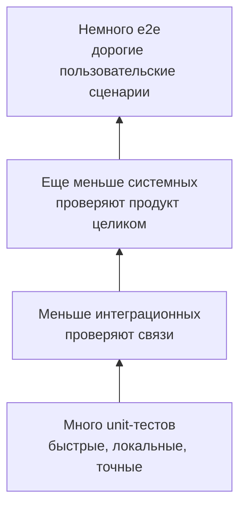
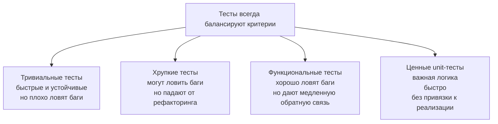
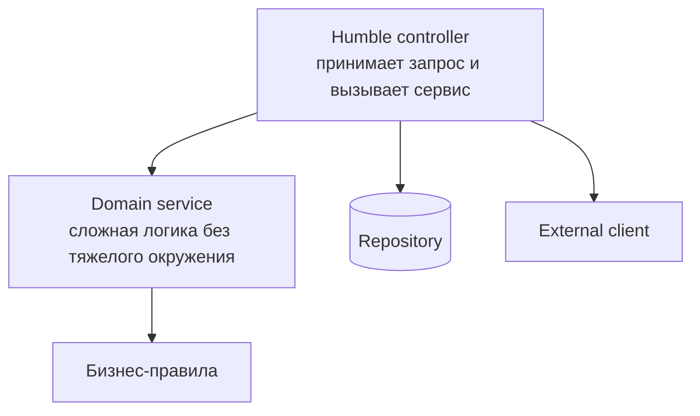
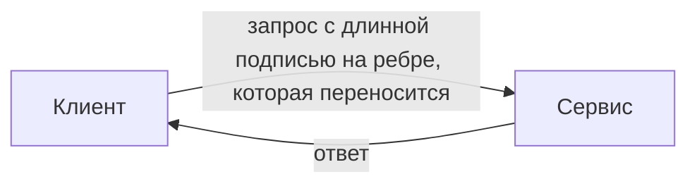

# Mermaid Contract Fixture

This internal page holds diagrams whose node labels are long enough to wrap: Cyrillic text, explicit ` `
line breaks and labels that wrap on their own. The browser tests check that no label is clipped by its node in
any engine and at any diagram scale. The diagrams reproduce the ones reported in issue #127.

## Bottom-to-top pyramid

## Wide fan-out that is scaled down to fit

## Mixed shapes

## Edge labels

